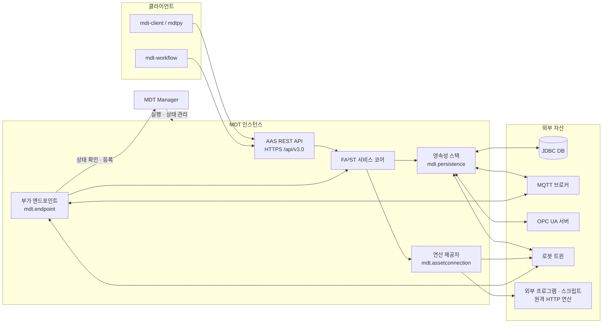
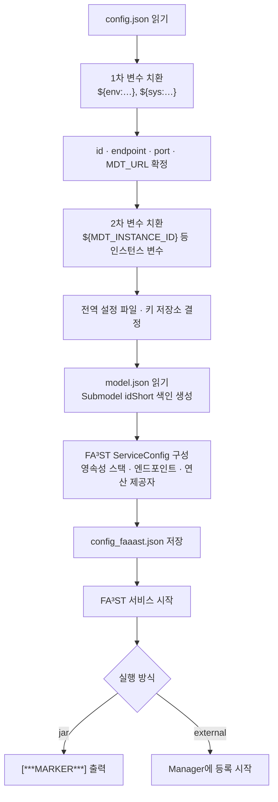
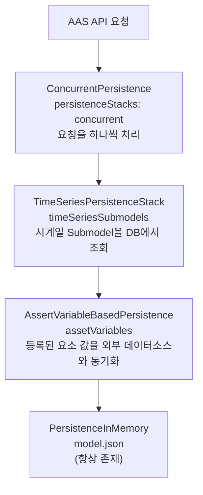

# mdt-instance

`mdt-instance`는 MDT(Manufacturing Digital Twin) 플랫폼에서 디지털 트윈 하나를 실제로 구동하는 서버다.
AAS(Asset Administration Shell) 모델을 메모리에 올려 AAS REST API v3.0으로 제공하고,
설비 데이터베이스·MQTT·OPC UA·로봇 트윈 같은 외부 자산을 모델 요소와 연결한다.
AAS Operation을 호출하면 Java 클래스, 외부 프로그램, Python 스크립트, 원격 HTTP 서비스 중
설정된 구현이 실행된다.

서버 골격은 Fraunhofer IOSB의 [FA³ST Service](https://github.com/FraunhoferIOSB/FAAAST-Service) 1.3.0을 사용하고,
MDT에 필요한 영속성 계층·연산 제공자·엔드포인트를 FA³ST의 확장 지점에 끼워 넣는 방식으로 구현했다.
인스턴스는 보통 MDT Manager(`mdt-manager`)가 실행·관리하지만, Docker 컨테이너처럼 독립적으로 실행한 뒤
Manager에 스스로 등록할 수도 있다.

## 목차

1. [시스템 구성](#1-시스템-구성)
2. [주요 기능](#2-주요-기능)
3. [소스 구성](#3-소스-구성)
4. [빌드](#4-빌드)
5. [실행](#5-실행)
6. [인스턴스 설정 파일](#6-인스턴스-설정-파일)
7. [영속성 스택](#7-영속성-스택)
8. [로그와 문제 진단](#8-로그와-문제-진단)
9. [기술 문서](#9-기술-문서)

## 1. 시스템 구성

MDT 인스턴스는 클라이언트와 외부 자산 사이에 놓인다. 클라이언트는 AAS API로 모델을 읽고 쓰거나
연산을 호출하고, 인스턴스는 그 요청을 받아 외부 자산의 데이터를 읽거나 실제 작업을 실행한다.



| 구성 요소 | 하는 일 |
| --- | --- |
| AAS REST API | FA³ST의 HTTP 엔드포인트. HTTPS로만 열리며 인증서(PKCS12 키 저장소)가 필요하다. |
| 영속성 스택 | 초기 모델(`model.json`)을 메모리에 보관하고, 설정된 요소는 외부 데이터소스와 값을 주고받는다. |
| 연산 제공자 | AAS Operation 호출을 Java·프로그램·스크립트·HTTP 구현으로 연결한다. |
| 부가 엔드포인트 | Manager 연결 유지, MQTT 메시지 수신, 동반 프로그램 실행처럼 서비스와 함께 시작·종료되는 작업을 맡는다. |

## 2. 주요 기능

모든 기능은 인스턴스 설정 파일(`config.json`)에 해당 항목을 넣어야 켜진다. 설정하지 않은 기능은 등록되지 않는다.

| 기능 | 설정 항목 | 패키지 | 자세한 문서 |
| --- | --- | --- | --- |
| 외부 데이터소스와 요소 값 연동 (JDBC, HTTP, MQTT, OPC UA, 로봇 트윈 상태) | `assetVariables` | `mdt.persistence.asset` | [mdt.persistence.asset](src/main/java/mdt/persistence/asset/README.md) |
| DB 테이블을 TimeSeries Submodel로 제공 | `timeSeriesSubmodels` | `mdt.persistence.timeseries` | [mdt.persistence.timeseries](src/main/java/mdt/persistence/timeseries/README.md) |
| AAS Operation 구현 연결 (Java, Program, Script, HTTP) | `operations` | `mdt.assetconnection` | [mdt.assetconnection](src/main/java/mdt/assetconnection/README.md) |
| 로봇 이동·그리퍼·장면 관측 연산 | `operations.javas` | `mdt.assetconnection.operation.robot` | [mdt.assetconnection.operation.robot](src/main/java/mdt/assetconnection/operation/robot/README.md) |
| MQTT 메시지로 요소 값 갱신 | `serviceEndpoints.mqtt` | `mdt.endpoint.mqtt` | [mdt.endpoint §4](src/main/java/mdt/endpoint/README.md) |
| 인스턴스와 함께 외부 프로그램 실행·재시작 | `serviceEndpoints.companion` | `mdt.endpoint.companion` | [mdt.endpoint §5](src/main/java/mdt/endpoint/README.md) |
| 동시 요청 직렬화 | `persistenceStacks` | `mdt.persistence` | [7장](#7-영속성-스택) |
| Manager 상태 확인·재등록 | 실행 방식에 따라 자동 등록 | `mdt.endpoint`, `mdt.endpoint.reconnector` | [mdt.endpoint §3](src/main/java/mdt/endpoint/README.md) |

## 3. 소스 구성

```text
src/main/java/mdt/
├── MDTInstanceMain.java      실행 진입점. 명령행·설정을 해석해 FA³ST 서비스를 구성하고 시작
├── MDTGlobalConfigurations   전역 설정 파일(mdt_global_config.json) 조회
├── ElementLocation(s) …      "Submodel:경로", "param:ID" 같은 요소 위치 표현 해석
├── config/                   인스턴스 설정 DTO(MDTInstanceConfig 등)와 MDTService
├── persistence/              영속성 스택 공통 구조, 동시성 계층(ConcurrentPersistence)
│   ├── asset/                외부 데이터소스 연동(jdbc, http, mqtt, opcua, robot)
│   └── timeseries/           JDBC 기반 시계열 Submodel
├── assetconnection/          FA³ST AssetConnection 구현
│   └── operation/            Java·Program·Script·HTTP 연산 제공자
│       └── robot/            로봇 트윈 연산 제공자
├── endpoint/                 Manager 상태 확인과 부가 엔드포인트
│   ├── reconnector/          EXTERNAL 인스턴스의 Manager 재등록
│   ├── mqtt/                 MQTT 메시지 수신
│   └── companion/            동반 프로그램 실행
├── ksx9101/                  KS X 9101 제조 데이터 JPA 매핑
└── ext/                      특정 과제용 연산 구현(RCK 프레스 시뮬레이션 등)
```

## 4. 빌드

### 4.1 준비 사항

- JDK 21
- Gradle (프로젝트에 Gradle wrapper가 없으므로 시스템에 설치된 `gradle`을 사용한다)
- 함께 빌드되는 저장소. `settings.gradle`이 다음 상대 경로의 프로젝트를 소스로 포함한다.

```text
development/
├── common/
│   └── utils/               ../../common/utils
└── mdt/
    ├── mdt-client/          ../mdt-client
    ├── mdt-robot-client/    ../mdt-robot-client
    └── mdt-instance/        (이 프로젝트)
```

### 4.2 빌드 명령

```bash
cd mdt-instance

# 실행용 단일 JAR(fat jar) 생성
MDT_BUILD_VERSION=1.0.0 gradle shadowJar
# → build/libs/mdt-instance-1.0.0-all.jar

gradle compileJava     # 컴파일만 확인
gradle test            # 단위 테스트 실행
gradle eclipse         # Eclipse 프로젝트 파일 생성
```

JAR 버전은 환경 변수 `MDT_BUILD_VERSION`에서 가져온다. 값이 없으면 `mdt-instance-unknown-all.jar`가 만들어진다.
`docker/build_image.sh`는 `mdt-instance-1.0.0-all.jar`를 찾으므로, Docker 이미지를 만들 때는 버전을
`1.0.0`으로 지정해 빌드한다.

## 5. 실행

### 5.1 실행 방식

인스턴스는 `--type` 옵션에 따라 두 가지 방식으로 실행되며, 방식에 따라 Manager와 관계를 맺는 방법이 다르다.

| | `jar` (기본값) | `external` |
| --- | --- | --- |
| 실행 주체 | MDT Manager가 자식 프로세스로 실행 | 사용자 또는 Docker 등 외부 실행기 |
| Manager와의 관계 | Manager의 `/health`를 주기적으로 호출하고(기본 10초), 한 번이라도 실패하면 인스턴스가 스스로 종료한다 | 시작할 때와 이후 주기마다(기본 60초) 자신의 endpoint를 Manager에 등록한다. 종료할 때 등록을 해제한다 |
| 관련 설정 | `managerCheckInterval` | `heartbeatInterval` |
| 시작 완료 알림 | 표준 출력에 `[***MARKER***] MDTInstance started: <endpoint>`를 출력하고, Manager는 이 줄을 보고 시작 완료를 판단한다 | 없음 |

`jar` 방식에서는 Manager가 잠시 응답하지 않아도 인스턴스가 바로 종료되므로, Manager와 인스턴스를 같은 장비에서
운영하는 경우에 적합하다. 자세한 동작은 [mdt.endpoint §3](src/main/java/mdt/endpoint/README.md)을 참고한다.

### 5.2 인스턴스 디렉터리

인스턴스 하나는 디렉터리 하나에 대응한다. 별도로 지정하지 않으면 현재 작업 디렉터리가 홈 디렉터리가 되고,
설정 파일과 모델 파일의 상대 경로는 홈 디렉터리를 기준으로 해석된다.

```text
<instance-home>/
├── model.json               AAS Environment (초기 모델, 필수)
├── config.json              인스턴스 설정 (필수, 내용이 {} 이어도 됨)
├── mdt_global_config.json   전역 연결 설정 (선택)
├── mdt_cert.p12             HTTPS 인증서 키 저장소
├── env.file                 Manager가 인스턴스에 넘길 추가 환경 변수 (jar 방식, 선택)
├── AddAndSleep/             연산 기술 파일·스크립트 등 연산별 자원 (선택)
│   └── operation.json
├── config_faaast.json       시작 시 생성되는 최종 FA³ST 설정 (디버깅용)
└── logs/
    ├── app.log              인스턴스 로그
    └── output.log           Manager가 수집한 표준 출력 (jar 방식)
```

`config_faaast.json`과 `logs/`는 홈 디렉터리가 아니라 **현재 작업 디렉터리**에 만들어진다.
Manager가 실행할 때는 둘이 같은 디렉터리이므로 차이가 없다.

### 5.3 명령행 옵션

| 옵션 | 기본값 | 설명 |
| --- | --- | --- |
| `--home <path>` | 현재 작업 디렉터리 | 인스턴스 홈 디렉터리 |
| `-c`, `--config <file>` | `config.json` | 인스턴스 설정 파일 |
| `-m`, `--model <file>` | `model.json` | 초기 AAS 모델 파일 |
| `-t`, `--type <jar\|external>` | `jar` | 실행 방식 ([5.1](#51-실행-방식)) |
| `--id <id>` | | 인스턴스 ID |
| `-p`, `--port <number>` | | HTTPS 포트. endpoint가 따로 정해지지 않은 경우에만 쓰인다 |
| `--instanceEndpoint <url>` | | 외부에 알릴 인스턴스 endpoint |
| `--globalConfig <path>` | | 전역 설정 파일 |
| `--keyStore <path>` | | PKCS12 키 저장소 파일 |
| `--keyStorePassword <password>` | | 키 저장소 암호 |
| `--logbackConfig <path>` | | Logback 설정 파일 |
| `-v`, `--verbose` / `-q`, `--quite` | | 로그를 INFO로 늘리거나 ERROR로 줄인다 |
| `--loglevel-faaast <level>`, `--loglevel-external <level>` | | FA³ST 패키지 / 그 밖의 패키지 로그 수준 |
| `-h`, `--help` | | 도움말 출력 |

### 5.4 환경 변수

| 환경 변수 | 필수 | 설명 |
| --- | --- | --- |
| `MDT_URL` | 예 | MDT Manager URL (예: `http://localhost:12985`). 명령행 옵션이 없고, 설정 파일의 `mdtUrl`보다 우선한다 |
| `MDT_INSTANCE_ID` | | `--id`가 없을 때 쓰는 인스턴스 ID |
| `MDT_INSTANCE_ENDPOINT` | | `--instanceEndpoint`가 없을 때 쓰는 endpoint |
| `MDT_HOST` | | 포트로 endpoint를 만들 때 쓰는 호스트 이름. 기본값 `localhost` |
| `MDT_GLOBAL_CONFIG_FILE` | | 전역 설정 파일 위치 |
| `MDT_KEY_STORE_FILE`, `MDT_KEY_STORE_PASSWORD` | | 키 저장소 파일과 암호 |
| `faaast.loglevel_faaast`, `faaast.loglevel_external` | | 로그 수준. 점 대신 밑줄(`faaast_loglevel_faaast`)로 써도 된다 |

Manager가 `jar` 방식으로 실행할 때는 `MDT_URL`, `MDT_INSTANCE_ID`, `MDT_INSTANCE_HOME`을 자동으로 넘겨 주고,
인스턴스 디렉터리의 `env.file`에 적힌 변수도 함께 설정한다.

### 5.5 실행 예

**Manager 없이 직접 실행하기**

```bash
cd ~/mdt/instances/test           # model.json, config.json이 있는 디렉터리

export MDT_URL=http://localhost:12985
export MDT_KEY_STORE_PASSWORD=<암호>

java -Dfile.encoding=UTF-8 -jar mdt-instance-1.0.0-all.jar \
    --type external --id test --port 19000 \
    --keyStore ~/mdt/mdt_cert.p12
```

이 경우 AAS API는 `https://localhost:19000/api/v3.0`에서 열리고, 인스턴스는 `MDT_URL`의 Manager에 스스로 등록한다.
`sbin/start_mdt`는 `$MDT_HOME/mdt-instance/mdt-instance-all.jar`를 같은 방식으로 실행하는 스크립트다.

**Docker 이미지로 실행하기**

`docker/Dockerfile`은 `--type external`로 인스턴스를 실행하는 이미지를 만든다. 작업 디렉터리는
`/mdt/mdt-instance`이므로 이 위치에 인스턴스 디렉터리를 마운트한다.

```bash
cd docker && ./build_image.sh     # kwlee0220/mdt-instance:latest 생성
```

### 5.6 시작 과정

`MDTInstanceMain`은 다음 순서로 설정을 확정한 뒤 FA³ST 서비스를 시작한다.
설정 오류는 대부분 이 단계에서 드러나므로, 시작에 실패하면 이 순서를 따라 원인을 좁혀 가면 된다.



## 6. 인스턴스 설정 파일

### 6.1 최상위 항목

`config.json`의 최상위 항목은 다음과 같다. 모두 생략할 수 있으며, 빈 객체(`{}`)도 올바른 설정이다.

| 항목 | 형식 | 설명 |
| --- | --- | --- |
| `id` | 문자열 | 인스턴스 ID |
| `port` | 정수 | HTTPS 포트 |
| `instanceEndpoint` | URL | 외부에 알릴 endpoint |
| `globalConfigFile` | 경로 | 전역 설정 파일 |
| `keyStoreFile`, `keyStorePassword`, `keyPassword` | 경로, 문자열 | 인증서 키 저장소. 두 암호 중 하나만 적으면 다른 하나도 같은 값을 쓴다 |
| `heartbeatInterval` | 기간 (예: `60s`) | `external` 방식의 Manager 재등록 주기 |
| `managerCheckInterval` | 기간 (예: `10s`) | `jar` 방식의 Manager 상태 확인 주기 |
| `serviceEndpoints` | 객체 | 부가 엔드포인트: `mqtt`, `companion`, `companions` |
| `assetVariables` | 배열 | 외부 데이터소스와 연결할 요소 목록 |
| `timeSeriesSubmodels` | 배열 | 시계열 Submodel 목록 |
| `persistenceStacks` | 배열 | 추가 영속성 계층 (현재는 `{"@type": "concurrent"}`만 지원) |
| `operations` | 객체 | 연산 구현 연결: `javas`, `programs`, `scripts`, `https` |

### 6.2 값이 정해지는 순서

같은 값을 명령행, 환경 변수, 설정 파일에서 모두 지정할 수 있는 항목이 있다. 앞에 있는 것이 우선한다.

| 값 | 우선순위 |
| --- | --- |
| 인스턴스 ID | `--id` → `MDT_INSTANCE_ID` → `id` |
| endpoint | `--instanceEndpoint` → `MDT_INSTANCE_ENDPOINT` → `instanceEndpoint` → `https://${MDT_HOST}:<port>/api/v3.0` |
| 포트 | `--port` → `port` → endpoint URL의 포트 |
| Manager URL | `MDT_URL` (필수, 설정 파일 값은 덮어쓴다) |
| 전역 설정 파일 | `--globalConfig` → `globalConfigFile` → `<home>/mdt_global_config.json` → `MDT_GLOBAL_CONFIG_FILE` → 사용 안 함 |
| 키 저장소 | `--keyStore` → `MDT_KEY_STORE_FILE` → `keyStoreFile` → `<home>/mdt_cert.p12` |
| 키 저장소 암호 | `--keyStorePassword` → `MDT_KEY_STORE_PASSWORD` → `keyStorePassword` (없으면 시작 실패) |

endpoint가 정해지면 HTTPS 서버는 **endpoint URL에 적힌 포트**로 열린다. 따라서 endpoint를 명시하면서
`--port`에 다른 값을 주면 `--port`는 쓰이지 않는다.

### 6.3 변수 치환

설정 파일은 읽을 때 두 번 치환된다. 첫 번째에는 `${env:이름}`(환경 변수)와 `${sys:이름}`(Java 시스템 속성) 같은
접두어 형식이 치환되고, 두 번째에는 다음 인스턴스 변수가 치환된다.

| 변수 | 값 |
| --- | --- |
| `${MDT_INSTANCE_ID}` | 확정된 인스턴스 ID |
| `${MDT_INSTANCE_ENDPOINT}` | 확정된 endpoint |
| `${MDT_INSTANCE_PORT}` | HTTPS 포트 |
| `${MDT_URL}` | Manager URL |
| `${MDT_INSTANCE_DIR}` | 현재 작업 디렉터리의 절대 경로 |

같은 변수는 `serviceEndpoints.companion`으로 실행하는 동반 프로그램에도 환경 변수로 전달된다.

### 6.4 설정 예

다음은 MQTT로 받은 값을 파라미터에 반영하고, 외부 프로그램과 Python 스크립트를 연산으로 등록한 예다.

```json
{
  "port": 19000,

  "serviceEndpoints": {
    "mqtt": {
      "subscribers": [
        { "topic": "mdt/test/parameters/Data", "element": "param:Data" }
      ]
    }
  },

  "operations": {
    "programs": {
      "AddAndSleep:Operation": { "descriptorFile": "AddAndSleep/operation.json" }
    },
    "scripts": {
      "RunScript:Operation": {
        "scriptFile": "RunScript/calc_text_length.py",
        "timeout": "30s"
      }
    }
  }
}
```

`operations`와 `assetVariables`의 요소 위치는 Submodel의 전역 ID가 아니라 **idShort**로 쓴다.

| 위치 표현 | 의미 | 예 |
| --- | --- | --- |
| `<submodelIdShort>:<요소 경로>` | Submodel 안의 요소 | `Data:Operations.MoveLinear` |
| `param:<파라미터 ID>` | MDT 파라미터 값 | `param:Temperature` |

로봇 트윈 상태 연동과 로봇 연산을 함께 등록하는 예는
[mdt.persistence.asset](src/main/java/mdt/persistence/asset/README.md)와 [mdt.assetconnection.operation.robot](src/main/java/mdt/assetconnection/operation/robot/README.md)에 있다.

### 6.5 전역 설정 파일

DB·브로커처럼 여러 인스턴스가 함께 쓰는 연결 정보는 전역 설정 파일에 이름을 붙여 두고,
인스턴스 설정에서는 그 이름만 참조한다. 이렇게 하면 접속 정보가 바뀌어도 전역 파일 하나만 고치면 된다.

```json
{
  "jdbcs":       { "default": { "jdbcUrl": "jdbc:postgresql://localhost:5432/mdt", "user": "mdt", "password": "…" } },
  "mqttBrokers": { "default": { "brokerUrl": "tcp://localhost:1883" } },
  "opcuas":      { "line1":   { "serverEndpoint": "opc.tcp://localhost:4840" } },
  "robotTwins":  { "panda":   { "robotTwinBaseUrl": "http://localhost:8811", "twinId": "panda" } }
}
```

| 그룹 | 용도 |
| --- | --- |
| `jdbcs` | JDBC 자산 변수, 시계열 조회 |
| `mqttBrokers` | MQTT 수신 엔드포인트, MQTT 자산 변수 |
| `opcuas` | OPC UA 자산 변수 |
| `robotTwins` | 로봇 트윈 상태 연동과 로봇 연산 |

이름을 지정하지 않으면 `default` 항목을 쓰고, `default`가 없으면 그룹의 첫 항목을 쓴다.
그룹별 세부 필드는 위 예와 다를 수 있으므로 각 기술 문서의 설정 절을 확인한다.

## 7. 영속성 스택

FA³ST는 모델을 하나의 Persistence 객체에 저장한다. MDT 인스턴스는 여기에 여러 계층을 겹쳐 쌓아,
요청이 바깥 계층부터 차례로 내려가면서 필요한 처리를 하도록 구성한다.
가장 아래에는 `model.json`을 담은 메모리 저장소가 있고, 그 위의 계층은 설정에 해당 항목이 있을 때만 추가된다.



`persistenceStacks`에 여러 항목을 넣으면 배열의 첫 항목이 가장 바깥에 놓인다.
각 계층이 요청을 어떻게 처리하는지는 [mdt.persistence.asset](src/main/java/mdt/persistence/asset/README.md)와
[mdt.persistence.timeseries](src/main/java/mdt/persistence/timeseries/README.md)에서 설명한다.

## 8. 로그와 문제 진단

| 위치 | 내용 |
| --- | --- |
| 콘솔 | 시작 과정 요약과 로그. 시작하자마자 주요 환경 변수 값을 출력한다 |
| `logs/app.log` | 파일 로그. 하루 단위와 10MB 단위로 `logs/archived/`에 보관된다 |
| `logs/output.log` | `jar` 방식에서 Manager가 수집한 인스턴스 표준 출력 |
| `config_faaast.json` | 인스턴스 설정을 변환해 만든 최종 FA³ST 설정 |

기본 로그 수준은 WARN이다. Manager가 `jar` 방식으로 실행할 때는 `-v`를 붙이므로 INFO 로그까지 남는다.

시작에 실패했을 때 자주 보이는 원인은 다음과 같다.

| 증상 | 확인할 것 |
| --- | --- |
| `MDTPlatform URL is not specified` | 환경 변수 `MDT_URL`이 설정되어 있는가 |
| `MDTInstance id not specified` | `--id`, `MDT_INSTANCE_ID`, 설정 파일 `id` 중 하나가 있는가 |
| `MDTInstance instanceEndpoint not specified` | endpoint나 포트를 지정했는가 |
| `Password for keystore or key is not specified` | 키 저장소 암호를 지정했는가 |
| `GlobalConfig file does not exist`, `Keystore file does not exist` | 명령행·설정 파일에 적은 경로가 실제로 있는가 |
| 요소·연산 위치를 찾지 못함 | 위치 표현의 앞부분이 Submodel **idShort**인가, `model.json`에 해당 요소가 있는가 |
| `jar` 인스턴스가 이유 없이 종료됨 | Manager의 `/health` 호출이 실패하지 않았는가 ([5.1](#51-실행-방식)) |

## 9. 기술 문서

| 문서 | 다루는 내용 |
| --- | --- |
| [mdt.endpoint 패키지](src/main/java/mdt/endpoint/README.md) | Manager 연결 관리, MQTT 수신, 동반 프로그램의 설정·생명주기·확장 방법 |
| [mdt.assetconnection 패키지](src/main/java/mdt/assetconnection/README.md) | AAS Operation 연결 구조, Java·Program·Script·HTTP 연산의 설정과 실행 계약, RobotTwin·AI 연산과 확장 방법 |
| [로봇 트윈 연산 Provider](src/main/java/mdt/assetconnection/operation/robot/README.md) | 로봇 이동·그리퍼·파지·장면 관측 연산별 입력·출력과 기본값, 워크플로 구성 |
| [mdt.persistence.asset 패키지](src/main/java/mdt/persistence/asset/README.md) | 자산 변수 계약과 JDBC·HTTP·MQTT·OPC UA·RobotTwin 연동 설정 |
| [mdt.persistence.timeseries 패키지](src/main/java/mdt/persistence/timeseries/README.md) | 시계열 Submodel 모델 구조, 설정, 세그먼트와 레코드 조회 |
| [mdt.ext.rck 패키지](src/main/java/mdt/ext/rck/README.md) | RCK 프레스 공정 시뮬레이터 연동 연산 |
