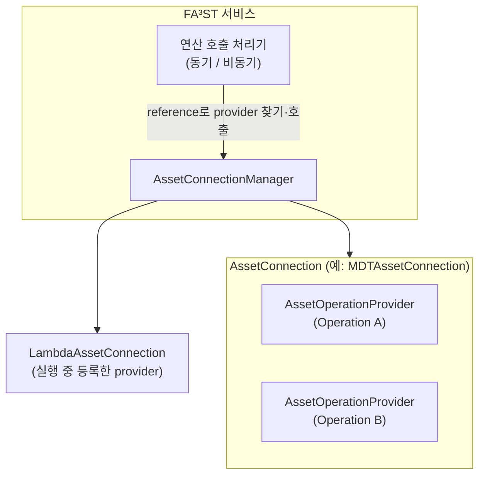
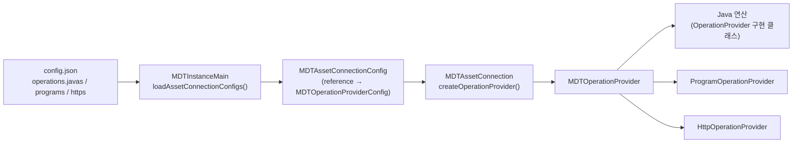
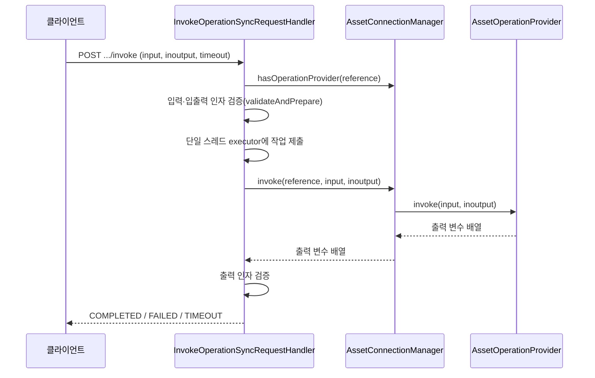
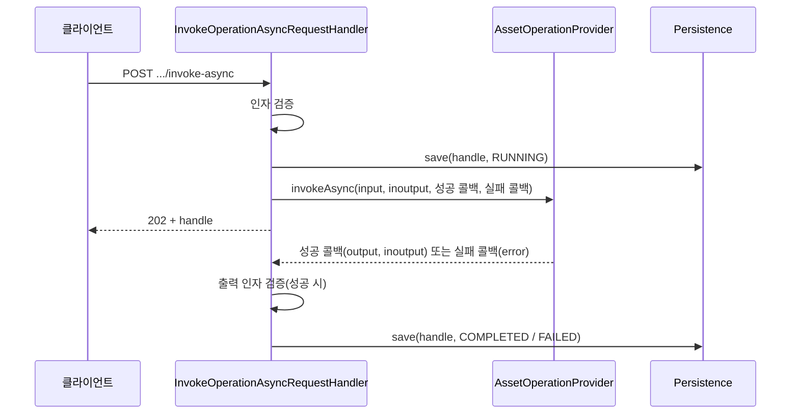
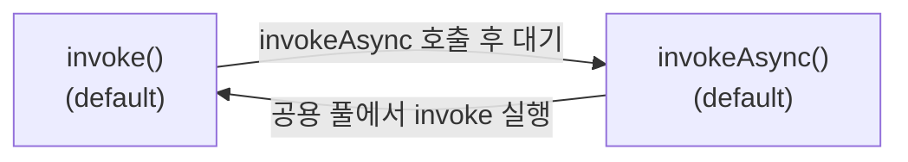

# FA³ST `AssetOperationProvider` 사용 가이드

이 문서는 FA³ST 1.3.0의 `de.fraunhofer.iosb.ilt.faaast.service.assetconnection.AssetOperationProvider`와 관련 클래스의 사용 방법을 설명한다. AAS `Operation` 호출이 provider에 전달되는 과정, 구현할 때 지켜야 할 계약, MDT 인스턴스에서 새 연산을 추가하는 방법을 다룬다. 분석 대상은 FA³ST `core-1.3.0` 소스와 mdt-instance의 `mdt.assetconnection` 패키지다.

| 독자 | 먼저 볼 곳 |
|------|-----------|
| MDT 트윈에 새 연산을 추가하려는 개발자 | [5장](#5-새-연산-추가하기) |
| `AssetOperationProvider`를 직접 구현하려는 개발자 | [3장](#3-핵심-인터페이스와-클래스), [4장](#4-구현-계약과-주의-사항) |
| 연산 호출이 어떻게 처리되는지 알고 싶은 개발자 | [2장](#2-연산-호출-처리-흐름) |

MDT가 제공하는 연산 종류(Java, Program, HTTP 등)별 설정과 동작은 [mdt.assetconnection README](../src/main/java/mdt/assetconnection/README.md)에서 자세히 다룬다. 이 문서는 그 바탕이 되는 FA³ST 계약을 중심으로 설명한다.

---

## 목차

1. [개요](#1-개요)
2. [연산 호출 처리 흐름](#2-연산-호출-처리-흐름)
3. [핵심 인터페이스와 클래스](#3-핵심-인터페이스와-클래스)
4. [구현 계약과 주의 사항](#4-구현-계약과-주의-사항)
5. [새 연산 추가하기](#5-새-연산-추가하기)
6. [주의 사항 정리](#6-주의-사항-정리)

---

## 1. 개요

### 1.1 역할

AAS 모델의 `Operation` 요소는 입력·입출력·출력 변수의 정의만 담는다. 클라이언트가 그 연산을 호출했을 때 실제로 무엇을 실행할지는 `AssetOperationProvider`가 정한다. FA³ST는 `Operation` 요소의 참조(`Reference`)마다 provider를 하나씩 연결해 두고, 호출 요청이 오면 그 provider의 `invoke()`나 `invokeAsync()`를 호출한다.

provider는 **asset connection**에 등록되어 관리된다. asset connection은 하나의 자산(장비, 외부 시스템)과의 연결을 나타내며, 그 연결을 통해 값을 읽고 쓰는 value provider, 변경을 구독하는 subscription provider, 연산을 실행하는 operation provider를 관리한다.

### 1.2 구성 요소



| 구성 요소 | 패키지 | 역할 |
|-----------|--------|------|
| `AssetOperationProvider<T>` | FA³ST core | `Operation` 하나의 실행을 맡는 인터페이스 |
| `AssetOperationProviderConfig` | FA³ST core | provider 설정. 인자 검증 방식(`ArgumentValidationMode`)을 담는다. |
| `AbstractAssetOperationProviderConfig` | FA³ST core | 위 설정의 기본 구현. 세 검증 방식을 모두 `DEFAULT`로 초기화한다. |
| `AssetConnection` / `AbstractAssetConnection` | FA³ST core | provider를 만들고 보관하는 연결 객체 |
| `AssetConnectionManager` | FA³ST core | 모든 연결을 모아 두고 reference로 provider를 찾아 호출한다. |
| `LambdaOperationProvider` | FA³ST core | 람다 함수 하나로 동작하는 provider. 실행 중에 코드로 등록한다. |
| `MDTAssetConnection` | mdt-instance | MDT 인스턴스에서 사용하는 유일한 asset connection. operation provider만 지원한다. |
| `MDTOperationProvider` | mdt-instance | MDT의 `AssetOperationProvider` 구현. Java·Program·HTTP 연산을 공통 방식으로 실행한다. |
| `OperationProvider` | mdt-instance | MDT 연산 구현이 따르는 단순한 동기 인터페이스(`invokeSync`) |

### 1.3 MDT 인스턴스에서의 구성

MDT 인스턴스는 FA³ST의 `AssetOperationProvider`를 직접 구현하는 대신, 각 연산을 공통 구현 클래스인 `MDTOperationProvider`의 인스턴스로 감싼다. 연산별 차이는 그 안의 `OperationProvider`(MDT 인터페이스)가 맡는다.



이 구조 덕분에 MDT에서 새 연산을 만드는 개발자는 대부분 FA³ST 계약을 직접 다룰 필요 없이 `OperationProvider.invokeSync()` 하나만 구현하면 된다([5.1절](#51-방법-선택)).

---

## 2. 연산 호출 처리 흐름

### 2.1 동기 호출(`invoke`)

클라이언트가 `POST .../submodel-elements/{path}/invoke`를 보내면 FA³ST는 다음 순서로 처리한다.



| 단계 | 처리 |
|------|------|
| provider 확인 | 연결된 provider가 없으면 `IllegalArgumentException`("no operation provider defined …")으로 요청이 실패한다. |
| 인자 검증 | provider 설정의 검증 방식에 따라 입력·입출력 인자를 검사하고 모델 정의 순서대로 다시 만든다([3.3절](#33-argumentvalidationmode)). |
| 실행 | 요청마다 단일 스레드 executor를 새로 만들어 그 스레드에서 `invoke()`를 실행하고, 요청의 `timeout`만큼 기다린다. |
| 시간 초과 | 실행 스레드에 `cancel(true)`(인터럽트)를 보내고 결과 상태를 `TIMEOUT`으로 돌려준다. |
| 실패 | `invoke()`가 예외를 던지면 결과 상태가 `FAILED`가 된다. 이때 FA³ST는 실패 원인을 응답 메시지에도, 로그에도 남기지 않는다. |
| 출력 검증 | 성공하면 출력 인자를 검증한다. 응답에는 provider에 전달한 inoutput 배열이 담고 있던 원래 `OperationVariable` 객체들이 포함된다. 따라서 provider가 전달받은 `OperationVariable` 내부의 값을 수정하면 응답에 반영되지만, 배열 요소 자체를 새 `OperationVariable` 객체로 교체하면 반영되지 않는다. |

### 2.2 비동기 호출(`invokeAsync`)

`POST .../invoke-async`는 실행 결과를 기다리지 않고 핸들을 먼저 돌려준다.



- `invokeAsync()`가 호출 즉시 예외를 던지면 실패 콜백과 같은 방식으로 `FAILED`가 기록된다.
- 실패 콜백으로 전달된 예외는 결과의 오류 메시지에 `"operation failed to execute (reason: <예외 메시지>)"` 형식으로 기록된다.
- FA³ST는 비동기 호출에 실행 시간 제한을 적용하지 않는다. MDT는 `MDTOperationProvider`와 별도 엔드포인트를 통해 취소를 지원한다([원격 연산 취소 가이드](operation-cancel-guide.md)). 실행 시간 제한은 개별 연산 구현이나 이를 호출하는 클라이언트에서 처리해야 한다.

---

## 3. 핵심 인터페이스와 클래스

### 3.1 `AssetOperationProvider<T extends AssetOperationProviderConfig>`

`AssetProvider`를 상속하는 인터페이스다. 두 호출 메서드가 모두 `default`로 정의되어 있으며, 서로를 호출하는 방식으로 구현되어 있다.

| 메서드 | 시그니처 | 수행 내용 |
|--------|----------|-----------|
| `getConfig` | `T getConfig()` | provider 설정을 반환한다. FA³ST는 이 설정에서 인자 검증 방식을 읽는다. |
| `asConfig` | `AssetProviderConfig asConfig()` | `AssetProvider`에서 상속한 메서드. 설정을 일반 타입으로 반환한다. |
| `invoke` | `default OperationVariable[] invoke(OperationVariable[] input, OperationVariable[] inoutput) throws AssetConnectionException` | 연산을 동기로 실행하고 출력 변수 배열을 반환한다. 기본 구현은 `invokeAsync()`를 호출하고 완료를 기다린다. |
| `invokeAsync` | `default void invokeAsync(OperationVariable[] input, OperationVariable[] inoutput, BiConsumer<OperationVariable[], OperationVariable[]> callbackSuccess, Consumer<Throwable> callbackFailure) throws AssetConnectionException` | 연산을 비동기로 실행한다. 성공하면 `callbackSuccess(출력, 입출력)`, 실패하면 `callbackFailure(예외)`를 호출한다. 기본 구현은 `CompletableFuture.supplyAsync()`로 공용 스레드 풀에서 `invoke()`를 실행한다. |

#### 3.1.1 기본 구현의 상호 호출



두 메서드 중 **적어도 하나는 반드시 재정의해야 한다.** 두 기본 구현은 서로를 호출하므로, 둘 다 그대로 두면 비동기 작업 생성과 완료 대기가 반복되어 연산이 정상적으로 끝나지 않고 실행 자원을 소모할 수 있다.

#### 3.1.2 어느 메서드를 재정의할지

| 구현 방식 | 동기 호출 | 비동기 호출 | 권장 여부 |
|-----------|-----------|-------------|-----------|
| `invoke()`만 재정의 | 직접 실행 | 기본 구현이 공용 스레드 풀(`ForkJoinPool.commonPool()`)에서 `invoke()`를 실행 | 간단한 연산에 적합. 기본 비동기 구현은 취소와 실행 시간 제한을 제공하지 않는다. |
| `invokeAsync()`만 재정의 | 기본 구현이 `invokeAsync()` 후 완료를 기다림 | 직접 실행 | **권장하지 않는다.** 기본 `invoke()`의 결함 때문에 실패 시 멈출 수 있다([4.2절](#42-기본-invoke의-결함)). |
| 둘 다 재정의 | 직접 실행 | 직접 실행 | 가장 안전하다. `MDTOperationProvider`가 이 방식이다. |

### 3.2 `AssetOperationProviderConfig`와 `AbstractAssetOperationProviderConfig`

`AssetOperationProviderConfig`는 `AssetProviderConfig`를 상속하며, 인자 종류별 검증 방식을 정한다.

| 메서드 | 시그니처 | 수행 내용 |
|--------|----------|-----------|
| 입력 검증 방식 | `ArgumentValidationMode getInputValidationMode()` / `void setInputValidationMode(ArgumentValidationMode mode)` | 입력 인자의 검증 방식을 읽고 쓴다. |
| 입출력 검증 방식 | `ArgumentValidationMode getInoutputValidationMode()` / `void setInoutputValidationMode(ArgumentValidationMode mode)` | 입출력 인자의 검증 방식을 읽고 쓴다. |
| 출력 검증 방식 | `ArgumentValidationMode getOutputValidationMode()` / `void setOutputValidationMode(ArgumentValidationMode mode)` | 출력 인자의 검증 방식을 읽고 쓴다. |
| 동등성 비교 | `boolean sameAs(AssetProviderConfig other)` | 설정이 같은지 비교한다. 설정 변경 시 provider를 다시 만들지 판단할 때 쓴다. |

`AbstractAssetOperationProviderConfig`는 세 검증 방식을 모두 `ArgumentValidationMode.DEFAULT`로 초기화하고, `sameAs()`와 빌더(`inputValidationMode()` 등)를 제공한다. 새 provider 설정은 이 클래스를 상속해 만든다. MDT의 `MDTOperationProviderConfig`도 이 클래스를 상속한다.

### 3.3 `ArgumentValidationMode`

호출 처리기는 인자를 provider에 넘기기 전에, 그리고 결과를 돌려주기 전에 모델의 변수 정의와 비교해 검증한다.

| 값 | 검증 | 빠진 인자 |
|----|------|-----------|
| `NONE` | 하지 않는다. 받은 인자를 그대로 넘긴다. | 그대로 둔다. |
| `REQUIRE_PRESENT` | 모델에 없는 인자, 중복 인자, `OperationVariable` 또는 그 안의 `SubmodelElement`가 `null`인 인자를 거부한다. | `InvalidRequestException` |
| `REQUIRE_PRESENT_OR_DEFAULT` (`DEFAULT`) | 위와 같다. | 모델 정의의 요소를 깊은 복사해 기본값으로 채운다. |

`NONE`이 아니면 인자는 **모델에 정의된 변수 순서대로** 재배열되고, `NONE`이면 전달된 순서를 유지한다. 검증 방식이나 모델의 변수 순서가 바뀌어도 동작하도록, provider는 배열 인덱스보다 `idShort`로 인자를 찾는 것이 좋다.

출력 인자도 같은 방식으로 검증하므로, provider는 출력 변수의 `idShort`를 모델에 정의된 것과 일치시켜 반환해야 한다. 검증이 활성화되어 있으면 모델에 없는 `idShort`의 출력 변수는 거부된다. 모델에 정의된 출력 변수가 누락된 경우에는 `DEFAULT`가 모델 정의를 복사해 보충하고, `REQUIRE_PRESENT`는 오류로 처리한다.

이 검증은 변수의 존재 여부와 이름을 중심으로 수행한다. Property 값의 형식이나 업무상 유효성은 연산 구현에서 별도로 검사해야 한다.

### 3.4 `AssetConnection`과 `AbstractAssetConnection`

provider의 생성과 관리를 담당한다. 새 provider 종류를 FA³ST에 직접 붙이려면 asset connection도 함께 구현해야 한다.

| 메서드 | 시그니처 | 수행 내용 |
|--------|----------|-----------|
| 연결 | `void connect() throws AssetConnectionException` | `doConnect()`를 호출해 자산에 연결하고, 설정에 등록된 provider들을 만든다. |
| 연결 해제 | `void disconnect() throws AssetConnectionException` | `doDisconnect()`를 호출하고 만들어 둔 provider 목록을 비운다. 설정은 남으므로 다시 연결하면 provider가 새로 만들어진다. |
| provider 등록 | `void registerOperationProvider(Reference reference, OC providerConfig) throws AssetConnectionException` | 설정에 provider를 추가한다. 이미 연결된 상태이면 `createOperationProvider()`로 바로 만든다. |
| provider 해제 | `void unregisterOperationProvider(Reference reference) throws AssetConnectionException` | 설정과 provider 목록에서 지운다. |
| provider 목록 | `Map<Reference, O> getOperationProviders()` | 만들어진 provider를 reference별로 반환한다. |
| provider 생성 | `protected abstract O createOperationProvider(Reference reference, OC providerConfig) throws AssetConnectionException` | 하위 클래스가 구현한다. 설정으로 provider 객체를 만든다. |

MDT의 `MDTAssetConnection`은 `createOperationProvider()`에서 설정의 `${…}` 변수를 치환한 뒤 `MDTOperationProvider`를 만든다. value provider와 subscription provider는 지원하지 않는다(`UnsupportedOperationException`).

### 3.5 `AssetConnectionManager`

FA³ST 서비스 안에서 모든 asset connection을 관리한다. 연산과 관련된 공개 메서드는 다음과 같다.

| 메서드 | 시그니처 | 수행 내용 |
|--------|----------|-----------|
| provider 유무 | `boolean hasOperationProvider(Reference reference)` | reference에 연결된 provider가 있는지 확인한다. |
| 동기 호출 | `Optional<OperationVariable[]> invoke(Reference reference, OperationVariable[] input, OperationVariable[] inoutput) throws AssetConnectionException` | provider의 `invoke()`를 호출한다. provider가 없으면 빈 `Optional`을 반환한다. |
| 비동기 호출 | `void invokeAsync(Reference reference, OperationVariable[] input, OperationVariable[] inoutput, BiConsumer<…> callbackSuccess, Consumer<Throwable> callbackFailure) throws AssetConnectionException` | provider의 `invokeAsync()`를 호출한다. |
| 검증 방식 조회 | `Optional<ArgumentValidationMode> getOperationInputValidationMode(Reference reference)` (입출력·출력도 같은 형태) | provider 설정의 검증 방식을 반환한다. |
| 람다 provider 등록 | `void registerLambdaOperationProvider(Reference reference, LambdaOperationProvider provider)` | 실행 중에 람다 provider를 등록한다. |
| 람다 provider 해제 | `void unregisterLambdaOperationProvider(Reference reference)` | 등록한 람다 provider를 지운다. |

같은 reference에 람다 provider와 일반 provider가 모두 있으면 **람다 provider가 우선**한다.

### 3.6 MDT의 `MDTOperationProvider`

`AssetOperationProvider<MDTOperationProviderConfig>`를 구현하며 `invoke()`와 `invokeAsync()`를 모두 재정의한다.

| 메서드 | 수행 내용 |
|--------|-----------|
| 생성자 `MDTOperationProvider(ServiceContext, Reference, MDTOperationProviderConfig)` | 모델에서 출력 변수 정의를 읽어 두고, 설정(`java`/`program`/`http` 중 하나)에 맞는 `OperationProvider`를 만든다. 모델에 해당 `Operation`이 정의되어 있지 않으면 `IllegalStateException`이 발생한다. |
| `invoke(input, inoutput)` | 출력 변수 정의를 복제해 `OperationProvider.invokeSync()`를 호출 스레드에서 실행하고 출력 배열을 반환한다. 실패하면 원인을 로그에 남기고 `AssetConnectionException`으로 감싼다. |
| `invokeAsync(…)` | `OperationHandleCaptureLayer`가 현재 스레드에 보관한 실행 핸들을 가져와 `OperationExecution`으로 등록하고, 전용 스레드 풀에서 `invokeSync()`를 실행한다. 실패 메시지는 최대 4096자로 제한해(초과분은 잘라) 전달하고, 취소된 실행은 `CANCELED`로 저장한다. |

### 3.7 MDT의 `OperationProvider`

MDT 연산 구현이 따르는 인터페이스다. 인자 검증은 FA³ST 요청 처리기가 수행하고, 비동기 실행과 콜백 처리는 `MDTOperationProvider`가 담당한다. 따라서 개별 MDT 연산은 동기 메서드인 `invokeSync()`에 실행 로직을 구현하면 된다.

| 메서드 | 시그니처 | 수행 내용 |
|--------|----------|-----------|
| `invokeSync` | `void invokeSync(OperationVariable[] inputVars, OperationVariable[] inoutputVars, OperationVariable[] outputVars) throws Exception` | 연산을 실행하고, 전달받은 `outputVars`와 `inoutputVars`의 값을 채운다. 취소되면 실행 스레드가 인터럽트된다. |
| `runCancellingOnInterrupt` | `static <T> T runCancellingOnInterrupt(AbstractThreadedExecution<T> execution) throws InterruptedException, ExecutionException, CancellationException` | 전달받은 실행 객체를 별도 스레드에서 시작하고, 기다리는 중 인터럽트되면 `cancel(true)`로 원격 취소를 전달한다. |

---

## 4. 구현 계약과 주의 사항

`AssetOperationProvider`를 직접 구현하거나(새 asset connection, 람다 provider), 그 동작을 이해해야 할 때 지켜야 할 규칙이다. MDT의 `OperationProvider`만 구현한다면 4.4절만 보면 된다.

### 4.1 반드시 지켜야 할 계약

| 계약 | 지키지 않았을 때 |
|------|------------------|
| `invoke()`와 `invokeAsync()` 중 적어도 하나를 재정의한다. 가능하면 둘 다 재정의한다. | 둘 다 기본 구현이면 비동기 작업 생성과 완료 대기가 반복되어 연산이 끝나지 않는다. |
| `getConfig()`는 `null`이 아닌 설정을, 설정의 세 검증 방식은 `null`이 아닌 값을 반환한다. | 호출 처리기가 `getOperation…ValidationMode(reference).get()`을 부르므로 `NoSuchElementException`이나 `NullPointerException`으로 요청이 실패한다. |
| 출력 변수는 모델의 출력 변수와 같은 `idShort`로 돌려준다. | 모델에 없는 `idShort`는 거부된다. 정의된 출력이 빠지면 `DEFAULT`는 모델 정의로 보충하고 `REQUIRE_PRESENT`는 오류로 처리한다. |
| 일반적인 성공·실패 처리에서는 해당 콜백을 한 번만 호출한다. 단, MDT의 취소 경로는 콜백을 호출하지 않고 `CANCELED` 결과를 저장소에 직접 기록한다([3.6절](#36-mdt의-mdtoperationprovider)). | 콜백을 호출하지 않고 종료 상태를 별도로 저장하지도 않으면 비동기 결과가 `RUNNING`으로 남는다. |
| `invokeAsync()`는 오래 걸리는 작업을 호출 스레드에서 실행하지 않는다. | FA³ST 요청 처리 스레드가 차단(블로킹)되어 `202` 응답 반환이 지연된다. |

### 4.2 기본 `invoke()`의 결함

`invokeAsync()`만 재정의하고 동기 호출을 기본 `invoke()`에 맡기면 다음 문제가 생긴다. 모두 FA³ST 1.3.0 구현의 결함이다.

- **실패 시 멈춤:** 기본 `invoke()`는 실패 콜백에서 오류만 기록하고 대기 래치를 풀지 않는다. 그래서 `invokeAsync()`가 실패 콜백을 호출하면 동기 호출이 끝나지 않는다. 동기 호출 처리기의 `timeout`이 지나 실행 스레드가 인터럽트된 뒤에야 끝나며, 결과는 `FAILED`가 아니라 `TIMEOUT`이 된다.
- **입출력 인자 매칭 오류:** 기본 `invoke()`는 입출력 인자를 콜백으로 전달받은 입출력 배열(inoutput)이 아니라 **출력 배열(output)**에서 `idShort`로 찾는다. 입출력 인자가 있는 연산은 `IllegalArgumentException`("variable provided but not found in actual output")으로 실패할 수 있다.

따라서 **`invokeAsync()`를 재정의할 때는 `invoke()`도 함께 재정의한다.**

### 4.3 동기·비동기 실행 환경 차이

| 항목 | 동기 호출 | 비동기 호출 |
|------|-----------|-------------|
| 실행 스레드 | 요청마다 새로 만든 단일 스레드 | provider가 정한다(기본 구현은 공용 스레드 풀) |
| 시간 제한 | 요청의 `timeout`. 넘기면 실행 스레드 인터럽트 | FA³ST는 적용하지 않는다 |
| 취소 | 없다(시간 초과 인터럽트만) | FA³ST 표준 경로 없음. MDT는 별도 취소 엔드포인트 제공 |
| 실패 원인 전달 | FA³ST가 응답·로그에 남기지 않는다 | 예외 메시지가 결과 메시지에 들어간다 |
| 입출력 인자 결과 | 전달된 변수 객체의 값 변경은 응답에 반영되고, 배열 항목을 새 객체로 교체한 것은 반영되지 않는다 | 성공 콜백으로 넘긴 입출력 배열이 저장된다 |

동기 호출에서 실패 원인이 사라지므로, provider는 실패할 때 원인을 직접 로그에 남기는 것이 좋다. `MDTOperationProvider.invoke()`가 이렇게 한다.

### 4.4 MDT Java 연산 구현 규칙

- public 생성자 `(ServiceContext, Reference, JavaOperationProviderConfig)`를 둔다. `MDTOperationProvider`가 Java 연산을 리플렉션으로 생성할 때 이 생성자를 찾는다. 새 provider 종류([5.3절](#53-새-provider-종류-추가하기방법-d))는 `MDTOperationProvider` 생성자가 직접 인스턴스를 생성하므로 `JavaOperationProviderConfig`를 받는 생성자 규칙을 따르지 않아도 된다. 나머지 규칙은 똑같이 지킨다.
- 같은 `Operation`에 대한 호출은 하나의 provider 객체를 공유하며, 동시에 실행될 수 있다. 호출별 상태를 필드에 두지 않는다.
- 출력은 전달받은 `outputVars`의 요소 값을 고쳐서 채운다. 배열을 새로 만들어 반환하는 방식이 아니다.
- 비동기 호출을 취소하면 실행 스레드가 인터럽트된다. 오래 걸리는 작업은 인터럽트에 반응하도록 작성하고, 원격 작업은 `runCancellingOnInterrupt()`로 실행한다.

---

## 5. 새 연산 추가하기

### 5.1 방법 선택

| 방법 | 적용 대상 | 구현할 것 | 설정 |
|------|-----------|-----------|------|
| A. Java 연산 | 인스턴스 JVM 안에서 Java로 처리하는 연산 | `OperationProvider`(또는 `AbstractJavaOperationProvider`) 구현 클래스 | `operations.javas` |
| B. Program 연산 | 외부 프로그램(Python 등)을 실행하는 연산 | 실행 프로그램과 기술자 파일 | `operations.programs` |
| C. HTTP 연산 | 원격 RESTful 비동기 RPC 서버의 연산 | 원격 서버 쪽 구현 | `operations.https` |
| D. 새 provider 종류 | Java·Program·HTTP로 표현할 수 없는 공통 실행 방식(예: 새 통신 규약) | `OperationProvider` 구현과 설정 클래스, `MDTOperationProvider` 분기 | 새 설정 항목 |
| E. 람다 provider | 테스트나 임베디드 서비스에서 코드로 바로 연결 | `LambdaOperationProvider` 핸들러 | 없음(코드에서 등록) |

대부분의 경우 A나 B로 충분하다. D는 여러 연산이 공유할 새 실행 방식이 필요할 때만 선택한다. B와 C의 설정 방법은 [mdt.assetconnection README](../src/main/java/mdt/assetconnection/README.md) 7·8장을 참고한다.

### 5.2 Java 연산 추가하기(방법 A)

#### 5.2.1 AAS 모델에 Operation 정의

`model.json`의 서브모델에 `Operation` 요소를 정의한다. 다음 예는 `Calculator` 서브모델의 `Add` 연산으로, 입력 `A`, `B`와 출력 `Sum`을 모두 `xs:int` Property로 둔다.

```json
{
  "modelType": "Operation",
  "idShort": "Add",
  "inputVariables": [
    { "value": { "modelType": "Property", "idShort": "A", "valueType": "xs:int" } },
    { "value": { "modelType": "Property", "idShort": "B", "valueType": "xs:int" } }
  ],
  "outputVariables": [
    { "value": { "modelType": "Property", "idShort": "Sum", "valueType": "xs:int" } }
  ]
}
```

#### 5.2.2 구현 클래스 작성

```java
package example;

import org.eclipse.digitaltwin.aas4j.v3.model.OperationVariable;
import org.eclipse.digitaltwin.aas4j.v3.model.Reference;
import de.fraunhofer.iosb.ilt.faaast.service.ServiceContext;
import mdt.assetconnection.operation.JavaOperationProviderConfig;
import mdt.assetconnection.operation.OperationProvider;
import mdt.assetconnection.operation.OperationVariables;

public final class AddOperation implements OperationProvider {
    public AddOperation(ServiceContext context, Reference reference, JavaOperationProviderConfig config) {
        // 호출별 상태는 필드에 두지 않는다. 설정값(config.getArguments())만 읽어 둔다.
    }

    @Override
    public void invokeSync(OperationVariable[] inputs, OperationVariable[] inoutputs,
                           OperationVariable[] outputs) {
        OperationVariables in = OperationVariables.fromArray(inputs);
        int sum = Math.addExact(in.readInt("A"), in.readInt("B"));
        OperationVariables.fromArray(outputs).updateInt("Sum", sum);
    }
}
```

입력은 `idShort`로 읽는다([3.3절](#33-argumentvalidationmode)). 출력은 전달받은 `outputs`의 `Sum` 요소 값을 고쳐서 채운다. 클래스는 인스턴스 jar 또는 인스턴스 classpath에 포함한다.

#### 5.2.3 config.json에 연결

인스턴스 `config.json`의 `operations.javas`에 `"<서브모델 idShort>:<Operation 경로>"`를 키로 등록한다.

```json
{
  "operations": {
    "javas": {
      "Calculator:Add": {
        "className": "example.AddOperation",
        "arguments": { }
      }
    }
  }
}
```

`arguments`의 값은 구현 클래스에서 `JavaOperationProviderConfig.getArguments()`로 읽는다. 인스턴스를 다시 시작하면 `MDTInstanceMain`이 이 항목으로 `MDTOperationProviderConfig`를 만들고, `MDTAssetConnection`이 `MDTOperationProvider`와 `AddOperation`을 생성한다. 시작 로그에 `Load JavaOperation: op-ref=…, provider=example.AddOperation`이 남으면 정상적으로 연결(등록)된 것이다.

#### 5.2.4 호출해 확인

인스턴스 endpoint는 인스턴스 키스토어의 인증서로 HTTPS를 연다. 자체 서명 인증서라면 `--cacert`로 신뢰할 인증서를 지정한다.

```bash
curl -s --cacert /path/to/instance-ca.pem -X POST \
  "https://<host>:<port>/api/v3.0/submodels/<base64url(서브모델 id)>/submodel-elements/Add/invoke" \
  -H 'Content-Type: application/json' \
  -d '{
        "inputArguments": [
          { "value": { "modelType": "Property", "idShort": "A", "valueType": "xs:int", "value": "3" } },
          { "value": { "modelType": "Property", "idShort": "B", "valueType": "xs:int", "value": "4" } }
        ],
        "clientTimeoutDuration": "PT30S"
      }'
# 응답의 outputArguments에 Sum 값이 7로 반환된다
```

### 5.3 새 provider 종류 추가하기(방법 D)

기존 Java·Program·HTTP 방식과 함께 지원할 새 실행 방식을 추가하는 절차다. 예를 들어 `grpc`라는 종류를 추가한다고 하자.

| 순서 | 위치 | 할 일 |
|------|------|-------|
| 1 | `mdt.assetconnection.operation` | `OperationProvider`를 구현한 `GrpcOperationProvider`와 설정 클래스 `GrpcOperationProviderConfig`를 만든다. 생성자는 `(ServiceContext, Reference, GrpcOperationProviderConfig)` 형태로 둔다. |
| 2 | `MDTOperationProviderConfig` | `grpc` 필드와 getter·setter를 추가한다. |
| 3 | `MDTOperationProvider` 생성자 | 설정 확인 조건(`Preconditions.checkArgument`)과 provider 생성 분기에 `getGrpc()`를 추가한다. |
| 4 | `config.OperationsConfig`, `MDTInstanceMain.loadAssetConnectionConfigs()` | `config.json`에서 읽을 새 항목(예: `grpcs`)과, 그 항목을 `MDTOperationProviderConfig.setGrpc()`로 옮기는 변환을 추가한다. |
| 5 | 문서 | [mdt.assetconnection README](../src/main/java/mdt/assetconnection/README.md)와 인스턴스 README의 설정 설명에 새 항목을 추가한다. |

`MDTOperationProvider`가 비동기 실행, 취소, 실패 메시지 처리를 공통으로 맡으므로, 새 provider도 [4.4절](#44-mdt-java-연산-구현-규칙)의 규칙 가운데 생성자 규칙을 뺀 나머지(호출별 상태를 필드에 저장하지 않기, 출력 채우기, 인터럽트 대응)를 지키면 된다.

### 5.4 람다 provider로 연결하기(방법 E)

FA³ST 서비스를 코드에서 직접 띄우는 테스트나 임베디드 환경에서는 설정 없이 람다로 연산을 연결할 수 있다. 다음 등록 코드는 서비스를 시작하는 초기화 메서드에 둔다.

```java
Reference opRef = ReferenceBuilder.forSubmodel(submodelId, "Add");   // Operation 요소의 참조

LambdaOperationProvider provider = LambdaOperationProvider.builder()
        .handle((input, inoutput) -> {
            int a = Integer.parseInt(propertyValue(input, "A"));
            int b = Integer.parseInt(propertyValue(input, "B"));
            Property sum = new DefaultProperty.Builder()
                    .idShort("Sum").valueType(DataTypeDefXsd.INT).value(Integer.toString(a + b)).build();
            return new OperationVariable[] { new DefaultOperationVariable.Builder().value(sum).build() };
        })
        .build();

service.getAssetConnectionManager().registerLambdaOperationProvider(opRef, provider);
```

다음 보조 메서드는 클래스 본문에 둔다. 입력은 배열 순서가 아니라 `idShort`로 찾는다([3.3절](#33-argumentvalidationmode)).

```java
static String propertyValue(OperationVariable[] vars, String idShort) {
    return Arrays.stream(vars)
            .map(OperationVariable::getValue)
            .filter(e -> idShort.equals(e.getIdShort()))
            .map(e -> ((Property)e).getValue())
            .findFirst()
            .orElseThrow(() -> new IllegalArgumentException("missing argument: " + idShort));
}
```

- `LambdaOperationProvider`는 `invoke()`만 재정의하므로 비동기 호출은 공용 스레드 풀에서 실행되며 취소할 수 없다.
- 핸들러의 예외는 `AssetConnectionException`으로 감싸진다.
- `asConfig()`는 `UnsupportedOperationException`을 던진다. 설정 파일로 저장·복원할 수 없는 실행 중 전용 provider다.

### 5.5 추가 후 확인 사항

1. 인스턴스 시작 로그에 provider 생성 오류(`Failed to load JavaOperation`, `operation not defined in AAS model`)가 없는지 확인한다.
2. 동기 호출(`/invoke`)로 정상 결과와 출력 `idShort`를 확인한다.
3. 비동기 호출(`/invoke-async`)과 상태 조회(`/operation-status/{handle}`)로 `Completed`를 확인한다.
4. 검증이 활성화된 상태에서 모델에 없는 인자를 전달해 요청이 실행 전에 거부되는지 확인한다(`FAILED` 결과가 아니라 오류 응답). `REQUIRE_PRESENT`를 사용하는 경우에는 정의된 인자를 누락했을 때도 거부되는지 확인한다. `DEFAULT`에서는 누락된 인자가 모델 정의로 보충된다.
5. 연산 실행 중 예외가 나는 입력으로 호출해 `FAILED`와 오류 메시지를 확인한다. 동기 호출은 원인이 응답에 없으므로 인스턴스 로그에서 확인한다.
6. 오래 걸리는 연산이면 비동기 호출을 취소해 실행이 실제로 멈추는지 확인한다([원격 연산 취소 가이드](operation-cancel-guide.md)).

---

## 6. 주의 사항 정리

| 주의할 점 | 이유 | 대응 |
|-----------|------|------|
| `invoke()`와 `invokeAsync()`를 모두 기본 구현으로 두면 안 된다 | 두 기본 구현이 서로를 호출한다 | 적어도 하나, 가능하면 둘 다 재정의한다 |
| `invokeAsync()`만 재정의하면 동기 호출이 실패 시 멈추거나 입출력 인자에서 실패한다 | FA³ST 1.3.0 기본 `invoke()`의 결함 | `invoke()`도 함께 재정의한다 |
| `getConfig()`나 검증 방식이 `null`이면 호출이 실패한다 | 호출 처리기가 검증 방식을 `Optional.get()`으로 읽는다 | `AbstractAssetOperationProviderConfig`를 상속한 설정을 반환한다 |
| 인자 배열의 순서에 의존해서는 안 된다 | 검증 방식에 따라 순서가 바뀌거나(`DEFAULT`) 그대로 넘어온다(`NONE`) | `idShort`로 찾는다 |
| 동기 호출의 실패 원인이 사라진다 | FA³ST가 응답·로그에 남기지 않는다 | provider에서 직접 로그를 남긴다 |
| 비동기 호출에는 시간 제한이 없다 | FA³ST가 적용하지 않는다 | provider나 클라이언트에서 시간 제한과 취소를 처리한다 |
| MDT `OperationProvider` 인스턴스는 여러 동시 호출이 공유한다 | `Operation`마다 provider가 하나다 | 호출별 상태를 필드에 두지 않는다 |
