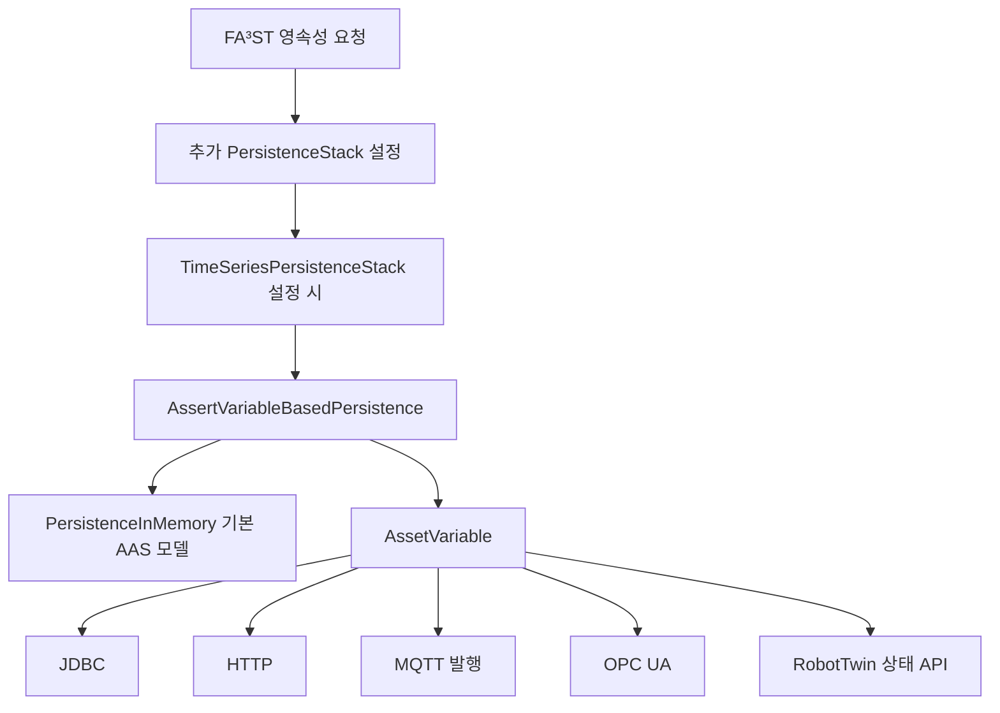
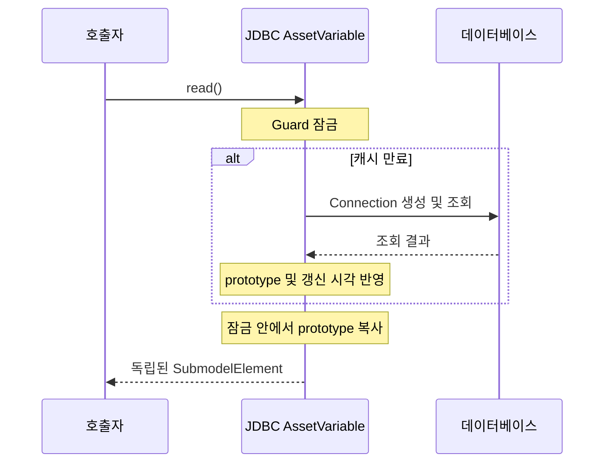

# mdt.persistence.asset 패키지 기술문서

`mdt.persistence.asset`은 AAS의 SubmodelElement와 외부 데이터소스를 연결하는 영속성 계층이다. 조회할 때 외부 값을 AAS 요소에 반영하고, 갱신할 때 AAS 요소의 값을 외부 데이터소스에 전달한다. 하나의 연결 단위를 `AssetVariable`이라고 하며, Property뿐 아니라 Collection과 List도 연결할 수 있다.

이 문서는 MDT 인스턴스 개발자와 데이터소스 연동 담당자를 대상으로 공통 계약, 요청 처리, 설정 형식, JDBC·HTTP·MQTT·OPC UA·RobotTwin 구현 및 확장 방법을 설명한다. 동작 기준은 2026년 10월의 프로젝트 소스이며, 클래스 이름 `AssertVariableBasedPersistence`와 `AssertVariableBasedPersistenceConfig`는 코드에 정의된 철자를 그대로 사용한다.

## 패키지 구조와 영속성 스택

`AssertVariableBasedPersistence`는 `PersistenceStack`을 상속한다. 하위 영속성 구현이 기본 AAS 모델을 보관하고, 이 계층이 등록된 요소의 외부 값 읽기와 쓰기를 담당한다. `MDTInstanceMain.loadPersistenceConfig()`는 `assetVariables`가 비어 있지 않을 때 이 계층을 자동으로 추가한다.



도식의 추가 스택과 시계열 계층은 설정된 경우에만 존재한다. 외부 데이터소스의 값이 필요하지 않은 요청은 하위 영속성 구현으로 위임한다. 따라서 이 패키지가 모든 AAS 데이터를 외부 저장소에 보관하는 것은 아니다.

| 위치 | 주요 클래스 | 역할 |
| --- | --- | --- |
| `mdt.persistence.asset` | `AssetVariable`, `AbstractAssetVariable` | 연결 계약, 모델 바인딩, 캐시 만료 계산 |
| 같은 패키지 | `AssetVariableConfig`, `AbstractAssetVariableConfig`, `AssetVariableConfigs` | 설정 계약, 공통 필드, `@type`에 따른 직렬화와 역직렬화 |
| 같은 패키지 | `AssertVariableBasedPersistence`, `AssertVariableBasedPersistenceConfig` | FA³ST 요청과 외부 변수 연결 |
| 같은 패키지 | `AssetVariableException` | 데이터소스 접근 및 변수 생성 실패 표현 |
| `jdbc` | `AbstractJdbcAssetVariable`과 네 가지 구현 | SQL과 AAS 값 매핑 |
| `http` | `HttpAssetVariable` | HTTP GET 응답과 AAS 값 매핑 |
| `mqtt` | `MqttAssetVariable` | AAS 값의 MQTT 발행 |
| `opcua` | `AbstractOpcUaAssetVariable`과 세 가지 구현 | OPC UA 노드 조회 및 재연결 |
| `robot` | `RobotStateVariable` | RobotTwin 상태 변수 조회 |

구현 진입점: [AssertVariableBasedPersistence.java](../src/main/java/mdt/persistence/asset/AssertVariableBasedPersistence.java), [PersistenceStack.java](../src/main/java/mdt/persistence/PersistenceStack.java), [MDTInstanceMain.java](../src/main/java/mdt/MDTInstanceMain.java).

## AssetVariable 계약과 모델 바인딩

### 인터페이스 계약

| 메서드 | 의미 |
| --- | --- |
| `getElementLocation()` | 담당하는 SubmodelElement의 위치 |
| `isReadable()` | 외부 데이터소스에서 읽을 수 있는지 판정 |
| `isUpdatable()` | 외부 데이터소스에 쓸 수 있는지 판정 |
| `initialize(MDTModelLookup)` | 위치를 실제 모델에 연결하고 prototype 준비 |
| `close()` | 외부 연결 등 사용 중인 자원 반납. 기본 구현은 아무 일도 하지 않음 |
| `read()` | 호출자가 독립적으로 사용할 수 있는 SubmodelElement 반환 |
| `update(SubmodelElement)` | 전달된 요소의 값을 외부 데이터소스에 기록 |
| `updatePart(String, SubmodelElement)` | 연결된 요소의 상대 경로에 해당하는 값만 변경 |
| `contains`, `isContained`, `overlaps` | 연결된 경로와 대상 경로의 포함 관계 판정 |

`read()`는 호출마다 새 객체를 반환해야 한다. 내부 캐시를 반환하면 호출자의 변경이 다음 조회나 다른 요청에 영향을 주므로, 공유 캐시를 사용하는 구현은 잠금 안에서 복사본을 만든다. `update()` 역시 호출자가 전달한 객체를 그대로 내부 캐시로 보관해서는 안 된다.

`updatePart()`의 기본 구현은 `read()`로 전체 요소를 읽고, 해당 부분의 값을 바꾼 뒤 `update()`한다. 이 세 단계는 기본적으로 원자적이지 않다. JDBC 구현은 이를 재정의하여 같은 변수에 대한 읽기·수정·쓰기를 하나의 잠금으로 보호한다.

`isReadable()`과 `isUpdatable()`은 외부 연결의 기능을 나타낸다. 예를 들어 읽기 전용 HTTP 변수를 등록해도 영속성 계층은 해당 AAS 요소의 기본 모델 갱신 자체를 금지하지 않는다. 외부 쓰기를 건너뛰고 기본 모델만 갱신하며, 이후 읽기에서는 외부 값이 다시 반영될 수 있다.

계약 정의: [AssetVariable.java](../src/main/java/mdt/persistence/asset/AssetVariable.java).

### 시작 시 초기화

1. `MDTInstanceMain`이 초기 AAS 모델의 Submodel 목록으로 `MDTModelLookup`을 생성한다.
2. 영속성 스택의 `init()`이 하위 영속성 구현을 생성하고 초기화한다.
3. `AssertVariableBasedPersistence.start()`가 하위 영속성 구현을 시작한다.
4. 각 설정 클래스 이름의 마지막 `Config` 여섯 글자를 제거하여 구현 클래스 이름을 구한다.
5. 해당 설정의 구체 타입을 인자로 받는 생성자를 리플렉션으로 호출한다.
6. `initialize(lookup)`으로 변수를 모델에 연결한다.
7. 변수를 `Map<String, List<AssetVariable>>`에 등록한다. 키는 Submodel의 전역 `id`다.

어느 변수의 생성이나 `initialize()`가 실패하면, 그 변수와 앞서 생성된 변수들의 `close()`를 호출한 뒤 시작을 실패시킨다. 영속성 계층이 중지될 때(`AssertVariableBasedPersistence.stop()`)도 등록된 모든 변수의 `close()`를 호출한 다음 하위 영속성 구현을 중지한다. `close()`가 던진 예외는 경고 로그만 남기고 다음 변수의 종료를 계속한다.

예를 들어 `SimpleJdbcAssetVariableConfig`는 같은 패키지의 `SimpleJdbcAssetVariable`과 연결된다. 클래스 이름과 생성자 시그니처는 실제 생성 규칙이므로 확장할 때 반드시 맞춰야 한다.

`AbstractAssetVariable.initialize()`는 `ElementLocation.activate()`로 위치를 해석하고, Submodel의 `idShort`와 요소 경로를 이용해 `m_prototype`을 찾는다. 초기 prototype은 lookup이 가진 모델 요소를 직접 참조한다. 초기화 시점에 별도 복사본을 만드는 구조는 아니며, `read()` 반환값의 복사 보장과 구분해야 한다.

`MDTModelLookup`은 최초 모델을 기반으로 생성되는 싱글턴이다. 요청 처리에서는 시작 시 구성한 Submodel ID별 변수 맵을 사용하므로 등록된 변수가 없는 새 Submodel은 하위 영속성 구현이 처리한다. 실행 중 모델 구조가 바뀌어도 변수의 경로와 prototype을 자동으로 다시 바인딩하는 기능은 없다.

관련 코드: [AbstractAssetVariable.java](../src/main/java/mdt/persistence/asset/AbstractAssetVariable.java), [MDTModelLookup.java](../src/main/java/mdt/persistence/MDTModelLookup.java).

### element 위치 표현식

`element`는 인스턴스 내부 위치이며 [ElementLocations.java](../src/main/java/mdt/ElementLocations.java)가 해석한다.

| 형식 | 예 | 의미 |
| --- | --- | --- |
| `<submodelIdShort>:<idShortPath>` | `Telemetry:Measurements.Temperature` | Submodel 내부 요소 지정 |
| `param:<parameterExpression>` | `param:Temperature` | Data Submodel의 ParameterID를 통해 값 위치 해석 |
| `oparg:<submodelIdShort>:<kind>:<argumentName>` | `oparg:Simulation:INPUT:Speed` | AI 또는 Simulation 인자 위치 표현 |

경로의 하위 요소는 `.`으로, List 인덱스는 `[0]`과 같이 표현한다. 외부 MDTExpression에서 사용하는 인스턴스 ID는 여기 넣지 않는다. 예를 들어 `param:machine01:Temperature`는 이 파서가 받는 형식이 아니다.

`oparg`의 `kind`는 현재 `INPUT`, `OUTPUT` 대문자 값으로 지정한다. 다만 [MDTOperationArgumentLocation.java](../src/main/java/mdt/MDTOperationArgumentLocation.java)의 현재 활성화 구현은 `argumentName`을 경로 선택에 사용하지 않는다. 이름별 인자 해석이 필요한 설정은 실제 모델 경로를 확인하고 일반 위치 표현식을 사용해야 한다.

## 조회와 갱신 요청 처리

### 요소 조회의 경로 분기

`getSubmodelElement()`는 같은 Submodel에 속한 읽기 가능한 변수를 순회한다. 다음 표에서 변수의 경로는 `Measurements`라고 가정한다.

| 요청 경로 | 관계 | 처리 |
| --- | --- | --- |
| `Measurements` | 정확히 일치 | `var.read()` 반환 |
| `Measurements.Temperature` | 요청이 변수의 하위 | 변수 전체를 읽고 상대 경로의 요소 반환 |
| 상위 Collection 경로 | 요청이 변수를 포함 | 하위 영속성 구현에서 상위 요소를 읽고 변수 영역의 값을 반영 |
| `Status` | 겹치지 않음 | 하위 영속성 구현에서 읽기 |

포함 판정은 단순 문자열 접두어 비교가 아니다. `.` 또는 `[` 경계를 확인하므로 `Value1`은 `Value10`의 상위 경로가 아니고, `Values`는 `Values[0]`을 포함한다.

`OutputModifier`의 content가 `METADATA`, `PATH`, `REFERENCE`이면 외부 조회를 생략하고 원래 modifier와 함께 하위 계층에 위임한다. 그 외 요소 조회에서 기본 모델을 읽을 때는 `QueryModifier.DEFAULT`를 사용한다. 직접 읽은 변수 결과에 modifier를 다시 적용하는 과정은 없다.

동일하거나 중첩된 경로에 여러 읽기 변수를 등록하면 첫 번째 정확 일치 또는 하위 경로 분기에서 반환될 수 있다. 중복 등록 검증이나 가장 구체적인 경로를 선택하는 정렬은 없으므로 연결 범위가 불필요하게 겹치지 않도록 구성한다.

### Submodel 조회와 목록 조회

`getSubmodel(id, modifier)`는 하위 영속성 구현에서 Submodel을 얻은 뒤 읽기 가능한 모든 변수 값을 대응 위치에 반영한다. 외부 조회 실패는 호출자에게 전달된다.

`findSubmodels()`는 `Level.DEFAULT`일 때 각 검색 결과를 `getSubmodel()`로 다시 읽는다. 특정 Submodel의 외부 조회가 실패하면 경고를 남기고 검색에서 얻었던 저장 모델을 반환한다. 이 때문에 목록 조회는 성공하더라도 일부 항목의 값은 외부 최신 값이 아닐 수 있다. `Level.DEFAULT`가 아니면 외부 값을 반영하지 않는다.

이 레벨 검사는 `findSubmodels()`에만 있다. `getSubmodel()`은 별도 레벨 검사 없이 등록 경로를 순회하므로, 하위 요소를 생략하는 modifier와의 조합에서는 경로 탐색이 실패할 수 있다. `findSubmodelElements()`는 이 계층에서 재정의하지 않아 하위 영속성 구현으로 직접 위임된다.

### 요소 갱신과 Submodel 저장

`update(identifier, update)`는 쓰기 가능한 변수마다 다음 규칙을 적용한다.

| 요청과 변수의 관계 | 외부 갱신 |
| --- | --- |
| 같은 경로 | `var.update(update)` |
| 요청이 변수의 하위 경로 | 읽기 가능한 변수는 `var.updatePart(relativePath, update)`. 쓰기 전용 변수는 기본 모델의 현재 값에 요청 부분을 반영한 전체 값으로 `var.update(...)` |
| 요청이 변수의 상위 경로 | 요청 객체에서 변수 영역을 추출하여 `var.update(subElement)` |
| 겹치지 않음 | 해당 변수는 건너뜀 |

관련 변수의 외부 갱신을 마친 후 하위 영속성 구현의 `update()`를 호출한다. 읽기와 달리 정확 일치 후에도 순회를 계속하므로, 겹치는 쓰기 변수가 여러 개라면 여러 외부 저장이 발생할 수 있다.

`save(Submodel)`도 같은 순서를 따른다. 먼저 저장할 Submodel에서 쓰기 가능한 모든 변수의 요소를 찾고, 외부에 값을 전달한 뒤 기본 Submodel을 저장한다. 변수에 해당하는 요소가 저장할 Submodel에 없으면 외부에 아무것도 쓰지 않고 실패한다. 따라서 외부 변수에 연결된 요소를 뺀 Submodel로는 저장할 수 없다.

| 메서드 | 실행 순서 | 실패 시 가능한 상태 |
| --- | --- | --- |
| `update()` | 외부 변수들 → 기본 모델 | 일부 외부 쓰기는 성공했지만 기본 모델은 갱신되지 않음 |
| `save(Submodel)` | 요소 확인 → 외부 변수들 → 기본 모델 | 일부 외부 쓰기는 성공했지만 기본 모델은 갱신되지 않음. 요소가 없어 실패한 경우는 외부 쓰기도 없음 |

두 경로 모두 외부 쓰기가 실패하면 기본 모델은 바뀌지 않으므로, 요청이 오류로 끝났는데 AAS 값만 바뀌는 경우는 없다.

여러 변수와 기본 모델을 하나로 묶는 트랜잭션이나 보상 처리는 없다. `insert`, 삭제 계열, `deleteAll`도 외부 데이터소스의 생성·삭제와 연결하지 않고 하위 영속성 구현으로 위임한다.

## 설정 형식과 구현 선택

인스턴스 설정의 최상위 `assetVariables` 배열에 변수 설정을 넣는다. `AssetVariableConfigs`가 `@type`으로 설정 클래스를 선택한다. `@type`이 없거나 등록되지 않은 값이면 역직렬화가 실패한다.

| `@type` | 구현 클래스 | 읽기 | 외부 쓰기 |
| --- | --- | --- | --- |
| `mdt:asset:jdbc:simple` | `SimpleJdbcAssetVariable` | `readQuery` 사용 | `updateQuery`가 있으면 지원 |
| `mdt:asset:jdbc:multi-column` | `MultiColumnCollectionAssetVariable` | 기본 활성화 | `APPEND` 또는 `UPDATE` |
| `mdt:asset:jdbc:multi-column-list` | `MultiColumnCollectionListAssetVariable` | 지원 | 미지원 |
| `mdt:asset:jdbc:multi-row` | `MultiRowAssetVariable` | `readQuery` 사용 | `updateQuery`가 있으면 지원 |
| `mdt:asset:http` | `HttpAssetVariable` | 지원 | 미지원 |
| `mdt:asset:mqtt` | `MqttAssetVariable` | 미지원 | 발행 |
| `mdt:asset:opcua:simple` | `OpcUaAssetVariable` | 기본 활성화 | 미지원 |
| `mdt:asset:opcua:list` | `OpcUaListAssetVariable` | 기본 활성화 | 미지원 |
| `mdt:asset:opcua:collection` | `OpcUaCollectionAssetVariable` | 기본 활성화 | 미지원 |
| `mdt:asset:robot-twin:state` | `RobotStateVariable` | 지원 | 미지원 |

공통 필드는 `element`와 선택 필드 `validPeriod`다. `validPeriod`는 생략 시 `Duration.ZERO`이며, `500ms`, `1s`, `PT1S`처럼 단위가 있는 값으로 지정한다. 직렬화 시에는 `Duration.toString()` 형식으로 기록된다.

### 연결 설정 지정

외부 연결이 필요한 변수는 연결 설정을 하나의 필드로 지정한다. 값이 문자열이면 전역 설정 파일의 항목 이름이고, 객체이면 연결 설정을 직접 기술한 것이다. 필드를 생략하면 전역 설정의 `default` 항목을 사용한다. MQTT 수신 엔드포인트(`serviceEndpoints.mqtt`)와 JDBC Audit도 같은 방식이다.

| 변수 | 연결 설정 필드 | 전역 설정 그룹 | 이전 형식의 이름 필드 |
| --- | --- | --- | --- |
| JDBC 계열 | `jdbcConfig` | `jdbcs` | `jdbcConfigName` |
| MQTT | `mqttBrokerConfig` | `mqttBrokers` | `mqttBrokerConfigName` |
| RobotTwin 상태 | `robotTwinConfig` | `robotTwins` | `robotTwinConfigName` |

```json
"jdbcConfig": "factory"
"jdbcConfig": { "jdbcUrl": "jdbc:postgresql://localhost:5432/mdt", "user": "mdt", "password": "..." }
```

이전 형식의 이름 필드도 계속 받지만, 새 필드와 함께 쓰면 설정 오류로 시작에 실패한다. 직렬화할 때는 새 필드 하나에 지정된 형태 그대로 기록하며, 인라인 설정의 값이 `null`인 필드는 기록하지 않는다. 로그에 출력하는 설정 문자열은 전역 설정 파일을 읽지 않고 `jdbcs.factory`처럼 이름을 표시하며, 인라인 JDBC 설정은 URL에 비밀번호가 있을 수 있어 `(inline)`으로만 표시한다.

관련 코드: [ConnectionConfigRef.java](../src/main/java/mdt/persistence/asset/ConnectionConfigRef.java).

### 캐시 유효 기간

캐시 만료는 `현재 시각 - 마지막 갱신 시각 > validPeriod`로 판정한다. 초기 갱신 시각은 `Instant.EPOCH`다. JDBC, HTTP, RobotTwin 구현은 이 판정을 사용하지만 OPC UA 구현은 매번 노드를 읽으며 MQTT에는 읽기 캐시가 없다. `validPeriod`가 모든 프로토콜에 같은 효력을 갖는 것은 아니다.

설정 레지스트리: [AssetVariableConfigs.java](../src/main/java/mdt/persistence/asset/AssetVariableConfigs.java).

## JDBC 연동

### 공통 연결 설정과 캐시

JDBC 접속 정보는 `jdbcConfig`로 지정한다. 전역 설정 `jdbcs`의 항목 이름이나 접속 정보 객체를 쓸 수 있고, 생략하면 `default`를 사용한다([연결 설정 지정](#연결-설정-지정)).

`AbstractJdbcAssetVariable`은 변수별 `Guard`로 캐시 접근을 직렬화한다.



`update()`는 DB 저장 성공 후 입력 객체의 복사본을 캐시에 넣고 갱신 시각을 변경한다. 저장 중 SQL 예외 또는 런타임 예외가 발생하면 갱신 시각을 EPOCH로 되돌려 다음 읽기에서 다시 조회하도록 한다. 각 DB 접근의 Connection은 try-with-resources로 닫는다.

`updatePart()`의 잠금은 같은 Java 변수 인스턴스에 대한 동시 부분 갱신의 유실을 방지한다. 읽기와 쓰기는 별도 Connection을 사용할 수 있고, 유효한 캐시를 읽을 수도 있다. 따라서 다른 프로세스의 DB 쓰기까지 포함한 트랜잭션 격리나 최신 값 보장은 아니다. 이 클래스는 명시적 `commit`·`rollback`으로 여러 SQL을 묶지 않는다.

핵심 구현: [AbstractJdbcAssetVariable.java](../src/main/java/mdt/persistence/asset/jdbc/AbstractJdbcAssetVariable.java), [AbstractJdbcAssetVariableConfig.java](../src/main/java/mdt/persistence/asset/jdbc/AbstractJdbcAssetVariableConfig.java).

### 단일 값 매핑

`SimpleJdbcAssetVariable`은 조회 결과의 첫 행 첫 컬럼을 사용한다. `readQuery`는 JSON 설정에서 필수이며, 선택적인 `updateQuery`에는 값 하나를 `?`에 바인딩한다.

다음 예제는 인스턴스 설정에 추가할 부분이다. `Telemetry` Submodel에 `Measurements.Temperature` Property가 존재하고, 전역 `jdbcs.default` 연결과 해당 DB 테이블이 준비되어 있어야 한다.

```json
{
  "assetVariables": [
    {
      "@type": "mdt:asset:jdbc:simple",
      "element": "Telemetry:Measurements.Temperature",
      "jdbcConfig": "default",
      "validPeriod": "1s",
      "readQuery": "SELECT temperature FROM machine_state WHERE machine_id = 'machine01'",
      "updateQuery": "UPDATE machine_state SET temperature = ? WHERE machine_id = 'machine01'"
    }
  ]
}
```

조회 결과가 없으면 경고를 남기고 기존 prototype 값을 유지한다. 이 경우에도 상위 읽기 로직은 갱신 시각을 변경하므로 다음 실제 조회는 캐시 만료 후 발생한다.

### 한 행의 여러 컬럼 매핑

`MultiColumnCollectionAssetVariable`은 SQL 결과의 첫 행을 Collection 내부 Property들에 매핑한다. `columns`는 컬럼 표현식과 상대 `subPath`의 순서 있는 배열이다.

```json
{
  "@type": "mdt:asset:jdbc:multi-column",
  "element": "Telemetry:Measurements",
  "jdbcConfig": "default",
  "validPeriod": "500ms",
  "table": "machine_state",
  "whereClause": "WHERE machine_id = 'machine01'",
  "readable": true,
  "updateMode": "UPDATE",
  "columns": [
    { "column": "temperature", "subPath": "Temperature" },
    { "column": "pressure", "subPath": "Pressure" }
  ]
}
```

`readable`의 기본값은 `true`, `updateMode`의 기본값은 `DISABLED`다. `APPEND`는 INSERT, `UPDATE`는 UPDATE를 생성한다. SQL은 처음 필요할 때 생성하여 설정 객체 안에 캐시한다.

`whereClause`는 필수 문자열이며 SQL에 그대로 붙는다. 조건이 있으면 `WHERE`를 포함하고, 조건이 없으면 빈 문자열을 지정한다. UPDATE에 빈 조건을 쓰면 테이블 전체가 갱신될 수 있다. 값은 PreparedStatement로 바인딩하지만 테이블명, 컬럼 표현식, 조건 문자열은 직접 SQL 구문이 된다.

컬럼 표현식이 `t.temperature`이면 결과를 읽을 때 마지막 부분인 `temperature`를 컬럼 이름으로 사용한다. 읽기 구현은 매핑 대상 요소를 `Property`로 캐스팅하므로 복합 요소 전체를 한 컬럼에 연결하는 용도로 사용하지 않는다.

### 여러 행을 Collection 목록으로 매핑

`MultiColumnCollectionListAssetVariable`은 결과 행마다 Collection을 만들고 대상 `SubmodelElementList`를 다시 채운다. 설정은 `table`, `whereClause`, `memberColumns`를 사용하며 `memberColumns`의 각 항목은 `{ "column": "...", "subPath": "..." }` 형식이다.

이 구현은 읽기 전용이다. 결과가 없으면 목록이 비워지며, Property 타입은 JDBC 결과 메타데이터에서 결정한다. 여기서 `subPath`는 새 Property의 `idShort`로 직접 사용되므로 중첩 경로를 해석해서 Collection을 생성하지 않는다. 기존 List 멤버의 상세 메타데이터를 복제하는 방식도 아니다.

### 여러 행의 키와 값 매핑

`MultiRowAssetVariable`은 결과의 첫 컬럼을 키 문자열, 두 번째 컬럼을 값으로 취급하고 `rows`로 연결한 하위 요소를 갱신한다.

```json
{
  "@type": "mdt:asset:jdbc:multi-row",
  "element": "Telemetry:Measurements",
  "jdbcConfig": "default",
  "validPeriod": "1s",
  "readQuery": "SELECT metric_key, metric_value FROM machine_metric WHERE machine_id = 'machine01'",
  "updateQuery": "UPDATE machine_metric SET metric_value = ? WHERE metric_key = ? AND machine_id = 'machine01'",
  "rows": [
    { "key": "temperature", "subPath": "Temperature" },
    { "key": "pressure", "subPath": "Pressure" }
  ]
}
```

등록되지 않은 키는 건너뛰고, 조회되지 않은 키의 기존 값은 유지한다. 저장은 매핑별로 SQL을 실행하며 첫 번째 파라미터는 값, 두 번째는 키다. 중간 실패 시 이미 실행한 행이 DB에 남을 수 있으므로 캐시 무효화가 DB 롤백을 의미하지는 않는다.

### 값 변환

[SubmodelElementHandler.java](../src/main/java/mdt/persistence/asset/jdbc/SubmodelElementHandler.java)는 Property이면 AAS `valueType`에 대응하는 `DataType`을 사용한다. Property가 아닌 요소는 MDT `ElementValue`의 JSON 문자열로 변환한다. 따라서 simple 또는 multi-row에서 복합 요소를 한 DB 값에 연결하려면 해당 컬럼의 JSON이 MDT 값 형식과 맞아야 한다.

읽기 호출 경로도 다르다. simple과 multi-row는 `update()`를 호출하고, multi-column은 JDBC 객체 변환을 추가로 수행하는 `updateWithJdbcObject()`를 사용한다. DB 드라이버가 반환하는 타입과 AAS 타입이 호환되는지 확인해야 한다.

## HTTP 연동

`HttpAssetVariable`은 HTTP GET 전용이며, `validPeriod`가 만료될 때 설정된 URL을 호출한다. 응답 본문을 JSON으로 해석하고, JSON이 아니면 공백을 제거한 본문을 문자열로 취급한다.

```json
{
  "@type": "mdt:asset:http",
  "element": "Telemetry:Measurements",
  "validPeriod": "1s",
  "url": "http://127.0.0.1:8080/api/machines/machine01/state",
  "headers": { "Accept": "application/json" },
  "timeout": "3s",
  "valuePointer": "/data",
  "mappings": {
    "Temperature": "/temperature",
    "Pressure": "/pressure",
    "Readings[0]": "/readings/0"
  }
}
```

위 설정은 `{ "data": { "temperature": 23.5, "pressure": 1.2, "readings": [10] } }` 같은 응답을 처리한다. 대상 AAS 모델에 세 경로가 미리 존재해야 한다.

| 필드 | 동작 |
| --- | --- |
| `url` | 필수이며 공백 문자열은 허용하지 않음 |
| `headers` | 선택적인 헤더 이름과 값 객체 |
| `timeout` | HTTP 호출 전체의 제한 시간. 생략하면 클라이언트 기본값 사용 |
| `valuePointer` | 응답에서 기준 JSON 선택. 기본값 `""`는 전체 응답 |
| `mappings` | AAS 상대 경로 → 기준 JSON 내부 Pointer. 생략하면 기준 값 전체를 반영 |

매핑의 키 `Readings[0]`는 AAS 경로이고, 값 `/readings/0`은 JSON Pointer다. JSON Pointer에 `/readings[0]`을 쓰면 배열 첫 항목이 아니라 `readings[0]`이라는 필드 이름을 찾는다.

기준 `valuePointer`가 없으면 실패한다. 개별 매핑의 Pointer가 없으면 경고 후 해당 항목을 건너뛰고, JSON null 값은 기존 값을 유지한다. 요청이나 변환이 실패하면 갱신 시각을 변경하지 않아 다음 읽기에서 재시도한다. 여러 매핑을 순차 반영하므로 중간 변환 실패가 이미 반영한 필드를 되돌리지는 않는다.

Property는 선언된 AAS 타입에 맞춰 변환한다. 객체·배열은 `xs:string` Property일 때 JSON 문자열로 저장할 수 있고, 다른 Property 타입에서는 오류가 된다. 복합 요소에는 MDT 값 형식으로 반영한다.

현재 설정 파서는 `url`을 사용한다. `AASHubConfig` 레코드와 관련 상수가 있지만 `aasHubName` 또는 `baseUrl`만으로 URL을 조립하는 경로는 연결되어 있지 않다.

관련 코드: [HttpAssetVariable.java](../src/main/java/mdt/persistence/asset/http/HttpAssetVariable.java), [HttpAssetVariableConfig.java](../src/main/java/mdt/persistence/asset/http/HttpAssetVariableConfig.java).

## MQTT 연동

`MqttAssetVariable`은 쓰기 전용이다. `initialize()`에서 broker 설정을 한 번 해석하여 보관하고 `MqttServicePool`에서 broker 연결을 얻으며, `update()`에서 `ElementValues.getValue(newElement).toValueJsonString()`을 설정된 topic으로 발행한다. AAS 요소의 전체 메타데이터가 아닌 값 표현이 메시지 본문이다.

같은 broker 설정(URL, 연결 timeout, keep-alive 주기, 재연결 간격)을 쓰는 MQTT 변수들과 MQTT 수신 엔드포인트(`serviceEndpoints.mqtt`)는 연결 하나를 공유한다. 전역 설정 이름으로 지정했는지 인라인으로 지정했는지와 관계없이 해석된 설정 값이 같으면 같은 연결을 쓴다. `close()`는 연결 사용권을 반납하며, 마지막 사용자가 반납할 때 재연결 시도를 멈추고 broker와의 연결을 끊는다(최대 5초 대기).

```json
{
  "@type": "mdt:asset:mqtt",
  "element": "Telemetry:Measurements",
  "mqttBrokerConfig": "factory",
  "topic": "machines/machine01/measurements",
  "qos": 1,
  "retained": false,
  "publishTimeout": "10s",
  "whenDisconnected": "skip"
}
```

| 필드 | 기본값 | 설명 |
| --- | --- | --- |
| `mqttBrokerConfig` | `"default"` | 문자열이면 전역 `mqttBrokers`의 항목 이름, 객체면 broker 설정(`brokerUrl`, `connectionTimeout`, `keepAliveInterval`, `reconnectInterval`)이다. MQTT 수신 엔드포인트의 같은 필드와 형식이 같다. |
| `topic` | (필수) | 발행 topic. 와일드카드(`+`, `#`)가 있거나 비어 있으면 설정 오류로 시작에 실패한다. |
| `qos` | `1` | 0, 1, 2. QoS 0은 broker의 확인을 기다리지 않고, 1·2는 각각 PUBACK·PUBCOMP를 기다린다. |
| `retained` | `false` | `true`이면 broker가 마지막 메시지를 보관했다가 새로 구독한 쪽에 바로 전달한다. 인스턴스를 없앤 뒤에도 broker에 마지막 값이 남는다. |
| `publishTimeout` | `10s` | QoS 1·2에서 broker의 전달 확인을 기다리는 최대 시간. 양수여야 한다. |
| `whenDisconnected` | `skip` | 메시지를 전달하지 못했을 때의 처리. 아래 표 참고. |

이전 형식의 `mqttBrokerConfigName`(전역 설정 이름)도 받지만, `mqttBrokerConfig`와 함께 쓰면 설정 오류다. 직렬화할 때는 `mqttBrokerConfig` 하나로 출력한다. broker 설정 객체에 지원하지 않는 필드(예: 오타인 `connectTimeout`)가 있으면 무시하고 경고 로그를 남긴다. 이 변수는 구독하여 AAS 값을 갱신하는 기능을 제공하지 않는다.

`whenDisconnected`는 broker와 연결되어 있지 않거나, `publishTimeout` 안에 broker의 전달 확인을 받지 못했을 때의 갱신 처리 방법이다. 연결은 비동기로 맺어지므로 인스턴스 시작 직후와 broker 장애 중에 이 정책이 적용된다. 확인 시간 초과는 메시지가 실제로는 전달되었을 수도 있는 경우다.

| 값 | 동작 |
| --- | --- |
| `skip` (기본값) | 발행을 건너뛰고 AAS 요소 값은 정상적으로 갱신한다. 전달하지 못한 첫 갱신에서 경고 로그를 한 번 남기고, 다시 발행에 성공하면 INFO 로그를 남긴다. 건너뛴 값은 다시 연결되어도 재발행하지 않는다. |
| `fail` | `AssetVariableException`으로 갱신을 실패시킨다. 요소 갱신과 Submodel 저장 모두 AAS 값도 바뀌지 않는다. |

연결 확인 후 발행하는 사이에 연결이 끊어진 경우(Paho 오류 코드 32104·32109·32102·32111)도 연결되지 않은 경우와 같이 처리한다. 권한 오류 등 그 밖의 발행 실패와 값 변환 실패는 정책과 관계없이 예외를 던진다. 이 정책이 없던 이전 버전은 `fail`과 같이 동작했고, 확인 대기 시간에도 제한이 없었다.

확인을 기다리는 동안에는 공유 연결의 lock을 잡지 않으므로, 한 변수의 발행이 느려도 같은 연결을 쓰는 다른 변수의 발행이나 구독이 막히지 않는다. 다만 `ConcurrentPersistence`를 사용하면 이 대기 시간 동안 인스턴스의 다른 요청은 기다리게 된다.

Collection 등 복합 요소에 연결한 경우 하위 요소만 갱신해도 된다. 예를 들어 `Measurements.Temperature`만 갱신하면, MQTT 변수는 현재 값을 읽을 수 없으므로 영속성 계층이 기본 모델에 저장된 `Measurements`를 복사해 `Temperature`만 바꾼 뒤 `Measurements` 전체 값을 발행한다. 서로 다른 하위 요소에 대한 갱신이 동시에 들어오면 발행된 값에 다른 갱신의 변경이 빠질 수 있으며, `ConcurrentPersistence`로 요청을 직렬화하면 이를 막을 수 있다. 기본 모델에는 각 요청의 하위 요소가 정상적으로 저장된다.

관련 코드: [MqttAssetVariable.java](../src/main/java/mdt/persistence/asset/mqtt/MqttAssetVariable.java).

## OPC UA 연동

OPC UA 변수는 읽기 전용이며 연결 설정은 모두 전역 `opcuas.default`를 사용한다. `readable`은 기본 `true`다. 현재 구현은 `validPeriod`와 관계없이 `read()`마다 서버를 조회한다.

| 타입 | 설정 필드 | 노드와 AAS 요소 대응 |
| --- | --- | --- |
| `opcua:simple` | `nodePath` 문자열 | namespace 2의 문자열 NodeId 하나 → 대상 요소 |
| `opcua:list` | `identifiers` 정수 배열 | namespace 2의 숫자 NodeId들 → 기존 List 멤버 순서 |
| `opcua:collection` | `mappings` 객체 | 상대 AAS 경로 → namespace 2의 숫자 NodeId |

표의 타입 앞에는 모두 `mdt:asset:`이 붙는다. 예를 들어 단일 노드는 다음과 같이 설정한다.

```json
{
  "@type": "mdt:asset:opcua:simple",
  "element": "Telemetry:Measurements.Temperature",
  "nodePath": "Machine01.Temperature",
  "readable": true
}
```

`nodePath`는 `new NodeId(2, nodePath)`의 문자열 식별자로 쓰인다. `ns=2;s=...` 전체를 파싱하는 필드가 아니다. List는 `identifiers: [1001, 1002]`, Collection은 `mappings: { "Joint1": 1001, "Joint2": 1002 }` 형태로 지정한다.

simple은 반환값을 요소 타입에 맞춰 반영하고 Bad 상태 코드를 예외로 바꾼다. list와 collection은 숫자 노드 값을 `Double`로 캐스팅하며 `PropertyValue.DOUBLE`로 반영한다. List는 기존 멤버와 identifier를 순서대로 짝짓기 때문에 두 개수를 맞춰야 한다. 이 경로에는 simple과 같은 Bad 상태 코드의 명시적 검사가 없다.

세 구현 모두 prototype을 복사한 객체에 값을 반영해 반환한다. List와 Collection의 여러 노드는 순서대로 조회하므로 결과 전체가 동일 시점의 원자적 스냅숏이라는 보장은 없다.

`AutoReconnectingOpcUaClient`는 비동기로 연결을 시도하고 연결이 끊기면 클라이언트를 정리한 뒤 재접속한다. 변수에서 지정하는 재시도 간격은 5초이고, 노드 조회 전에 연결된 클라이언트를 기다리는 제한도 5초다. 이 대기 제한은 뒤이어 수행되는 `readValue(...).get()` 전체의 제한 시간을 뜻하지 않는다.

`OpcUaServerReconnect`는 실제 연결 재시도를 수행한다. `PandaRobotOpcUaReader`는 별도의 로봇 조회 보조 코드이며 `AssetVariableConfigs`에 등록되는 변수 구현은 아니다.

관련 코드: [AbstractOpcUaAssetVariable.java](../src/main/java/mdt/persistence/asset/opcua/AbstractOpcUaAssetVariable.java), [AutoReconnectingOpcUaClient.java](../src/main/java/mdt/persistence/asset/opcua/AutoReconnectingOpcUaClient.java).

## RobotTwin 상태 연동

`RobotStateVariable`은 mdt-robot-client의 `RobotTwinClient.readRaw()`로 다음 API에서 상태 변수 하나를 읽는다.
품질 판정은 이 클래스가 하므로, 품질이 낮아도 예외로 바꾸지 않는 `readRaw()`를 쓴다.

```text
GET {robotTwinBaseUrl}/api/v1/robot_twins/{twinId}/variables/{variable}
```

접속 정보는 `robotTwinConfig`로 지정한다. 전역 설정 `robotTwins`의 항목 이름이나 접속 정보 객체를 쓸 수 있고, 생략하면 `default`를 사용한다([연결 설정 지정](#연결-설정-지정)). 객체로 지정할 때는 URL과 twin ID를 아래처럼 기술한다.

```json
{
  "@type": "mdt:asset:robot-twin:state",
  "element": "Robot:JointStates",
  "validPeriod": "500ms",
  "robotTwinConfig": {
    "robotTwinBaseUrl": "http://127.0.0.1:8801",
    "twinId": "panda01"
  },
  "variable": "joint_states",
  "requireOkQuality": true,
  "mappings": {
    "Joint1": "/position/panda_joint1",
    "Joint2": "/position/panda_joint2"
  }
}
```

응답은 `RobotTwinVariable`로 해석하며 `mappings`의 Pointer는 응답 전체가 아닌 `value`를 기준으로 한다. 매핑 생략 시 value 전체를 반영한다. 객체 형식 외에 기존 `{ "subPath": "...", "pointer": "..." }` 항목의 배열 형식도 읽을 수 있고, 다시 직렬화할 때는 객체 형식으로 기록한다.

설정을 읽을 때 다음을 검사하며, 맞지 않으면 `JacksonDeserializationException`으로 인스턴스 설정 로딩이 실패한다.

- `requireOkQuality`는 boolean이어야 한다. 생략하면 `false`이며, 값이 있으면 직렬화할 때도 기록한다.
- 매핑 값은 문자열 JSON Pointer여야 한다. 객체·숫자 값이나 앞의 `/`가 없는 포인터, `~` 뒤가 `0`·`1`이 아닌 이스케이프(`~2`, 끝의 `~`)는 거부한다.
- 로봇 트윈 base URL은 변수 생성 시 http(s) URL인지 검사한다.

품질이 OK가 아니면 경고를 남기고, `requireOkQuality: true`이면 `AssetVariableException`으로 읽기를 실패시킨다. 값이 없거나(`NO_DATA` 등) 매핑한 필드가 null이면 해당 값을 유지한다. 응답에 매핑한 필드가 없을 때도 경고만 남기고 이전 값을 유지한다.

값은 대상 SubmodelElement의 구조를 따라 검사한 뒤 반영한다. 숫자형 Property(FLOAT·DOUBLE·DECIMAL·INT·LONG·SHORT·BYTE·INTEGER)는 JSON 숫자만, BOOLEAN은 JSON boolean만 받으며, 정수형은 범위를, 실수형은 유한성을 검사한다(DECIMAL은 정수라면 double 범위를 넘어도 받는다). 컬렉션은 같은 idShort 필드를, 리스트는 같은 위치 원소를, Range는 `min`·`max`를 같은 규칙으로 검사한다. `"sensor-error"` 같은 값이 0으로 바뀌어 기록되지 않도록 하기 위해서다.

모든 매핑은 캐시(prototype)의 복사본에 적용하고, 모두 성공했을 때만 캐시를 교체한다. 일부 필드 변환이 실패해도 캐시에 서로 다른 시점의 값이 섞이지 않는다. 정상 종료된 읽기만 갱신 시각을 변경하며, JDBC·HTTP와 같이 `Guard` 안에서 캐시를 갱신하고 복사본을 반환한다.

관련 코드: [RobotStateVariable.java](../src/main/java/mdt/persistence/asset/robot/RobotStateVariable.java), [RobotStateVariableConfig.java](../src/main/java/mdt/persistence/asset/robot/RobotStateVariableConfig.java).

## 새 데이터소스 구현 방법

1. `AssetVariableConfig`를 구현하는 `ExampleAssetVariableConfig`를 만든다. 공통 위치·TTL 처리는 `AbstractAssetVariableConfig`를 상속하면 재사용할 수 있다.
2. 고유한 `SERIALIZATION_TYPE`, `getSerializationType()`, `serializeFields()`와 정적 `deserializeFields(JsonNode)`를 구현한다.
3. `AssetVariableConfigs.parseJsonNode()`에 해당 타입의 분기를 등록한다.
4. 같은 패키지에 `ExampleAssetVariable`을 만들고, 접근 가능한 `ExampleAssetVariable(ExampleAssetVariableConfig config)` 생성자를 제공한다.
5. 읽기·쓰기 지원 여부, 초기화와 데이터 변환을 구현한다. `read()`의 독립 객체 반환과 `update()` 입력 객체의 소유권 계약을 지킨다.
6. 쓰기 가능한 복합 요소에서 동시 부분 갱신이 가능하다면 `updatePart()` 전체를 보호한다. 쓰기 전용 구현(`isReadable()`이 `false`)에는 영속성 계층이 `updatePart()` 대신 기본 모델의 현재 값으로 만든 전체 값을 `update()`로 전달한다.
7. 연결이나 백그라운드 작업을 시작하는 구현은 `close()`에서 이를 정리한다. `close()`는 `initialize()`가 끝나지 않은 상태에서도 호출될 수 있고, 여러 번 호출되어도 안전해야 한다.

JDBC 확장은 `AbstractJdbcAssetVariable`과 `AbstractJdbcAssetVariableConfig`를 기반으로 할 수 있다. `loadOnBuffer(Connection)`에서 조회 값을 prototype에 반영하고, `saveBuffer(Connection, SubmodelElement)`에서는 전달받은 값을 저장한다. 저장 성공 전 prototype을 바꾸거나 입력 객체를 수정하지 않아야 공통 캐시 처리와 일관된다.

현재 `close()`를 구현한 변수는 MQTT뿐이다. OPC UA 변수는 기본 구현을 그대로 사용하므로, 이 스택이 중지되어도 OPC UA 연결은 닫히지 않는다.

확장 시에는 설정의 직렬화 왕복, 없는 모델 경로, 반환 객체 변경의 캐시 격리, 저장 실패 후 재조회, 동시 부분 갱신을 검증한다. TTL은 외부 변경을 가리는 기간이 될 수 있으므로 업무에서 허용하는 갱신 지연에 맞춘다.

## 문제 진단

| 증상 | 확인할 지점 |
| --- | --- |
| 시작 시 `Failed to create an AssetVariable` | 내부 원인 예외, 설정 클래스 이름, 생성자 타입, 연결 설정, 모델의 실제 경로 |
| 조회 값이 즉시 바뀌지 않음 | `validPeriod`, 조회 결과가 없는 경우의 기존 값 유지, 외부 null 응답 |
| 목록은 조회되지만 단일 Submodel 조회가 실패 | `findSubmodels()`의 저장 모델 대체 경고와 외부 데이터소스 오류 |
| HTTP 매핑에서 일부 필드만 갱신되지 않음 | 기준 `valuePointer`, JSON Pointer의 배열 문법, null, AAS 상대 경로 |
| MQTT 하위 요소 갱신 실패 | 쓰기 전용 변수에서 기본 `updatePart()`가 `read()`를 호출하는지 확인 |
| OPC UA 값을 읽지 못함 | 전역 `opcuas.default`, namespace 2, 문자열·숫자 NodeId 구분, 반환 타입 |
| JDBC 갱신 후 모델과 DB 값이 다름 | 외부 쓰기와 기본 모델의 처리 순서, 여러 SQL의 부분 성공, 다른 프로세스의 갱신 |
| 모델 구조 변경 후 경로 탐색 실패 | 시작 시 등록한 경로와 prototype이 현재 구조에 여전히 맞는지 확인 |

`AssetVariableException`은 `MDTException`을 상속한다. 모든 실패가 이 타입으로 정규화되는 것은 아니며, 경로 탐색·타입 변환에서 다른 런타임 예외가 전달될 수도 있다. 로그의 변수 위치와 원인 예외를 함께 확인한다.
