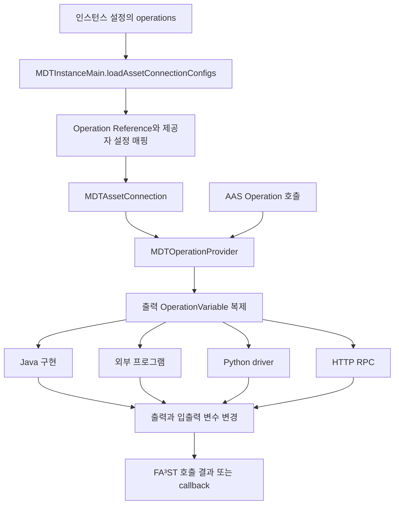
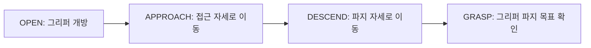
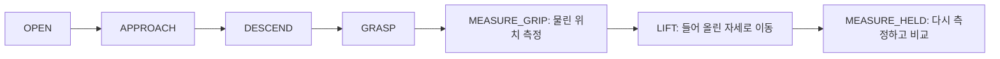
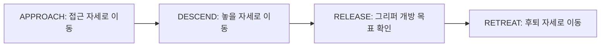
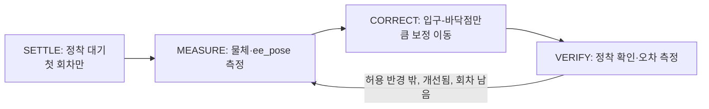

# mdt.assetconnection 패키지 기술문서

`mdt.assetconnection`은 FA³ST의 AAS Operation 호출을 실제 연산 구현에 연결하는 계층이다.
Java 클래스, 외부 프로그램, Python 스크립트, HTTP RPC를 동일한 Operation 호출 인터페이스로 제공하고,
호출 결과를 AAS `OperationVariable`에 반영한다.

로봇 트윈 연산별 동작, 입력·출력 인자와 기본값은
[로봇 트윈 연산 Provider 기술 가이드](robot-twin-operation-guide.md)에 자세히 정리되어 있다.

대상 독자는 MDT 인스턴스 개발자와 연산 연동 담당자다. 2026년 10월 30일의 작업 트리를 기준으로
공통 계약, 설정 변환, 제공자별 데이터 형식, RobotTwin·AI 연산과 확장 방법을 설명한다.
빌드 설정의 Java 대상 버전은 21, FA³ST starter 의존성은 1.3.0이다.

## 역할과 패키지 구조

AAS 요소의 평상시 값 읽기·쓰기는 `mdt.persistence.asset`이 담당한다.
이 패키지는 **Operation 실행**을 담당하며, `MDTAssetConnection`의 ValueProvider와
SubscriptionProvider 생성은 `UnsupportedOperationException`을 발생시킨다.
오류 문구에 남아 있는 MQTT 표현은 MQTT 기능을 지원한다는 뜻이 아니다.

| 위치 | 주요 클래스 | 역할 |
|---|---|---|
| 패키지 루트 | `MDTAssetConnection`, `MDTAssetConnectionConfig` | FA³ST asset connection과 연산 제공자 등록 |
| 패키지 루트 | `UnsupportedValueProvider`, `UnsupportedSubscriptionProvider`와 설정 클래스 | 미지원 기능을 표시하는 타입 |
| `operation` | `OperationProvider` | MDT 연산 구현의 동기·비동기 계약 |
| `operation` | `MDTOperationProvider`, `MDTOperationProviderConfig` | FA³ST 호출 어댑터, 출력 prototype 복제, 구현 선택 |
| `operation` | `ProgramOperationProvider`, `ProgramOperationDescriptor` | 외부 프로세스와 파일 기반 입출력 |
| `operation` | `ScriptOperationProvider` | Python driver를 통한 JSON 파일 입출력 |
| `operation` | `HttpOperationProvider` | 원격 비동기 RPC 호출 |
| `operation` | `JavaOperationProviderConfig`, `OperationVariables` | Java 구현 설정과 변수 접근 보조 |
| `operation` | `AbstractJavaOperationProvider` | Java 연산 구현의 공통 기반(이름별 변수 접근, 설정 arguments·전역 설정 처리) |
| `operation` | `AIModelOperation` | AI 모델 서버의 예측 API 호출 |
| `operation.robot` | `RobotTwinOperationProvider` | RobotTwin 설정 처리와 로봇 연산 공통 기능 |
| `operation.robot` | `MoveToJointsProvider`, `MoveLinearProvider`, `MoveToNamedTargetProvider`, `MoveGripperToTargetProvider`, `GraspProvider`, `PickProvider`, `PlaceProvider`, `ResetSceneProvider`, `GetSceneObjectsProvider`, `WaitUntilObjectStillProvider`, `AlignHeldObjectProvider` | 로봇 이동·scene 연산 구현 |

별도로 있는 `UnsupportedOperationProvider`와 그 설정은 현재 `MDTAssetConnection`의 연산 제공자 타입으로
사용되지 않는다. 실제 연산 제공자는 `MDTOperationProvider`다.

## 등록과 실행 흐름



1. `MDTInstanceMain`이 `operations` 설정의 연산 위치를 실제 모델 Reference로 변환한다.
2. 위치별 `MDTOperationProviderConfig`를 `MDTAssetConnectionConfig.operationProviders`에 등록한다.
3. `MDTAssetConnection.createOperationProvider()`가 설정을 JSON으로 직렬화하고
   `MDTSubstitutor.substibute()`로 환경 변수 등을 치환한 뒤 다시 읽는다.
4. `MDTOperationProvider`는 모델에서 출력 변수 정의를 가져오고 구체 구현을 한 번 생성한다.
5. 호출마다 출력 변수를 JSON 직렬화·역직렬화로 복제한 뒤 구체 구현에 넘긴다.

대상 Operation은 AAS 모델에 미리 정의되어 있어야 한다. 등록 과정이 Operation이나 출력 변수를 생성하지는 않는다.
동기 호출에서는 변경한 `outputVars`를 반환하고, 비동기 호출에서는 성공 callback에 전달한다.
입력·입출력 배열은 어댑터가 별도로 복제하지 않는다. 출력 prototype만 복제한다고 해서 제공자 내부 상태까지
호출별로 격리되는 것은 아니다.

`doConnect()`와 `doDisconnect()`는 빈 구현이며 `getEndpointInformation()`은 null을 반환한다.
따라서 asset connection 초기화만으로 외부 연산 서버의 연결 상태가 검증되는 것은 아니다.

## OperationProvider 공통 계약

```java
void invokeSync(
    OperationVariable[] inputVars,
    OperationVariable[] inoutputVars,
    OperationVariable[] outputVars
) throws Exception;
```

반환값 대신 전달받은 변수 안의 `SubmodelElement`를 변경한다. 변수 이름은
`OperationVariable.getValue().getIdShort()`다.

| 배열 | 의미 | 구현자가 지켜야 할 사항 |
|---|---|---|
| `inputVars` | 입력 변수 | 필요한 이름과 요소 타입을 확인하고 읽음 |
| `inoutputVars` | 입력과 출력 겸용 변수 | 지원하는 구현에서는 같은 변수에 결과 반영 |
| `outputVars` | 모델 정의에서 복제한 출력 변수 | 기존 요소 타입에 맞춰 결과를 설정 |

사용하지 않는 배열은 빈 배열로 전달하는 편이 안전하다. null 처리 방식은 구현별로 같지 않다.
맵 변환과 파일 입출력이 이름을 키로 사용하므로 변수의 `idShort`가 중복되지 않도록 구성한다.

### 비동기 호출

기본 `invokeAsync()`는 `CompletableFuture.runAsync()`에서 `invokeSync()`를 실행한다.
별도 Executor를 지정하지 않으며 호출자에게 Future나 취소 handle을 반환하지 않는다.

- 성공 callback 인자 순서는 **`(outputVars, inoutputVars)`**다.
- 작업 예외는 원인을 풀어 failure callback으로 전달한다. timeout, 취소, task 오류, interrupt 등 일부 예외는
  `ExecutionException`으로 다시 감싼다.
- 성공 callback은 `Try.run()`으로 감싸므로 callback 자체의 예외를 failure callback으로 전환하지 않는다.
- `Error`와 failure callback의 예외에 대한 별도 결과 전달 처리는 없다.

`MDTOperationProvider`는 동기 호출 및 비동기 시작 과정의 예외를 `AssetConnectionException`으로 감싼다.
이미 해당 타입인 예외는 그대로 전달한다. 비동기 작업 실행 중의 오류는 callback 경로로 전달된다.
이 계층에는 공통 재시도, rollback, 실행별 timeout이나 외부 취소 요청 API가 없다.

## 인스턴스 설정

일반 사용자는 FA³ST 제공자 설정을 직접 작성하기보다 인스턴스 `config.json`의 `operations`를 작성한다.
다음은 해당 부분만 보여 주는 예다. `Demo` 서브모델 안에 각 Operation이 이미 존재해야 하며,
파일과 서버 주소는 배포 환경에 맞게 준비한다.

```json
{
  "operations": {
    "javas": {
      "Demo:Increment": {
        "className": "example.IncrementOperation",
        "arguments": {}
      }
    },
    "programs": {
      "Demo:Add": {
        "descriptorFile": "/opt/mdt/operations/add/descriptor.json"
      }
    },
    "scripts": {
      "Demo:Transform": {
        "scriptFile": "/opt/mdt/operations/transform/transform.py",
        "timeout": "60s"
      }
    },
    "https": {
      "Demo:Predict": {
        "baseUrl": "http://example.invalid:12987",
        "endpoint": "/api/v1/operations/predict",
        "pollInterval": "3s",
        "timeout": "60s"
      }
    }
  }
}
```

`https`는 **HTTP 제공자 설정 맵의 이름**이다. HTTPS 프로토콜만 허용한다는 뜻은 아니다.
연산 위치의 일반 형식은 `<submodel idShort>:<요소 경로>`이며 현재 인스턴스 모델 안에서 해석한다.
외부 MDT 참조처럼 앞에 인스턴스 ID를 붙이지 않는다.

### 외부 설정과 내부 설정의 필드 대응

| 인스턴스 설정 | 내부 제공자 설정 |
|---|---|
| `javas.*.className` | `java.operationClassName` |
| `javas.*.arguments` | `java.arguments` |
| `programs.*.descriptorFile` | `program.operationDescriptorFile` |
| `scripts.*.scriptFile`, `timeout` | `script.scriptFile`, `timeout` |
| `https.*.baseUrl`, `endpoint`, `pollInterval`, `timeout` | `http` 아래 같은 이름의 필드 |

인스턴스 설정은 `programs → javas → scripts → https` 순서로 같은 Map에 등록된다.
같은 Operation을 여러 그룹에 넣으면 나중 항목이 앞 항목을 덮어쓴다.
반면 내부 `MDTOperationProviderConfig` 하나에 여러 종류를 넣으면 선택 순서는
`java → program → script → http`다. 중복을 거부하는 검사가 없으므로 연산 하나에 구현 하나만 지정한다.

### 기간과 경로

기간은 `UnitUtils.parseDuration()`을 사용한다. `3s`, `1m`, `500ms`, `PT1M`처럼 단위 또는 ISO 기간을
명시하며, 단위 없는 `60`을 초로 해석하지 않는다.
HTTP의 `pollInterval`·`timeout`과 Script의 `timeout`은 null이면 일부 직렬화 getter의
`Duration.toString()`에서 실패할 수 있다. HTTP 실행 코드에 3초 기본 폴링이 있더라도
설정 직렬화가 먼저 수행되므로 정상 등록을 위해 이 값들을 명시한다.

Program 기술자와 Script 파일의 상대 경로는 provider 생성 시 JVM 작업 디렉터리를 기준으로 해석한다.
Program의 `workingDirectory`가 생략되면 기술자 파일의 부모 디렉터리를 쓴다.
지정된 상대 작업 디렉터리는 기술자 위치에 자동으로 붙이지 않으므로 절대 경로를 쓰는 편이 명확하다.

## Java 연산과 확장

Java 구현은 `OperationProvider`를 구현하고 다음 **public 생성자**를 제공해야 한다.

```java
public MyOperation(
    ServiceContext serviceContext,
    Reference operationRef,
    JavaOperationProviderConfig config
)
```

로더는 `Class.forName()`과 위 시그니처의 `getConstructor()`로 인스턴스를 생성한다.
클래스가 classpath에 없거나 생성자·타입이 맞지 않으면 등록 중 실패한다.
실패 원인은 로그에 남기고 `InternalException`으로 감싼다.

### 간단한 구현 예제

다음 클래스는 `Value`와 `Result`가 `xs:int` Property로 정의된 Operation을 전제로 한다.
이 예제는 프로젝트에 이미 있는 연산이 아니라 추가 구현의 형태를 보여 준다.

```java
package example;

import org.eclipse.digitaltwin.aas4j.v3.model.OperationVariable;
import org.eclipse.digitaltwin.aas4j.v3.model.Reference;
import de.fraunhofer.iosb.ilt.faaast.service.ServiceContext;
import mdt.assetconnection.operation.JavaOperationProviderConfig;
import mdt.assetconnection.operation.OperationProvider;
import mdt.assetconnection.operation.OperationVariables;

public final class IncrementOperation implements OperationProvider {
    public IncrementOperation(ServiceContext context, Reference reference,
                              JavaOperationProviderConfig config) {
    }

    @Override
    public void invokeSync(OperationVariable[] inputs, OperationVariable[] inoutputs,
                           OperationVariable[] outputs) {
        if (inoutputs != null && inoutputs.length != 0) {
            throw new IllegalArgumentException("inoutput variables are not supported");
        }
        int value = OperationVariables.fromArray(inputs).readInt("Value");
        OperationVariables.fromArray(outputs).updateInt("Result", Math.addExact(value, 1));
    }
}
```

`OperationVariables`는 `read/update`, string·int·File 전용 접근자를 제공한다.
없는 변수 이름은 `IllegalArgumentException`이다. 현재 `exists(name)`도 내부의 예외를 던지는 조회를 사용하므로,
변수가 없을 때 false를 돌려주는 안전한 검사로 사용하면 안 된다.

### AbstractJavaOperationProvider

`mdt.assetconnection.operation` 패키지의 공통 기반 클래스이며, 로봇 연산(`RobotTwinOperationProvider`)뿐 아니라
`AIModelOperation`·`RCKSimulationOperation`도 상속한다.
세 배열을 `Map<String, SubmodelElement>`로 바꿔 protected `invokeSync()`에 전달한다.
설정 arguments 접근, 전역 설정 선택, 필수 SMC·Property 및 XSD 타입 검사 기능을 제공한다.

이름에 `Required`가 붙은 getter는 변수가 없거나 값이 비어 있으면 `IllegalArgumentException`을 던진다.
`getStringVariableValue()`, `getIntVariableValue()`, `getFloatVariableValue()`, `getDoubleVariableValue()`,
`getBooleanVariableValue()`는 선택 변수용으로, 변수가 없으면 null을 반환한다. 숫자·Boolean은 값이 null이거나
공백뿐이어도 null을 반환한다. 요소 타입이 다르거나 값을 해석할 수 없으면 예외가 발생하며, Boolean은
`true`/`false`/`1`/`0`(대소문자 무시)만 받는다.
내부 `JavaOperationProviderConfig.arguments`를 직접 생성할 때는 null 대신 빈 Map을 전달한다.
인스턴스 설정의 `JavaConfig`는 생략한 arguments를 빈 Map으로 정규화한다.

## Program 연산

`ProgramOperationProvider`는 `MDTService`와 FileStorage에 의존한다.
생성 시 기술자 파일을 읽을 수 있는지 확인하고, **호출할 때마다** `ProgramOperationDescriptor`를 다시 읽는다.
외부 명령은 `CommandExecution`을 통해 실행한다.

### 기술자와 실행 파일

다음은 `Left`, `Right` 입력과 `Result` 출력을 가진 연산의 기술자 예다.

```json
{
  "commandLine": [
    "python3", "sum.py", "${Left:path}", "${Right:path}", "${Result:path}"
  ],
  "workingDirectory": "/opt/mdt/operations/add",
  "timeout": "30s"
}
```

`commandLine`은 shell 문자열이 아닌 인자 배열이다. 파이프나 redirection 같은 shell 문법은 자동 해석하지 않는다.
`CommandExecution`의 변수 표현은 다음과 같다.

| 표현 | 치환 결과 |
|---|---|
| `${Left}` 또는 `${Left:name}` | 변수 이름 `Left` |
| `${Left:value}` | 변수 값 문자열 |
| `${Left:path}` | 변수 파일의 절대 경로 |
| `${WORKING_DIR}` | 작업 디렉터리 절대 경로 |

어느 변수와도 맞지 않는 `${...}`가 남아 있으면(예: 변수 이름 오타) 프로세스를 시작하지 않고
`IllegalArgumentException`으로 실패한다. 치환된 변수 값 안의 `${...}`는 다시 치환하지 않는다.
한 호출에 같은 이름의 변수(예: 같은 `idShort`의 입력과 출력)를 두 번 등록할 수도 없다.
프로그램의 표준 입력은 OS의 null device에 연결되므로, stdin을 읽는 프로그램은 바로 EOF를 받는다.

`sum.py`는 값 JSON 파일을 읽고 결과 JSON을 지정 파일에 기록하도록 작성할 수 있다.

```python
import json
import sys
from pathlib import Path

left = json.loads(Path(sys.argv[1]).read_text(encoding="utf-8"))
right = json.loads(Path(sys.argv[2]).read_text(encoding="utf-8"))
Path(sys.argv[3]).write_text(json.dumps(left + right), encoding="utf-8")
```

기술자의 `operationSubmodel`, `inputArguments`, `outputArguments`, `concurrent` 필드는 모델에 존재하지만
현재 `ProgramOperationProvider`는 실행에 사용하지 않는다. 실제 인자는 AAS 호출 배열에서 결정된다.
특히 `concurrent: false`가 동시 실행을 직렬화해 주지는 않는다.

### 변수 파일 규약

| 변수 종류 | 프로세스 입력·출력 방식 |
|---|---|
| 일반 입력 | 작업 디렉터리의 `<idShort>` 파일에 값 JSON 기록. 값이 null이면 빈 파일을 만들며, 같은 이름의 파일이 이미 있으면 실패 |
| 일반 출력 | 실행 전에 남아 있던 `<idShort>` 파일을 지운다. 프로그램이 이 파일에 값 JSON을 기록하면 기존 AAS 요소 타입으로 복원 |
| 일반 입출력 | 입력과 같은 CommandVariable을 결과 읽기에도 사용 |
| File 입력 | AAS File의 경로로 FileStorage에서 바이트를 읽어 `<작업 디렉터리>/<AAS File 경로>`에 복사. 경로가 비어 있으면 `TaskException` |
| File 출력 | 출력 변수 파일 내용으로 **결과 파일의 경로**를 전달, 그 파일을 FileStorage에 저장. 경로가 비어 있으면 WARN 후 AAS File 유지 |

일반 문자열 출력은 JSON 문자열이어야 한다. 예를 들어 `hello`가 아니라 `"hello"`를 출력 변수 파일에 쓴다.
일반 입출력 변수는 명령에서 `${변수:path}`를 사용하여 file mode로 전환해야 수정된 파일을 읽는 경로가 된다.
값만 전달하고 파일 내용을 나중에 바꿔도 메모리에 남은 원래 값이 반환될 수 있다.

File 출력은 출력 변수 파일 자체가 최종 첨부파일이 아니다. 그 내용으로 최종 파일의 경로를 전달한다.
코드는 경로 문자열을 trim하거나 작업 디렉터리에 다시 결합하지 않으므로, 개행 없는 절대 경로를 기록하는 편이
명확하다. 결과 파일은 basename으로 FileStorage에 저장되고 AAS File의 `value`가 바뀐다.
결과 파일 삭제는 저장 시도의 `finally`에서 수행되므로 저장 실패 시에도 원본 파일이 삭제될 수 있다.

`env.file`이 있으면 프로세스 환경에 반영한다. 파일이 있는데 읽을 수 없으면 프로세스를 시작하지 않고 실패한다.
stderr는 stdout에 합쳐 `output.log`에 기록하며, 이 파일은 호출마다 덮어쓴다.
종료 코드가 0이 아니면 `CommandFailedException`(종료 코드 포함)으로 실패한다. 출력 끝부분(최대 4KB)은 예외 객체에만
담기고 오류 메시지에는 들어가지 않으므로, 원인은 `output.log`에서 확인한다. 기술자의 `timeout`을 넘기면
`TimeoutException`으로 실패하며, 프로세스 정리는 `CommandExecution`에 위임한다. 자세한 실행 규칙은 utils의
[async-command-guide](../../../common/utils/docs/async-command-guide.md)를 참고한다.
호출 종료 시 등록된 변수 파일을 정리하지만, 실패한 모든 파일 준비 과정까지 원자적으로 되돌리는 것은 아니다.

같은 provider의 `m_cmdExec` 필드와 작업 파일명이 공유된다. 병렬 호출이 필요하면 호출별 디렉터리와
실행 객체 격리가 필요하며, 현재 구현만으로 같은 연산의 동시 호출이 안전하다고 가정하지 않는다.

## Script 연산

`ScriptOperationProvider`는 설정한 script 파일의 부모 디렉터리를 작업 디렉터리로 사용하고 다음 명령을 실행한다.

```text
uv run python <작업 디렉터리>/run_script.py
  --script <실행할 script의 절대 경로>
  --inputs <작업 디렉터리>/inputs.json
  --outputs <작업 디렉터리>/outputs.json
```

`uv`, Python 실행 환경, `run_script.py`는 배포 측에서 준비해야 한다.
provider가 driver를 생성하거나 복사하지 않는다. 현재 프로젝트 소스에는 이 driver가 포함되어 있지 않으므로,
driver 내부에서 script에 어떤 전역 변수를 제공하는지까지 이 패키지의 보장으로 취급하지 않는다.
이 연동은 `mdtpy.airflow.PythonScriptOperator`의 프로세스 내부 `exec()` 계약과도 다르다.

### 파일 입출력 계약

입력은 `inputVars`를 이름별 **값 JSON**으로 변환한 `inputs.json`이다.
driver는 결과를 `outputs.json`의 이름별 값 JSON으로 기록해야 한다.
예를 들어 입력 `Value=10`, 출력 `Result=20`이면 다음 형태를 사용한다.

```json
{
  "Value": 10
}
```

```json
{
  "Result": 20
}
```

`outputs.json`의 값은 기존 출력 요소를 prototype으로 해석한다. HTTP 제공자의 타입 포함 ElementValue JSON과
혼동하지 않는다. File 입출력에도 Program 제공자처럼 첨부파일 바이트를 가져오거나 업로드하는 별도 처리가 없다.

입력 중 `script`라는 이름의 Property에 비어 있지 않은 값이 있으면, 그 내용을 `__script.py`로 써서
설정 script 대신 실행한다. `script`는 `inputs.json`에서 제외된다. 값이 비어 있으면 설정 파일을 사용하고,
Property가 아니면 실패한다. 기본 script 파일의 읽기 가능 여부는 provider 생성 시 먼저 검사한다.

`inoutputVars`는 현재 입력 파일 구성과 결과 갱신에 사용되지 않는다.
결과에 없는 출력은 건너뛰고, 출력 하나를 갱신하다 발생한 예외는 로그만 남기고 나머지를 계속 처리한다.
따라서 프로세스의 정상 종료가 모든 출력 변수의 정상 갱신을 뜻하지 않는다.

`env.file`과 `output.log`는 Program과 같은 용도로 사용한다.
실행을 감싼 `finally`에서 입력·출력 JSON과 생성한 `__script.py`를 삭제하려고 하지만, 삭제 실패는 무시한다.
파일 준비 단계에서 실패한 경우까지 같은 정리가 적용되는 것은 아니다.
고정 파일명과 공유 `m_cmdExec` 때문에 같은 작업 디렉터리의 동시 호출은 충돌할 수 있다.

## HTTP 연산

`HttpOperationProvider`는 `utils.rpc.restful.RESTfulAsyncRpcClient`로 원격 연산을 시작하고 완료를 기다린다.
설정의 `baseUrl`은 서버 기본 주소, `endpoint`는 연산 경로다. 실제 URL은 클라이언트가 두 값을 결합한다.
예를 들어 `baseUrl=http://host:12987`, `endpoint=/api/v1/operations/predict`로 사용한다.
코드 주석에 남은 `opId` 설명과 달리, 현재 설정 객체에는 `opId` 필드가 없다.

`inoutputVars`가 비어 있지 않으면 `IllegalArgumentException`을 발생시킨다.
입력뿐 아니라 **출력 prototype도** `SubmodelElement` 전체 JSON으로 원격 서버에 보낸다.

```json
{
  "inputs": {
    "Value": {
      "modelType": "Property",
      "idShort": "Value",
      "valueType": "xs:int",
      "value": "10"
    }
  },
  "outputs": {
    "Result": {
      "modelType": "Property",
      "idShort": "Result",
      "valueType": "xs:int",
      "value": "0"
    }
  }
}
```

원격 프로토콜은 다음 흐름을 따른다.

1. 연산 경로로 POST하여 `status: RUNNING`과 `session_endpoint`를 받는다.
2. 해당 세션을 GET으로 폴링한다.
3. `COMPLETED`의 `outputs`를 받거나 `FAILED`·`CANCELLED`를 오류로 처리한다.

현재 클라이언트의 시작 처리에서는 즉시 `COMPLETED` 응답을 받는 경우를 지원하지 않는다.
반환 출력의 예는 다음과 같다.

```json
{
  "status": "COMPLETED",
  "outputs": {
    "Result": {"@type": "mdt:value:integer", "value": 20}
  }
}
```

출력 값은 `ElementValues.parseGeneralJsonNode()`로 읽으므로 `@type`이 있는 ElementValue JSON과
일반 값 JSON을 모두 지원한다. 일반 값이면 기존 출력 요소의 타입을 사용한다.
등록된 출력 중 응답에 없는 것은 변경하지 않고, 등록되지 않은 추가 결과는 반환 배열에 추가하지 않는다.
변경하지 않은 출력은 복제된 prototype의 기존 값을 유지할 수 있으므로 “누락 출력은 null”이라고 가정하지 않는다.

provider가 실행에 사용하는 폴링 기본값은 3초이며 전체 대기 시간은 설정의 `timeout`을 넘긴다.
이 값은 개별 HTTP 연결·응답 timeout과 동일한 설정이 아니다.
RPC 클라이언트에는 세션 DELETE 취소 기능이 있지만 `OperationProvider`의 공개 인터페이스로 노출하지 않는다.
`timeout`이 지나면 `TimeoutException`으로 끝나지만 원격 세션에 취소(DELETE)를 보내지 않으므로 원격 연산은 계속 실행될 수 있다.
상위 요청 취소가 원격 취소까지 연결된다고 가정해서는 안 된다.

## RobotTwin 연산

로봇 연산은 `operations.javas`에 Java 제공자로 등록한다.
`RobotTwinOperationProvider`는 `arguments.robotTwinConfig`로 접속 정보를 지정한다.
문자열이면 전역 `robotTwins` 설정의 항목 이름이고, 객체이면 접속 정보이다. 생략하면 전역 설정의 `default` 항목을 사용하고, `default`가 없으면 그룹의 첫 항목을 사용한다.
이전 형식의 `arguments.robotTwinConfigName`도 받지만, `robotTwinConfig`와 함께 쓰면 Provider 생성이 실패한다.

```json
{
  "operations": {
    "javas": {
      "Robot:MoveToNamedTarget": {
        "className": "mdt.assetconnection.operation.robot.MoveToNamedTargetProvider",
        "arguments": {
          "robotTwinConfig": {
            "robotTwinBaseUrl": "http://example.invalid:8080",
            "twinId": "robot1"
          }
        }
      }
    }
  }
}
```

연산 경로는 `/api/v1/robot_twins/<twinId>/operations/` 아래에 붙는다.
각 제공자는 클래스마다 정해진 경로를 사용한다.

| 제공자 | 경로 끝부분 | 입력 AAS 변수 | 출력 AAS 변수 |
|---|---|---|---|
| `MoveToJointsProvider` | `move_to_joints` | `Joints` SMC, `VelocityScaling` float, `MaxDurationSec` int | `FinalPose`, `FinalJoints` SMC |
| `MoveLinearProvider` | `move_linear` | `TargetPose` SMC, `VelocityScaling` float, `MaxDurationSec` int, `Tolerance` double, `SettleTimeout` double, `RequireReached` boolean | `FinalPose`, `FinalJoints` SMC, `Reached` boolean, `PositionError` double |
| `MoveToNamedTargetProvider` | `move_to_named_target` | `TargetName` string, `VelocityScaling` float, `MaxDurationSec` int | `FinalPose`, `FinalJoints` SMC |
| `MoveGripperToTargetProvider` | `move_gripper_to_target` | `Target` string | `Pose` string, `Position` float, `Effort` float(선택), `Stalled` boolean, `ReachedGoal` boolean |

표의 scalar 타입은 `xs:string`, `xs:int`, `xs:float`, `xs:double`, `xs:boolean` Property를 뜻한다.
`VelocityScaling`은 선택 입력이다. 변수가 없거나 값이 비어 있으면 요청에서 빠지고 로봇 트윈의 기본값이 쓰인다.
세 이동 연산 공통의 `MaxDurationSec`(`max_duration_sec`, 0보다 커야 함)도 같은 규칙의 선택 입력이며,
범위를 벗어나면 로봇 트윈을 호출하기 전에 거부한다.
`MoveLinearProvider`는 `Frame`, `MaxStep`, `JumpThreshold`를 더 이상 받지 않는다.
AAS 연산 모델과 호출 입력에서 세 변수를 제거해야 하며, 값이 비어 있거나 inoutput으로 전달해도
원격 요청 전에 `IllegalArgumentException`으로 거부한다. 프레임과 경로 계획은 서버 기본 설정을 따른다.

이동 연산의 비동기 결과 폴링 주기는 1초다. `MoveLinearProvider`, `MoveToJointsProvider`,
`MoveToNamedTargetProvider`는 각각 `mdt-robot-client`의 `MoveLinear`, `MoveToJoints`,
`MoveToNamedTarget`에 실행과 판정을 위임하며, 서버 카탈로그에 따라 동기·비동기 호출을 선택한다. 클라이언트 timeout은 로봇 트윈의 세션 시간 상한에 30초를 더한 값이다.
상한은 `max_duration_sec`을 보냈으면 그 값이고, 아니면 로봇 트윈 설정의 기본값(`default_timeout_sec`, 60초)이다.
로봇 트윈은 상한을 넘긴 세션의 로봇에 정지를 보내고 `FAILED`(`TIMEOUT`)로 끝내는데, 클라이언트가 먼저 대기를 포기하면
이 판정을 받지 못하고 로봇도 계속 움직이므로 여유를 둔다.
코드는 기본 상한을 60초로 가정한다. 로봇 트윈 설정에서 `default_timeout_sec`을 바꾸면 이 값도 맞춰야 한다.

로봇 트윈 Provider는 `RobotTwinClient`로 통신한다. 신규 Provider는 대응하는
`mdt-robot-client` 연산이 있으면 `createRobotTwinClient()`와 `runOperation()`을 우선 사용하고,
AAS 입력 변환과 출력 갱신을 담당한다. 정착 판정에는 클라이언트의 `WaitUntilStill`을 사용한다.
세 이동 Provider, `MoveGripperToTargetProvider`, `ResetSceneProvider`는 부모 클래스의 클라이언트 생성 설정과
동기 실행의 원인 예외 전달 메서드를 공유한다. `GetSceneObjectsProvider`도 같은 설정으로 클라이언트를 생성한다.
이동 Provider는 JSON null 처리 메서드도 공유한다.
관절 이동과 이름 자세 이동은 `handleMotionResult()`로 원격 실패 처리, 도달 확인 불가의 로그 수준 결정,
최종 출력 갱신도 공유한다. 로그는 각 Provider의 로거로 남기며 연산 이름을 포함한다.
직선 이동은 정착 관측과 `RequireReached` 처리가 필요하므로 별도의 결과 처리 흐름을 유지한다.
부모의 별도 REST 클라이언트와 이전 변수 조회·갱신 대기 코드는 제거했다.
각 Provider는 자신이 만든 `RobotTwinClient` 하나를 재사용한다.
원격 실패·취소 시 서버 결과를 담은 `OperationFailedException`을 던지고,
로그에는 트윈 ID·연산 이름·원격 상태·오류 코드와 클라이언트가 보완한 실패 안내를 남긴다.
이동·그리퍼·리셋 Provider는 부모의 `throwIfRemoteFailed()`를 공유하여 실패 로그와 예외 처리를 일관되게 유지한다.

### MoveToJointsProvider의 결과 해석

`FinalPose`와 `FinalJoints`는 서버 연산 결과에 담긴 스냅샷이다. 정착을 기다리거나 목표 관절값과
오차를 비교하지 않으므로, 특히 개루프 환경에서는 아직 움직이는 중의 값일 수 있다.
원격 `COMPLETED`라도 `closed_loop`이 false이거나 누락·형식 오류이면 **도달 확인 불가**로 기록한다.
JSON Boolean `false`는 정상적인 개루프 보고이므로 INFO, 누락·null·형식 오류는 WARN이다.
백엔드 이름이나 안내 문자열이 아닌 실제 출력 타입과 값으로 로그 수준을 정한다.
로그에는 클라이언트 판정 사유를 포함하며, 출력 갱신과 정상 반환은 유지한다. 원격 실패·취소는 계속 WARN으로 남긴다.
현재 AAS 출력에는 `Reached`가 없으므로 이 로그만으로 워크플로가 자동 중단되지는 않는다.
출력 스냅샷을 정착 완료나 목표 도달의 증거로 사용하지 않는다.

### MoveToNamedTargetProvider의 결과 해석

`TargetName`을 클라이언트 연산에 전달한다. `VelocityScaling`을 생략하면 서버 기본 속도를 사용하며,
`MaxDurationSec`와 클라이언트 대기 상한은 위의 공통 규칙을 따른다.
목표 이름의 null·빈 문자열·앞뒤 공백과 잘못된 속도 배율은 요청 전에 거부한다.
목표 이름이 서버에 실제로 존재하는지는 서버가 확인한다.

`FinalPose`·`FinalJoints`는 서버 스냅샷이다. `MoveToJointsProvider`와 마찬가지로 정착을 검증하지 않으며,
도달 확인 불가만으로 실패시키지 않는다. `closed_loop`의 Boolean false는 INFO,
누락·null·형식 오류는 WARN으로 기록한다. 원격 FAILED/CANCELLED는 WARN으로 안내를 남기고
`OperationFailedException`으로 전달한다. 접수·통신 오류는 실행 래퍼에서 원인 예외를 꺼내 전달한다.
서버 최종 출력이 누락·null이면 해당 기존 AAS 출력 값을 유지한다.

### MoveLinearProvider의 도달 판정

로봇 트윈의 `COMPLETED`는 연산이 종료되었다는 뜻일 뿐 목표 도달을 보장하지 않는다.
직선 경로 계획이 일부만 성공해도 성공으로 종료하고, 개루프 백엔드에서는 종료 시점에 로봇이 아직 움직이는 중일 수 있다.
도달 판정은 `mdt-robot-client`의 `MoveLinear`가 수행하고 Provider는 그 결과를 AAS 출력으로 변환한다.

1. 연산 출력의 `closed_loop`이 JSON Boolean `true`가 아니면 `ee_pose`가 멈출 때까지 기다린다(0.6초 동안 0.2mm 이내).
   멈춘 자세를 `FinalPose`로, 추가 조회한 품질 OK의 `joint_states`를 `FinalJoints`로 쓴다. 품질 불량·값 누락·조회 통신 오류 시 경고를 남기고 서버 관절 출력을 유지한다.
   이 경우에도 확보한 `FinalPose`, `Reached`, `PositionError`는 갱신한다. 서버 관절 출력도 없으면 기존 `FinalJoints`를 유지한다.
   조회 중 인터럽트는 계속 전파한다. `FinalPose`와 `FinalJoints`는 동기화된 표본이 아니며,
   관절 품질이 OK여도 두 값의 관측 시점 일치를 보장하지 않는다.
   `SettleTimeout` 안에 정착을 확인하지 못하면 `Reached=false`다. 서버 최종 자세는 진단용 출력으로
   보관할 수 있지만 성공 판정에 쓰지 않는다. `SettleTimeout=0` 또는 폐루프 완료 응답이면 추가 관측을 생략한다.
2. 최종 자세와 `TargetPose`의 위치 오차(축별 거리의 최대값)를 `Tolerance`와 비교한다. 자세(orientation)는 비교하지 않는다.

| 변수 | 구분 | 기본값 | 설명 |
|---|---|---|---|
| `Tolerance` | 선택 입력 | `0.005` | 도달 판정 허용 오차(m). 0보다 커야 한다 |
| `SettleTimeout` | 선택 입력 | `10` | 정착 대기 상한(초). `0`이면 대기하지 않는다 |
| `RequireReached` | 선택 입력 | `false` | `true`이면 도달하지 못했을 때(판정할 수 없는 경우 포함) 연산을 실패시킨다. |
| `Reached` | 선택 출력 | — | 목표에 도달했으면 `true`. 판정할 수 없으면 `false` |
| `PositionError` | 선택 출력 | — | 위치 오차(m). 판정할 수 없으면 갱신하지 않는다 |

`TargetPose`는 서버 기본 EE 프레임(미설정 시 tip 프레임) 기준이어야 하며, `ee_pose`와 같은
좌표계·도구 기준점을 사용해야 한다. 필요하면 서버가 EE → tip 변환을 수행한다. 호출자는 동일한
변환을 중복 적용하지 않는다. 개별 요청의 `Frame`으로 기준점을 바꾸는 방식은 지원하지 않는다.

기본적으로 도달하지 못한 것은 연산 실패가 아니다. 접촉이 예상되는 구간처럼 도달하지 못하는 것이 정상인 경우가
있으므로, 호출자가 `Reached`를 보고 판단한다. 워크플로처럼 도달하지 못하면 그 자리에서 멈춰야 하는 경우에는
`RequireReached`를 `true`로 준다. 그러면 `TaskException`으로 연산을 실패시키므로 별도의 판정 task가 필요 없다.
단, **예외가 나면 `MDTOperationProvider`가 출력을 반환하지 않고 `AASOperationClient`도 실패 결과의 출력을 읽지 않는다.**
실패 시점의 자세와 판정을 워크플로에서 사용하려면 `RequireReached=false`로 호출하고 `Reached`로 분기해야 한다.
로봇 트윈이 연산을 `FAILED` 또는 `CANCELLED`로 종료하면 `RequireReached`와 관계없이 예외가 발생한다.
선택 출력은 AAS 모델에 없으면 건너뛰므로 기존 모델도 그대로 동작한다.

Pose·Joints의 Collection 내부 구조는 `Ros2SerDes`의 각 serde와 일치해야 한다.
`FinalPose`는 `POSE_STAMPED_SERDE`, `FinalJoints`는 `JOINT_STATES_SERDE`로 갱신한다.
로봇 트윈은 상태 캐시가 비어 있으면 `final_pose`/`final_joints`를 출력에서 빼는데, 이때 세 이동 연산은
연산을 실패시키지 않고 해당 출력 변수를 갱신하지 않은 채 경고만 남긴다.
네 연산 제공자는 각각 `RobotTwinClient`를 한 번 만들어 재사용하며, HTTP 읽기 타임아웃은 30초다.
동기 연산은 연산이 끝난 뒤에 응답이 오므로 이 값이 로봇 트윈의 `sync_timeout_sec`보다 길어야 한다.

### MoveGripperToTargetProvider의 실행과 결과 해석

`MoveGripperToTargetProvider`는 `MoveGripperToNamedTarget`을 사용한다.
`Target`의 null·빈 문자열·앞뒤 공백은 요청 전에 거부하며, 목표 이름의 지원 여부는 서버가 확인한다.
동기·비동기 호출은 서버 카탈로그를 따른다. 일반적인 동기 배포에서는 HTTP 시간 제한이 적용된다.
비동기 배포에서는 1초 간격으로 결과를 조회하고 최대 120초 동안 기다린다.
대기 시간 초과는 원격 연산을 자동 취소하지 않는다.

원격 `FAILED`·`CANCELLED`는 안내를 WARN으로 남기고 출력 갱신 전에 `OperationFailedException`으로 전달한다.
접수·통신 오류는 원인 예외로, 실행 중 인터럽트는 `InterruptedException`으로 전달한다.
`COMPLETED`라도 `at_goal=false`일 수 있으며, 이때 예외 대신 `ReachedGoal=false`를 출력한다.
`stalled`만으로 목표 달성이나 물체 파지 성공을 판단하지 않는다.
응답은 `target` → `Pose`, `width` → `Position`, `stalled` → `Stalled`, `at_goal` → `ReachedGoal`로 매핑한다.
`Position`은 관절값이 아니라 개구 폭(m)이다(Panda는 관절값의 2배).
`width`가 누락되거나 null이면 기존 `Position`을 유지한다.
현재 로봇 트윈은 `effort`를 보내지 않으므로 `Effort`는 값이 올 때만 갱신한다.
현재 서버는 `target`과 `goal`을 모두 반환한다. Provider는 `target`이 없으면 `goal`을 사용하며,
이전 버전 로봇 트윈의 출력 이름(`position`, `reached_goal`)도 호환 처리한다.
원래 이름의 출력이 누락·null인 경우에만 대체 이름을 사용한다.
호환 이름을 선택한 뒤 `stalled`와 `at_goal`(`reached_goal`)의 Boolean 형식을 검사한다.
문자열 `"true"`나 숫자 `1` 등은 필드 이름과 실제 값을 WARN으로 남기고 해당 AAS 출력을 false로 갱신한다.
정상적인 Boolean false나 유효한 호환 출력에는 형식 오류 경고를 남기지 않는다.
`ReachedGoal=true`는 그리퍼 노드가 목표 달성을 보고했다는 뜻이며, 원하는 물체의 실제 파지 성공을 보장하지 않는다.
필수 출력(`target`, `stalled`, `at_goal`, 호환 이름 포함)이 없으면 `IOException`을 던지고 기존 AAS 출력을 유지한다.
모든 구현이 `inoutputVars`를 별도로 처리하지 않는다.

### GraspProvider: 접근·하강과 파지 목표 확인

`GraspProvider`는 `mdt-robot-client`의 `Grasp`를 동기로 실행한다. panda01에서는
`Data:Operations.Grasp`로 호출하며, `config.json`의 같은 키가 Provider를 연결한다.



각 단계의 목표를 확인해야 다음 단계로 진행한다. 상승은 포함하지 않으므로 들어 올리는 동작은
호출자가 별도로 구성한다. 이미 물체를 쥔 상태에서 실행하면 첫 단계에서 그리퍼를 열게 된다.

| 입력 | 형식·기본값 | 의미 |
|---|---|---|
| `ApproachPose` | Pose SMC, 필수 | 접근 위치·자세. `Position.x/y/z`, `Orientation.x/y/z/w`는 xs:float |
| `GraspPose` | Pose SMC, 필수 | 하강 후 파지할 위치·자세. ApproachPose와 같은 구조 |
| `ApproachVelocityScaling` | xs:float, 0.2 | 접근 속도 배율, `(0, 1]` |
| `DescentVelocityScaling` | xs:float, 0.2 | 하강 속도 배율, `(0, 1]` |
| `Tolerance` | xs:double, 0.005m | 두 이동의 위치 허용 오차. 양수이며 방향 오차는 판정하지 않음 |
| `SettleTimeout` | xs:double, 10초 | 각 개루프 이동의 정착 대기 상한. 0이면 관측 생략 |
| `TimeoutSec` | xs:int, 120초 | 하위 비동기 연산마다 적용하는 결과 대기 상한. 전체 작업·서버 실행 상한이 아님 |
| `OpenTarget` / `GraspTarget` | xs:string, `open` / `grasp` | 그리퍼 목표 이름. 지원 여부는 서버가 검사 |

두 자세는 서버 기본 EE 프레임 기준의 절대 자세다. 물체 중심을 그대로 넣지 말고,
사용하는 백엔드의 도구 기준점에 맞춘 TCP 보정과 접근 높이를 계산해야 한다.
모델의 두 자세에는 기본 좌표를 넣지 않았으므로 호출자가 모든 성분을 채워야 한다.
직선 이동과 Grasp 모두 자세의 모든 성분이 유한한 숫자인지 전송 전에 검사한다. NaN·Infinity는 거부한다.
두 Provider의 `SettleTimeout`은 초 단위 입력을 가장 가까운 밀리초로 반올림한다(0.5ms는 1ms).
0.5ms 미만은 0이 되어 정착 확인을 생략하며, 음수·비유한 값·밀리초 long 범위 초과는 거부한다.
Grasp의 속도 기본값은 각 0.2로 유지한다. 속도 생략 시 서버 기본값을 쓰는 MoveLinear와는 다르다.
모든 입력과 출력 바인딩을 첫 개방 전에 검증하며, 입력 검증 실패 시 기존 출력은 유지한다.
서버에서만 알 수 있는 목표 이름·경로 유효성은 실행 단계에서 거부될 수 있다.

| 출력 (모두 필수) | 의미 |
|---|---|
| `GoalsReached` (xs:boolean) | 네 단계의 목표를 모두 확인했는지. 실제로 원하는 물체를 잡았다는 보장은 아님 |
| `GraspAttempted` (xs:boolean) | GRASP 단계 실행에 진입했는지. 전송·파지 성공의 증거가 아니며 false도 빈손을 보장하지 않음 |
| `FailedStage` (xs:string) | OPEN / APPROACH / DESCEND / GRASP. 목표를 모두 확인하면 빈 문자열 |
| `FailureReason` (xs:string) | 목표 미확인 사유. 목표를 모두 확인하면 빈 문자열 |

단계 목표 미확인과 하위 연산의 원격 `FAILED`/`CANCELLED` 결과는 **`GoalsReached=false`로 정상 반환**한다.
이때도 나머지 세 진단 출력을 함께 반환하므로 워크플로가 `GraspAttempted`와 `FailedStage`를 보고 복구를 결정할 수 있다.
**AAS 호출 완료만으로 다음 이동을 시작하지 말고, 반드시 `GoalsReached`를 확인해야 한다.**

접수 거부·통신 오류는 원인 예외, 인터럽트는 `InterruptedException`으로 전달한다. 이 경우에는
`MDTOperationProvider`가 출력을 반환하지 않고 `AASOperationClient`도 실패 결과의 출력을 읽지 않는다.
Provider는 진행 스냅샷의 파지 시도 여부와 중단 위치를 로그로 남긴다. 단계 사이 중단은 성공한 앞 단계를
실패 단계로 표시하지 않고, “APPROACH 완료 후 DESCEND 진입 전 중단”처럼 구분한다.
예외 발생 시에도 자동 복구에 필요한 진단을 읽어야 한다면 별도의 호출별 진단 보관·조회 기능이 필요하다.
현재는 이를 제공하지 않으므로 예외나 출력 부재를 빈손의 증거로 사용하면 안 된다.
자동 개방·상승·복귀·재시도는 하지 않는다. 전체 단계를 하나의 원격 자원 잠금으로 보호하지 않으므로
호출자가 다른 명령의 동시 실행을 막아야 한다. 동기 그리퍼의 HTTP 읽기 제한은 30초이며,
각 이동의 정착 대기는 `TimeoutSec`와 별도이므로 이를 전체 실행 상한으로 해석하지 않는다.

### PickProvider: 파지와 들어 올리기, 유지 확인

`PickProvider`는 `mdt-robot-client`의 `Pick`을 동기로 실행한다. `GraspProvider`의 네 단계 뒤에
들어 올리기(LIFT)를 더하고, `ObjectName`을 주면 파지 직후와 들어 올린 뒤에 물린 위치를 잰다.
panda01 모델에는 아직 등록하지 않았다.



두 측정 단계는 `ObjectName`이 있을 때만 실행한다. 없거나 빈 문자열이면 다섯 단계만 실행하며,
이때 `GoalsReached=true`는 그리퍼가 목표 상태(`grasp`에서는 물체에 막혀 멈춤)에 도달했다는 뜻일 뿐이다.

물린 위치는 `MeasureObjectOffset`이 같은 배치 응답의 `ee_pose`와 `scene_objects`로 계산한
**물체 중심 - 도구 기준점**이다. 두 값을 각 측정의 도구 자세로 도구 좌표계에 옮겨 비교하므로, 물체가 그리퍼와 함께
올라오면 손목이 돌아도 거의 같고, 탁자에 남았거나 다른 물체를 물었으면 들어 올린 거리만큼 벌어진다.
그리퍼의 파지 판정만으로는 원하는 물체를 들었는지 알 수 없으므로, 이 장면 관측으로 그 경우를 걸러 낸다.
물체 형상은 쓰지 않으며, 놓기 직전까지 유지되는지나 미끄러진 원인은 판정하지 않는다.

이 판정은 두 측정 사이에 도구 기준점이 실제로 `HoldTolerance`의 2배 이상 움직여야 성립한다. 덜 움직였으면
(상승이 짧았거나 상승 뒤 관측이 갱신되지 않아 상승 전 값이 다시 왔으면) "유지 판정 불가"로 `GoalsReached=false`,
`FailedStage=MEASURE_HELD`를 반환한다. `ObjectName`을 줬는데 `LiftPose`가 `GraspPose`에서 이 거리보다 가까우면
움직이기 전에 `IllegalArgumentException`으로 거부한다(기본값 기준 20 mm).

| 입력 | 형식·기본값 | 의미 |
|---|---|---|
| `ApproachPose`, `GraspPose` | Pose SMC, 필수 | GraspProvider와 같음 |
| `LiftPose` | Pose SMC, 없으면 `ApproachPose` | 들어 올릴 자세. 모델에 선언하면 호출자가 모든 성분을 채워야 함 |
| `ApproachVelocityScaling` / `DescentVelocityScaling` / `LiftVelocityScaling` | xs:float, 각 0.2 | 단계별 속도 배율, `(0, 1]` |
| `Tolerance`, `SettleTimeout`, `TimeoutSec` | GraspProvider와 같음 | 세 이동에 함께 적용 |
| `OpenTarget` / `GraspTarget` | xs:string, `open` / `grasp` | 그리퍼 목표 이름 |
| `ObjectName` | xs:string, 선택 | 물린 위치를 잴 `scene_objects` 물체 이름. 비어 있으면 재지 않음 |
| `TcpReference` | xs:string, `AS_REPORTED` | 측정의 도구 기준점. 펑션베이는 `AS_REPORTED`(grasp_center), Isaac Panda Hand는 `PANDA_HAND_TCP` |
| `HoldTolerance` | xs:double, 0.01m | 들기 전후 물린 위치 차이(도구 좌표계)의 허용값. 유한한 양수. 이 값의 2배 이상 들어 올려야 함 |

`AASOperationClient`는 모델에 선언된 입력 변수를 모두 보내므로, `LiftPose`를 기본값 없이 선언하면
빈 자세가 전달되어 거부된다. 접근 자세로 들어 올리면 충분한 경우에는 `LiftPose`를 모델에 넣지 않는다.

| 출력 | 의미 |
|---|---|
| `GoalsReached` (xs:boolean, 필수) | 모든 단계의 목표와 (측정했다면) 유지 판정을 확인했는지 |
| `GraspAttempted` (xs:boolean, 필수) | GRASP 단계 실행에 진입했는지 |
| `FailedStage` (xs:string, 필수) | OPEN / APPROACH / DESCEND / GRASP / MEASURE_GRIP / LIFT / MEASURE_HELD. 성공하면 빈 문자열 |
| `FailureReason` (xs:string, 필수) | 목표 미확인 사유. 성공하면 빈 문자열 |
| `HoldDriftM` (xs:double, 선택) | 들기 전후 물린 위치를 도구 좌표계에서 비교한 차이의 크기(m) |
| `HeldOffset` (SMC `x`/`y`/`z` xs:double, 선택) | 들어 올린 뒤의 물린 위치(기준 좌표계). 놓기 자세 계산에 쓴다 |
| `Objects` (SMC, 선택) | 들어 올린 뒤 측정에 쓴 scene 물체 목록 |

세 선택 출력은 두 측정을 모두 마쳤을 때만 갱신한다. 유지 판정에 실패한 경우(`FailedStage=MEASURE_HELD`)에도
갱신하므로 워크플로가 차이 크기를 볼 수 있다. 측정 전에 멈췄거나 `ObjectName`이 없으면 이전 값이 남는다.
`Objects`는 장면에 AAS idShort로 쓸 수 없는 이름(`another-box` 등)이 있어 변환할 수 없으면 경고 로그만 남기고 이전 값을 둔다.
로봇이 이미 물체를 들어 올린 뒤 선택 출력 하나 때문에 연산 전체를 실패시키지 않기 위해서다.
`WaitUntilObjectStillProvider`·`AlignHeldObjectProvider`의 `Objects`도 같은 규칙을 따른다.

결과 처리 규칙은 GraspProvider와 같다. 단계 목표 미확인, 원격 `FAILED`/`CANCELLED`, 유지 판정 실패는
`GoalsReached=false`로 정상 반환하고, 접수 거부·통신 오류·인터럽트는 예외로 전달하며 이때 출력은 반환되지 않는다.
유지 판정에 실패해도 그리퍼를 닫은 채 들어 올린 자세에서 멈추며, 자동 개방·복귀·재시도는 하지 않는다.
측정 단계는 각각 최대 5초 동안 유효한 표본을 기다리며, 이 시간은 `TimeoutSec`와 별개다.

peg 삽입처럼 들기 전에 기하 판정이 필요한 작업은 `Pick` 대신 `Grasp`를 쓰고, 판정한 뒤에 따로 들어 올린다.

### PlaceProvider: 접근·하강, 개방 목표 확인과 후퇴

`PlaceProvider`는 `mdt-robot-client`의 `Place`를 동기로 실행한다. 물체를 쥔 상태에서 호출하며,
연결 방식은 `GraspProvider`와 같다(`config.json`의 연산 키에 `className`을 지정한다).



각 단계의 목표를 확인해야 다음 단계로 진행한다. 개방 목표를 확인하면 고정 대기 없이 후퇴한다.
개방 전에 착석을 확인해야 하는 작업(예: peg 삽입)에는 쓰지 않고, 착석 확인 task를 사이에 둔 개별 연산으로 구성한다.

| 입력 | 형식·기본값 | 의미 |
|---|---|---|
| `ApproachPose` | Pose SMC, 필수 | 놓을 위치 위의 접근 자세 |
| `PlacePose` | Pose SMC, 필수 | 하강 후 개방할 자세. 물체 형상·파지 오프셋·여유 간격을 고려한 접촉 전 위치 |
| `RetreatPose` | Pose SMC, 선택 | 개방 뒤 후퇴 자세. **변수가 없으면 `ApproachPose`**로 후퇴한다 |
| `ApproachVelocityScaling` / `DescentVelocityScaling` / `RetreatVelocityScaling` | xs:float, 각 0.2 | 단계별 속도 배율, `(0, 1]` |
| `Tolerance` | xs:double, 0.005m | 세 이동의 위치 허용 오차 |
| `SettleTimeout` | xs:double, 10초 | 각 개루프 이동의 정착 대기 상한. 밀리초로 반올림하며 0이면 관측 생략 |
| `TimeoutSec` | xs:int, 120초 | 하위 비동기 연산마다 적용하는 결과 대기 상한 |
| `ReleaseTarget` | xs:string, `open` | 그리퍼 개방 목표 이름 |

`RetreatPose` 변수를 모델에 선언하면 모든 성분을 채워야 한다. 빈 값은 접근 자세로 대체하지 않고 거부한다.
입력 검증, 자세 성분 검사, 속도 기본값, `SettleTimeout` 해석은 `GraspProvider`와 같다.

| 출력 (모두 필수) | 의미 |
|---|---|
| `GoalsReached` (xs:boolean) | 네 단계의 목표를 모두 확인했는지. 물체의 실제 분리·안착을 보장하지 않음 |
| `ReleaseAttempted` (xs:boolean) | RELEASE 단계 실행에 진입했는지. 해제 성공의 증거가 아니며 false도 계속 쥐고 있음을 보장하지 않음 |
| `FailedStage` (xs:string) | APPROACH / DESCEND / RELEASE / RETREAT. 목표를 모두 확인하면 빈 문자열 |
| `FailureReason` (xs:string) | 목표 미확인 사유. 목표를 모두 확인하면 빈 문자열 |

실패 처리는 `GraspProvider`와 같다. 단계 목표 미확인과 원격 `FAILED`/`CANCELLED`는 `GoalsReached=false`로
정상 반환하고, 접수 거부·통신 오류·인터럽트는 예외로 전달하며 이때는 출력이 반환되지 않는다.
`FailedStage=RETREAT`이면 개방 목표는 확인한 뒤 후퇴만 확인하지 못한 것이다.
**AAS 호출 완료만으로 다음 동작을 시작하지 말고, 반드시 `GoalsReached`를 확인해야 한다.**

### WaitUntilObjectStillProvider: 물체 정착 관측

`WaitUntilObjectStillProvider`는 `mdt-robot-client`의 `WaitUntilObjectStill`로 `scene_objects` 안의 한 물체가
멈출 때까지 관측하고, 그 시점의 scene 물체를 돌려준다. 워크플로의 DAG에는 반복이 없어 "고정 대기 + `GetSceneObjects`"로
대신하던 절차(예: wf_peg_in_hole의 `settle_lift` → `read_align1`)를 관측 기반의 한 task로 바꾸는 용도다.
로봇 명령은 보내지 않는다.

| 입력 | 형식·기본값 | 의미 |
|---|---|---|
| `ObjectName` | xs:string, 필수 | 관측할 물체 이름(`scene_objects`의 키) |
| `Timeout` | xs:double, 10초 | 관측 상한. 양수 |
| `PositionTolerance` | xs:double, 0.0002m | 축별 위치 허용값 |
| `AngleToleranceDeg` | xs:double, 0.5도 | 회전 허용값, `[0, 180]` |
| `QuietPeriod` | xs:double, 0.6초 | 허용 범위 안에 머물러야 하는 시간. 양수 |

시간 입력은 밀리초로 반올림하며 조회 간격은 100ms다. 표본은 `quality=OK`, 시간대가 있는 `received_at`,
유효한 위치·단위 쿼터니언이어야 한다. 위치와 회전이 구간 시작 자세의 허용 범위에 머물고 로컬 경과와
`received_at` 경과가 모두 `QuietPeriod` 이상이면 정착으로 본다. `STALE`은 정숙 구간을 처음부터 다시 시작하므로,
펑션베이처럼 발행이 주기적으로 멈추는 배포에서는 중단 시간(약 2초), 재개 후 `QuietPeriod`, 폴링 여유를 `Timeout`에 포함한다.

| 출력 | 의미 |
|---|---|
| `Settled` (xs:boolean, 필수) | 정착을 확인했는지 |
| `Outcome` (xs:string, 필수) | `SETTLED` / `TIMEOUT`(유효 표본은 있었으나 정착 미확인) / `NO_VALID_SAMPLE`(유효 표본 없음) |
| `Objects` (SMC, 선택) | 마지막 유효 응답의 scene 물체. 구조는 `GetSceneObjectsProvider`와 같다 |
| `Diagnostics` (xs:string, 선택) | 표본 수·거부 사유·구간 재시작 사유 요약 |

정착하지 못한 것은 예외가 아니라 `Settled=false`로 정상 반환하므로 워크플로가 `Settled`로 다음 동작을 정한다.
`Objects`는 정착하지 못한 경우에도 마지막 유효 응답으로 갱신하지만 정착의 근거는 아니며, 유효 응답이 없으면 갱신하지 않는다.
정착은 관측 구간의 pose 변화에 대한 판정이며 물리적 정지, 파지·착석·쌓기 성공이나 물체 끝점의 위치 오차를 보장하지 않는다.
통신 오류와 인터럽트는 예외로 전달하며 이때 출력은 반환되지 않는다.

### AlignHeldObjectProvider: 쥔 원기둥의 바닥점 정렬

`AlignHeldObjectProvider`는 `mdt-robot-client`의 `AlignHeldObject`로 쥔 원기둥(peg)의 **아래쪽 끝면 중심**을
입구 위로 맞춘다. 구멍에 들어가는 것은 중심이 아니라 바닥점이므로, 기울기가 작아도 바닥점으로 맞춘다.
하강·삽입·착석은 포함하지 않는다. wf_peg_in_hole에서 "고정 대기 → scene 읽기 → 계획 → 이동"을 반복하던 정렬 구간을 대신한다.



| 입력 | 형식·기본값 | 의미 |
|---|---|---|
| `ObjectName` | xs:string, 필수 | 쥔 원기둥 이름(`type=cylinder`) |
| `Entry` | SMC `x`/`y`/`z` (xs:double), 필수 | 바닥점을 맞출 입구 위치(로봇 base). x, y만 쓴다 |
| `Clearance` | xs:double, 필수 | 입구 반경 여유(m) |
| `AcceptRatio` | xs:double, 0.4 | 허용 반경 = `Clearance × AcceptRatio` |
| `TravelZ` | xs:double, 0.15 | 보정 이동의 도구 기준점 높이(m) |
| `TargetYawDeg` | xs:double, -90 | 보정 자세: 아래를 보는 자세를 z축으로 돌린 각(도). 절대 자세로 고정한다 |
| `MaxPasses` | xs:int, 3 | 최대 보정 회차 |
| `VelocityScaling` / `Tolerance` / `SettleTimeout` | xs:float 0.15 / xs:double 0.005m / xs:double 15초 | 보정 이동의 속도·위치 허용 오차·정착 대기 상한 |
| `StillTimeout` | xs:double, 10초 | 물체 정착 관측 상한. 펑션베이 발행 정지(약 2초)를 포함한다 |
| `TimeoutSec` | xs:int, 120 | 보정 이동의 결과 대기 상한 |

| 출력 | 의미 |
|---|---|
| `Aligned` (xs:boolean, 필수) | **마지막으로 잰 실제 오차**가 허용 반경 미만인지 |
| `StopReason` (xs:string, 필수) | `ALIGNED` / `NOT_IMPROVING`(직전보다 줄지 않음) / `MAX_PASSES` / `STEP_FAILED`(정착·측정 미확인 또는 보정 이동 미도달) |
| `Passes` (xs:int, 필수) | 오차를 잰 회차 수 |
| `ErrorM` (xs:double, 선택) | 마지막으로 잰 바닥점-입구 수평 거리(m) |
| `Target` (Pose SMC, 선택) | 마지막 보정 목표. 하강 자세의 x, y로 쓴다 |
| `Objects` (SMC, 선택) | 마지막 정착 관측의 scene 물체(구조는 `GetSceneObjectsProvider`와 같다) |
| `FailedStage` / `FailureReason` (xs:string, 선택) | 정렬하지 못한 단계와 이유 |

정렬 실패는 예외가 아니라 `Aligned=false`로 정상 반환하므로 워크플로는 반드시 `Aligned`로 하강 여부를 정한다.
흔들수록 peg가 그리퍼 안에서 돌아앉으므로 오차가 줄지 않으면 더 반복하지 않는다. 이전 회차의 더 작은 오차로 성공을
판정하지 않는다(그 자리에 있지 않기 때문이다). 정착을 확인하지 못한 관측으로는 다음 목표를 만들지 않는다.
이동 명령의 기준점과 ee_pose가 같은 점이어야 하므로 펑션베이(grasp_center)용이다.
접수 거부·통신 오류와 인터럽트는 예외로 전달하며 이때 출력은 반환되지 않는다.

### scene 연산

| 제공자 | 로봇 트윈 호출 | 입력 AAS 변수 | 출력 AAS 변수 |
|---|---|---|---|
| `ResetSceneProvider` | 클라이언트 `ResetScene` → `reset_scene` (현재 서버는 동기) | `SceneName` string, `Seed` int(선택) | `Objects` SMC(선택) — **명령한** 배치 |
| `GetSceneObjectsProvider` | 변수 `scene_objects` 조회 | 없음 | `Objects` SMC — **실제** 위치 |

`ResetSceneProvider`는 클라이언트의 `ResetScene`을 사용하여 물체를 레시피(`SceneName`)대로 다시 배치한다.
`SceneName`의 앞뒤 공백은 기존처럼 제거하고, `Seed`를 생략하면 요청에서도 생략한다.
카탈로그에 따라 동기·비동기 호출을 선택하며, 동기 HTTP 읽기 제한은 30초,
비동기 결과 대기 상한은 120초이고 폴링 간격은 1초다. 시간 초과나 인터럽트로 재배치를 자동 취소·재시도하지 않는다.
레시피는 로봇 트윈 설정의
`reset_scene.backend.scenes`에 있다(예: Isaac 트윈의 `initial`, `one_block`, `two_objects`). 무작위 레시피는
`Seed`가 같으면 같은 배치가 재현되고, 생략하면 로봇 트윈이 0을 쓴다. 팔과 scene을 함께 점유하므로 팔이 움직이는
중에는 409로 거부된다. 리셋 직후의 `scene_objects`는 주기 발행이라 한동안 리셋 전 배치를 보고하므로,
`ResetSceneProvider`는 적용을 확인한 뒤 `WaitForFreshVariable`로 `scene_objects`의 갱신 2회를 기다린다.
기준 표본 이후 시각이 두 번 증가해야 하며 관측 상한은 5초, 조회 간격은 100ms다.
품질 `OK`, null이 아닌 `value`, 유효한 시각이 필요하다. `received_at`을 우선하고 없으면 `stamp`를 사용한다.
이전 구현과 달리 시각이 없다고 갱신 성공으로 보지 않으며, STALE이나 시각 역행도 갱신으로 세지 않는다.
갱신 미확인은 진단을 WARN으로 남기고 명령 배치를 출력한다. 새 발행도 리셋 반영·물리적 정착을 보장하지 않는다.
관측 상한은 진행 중인 HTTP를 즉시 끊지 않으므로 전체 호출 시간이 더 길어질 수 있다.

원격 `FAILED`·`CANCELLED`는 출력 갱신 전에 `OperationFailedException`으로 전달한다.
`COMPLETED`여도 배치의 기본 형식이 잘못됐거나 `applied_count`가 없거나 배열 크기와 다르면
`TaskException`으로 실패한다. 이때는 관측도 시작하지 않는다. 이 검사는 선택 출력 `Objects`가 없어도 수행한다.
이는 부분 적용이나 확인 불가능한 배치를 정상 리셋으로 간주하지 않도록 강화한 계약이다.
관측 통신 오류는 원인 예외로, 인터럽트는 `InterruptedException`으로 전달하며 기존 `Objects`는 유지한다.
갱신 미확인은 경고로 허용하지만 관측 통신 오류는 기존 계약에 따라 호출자에게 전달한다.
이는 도달 판정 후 부가 관절 조회의 실패를 허용하는 `MoveLinearProvider`와 다른 정책이다.
관측 실패가 이미 적용된 리셋의 취소를 뜻하지는 않는다. 같은 seed는 같은 명령 배치를 만들 뿐,
재실행에 부작용이 없다는 보장은 아니므로 자동 재시도의 근거로 삼지 않는다.
갱신 확인 실패만으로는 예외를 던지지 않으므로, 뒤따르는 `GetSceneObjectsProvider`가 이전 배치를 읽을 수도 있다.

`GetSceneObjectsProvider`는 재사용하는 `RobotTwinClient`의 `readRaw("scene_objects")`로 응답 전체를 읽는다.
연산 카탈로그 조회나 세션 생성은 하지 않으며 HTTP 읽기 제한은 30초다.
품질(`quality`)이 `OK`이면 반환하고, `STALE`일 때만 300ms 간격으로 재조회한다.
펑션베이의 주기적 정지처럼 짧은 관측 중단으로 워크플로가 곧바로 실패하는 것을 줄이기 위한 처리다.
재조회 예산은 최초 조회 시작부터 10초이며 추가 요청을 시작할지 결정하는 데 사용한다.
`NO_DATA`·기타 품질·품질 누락은 즉시 `TaskException`으로 실패한다.
남은 예산이 조회 간격 이하이면 불필요하게 기다리지 않고 재시도를 종료한다.
품질 오류 메시지에는 마지막 품질·서버 사유·조회 횟수를 담으며,
예산 소진과 다음 재시도를 위한 예산 부족을 구분하고 설정된 예산도 표시한다.
10초는 전체 HTTP 호출을 강제 종료하는 상한이 아니다. 진행 중인 요청 때문에 더 늦게 반환할 수 있으며,
이미 시작한 요청에서 받은 `OK`는 예산 이후 도착해도 사용한다. `OK`는 서버 판정 시점의 품질이며
전송 지연까지 포함한 수신 시점의 최신성을 보장하지는 않는다.
재조회 후 `OK`로 회복하면 트윈 ID·조회 횟수·경과 시간을 INFO로 한 번 남긴다. 최초 조회 성공에는 남기지 않는다.
HTTP 오류는 `TwinException` 등 클라이언트의 예외로 즉시 전달하며 재시도하지 않는다.
조회 또는 재조회 간격 대기 중 인터럽트도 즉시 중단하고,
원인과 인터럽트 플래그를 보존한 `RuntimeInterruptedException`으로 전달한다.
품질 검사나 물체 변환에 실패하면 기존 `Objects` 출력을 유지한다.
이미 `OK`인 값의 새 발행을 추가로 기다리지는 않는다. `ResetSceneProvider`도 갱신 대기 시간 초과 시 반환하므로,
리셋 직후의 조회가 항상 새 배치라는 보장은 없다.

두 연산의 `Objects`는 물체 이름을 idShort로 하는 물체 SMC를 구성원으로 갖는다. 물체 수가 scene마다 다르므로
호출할 때마다 구성원을 새로 만들며, 모델에는 빈 SMC로 두면 된다. 물체 SMC의 구조는 다음과 같다.

```
<물체 이름>        SMC   (idShort 규칙 [A-Za-z][A-Za-z0-9_]* 를 따라야 한다)
  Type            xs:string        box / cylinder / sphere ...
  Dimensions      SML(xs:float)    shape_msgs/SolidPrimitive 순서 — box [x, y, z], cylinder [높이, 반지름], sphere [반지름]
  Pose            SMC
    Position      SMC  x, y, z     (xs:float, m, 로봇 base 기준)
    Orientation   SMC  x, y, z, w  (xs:float, 쿼터니언)
```

좌표는 물체 **중심**이다. `MoveLinearProvider`의 `TargetPose`로 쓰려면 손끝(TCP) 보정과 그리퍼 자세가 필요하다.
`ResetSceneProvider`의 `Objects`는 로봇 트윈이 반환한 명령 배치라, 물리 시뮬레이터에서는 실제 안착 위치와 다를 수
있다. 실제 위치가 필요하면 `GetSceneObjectsProvider`를 쓴다.

## AI 모델 연산

`AIModelOperation`도 Java 제공자다. 일반 HTTP 제공자의 RPC envelope 대신 다음 전용 프로토콜을 사용한다.
입력·출력 이름은 정해져 있지 않고, AAS Operation에 정의한 변수 이름을 그대로 쓴다.

| 항목 | 계약 |
|---|---|
| 설정 | 필수 `arguments.modelId`, 선택 `arguments.modelServer`, `arguments.version` |
| 서버 설정 | 전역 `aiModelServers` 그룹의 설정 객체에 `serverUrl` |
| 입력 | 모든 입력 변수. 각 변수는 Property여야 하며 값이 null인 변수는 보내지 않음 |
| 출력 | 응답에서 이름이 같은 항목을 찾아 기존 출력 요소의 타입으로 갱신. 응답에 없는 출력은 그대로 둠 |
| 요청 URL | 끝에 `/`를 보완한 `serverUrl` + URL 인코딩한 `modelId`. `version`이 있으면 `/<version>`(URL 인코딩)을 덧붙임 |
| 요청 JSON | `{"Inputs":{"<입력 이름>":"<값 문자열>", ...}}` |
| 응답 JSON | `{"Outputs":{"<출력 이름>":<값>, ...}}`. `Outputs` 키는 대소문자를 가리지 않음 |

입력 값은 Property의 `valueType`과 관계없이 문자열 값 그대로 JSON 문자열로 보낸다. 예를 들어 `xs:int` 값 10은
`"10"`으로 전송되며, 문자열 안의 JSON을 객체로 파싱해 보내지도 않는다. 응답에 `Outputs`가 없으면
`IllegalStateException`으로 실패한다. 입력에 Property가 아닌 요소가 있으면 `IllegalArgumentException`으로 실패한다.

기본 설정은 다음 형태로 작성할 수 있다. 첫 JSON은 전역 설정의 일부이고, 두 번째는 인스턴스 설정의 일부다.

```json
{
  "aiModelServers": {
    "default": {"serverUrl": "http://example.invalid/models"}
  }
}
```

```json
{
  "operations": {
    "javas": {
      "AI:Operation": {
        "className": "mdt.assetconnection.operation.AIModelOperation",
        "arguments": {"modelId": "anomaly_model"}
      }
    }
  }
}
```

`modelServer`를 생략하면 `getGlobalConfiguration("aiModelServers", "default")`를 사용한다.
명시한 `default`가 없으면 전역 설정 로더는 그룹의 첫 항목을 선택한다.
기본값이 아닌 문자열을 지정할 때는 단순히 그 이름의 전역 항목을 바로 읽는 방식이 아니다.
예를 들어 `modelServer: "serving"`이면 공통 helper가 `arguments.servingName`으로 전역 항목을 선택하거나
`arguments.serving`의 인라인 객체를 읽는다. 이 간접 선택 규칙에 맞춰 설정한다.

## 실패 처리와 운영상 제약

| 상황 | 현재 처리 | 운영 시 확인할 점 |
|---|---|---|
| 제공자 설정이 모두 없음 | 초기 조건 검사 실패 | 구현 종류 한 개를 지정 |
| 대상 Operation 없음 | 출력 정의 조회 실패 | 모델 위치와 Operation 정의 확인 |
| Java 클래스·생성자 오류 | 로그와 `InternalException` | classpath와 public 생성자 시그니처 확인 |
| Program 기술자·Script 파일 없음 | 생성 시 `FileNotFoundException` | JVM 작업 디렉터리와 파일 읽기 권한 확인 |
| 외부 프로세스 비정상 종료 | `CommandFailedException`(종료 코드 포함) | 작업 디렉터리의 `output.log` 확인 |
| Script의 개별 출력 변환 실패 | 오류 로그 후 계속 진행 | 성공 응답만으로 출력 완전성 판단 금지 |
| HTTP 응답의 출력 누락 | 해당 출력 prototype 유지 | 필수 결과가 실제 응답에 있는지 검증 |
| 일부 결과 반영 후 실패 | 공통 rollback 없음 | 파일 저장·외부 연산 부수효과 별도 확인 |
| 같은 Program·Script의 동시 호출 | 실행 필드·파일명 공유 | 외부 직렬화 또는 구현의 호출별 격리 필요 |

Program 제공자는 출력 전용 변수 파일(`<작업 디렉터리>/<idShort>`)을 실행 전에 지운다(지우지 못하면 호출 실패).
따라서 프로그램이 출력 변수 파일을 만들지 않으면 이전 결과를 읽는 대신 호출이 실패한다.
Script의 `outputs.json`은 실행 전에 지우지 않지만, 호출이 끝날 때마다 `finally`에서 삭제를 시도한다.
`MDTAssetConnectionConfig.equalsIgnoringProviders()`는 현재 항상 false를 반환한다.
연결 설정의 동등성 비교가 이 메서드에 의존하는 경우 의미상 같은 설정도 같다고 판단하지 않는다.

제공자가 직접 HTTP 호출·파일 저장·로봇 제어를 수행하므로 재시도 시 외부 작업이 반복될 수 있다.
이 패키지가 요청 중복 제거, 원자적 갱신, 정확히 한 번 실행을 제공하는 것은 아니다.

## 확장과 검증 절차

1. AAS Operation에 입력·입출력·출력의 이름과 요소 타입을 정의한다.
2. 기존 Java 제공자로 구현할 수 있으면 `OperationProvider`와 요구 생성자를 구현한다.
3. 호출별 상태를 지역 변수로 관리하고, 공유 자원을 쓴다면 동시성 정책을 명시한다.
4. `operations.javas`로 등록하고 클래스 로딩·출력 prototype 조회를 확인한다.
5. 동기 호출에서 결과 값·타입·누락 처리, 비동기 호출에서 callback 순서와 실패 전달을 확인한다.
6. 외부 프로세스·HTTP를 사용하는 경우 비정상 종료, timeout, 잘못된 결과 형식과 부분 반영을 확인한다.

새 Java 구현을 추가하는 것만으로는 공통 로더를 수정할 필요가 없다.
반면 다섯 번째 **제공자 종류**를 추가하려면 `AASOperationConfig`, `OperationsConfig`,
`MDTInstanceMain.loadAssetConnectionConfigs()`, `MDTOperationProviderConfig`와 구현 선택 분기를 함께 확장한다.

로봇 연산 제공자는 `src/test/java/mdt/assetconnection/operation/robot`에 mockwebserver 기반 단위 테스트가 있다.
`MDTOperationProvider`와 Program·Script·HTTP 제공자에는 아직 테스트가 없다. 검증을 추가할 때는 `ServiceContext`에서
출력 prototype을 반환하도록 mock하고, 제공자가 원본 prototype을 변경하지 않는지부터 확인하는 것이 좋다.
실제 프로그램·HTTP 서버·로봇을 사용하는 통합 검증은 각각의 배포 환경에서 수행해야 한다.

## 소스와 관련 문서

| 내용 | 소스 |
|---|---|
| FA³ST 연결 진입점 | [MDTAssetConnection](../src/main/java/mdt/assetconnection/MDTAssetConnection.java), [MDTAssetConnectionConfig](../src/main/java/mdt/assetconnection/MDTAssetConnectionConfig.java) |
| 공통 호출·구현 선택 | [OperationProvider](../src/main/java/mdt/assetconnection/operation/OperationProvider.java), [MDTOperationProvider](../src/main/java/mdt/assetconnection/operation/MDTOperationProvider.java) |
| 인스턴스 설정 변환 | [MDTInstanceMain](../src/main/java/mdt/MDTInstanceMain.java), [AASOperationConfig](../src/main/java/mdt/config/AASOperationConfig.java), [OperationsConfig](../src/main/java/mdt/config/OperationsConfig.java) |
| Program | [ProgramOperationProvider](../src/main/java/mdt/assetconnection/operation/ProgramOperationProvider.java), [ProgramOperationDescriptor](../src/main/java/mdt/assetconnection/operation/ProgramOperationDescriptor.java) |
| Script | [ScriptOperationProvider](../src/main/java/mdt/assetconnection/operation/ScriptOperationProvider.java), [ScriptOperationProviderConfig](../src/main/java/mdt/assetconnection/operation/ScriptOperationProviderConfig.java) |
| HTTP | [HttpOperationProvider](../src/main/java/mdt/assetconnection/operation/HttpOperationProvider.java), [HttpOperationProviderConfig](../src/main/java/mdt/assetconnection/operation/HttpOperationProviderConfig.java) |
| Java 구현 보조 | [OperationVariables](../src/main/java/mdt/assetconnection/operation/OperationVariables.java), [AbstractJavaOperationProvider](../src/main/java/mdt/assetconnection/operation/AbstractJavaOperationProvider.java) |
| 로봇 연산 | [operation.robot](../src/main/java/mdt/assetconnection/operation/robot), [RobotTwinConfig](../src/main/java/mdt/RobotTwinConfig.java) |
| AI 모델·전역 설정 | [AIModelOperation](../src/main/java/mdt/assetconnection/operation/AIModelOperation.java), [MDTGlobalConfigurations](../src/main/java/mdt/MDTGlobalConfigurations.java) |
| 명령 실행·변수 파일 | [CommandExecution](../../../common/utils/src/main/java/utils/async/command/CommandExecution.java), [CommandVariable](../../../common/utils/src/main/java/utils/async/command/CommandVariable.java), [async-command-guide](../../../common/utils/docs/async-command-guide.md) |
| RPC 프로토콜 | [RESTfulAsyncRpcClient](../../../common/utils/src/main/java/utils/rpc/restful/RESTfulAsyncRpcClient.java) |
| 값 변환 | [ElementValues](../../mdt-client/src/main/api/mdt/model/sm/value/ElementValues.java) |
| 외부 데이터 값 연결 | [asset persistence 가이드](asset-persistence-guide.md) |
| 시계열 연산 확장 예 | [timeseries persistence 가이드](timeseries-persistence-guide.md) |

`common/utils`와 `mdt-client` 링크는 관련 저장소를 현재와 같은 디렉터리 구조로 배치했을 때 사용할 수 있다.
