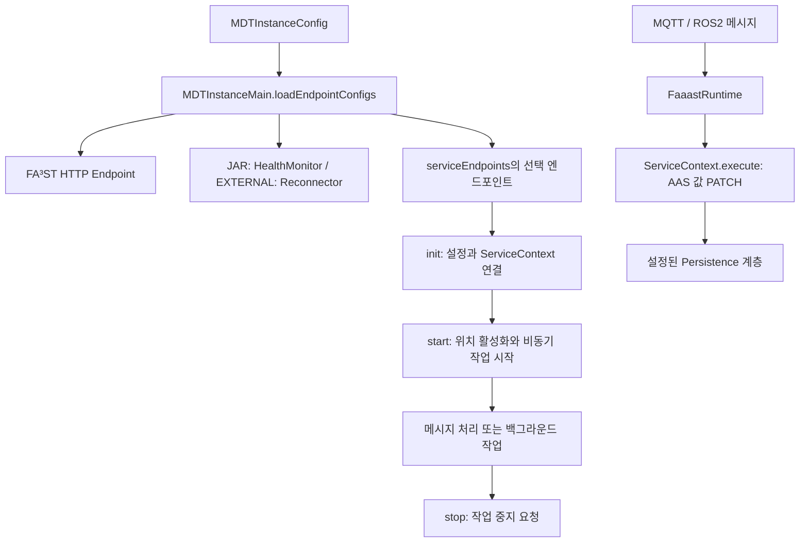
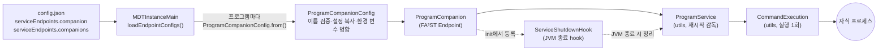
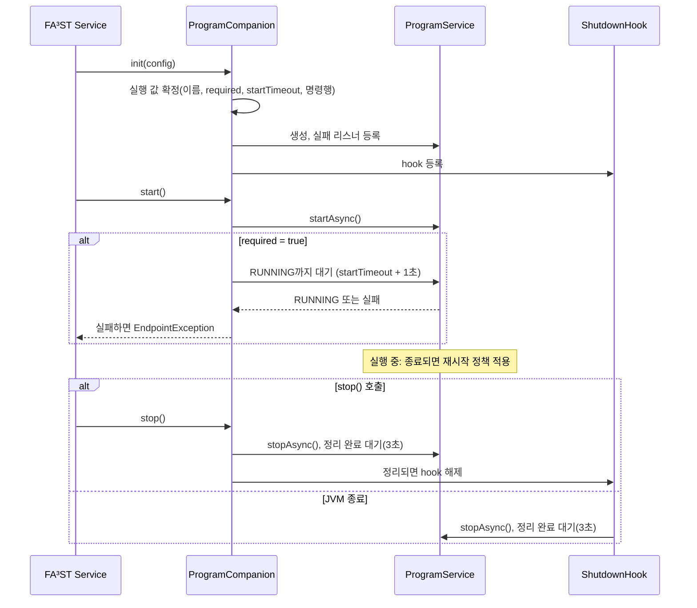
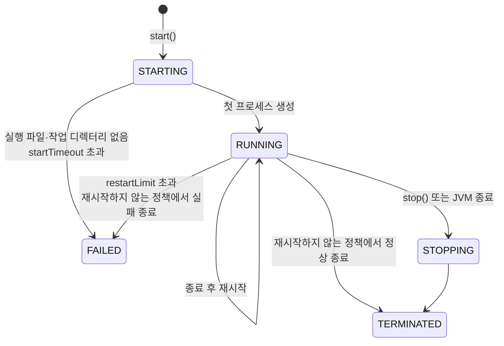

# mdt.endpoint 패키지 기술문서

`mdt.endpoint`는 MDT 인스턴스의 FA³ST 서비스 생명주기에 외부 통신과 백그라운드 작업을 연결한다.
MQTT·ROS2 메시지를 AAS 요소 값에 반영하고, MDT Manager와의 연결을 관리하며,
외부 동반 프로세스 실행과 요소 값의 JDBC 기록 기능을 제공한다.

이 문서는 인스턴스 개발자와 연동 담당자를 대상으로 한다. 2026년 10월 28일의 작업 트리를 기준으로
설정 로더, 엔드포인트 구현, 관련 `mdt-client`·`utils` 코드를 함께 검토했다.
이번 개정에서는 Companion(7절)의 여러 프로그램 등록, 필수 프로그램 지정, 환경 변수 병합, 실패 로그,
종료 시 프로세스 정리 방식을 반영했다.
설정 예제는 기존 인스턴스 설정에 합치는 **부분 설정**이며, 전체 실행 파일을 대체하지 않는다.
RobotTwin 조회와 Audit 등록처럼 구현이 연결되지 않은 부분은 별도로 표시한다.

## 1. 역할과 구현 상태

여기서 Endpoint는 HTTP 요청을 받는 서버만을 뜻하지 않는다. FA³ST의 `Endpoint<C>` 계약으로
시작·중지되는 메시지 소비자, 주기 작업, 프로세스 관리기도 포함한다.
AAS HTTP API는 `MDTInstanceMain`이 별도로 등록하는 FA³ST `HttpEndpointConfig`가 담당한다.

| 위치 / 주요 클래스 | 역할 | 기본 인스턴스 로더에서의 등록 |
| --- | --- | --- |
| 루트 / `MDTManagerHealthMonitor` | Manager 생존 확인, 실패 시 인스턴스 JVM 종료 | `JAR` 유형에 자동 등록 |
| `reconnector` / `MDTManagerReconnector` | 외부 인스턴스의 주기적 등록·연결 유지 | `EXTERNAL` 유형에 자동 등록 |
| `mqtt` / `MqttEndpoint` | MQTT 메시지 → AAS 요소 값 갱신 | `serviceEndpoints.mqtt` |
| `ros2` / `Ros2Endpoint` | rosbridge WebSocket 메시지 → AAS 관절 위치 갱신 | `serviceEndpoints.ros2` |
| `rt` / `RobotTwinEndpoint` | RobotTwin REST 상태 조회용 코드 | `serviceEndpoints.robotTwin`; **조회 루프는 비활성** |
| `companion` / `ProgramCompanion` | 외부 프로그램 시작·재시작·종료, 실패 로그 | `serviceEndpoints.companion`, `serviceEndpoints.companions` |
| `audit` / `PeriodicElementAudit` | 요소 값 변경을 JDBC 테이블에 기록 | **기본 로더에 등록 경로 없음** |

연산 호출은 [mdt.assetconnection](assetconnection-guide.md), 저장 계층의 값 접근은
[mdt.persistence.asset](asset-persistence-guide.md)에서 다룬다.
이 패키지의 MQTT·ROS2는 수신 이벤트에 따라 FA³ST에 값 변경 요청을 전달하는 역할이다.

## 2. 등록과 공통 생명주기



`loadEndpointConfigs()`는 `mdtUrl`과 `instanceEndpoint`를 요구한다.
HTTP 엔드포인트의 포트는 `instanceEndpoint`에서 추출하며, 인증서 설정도 함께 구성한다.
이후 인스턴스 유형에 맞는 Manager 엔드포인트와 선택 엔드포인트를 설정 목록에 추가한다.

| 메서드 | 공통 역할 | 구현별 유의점 |
| --- | --- | --- |
| `init(CoreConfig, C, ServiceContext)` | 설정 보관, 클라이언트·실행 객체 준비 | 모델 위치 해석을 `start()`까지 미루는 구현이 있음 |
| `asConfig()` | 현재 엔드포인트 설정 반환 | FA³ST 설정 래퍼와 인스턴스 JSON DTO를 구분해야 함 |
| `getProfiles()` | 설정의 서비스 프로파일 반환 | 외부 연결 성공 여부를 나타내는 상태 API는 아님 |
| `start()` | 작업 시작 | 대부분 `startAsync()` 또는 비동기 실행을 호출하며 연결 완료를 기다리지 않음. Companion의 `required=true`만 프로세스 시작을 확인함 |
| `stop()` | 중지 요청 | 완료 대기·자원 정리 범위가 구현마다 다름. Companion은 자식 프로세스 정리를 최대 3초 기다림 |

`start()` 반환이나 시작 로그만으로 브로커 연결, WebSocket 구독, 자식 프로그램의 업무 준비가
완료되었다고 판단할 수 없다. 또한 메시지 갱신은 `FaaastRuntime`을 통해 FA³ST 요청으로 실행되므로,
실제 저장·외부 자산 쓰기 동작은 해당 인스턴스의 Persistence 구성에도 영향을 받는다.

근거: [MDTInstanceMain](../src/main/java/mdt/MDTInstanceMain.java),
[ServiceEndpointConfigs](../src/main/java/mdt/config/ServiceEndpointConfigs.java),
[FaaastRuntime](../src/main/java/mdt/FaaastRuntime.java).

### 2.1 전역 연결 설정

MQTT와 ROS2는 인스턴스 설정에서 연결 이름을 지정하고, 전역 설정 파일에서 상세 내용을 읽는다.
다음은 전역 설정 파일의 일부다.

```json
{
  "mqttBrokers": {
    "factory": {
      "brokerUrl": "tcp://localhost:1883",
      "connectionTimeout": "10s",
      "keepAliveInterval": "30s"
    }
  },
  "rosBridges": {
    "robot": {
      "serverUri": "ws://localhost:9090"
    }
  }
}
```

`MDTGlobalConfigurations`가 설정된 전역 파일에서 그룹과 이름을 조회한다.
`default`라는 이름의 항목이 없으면 해당 그룹의 첫 항목으로 대체한다.
그룹 자체가 없거나, `default` 이외의 이름을 찾지 못하면 실패한다.
배포 설정에서는 의도한 연결 이름을 명시하는 편이 명확하다.

`mqttBrokerConfig`와 Audit의 `jdbcConfig`는 Java 타입이 `Object`이지만,
접근자가 지원하는 값은 연결 설정 객체의 실제 인스턴스 또는 전역 설정 이름인 문자열이다.
일반 JSON 객체를 바로 넣으면 Map으로 역직렬화될 수 있고, 이를 해당 설정 타입으로 변환하는
처리는 없다. 아래 JSON 예제는 모두 문자열 참조를 사용한다.

근거: [MDTGlobalConfigurations](../src/main/java/mdt/MDTGlobalConfigurations.java).

### 2.2 AAS 요소 위치

MQTT 구독, ROS2 핸들러, Audit 컬럼은 `ElementLocations.parseStringExpr()`로 대상 요소를 지정한다.

| 표현 | 의미 | 예 |
| --- | --- | --- |
| `<submodelIdShort>:<elementPath>` | Submodel의 idShort와 요소 경로 | `RobotState:Joints` |
| `param:<parameterId>` | MDT 파라미터 위치 | `param:Temperature` |
| `oparg:<submodelIdShort>:<kind>:<argumentName>` | AI·Simulation Submodel의 입출력 값 위치 | `kind`는 `INPUT` 또는 `OUTPUT` |

일반 표현의 앞부분은 Submodel의 전역 ID URI가 아니라 **idShort**다.
예를 들어 `RobotState:Joints.Joint1`은 `RobotState` Submodel의 `Joints.Joint1` 요소를 가리킨다.
시작 시 `activate(MDTModelLookup)`가 이를 실제 Submodel ID와 경로로 해석한다.
대상 모델·요소가 미리 존재해야 하며, 엔드포인트가 모델 구조를 생성하지 않는다.
파서는 콜론으로 분리하므로 콜론을 포함한 임의의 식별자에 대한 이스케이프 문법은 제공하지 않는다.

`oparg`는 일반 AAS Operation의 임의 인자를 탐색하는 기능으로 해석하면 안 된다.
현재 `MDTOperationArgumentLocation`은 AI·Simulation semantic ID를 검사하고 각각
`AIInfo.Inputs.InputValue` 또는 `SimulationInfo.Inputs.InputValue` 같은 경로를 구성한다.
OUTPUT도 같은 방식으로 처리하지만, 입력받은 `argumentName`은 경로 선택에 사용하지 않는다.
개별 인자를 지정할 때는 실제 모델 경로와 이 제한을 확인해야 한다.

근거: [ElementLocations](../src/main/java/mdt/ElementLocations.java),
[DefaultElementLocation](../src/main/java/mdt/DefaultElementLocation.java),
[MDTOperationArgumentLocation](../src/main/java/mdt/MDTOperationArgumentLocation.java).

## 3. Manager 연결 관리

### 3.1 JAR 인스턴스: HealthMonitor

`MDTManagerHealthMonitor`는 Manager가 실행한 JAR 인스턴스가 Manager 종료 후 남아 있는 상황을
방지하기 위한 서비스다. 시작 직후부터 일정 주기로 `GET {mdtUrl}/health`를 호출한다.

```json
{
  "mdtUrl": "http://localhost:12985",
  "managerCheckInterval": "10s"
}
```

- 기본 주기는 `10s`이고, 스케줄은 초기 지연 0의 fixed-rate다.
- HTTP 응답 본문의 업무 상태 필드를 별도로 분석하지 않는다.
- 호출 과정에서 예외가 한 번 발생하면 로그를 남기고 **`System.exit(0)`**을 호출한다.
- 연속 실패 횟수, 유예 시간, 재접속 후 복구 판단은 구현되어 있지 않다.
- `stop()`은 스케줄 중지만 요청하며 종료 완료를 기다리지 않는다.

따라서 Manager의 일시적인 통신 장애도 인스턴스 종료로 이어질 수 있다.
종료 코드가 0이므로 외부 프로세스 관리기의 재시작 정책과 함께 해석해야 한다.
설정 클래스에는 `enabled`가 있지만 기본 로더는 `true`로 생성한다.
`serviceEndpoints`에 HealthMonitor 비활성화 필드는 없다.

근거: [MDTManagerHealthMonitor](../src/main/java/mdt/endpoint/MDTManagerHealthMonitor.java),
[MDTManagerHealthMonitorConfig](../src/main/java/mdt/endpoint/MDTManagerHealthMonitorConfig.java).

### 3.2 EXTERNAL 인스턴스: Reconnector

`MDTManagerReconnector`는 시작 직후와 이후 주기마다 자신의 repository endpoint를 Manager에 전달한다.
기본 `heartbeatInterval`은 `60s`다.

```json
{
  "id": "robot-01",
  "mdtUrl": "http://localhost:12985",
  "instanceEndpoint": "https://localhost:19001",
  "heartbeatInterval": "60s"
}
```

요청 계약은 다음과 같다.

```http
POST /instance-manager/registry/robot-01
Content-Type: text/plain

https://localhost:19001
```

본문은 endpoint 문자열 자체다. 패키지에 `ConnectRequestBody` DTO가 있지만 현재 전송 경로에서는
사용하지 않는다. URL의 instance ID는 문자열로 직접 결합되며 별도 경로 인코딩은 수행하지 않는다.

일반 통신 실패는 다음 주기에 재시도한다. 역직렬화·unwrap된 원인이 `MDTInstanceManagerException`이면
`System.exit(-1)`을 호출하는 분기가 있다. 다만 이 분기는 `isInfoEnabled()` 조건 안에 있으므로
현재는 INFO 로깅 활성 여부에 따라 종료 동작도 달라진다.

`stop()`은 스케줄 중지를 요청한 뒤 같은 registry URL에 DELETE를 보내고 DELETE 실패는 무시한다.
진행 중인 POST 완료를 기다리는 처리가 없어, 종료 중 등록 요청과 해제 요청의 순서가 보장되지는 않는다.
기본 로더는 `enabled=true`로 생성한다. 설정 클래스를 직접 JSON으로 만들 경우에는 생성자의
primitive `boolean enabled`에 의존하므로 활성 여부를 명시해야 한다.

근거: [MDTManagerReconnector](../src/main/java/mdt/endpoint/reconnector/MDTManagerReconnector.java),
[MDTManagerReconnectorConfig](../src/main/java/mdt/endpoint/reconnector/MDTManagerReconnectorConfig.java).

## 4. MQTT 수신 엔드포인트

### 4.1 설정

```json
{
  "serviceEndpoints": {
    "mqtt": {
      "mqttBrokerConfig": "factory",
      "subscribers": [
        {"topic": "factory/robot01/temperature", "element": "RobotState:Temperature"},
        {"topic": "factory/robot01/joints", "element": "RobotState:Joints"}
      ]
    }
  }
}
```

`mqttBrokerConfig` 기본값은 `default`, `subscribers` 기본값은 빈 목록이다.
각 구독은 `topic`과 `element`를 요구한다. 브로커 설정의 URL 기본값은 `tcp://localhost:1883`이며,
timeout과 keep-alive를 생략하면 MQTT 라이브러리 기본값을 사용한다.
`reconnectInterval`(예: `"10s"`)은 연결될 때까지 다시 시도하는 간격이다. 첫 연결 재시도 간격이면서,
연결된 뒤 끊어졌을 때 Paho 자동 재연결 간격의 상한이다(Paho는 1초부터 두 배씩 늘려 이 값까지 기다린다).
생략하면 첫 연결은 5초 간격, 재연결은 최대 128초 간격이다.
현재 `MqttBrokerConfig`에는 사용자명·비밀번호·인증서 필드가 없다.
지원하지 않는 필드(예: 오타인 `connectTimeout`)는 무시되며, 설정을 읽을 때 경고 로그를 남긴다.

### 4.2 수신 값 계약

1. `init()`에서 broker 설정을 해석한다.
2. `start()`에서 요소 위치를 활성화한 뒤 `MqttServicePool`에서 broker 연결을 얻어 구독을 등록한다.
3. 수신 payload를 UTF-8 문자열로 읽는다.
4. 최초 메시지에서 `FaaastRuntime.newValueUpdater()`로 대상 요소의 값 갱신기를 만든다. 이때 요소의 FA³ST `TypeInfo`를 조회해 두고, 이후 메시지에서 재사용한다.
5. 갱신기가 `PatchSubmodelElementValueByPathRequest`를 실행하고 응답 상태를 확인한다.

payload는 대상 모델에 맞는 **AAS value-only JSON**이다.
예를 들어 숫자 Property인 `Temperature`로 보내는 메시지는 다음과 같다.

```json
23.5
```

`Joints`가 숫자 Property `Joint1`, `Joint2`를 포함하는 Collection이라면 메시지는 다음 형태다.

```json
{
  "Joint1": 0.25,
  "Joint2": -0.1
}
```

Property 문자열은 JSON 문자열로 인코딩해야 한다. 완전한 AAS 요소 정의나 MDT의 타입 메타데이터가
붙은 직렬화 형식은 이 입력 계약과 다르다. 값의 해석은 미리 존재하는 AAS 요소 타입에 의존한다.
캐시된 타입 정보는 메시지마다 다시 조회하지 않는다.

### 4.3 연결·오류 처리

broker 연결은 `MqttServicePool`을 통해 같은 broker 설정(URL, 연결 timeout, keep-alive 주기, 재연결 간격)을 쓰는
MQTT 자산 변수(`mdt:asset:mqtt`)와 공유한다. 처음 연결을 얻는 쪽이 `MqttService`를 만들어 시작하고,
마지막 사용자가 반납하면 연결을 끊는다. `stop()`은 이 엔드포인트의 구독을 해제한 뒤 연결을 반납하며,
마지막 사용자인 경우 연결이 종료될 때까지 최대 5초 기다린다.

`MqttService`는 초기 연결을 반복 시도하며 기본 재시도 간격은 5초다.
첫 연결 시도가 실패하면 broker 주소와 원인을 WARN 로그로 한 번 남기고, 이후의 실패는 DEBUG로만 남긴다.
연결에 성공하면 그때까지 실패한 횟수와 함께 INFO 로그를 남긴다. 연결된 뒤 끊어지면 WARN 로그를 남기고
Paho 자동 재연결을 사용한다. 공유 연결의 서비스 자체가 실패하면 `MqttServicePool`이 ERROR 로그를 남긴다.
연결 옵션은 clean session과 Paho 자동 재연결을 사용하고, 연결 완료 callback에서 모든 토픽을 재구독한다.
`MqttService`는 topic별 QoS(같은 topic에 요청된 QoS 중 최댓값)를 보관하여 재구독할 때도 같은 QoS를 사용하며,
일부 topic의 재구독이 실패해도 나머지 topic은 계속 구독한다. 엔드포인트는 QoS 1로 구독한다.
같은 topic을 여러 구독자가 구독하면 broker 구독은 하나만 유지되고, 마지막 구독자가 해제될 때 broker 구독도 해제된다.

`+`, `#` 토픽 패턴을 지원하는 로컬 분배 로직이 있다. 중복·겹치는 구독은 같은 메시지를 여러 대상에
반영할 수 있다. 엔드포인트에는 중복 제거, 수신 시각 비교, 메시지 저장·재처리 큐가 없다.

FA³ST는 요청 처리 중의 실패(값 파싱 실패, 요소 없음, 저장 계층의 쓰기 실패 등)를 예외 대신 오류 상태의 응답으로 돌려준다.
갱신기는 응답 상태를 확인해 실패를 `ElementUpdateException`으로 알리고, 구독자는 이를
`failed to update element from MQTT message: topic=..., element=..., cause=...` ERROR 로그로 남긴 뒤 다음 메시지를 계속 처리한다.
`cause`에는 응답 상태 코드와 FA³ST 메시지가 들어가며, payload 원문은 비밀 값이 있을 수 있어 남기지 않는다.
요소 경로가 잘못되어 갱신기를 만들지 못한 경우도 같은 로그(`element not found: ...`)로 남는다. 다만 지금은 시작 단계에서
요소를 확인하지 않으므로, 이런 오류는 첫 메시지를 받을 때 드러나고 메시지마다 반복된다. 실패 로그에도 아직 빈도 제한이 없다.
구독자 호출은 `MqttService`의 lock 밖에서 수행되므로, 메시지 처리 중에도 다른 구독·발행이 막히지 않는다.
서비스의 RUNNING 상태는 실제 브로커 접속 완료와 동일하지 않다.

근거: [MqttEndpoint](../src/main/java/mdt/endpoint/mqtt/MqttEndpoint.java),
[MqttSubscriber](../src/main/java/mdt/endpoint/mqtt/MqttSubscriber.java),
[FaaastRuntime](../src/main/java/mdt/FaaastRuntime.java),
[MqttEndpointConfig](../src/main/java/mdt/endpoint/mqtt/MqttEndpointConfig.java),
[MqttElementSubscriber](../src/main/java/mdt/endpoint/mqtt/MqttElementSubscriber.java),
[MqttService](../../mdt-client/src/main/java/mdt/client/support/MqttService.java),
[MqttBrokerConfig](../../mdt-client/src/main/java/mdt/client/support/MqttBrokerConfig.java).

## 5. ROS2 / rosbridge 엔드포인트

`Ros2Endpoint`는 rosbridge WebSocket에 접속하여 설정된 토픽을 구독한다.
현재 JSON 다형성 등록에서 지원하는 메시지 핸들러는 `messageType: "joint_states"` 하나다.

### 5.1 설정과 매핑

```json
{
  "serviceEndpoints": {
    "ros2": {
      "connectionConfig": "robot",
      "messages": [
        {
          "messageType": "joint_states",
          "topic": "/joint_states",
          "element": "RobotState:Joints",
          "mappings": [
            {"name": "joint1", "subPath": "Joint1"},
            {"name": "joint2", "subPath": "Joint2"}
          ]
        }
      ]
    }
  }
}
```

`connectionConfig`는 전역 `rosBridges` 그룹의 이름이며 기본값은 `default`다.
`messages`는 기본 목록이 초기화되지 않으므로 명시해야 한다.
`element`는 갱신할 상위 요소, `subPath`는 그 요소 내부의 Property 경로다.
대상 Property는 관절 위치의 double 값 표현을 받을 수 있도록 정의해야 한다.

`Ros2EndpointConfig.MDTConfig`에는 `reconnectInterval`이 있고 기본값은 10초다.
그러나 `MDTInstanceMain`은 ROS2 설정을 새 래퍼에 복사할 때 `connectionConfig`와 `messages`만 전달한다.
따라서 표준 `serviceEndpoints.ros2` 경로에서는 지정한 `reconnectInterval`이 반영되지 않고 10초가 사용된다.
설정을 보존하려면 로더 수정 또는 해당 설정을 직접 전달하는 별도 등록 경로가 필요하다.

### 5.2 메시지 처리

연결될 때마다 토픽별로 다음 구독 메시지를 보낸다.

```json
{"op": "subscribe", "topic": "/joint_states"}
```

수신 프레임 예시는 다음과 같다.

```json
{
  "op": "publish",
  "topic": "/joint_states",
  "msg": {
    "header": {"stamp": {"sec": 1700000000, "nanosec": 0}, "frame_id": "base"},
    "name": ["joint1", "joint2"],
    "position": [0.25, -0.1],
    "velocity": [],
    "effort": []
  }
}
```

핸들러는 초기화 때 대상 요소를 읽어 `m_buffer`에 보관한다.
수신 시 `name`과 `position`을 zip하고, `mappings`에 등록된 이름의 Property를 찾아 값을 변경한 뒤
**버퍼 전체의 value-only 값**을 FA³ST에 반영한다.
`velocity`, `effort`, `header.stamp`는 이 갱신 경로에서 사용하지 않는다.
`MsgPayload.getTimestamp()`가 있어도 과거 메시지 제거에 쓰이는 것은 아니다.

배열 길이 일치, 단위, 관절 범위, 시간 순서에 대한 검증은 별도로 없다.
핸들러가 보관한 전체 버퍼를 반복 사용하므로, 같은 상위 요소를 다른 생산자가 함께 갱신하면
그 변경을 이전 버퍼 값으로 덮어쓸 수 있다.

토픽을 키로 핸들러를 저장하므로 같은 토픽에 여러 핸들러를 지정하면 뒤의 항목으로 대체된다.
수신부는 `topic`으로 바로 핸들러를 조회하며 `op` 필터링과 미등록 토픽 검증은 수행하지 않는다.
JSON 읽기 `IOException`은 로그에 남지만, 누락된 topic이나 null 핸들러 등에서 발생하는 다른 예외는
상위 WebSocket listener 실행부에서 무시될 수 있다.

### 5.3 재연결과 생명주기 제한

`AutoReconnectingWebSocketClient`는 `WebSocketReconnector`로 접속을 반복 시도한다.
소켓이 열리면 현재 연결을 저장하고 구독 callback을 실행한다.
연결 종료 callback에서는 `remote=true`일 때 재연결을 시작한다.

현재 구현에는 다음 보완점이 있다.

- Guava `AbstractService`의 `notifyStarted()`와 `notifyStopped()` 호출이 없어 서비스 상태 전이가 완결되지 않는다.
- `doStop()`은 재접속 작업 취소만 구현하며, 활성 WebSocket을 닫는 처리가 없다.
  위 상태 전이 누락 때문에 `stopAsync()`가 정상적인 종료 경로에 도달하는 것도 기대할 수 없다.
- 연결 성공 때 `awaitConnected()` 대기자를 깨우는 명시적 signal 호출이 없어 대기 API도 검증이 필요하다.
- 원격 종료 후 재연결 분기에는 서비스 종료 요청 여부를 검사하는 조건이 없다.
- listener는 공통 lock 안에서 호출된다. 느린 값 갱신이 다른 callback 처리를 지연시킬 수 있다.
- 인자 없는 `send()`는 빈 구현이다. 구독 전송은 callback에 전달된 실제 WebSocket의 `send()`를 사용한다.

따라서 현재 코드를 사용할 때 연결 여부와 서비스 상태를 구분해야 하며,
정상 종료와 장애 후 재연결까지 검증된 통신 계층으로 가정해서는 안 된다.

근거: [Ros2Endpoint](../src/main/java/mdt/endpoint/ros2/Ros2Endpoint.java),
[Ros2EndpointConfig](../src/main/java/mdt/endpoint/ros2/Ros2EndpointConfig.java),
[Ros2MessageHandler](../src/main/java/mdt/endpoint/ros2/msg/Ros2MessageHandler.java),
[JointStateMessageHandler](../src/main/java/mdt/endpoint/ros2/msg/JointStateMessageHandler.java),
[AutoReconnectingWebSocketClient](../src/main/java/mdt/endpoint/ros2/AutoReconnectingWebSocketClient.java),
[WebSocketReconnector](../src/main/java/mdt/endpoint/ros2/WebSocketReconnector.java).

## 6. RobotTwin 엔드포인트와 상태 DTO

### 6.1 현재 동작 범위

**현재 `RobotTwinEndpoint`의 polling 시작·종료 코드는 주석 처리되어 있다.**
`init()`은 URL과 REST 클라이언트를 준비하지만, `start()`는 핸들러 초기화와 로그 출력만 수행한다.
핸들러를 설정으로 등록하는 경로도 없으므로 기본 핸들러 맵은 비어 있다.
`getLastStateSnapshot()`은 일반 실행 경로에서 계속 null이며, AAS 값으로 상태를 반영하는 코드도 연결되어 있지 않다.

다음 설정은 DTO와 기본 로더가 인식하는 형태를 보여준다. 이 설정만으로 주기 조회가 시작되지는 않는다.

```json
{
  "serviceEndpoints": {
    "robotTwin": {
      "robotTwinBaseUrl": "http://localhost:8000",
      "twinId": "panda01",
      "pollInterval": "PT1S",
      "reconnectInterval": "PT10S"
    }
  }
}
```

`pollInterval` 기본값은 1초, `reconnectInterval` 기본값은 10초다.
현재 polling이 비활성이므로 조회 주기가 적용되지 않으며, `reconnectInterval`은 조회 보조 코드에서도 쓰이지 않는다.
로그용 `toString()`은 `ROS2Endpoint`라는 이름과 미설정 연결 필드를 출력하는 상태다.

### 6.2 구현되어 있으나 호출되지 않는 조회 절차

`pollRobotTwinState()` 등 private 메서드에는 다음 절차가 구현되어 있다.

1. `GET {base}/api/v1/robot_twins/{twinId}/variables`로 카탈로그를 읽는다.
2. 응답 `variables` 배열의 각 객체에서 `name`을 추출하고 목록을 캐시한다.
3. 같은 URL에 `names` query parameter로 쉼표 구분 이름 목록을 보내 최신 값을 일괄 조회한다.
4. 응답의 `values` 객체를 이름 → `RobotTwinVariable` 맵으로 변환한다.
5. `Instant.now()`와 함께 `RobotTwinStateSnapshot`을 만든다.

코드가 기대하는 카탈로그·값 응답의 최소 예시는 각각 다음과 같다.

```json
{"variables": [{"name": "joint_states"}]}
```

```json
{
  "values": {
    "joint_states": {
      "quality": "OK",
      "stamp": {"sec": 1700000000, "nanosec": 0},
      "received_at": "2023-11-14T22:13:20Z",
      "age_ms": 20,
      "schema_version": 1,
      "value": {"name": ["joint1"], "position": [0.25]}
    }
  }
}
```

이 절차에서 오류가 발생하면 변수 목록 캐시를 비우고 이전 스냅샷은 유지한다.
성공 중에는 카탈로그를 다시 읽지 않으며, 빈 목록도 캐시되어 이후 조회를 건너뛴다.
이는 메서드 본문 분석 결과이며, 현재 엔드포인트가 수행하는 주기 작업을 설명하는 것은 아니다.

### 6.3 DTO 계약

| 타입 / 필드 | 의미 |
| --- | --- |
| `RobotTwinVariable.name` | 변수 이름. 응답 내부에 없으면 `values` 객체의 키로 보충 |
| `quality` | `OK`, `STALE`, `NO_DATA`, `SOURCE_UNAVAILABLE`, `ERROR`, `UNKNOWN` |
| `stamp` | 원본 timestamp의 `sec`, `nanosec` |
| `received_at`, `age_ms` | 수신 시각과 값 나이. nullable |
| `schema_version` | 정수 버전, 미지정 시 0 |
| `value` | nullable `JsonNode`; 구체 ROS 메시지 타입으로 강제하지 않음 |
| `reason`, `error` | 소스 부재·변환 실패 등의 추가 정보 |
| `RobotTwinStateSnapshot.polledAt` | 조회 측에서 스냅샷을 생성한 시각 |
| `RobotTwinStateSnapshot.variables` | 이름별 변수 맵 |

알 수 없는 quality 문자열은 `UNKNOWN`으로 처리하며 비교는 대소문자를 무시한다.
`isOk()`는 quality가 `OK`인지 비교할 뿐 age 임계값을 직접 계산하지 않는다.
스냅샷은 수정 불가 Map 뷰를 반환하지만 방어적 복사나 내부 변수 객체의 불변성을 제공하지는 않는다.
`polledAt`도 모든 변수의 원본 생성 시각이 같음을 의미하지 않는다.

설정 타입은 특히 구분해야 한다. `RobotTwinEndpointConfig.RobotTwinConfig`는 위 엔드포인트의 중첩 DTO이고,
별도 클래스 `mdt.endpoint.rt.RobotTwinConfig`는 전역 `robotTwins` 연결·operations 설정이다.
표준 `serviceEndpoints.robotTwin`은 중첩 DTO를 사용하며 전역 연결 이름을 조회하지 않는다.
전역 RobotTwin 설정을 사용하는 연산·Persistence 경로와 이 비활성 엔드포인트를 혼동하지 않아야 한다.

근거: [RobotTwinEndpoint](../src/main/java/mdt/endpoint/rt/RobotTwinEndpoint.java),
[RobotTwinEndpointConfig](../src/main/java/mdt/endpoint/rt/RobotTwinEndpointConfig.java),
[RobotTwinVariable](../src/main/java/mdt/endpoint/rt/RobotTwinVariable.java),
[RobotTwinStateSnapshot](../src/main/java/mdt/endpoint/rt/RobotTwinStateSnapshot.java),
[전역 RobotTwinConfig](../src/main/java/mdt/endpoint/rt/RobotTwinConfig.java).

## 7. Companion 외부 프로그램

Companion은 MDT 인스턴스가 떠 있는 동안 **함께 실행해 두어야 하는 외부 프로그램**을 관리한다.
센서 데이터를 가공해 AAS에 써 넣는 Python 스크립트, 예측 결과를 MQTT로 내보내는 보조 프로세스처럼
인스턴스와 수명을 같이하는 프로그램이 대상이다. 인스턴스가 시작되면 프로그램을 띄우고, 프로그램이 죽으면
정책에 따라 다시 띄우며, 인스턴스가 끝나면 프로그램도 정리한다.

AAS Operation이 호출될 때마다 프로그램을 한 번씩 실행하는 `ProgramOperationProvider`와는 쓰임새가 다르다.

| 구분 | Companion (`ProgramCompanion`) | Operation 프로그램 (`ProgramOperationProvider`) |
| --- | --- | --- |
| 실행 시점 | 인스턴스 시작 시 한 번 시작해 계속 실행 | Operation 호출마다 실행 후 종료 |
| 종료 후 동작 | 재시작 정책에 따라 다시 실행 | 결과를 Operation 출력으로 반환 |
| 입출력 | 없음(프로그램이 직접 MDT·MQTT·DB에 접근) | Operation 입력·출력 인자 |
| 설정 위치 | `serviceEndpoints.companion` / `companions` | `operations.programs` |

### 7.1 구성 요소와 등록 흐름



| 구성 요소 | 위치 | 역할 |
| --- | --- | --- |
| `CompanionConfig` | `mdt.endpoint.companion` | 설정 파일의 항목 하나. utils `ProgramServiceConfig`에 `required`를 더한 형태 |
| `ProgramCompanionConfig` | `mdt.endpoint.companion` | FA³ST endpoint 설정. 이름, 실행 설정, `required`를 담는다. 로더가 `from()`으로 만든다 |
| `ProgramCompanion` | `mdt.endpoint.companion` | FA³ST 생명주기(`init`·`start`·`stop`)와 프로그램 서비스를 연결한다 |
| `ProgramService` | `utils.async.command` | 자식 프로세스 실행, 재시작 정책, 시작 제한 시간, 정리 완료 대기 |
| `CommandExecution` | `utils.async.command` | 프로세스 한 번의 실행. 출력 기록, SIGTERM 후 SIGKILL 종료 |
| `ServiceShutdownHook` | `utils.async.command` | JVM이 종료될 때 서비스를 멈추고 정리를 기다리는 hook |

동반 프로그램 하나에 `ProgramCompanion` 하나가 만들어진다. 따라서 여러 프로그램을 등록하면 각각 따로 시작·재시작·중지되고,
한 프로그램의 실패가 다른 프로그램에 영향을 주지 않는다. 엔드포인트 목록에서 companion은 HTTP·Manager·MQTT·ROS2·RobotTwin
엔드포인트 다음에 놓이며, 단일 `companion`이 먼저, 이어서 `companions`가 설정 파일에 적힌 순서대로 시작된다.

### 7.2 설정 방법

#### 단일 프로그램

프로그램이 하나뿐이면 `serviceEndpoints.companion`에 실행 설정을 바로 적는다.
`programConfig` 같은 감싸는 항목은 넣지 않는다.

```json
{
  "serviceEndpoints": {
    "companion": {
      "commandLine": ["python3", "bridge.py", "--instance", "${MDT_INSTANCE_ID}"],
      "workingDirectory": "/opt/mdt/robot-bridge",
      "environmentFile": "/opt/mdt/robot-bridge/bridge.env",
      "restartDelay": "5s"
    }
  }
}
```

#### 여러 프로그램

프로그램이 여럿이면 `serviceEndpoints.companions`에 이름을 키로 하여 적는다.
단일 `companion`과 함께 써도 된다.

```json
{
  "serviceEndpoints": {
    "companions": {
      "inspect-waveform": {
        "commandLine": ["uv", "run", "python", "inspect_waveform.py", "--instance", "${MDT_INSTANCE_ID}"],
        "workingDirectory": "${env:MDT_INSTANCE_HOME}/welder",
        "restartDelay": "10s"
      },
      "predict-throughput": {
        "commandLine": ["uv", "run", "--directory", "${env:MDT_INSTANCE_HOME}/welder",
                        "python", "predict_throughput.py", "--instance", "${MDT_INSTANCE_ID}"],
        "workingDirectory": "${env:MDT_INSTANCE_HOME}/companion",
        "required": true
      }
    }
  }
}
```

이름은 영문자나 숫자로 시작하고 영문자·숫자·`_`·`-`로만 이루어져야 한다(`.`, 공백, 한글 불가).
규칙에 맞지 않으면 설정을 읽는 단계에서 `IllegalArgumentException`으로 인스턴스 시작이 실패한다.
이름은 hook과 logger 이름, 실패 로그에 들어가므로 프로그램을 알아보기 쉬운 이름을 쓴다.

| 설정 형태 | 이름 | hook 쓰레드 이름 | logger 이름 |
| --- | --- | --- | --- |
| `companion` | 없음 | `<id>-companion-ShutdownHook` | `mdt.endpoint.companion.ProgramCompanion.<id>-companion` |
| `companions.<name>` | `<name>` | `<id>-companion-<name>-ShutdownHook` | `mdt.endpoint.companion.ProgramCompanion.<id>-companion-<name>` |

`<id>`는 인스턴스 ID다. 인스턴스 ID를 알 수 없으면 `<id>-` 부분이 빠진다(예: `companion-ShutdownHook`).

모든 프로그램은 표준 출력과 표준 오류를 작업 디렉터리의 `application.log`에 이어 쓴다.
두 프로그램이 같은 작업 디렉터리를 쓰면 로그가 한 파일에 섞이므로 작업 디렉터리를 나누는 것이 좋다.
위 예제의 `predict-throughput`처럼 프로그램은 다른 디렉터리에서 실행해야 한다면, 작업 디렉터리는 로그용으로 따로 두고
`uv run --directory`나 `sh -c "cd ...; exec ..."`로 실행 위치를 옮기면 된다.

#### 설정 항목

| 필드 | 기본값 | 설명 |
| --- | --- | --- |
| `commandLine` | (필수) | 실행 파일과 인자 목록. 셸을 거치지 않으므로 파이프나 리다이렉션이 필요하면 `["sh", "-c", "..."]`로 적는다 |
| `workingDirectory` | 인스턴스의 현재 디렉터리 | 프로그램 실행 위치이자 `application.log`가 생기는 위치. 상대 경로는 인스턴스의 현재 디렉터리 기준 |
| `environmentFile` | 없음 | `KEY=VALUE` 형식의 환경 변수 파일. 파일이 없으면 무시한다 |
| `environments` | 빈 맵 | 자식 프로세스에 줄 환경 변수. 로더가 인스턴스 변수와 병합한다(7.3) |
| `restartPolicy` | `ALWAYS` | `ALWAYS`, `ON_COMPLETED`, `ON_FAILED`, `NO`. `on-completed`처럼 소문자·하이픈 표기도 된다(7.5) |
| `restartDelay` | `5s` | 재시작 전에 기다리는 시간 |
| `maxRestartDelay` | `1m` | 짧은 실행이 이어질 때 늘어나는 재시작 지연의 상한. `restartDelay` 이하이면 지연을 늘리지 않는다 |
| `stableRunTime` | `10s` | 이보다 짧게 끝난 실행을 "짧은 실행"으로 본다 |
| `restartLimit` | `0` (제한 없음) | 양수이면 `restartLimitInterval` 안에 이 횟수를 넘겨 재시작하려 할 때 서비스를 FAILED로 만든다 |
| `restartLimitInterval` | `1m` | `restartLimit`을 세는 구간 |
| `startTimeout` | `30s` | 첫 실행이 이 시간 안에 시작되지 못하면 서비스를 FAILED로 만든다. `0s`이면 제한 없음 |
| `required` | `false` | `true`이면 프로그램이 시작되지 못할 때 인스턴스 시작도 실패시킨다(7.4) |

시간 값은 `"5s"`, `"1m"`, `"PT5S"` 형식을 모두 받는다.

### 7.3 변수 치환과 환경 변수

Companion 설정에서 값을 바꿔 넣는 방법은 두 가지이고, 적용 시점이 다르다.

| 방법 | 적용 시점 | 쓰는 곳 | 예 |
| --- | --- | --- | --- |
| 설정 문자열 치환 | 인스턴스가 `config.json`을 읽을 때 | `commandLine`, `workingDirectory` 등 설정 파일의 모든 문자열 | `${MDT_INSTANCE_ID}`, `${env:MDT_HOST}`, `${sys:user.home}` |
| 자식 프로세스 환경 변수 | 프로그램이 실행될 때 | 프로그램 내부에서 `os.environ` 등으로 읽음 | `MDT_INSTANCE_ID`, `environments`의 값 |

**설정 문자열 치환**에서 `${MDT_INSTANCE_ID}`처럼 접두어가 없는 참조는 아래 인스턴스 변수에서 찾고,
`${env:...}`는 인스턴스 JVM의 환경 변수, `${sys:...}`는 Java 시스템 속성에서 찾는다.
찾지 못한 참조는 오류 없이 글자 그대로 남으므로, 치환 결과는 인스턴스 로그의
`Register Companion endpoint` 줄에서 확인한다. 인스턴스 ID는 Manager가 띄우든 직접 띄우든 항상 정해지므로
`${env:MDT_INSTANCE_ID}`보다 `${MDT_INSTANCE_ID}`를 쓰는 편이 안전하다.

**자식 프로세스 환경 변수**로는 로더가 다음 인스턴스 변수를 항상 넣어 준다.

| 변수 | 값 |
| --- | --- |
| `MDT_INSTANCE_ID` | 인스턴스 ID |
| `MDT_INSTANCE_ENDPOINT` | 인스턴스의 AAS API 주소 |
| `MDT_URL` | MDT Manager 주소 |
| `MDT_INSTANCE_PORT` | 인스턴스 포트. 설정에 없으면 `instanceEndpoint`에서 뽑은 값 |
| `MDT_INSTANCE_DIR` | 인스턴스 JVM의 현재 디렉터리 |

자식 프로세스가 받는 환경은 다음 순서로 만들어진다. 아래쪽이 위쪽을 덮어쓴다.

1. 인스턴스 JVM의 환경 변수(부모 프로세스 환경)
2. `environmentFile`의 값 중 3에 없는 이름
3. 인스턴스 변수 위에 사용자의 `environments`를 병합한 값

같은 이름이 인스턴스 변수와 `environments`에 모두 있으면 사용자 값이 이긴다. 이때 인스턴스 변수를 다른 값으로
덮어쓰면 `companion environment 'MDT_URL' overrides the MDT instance variable` 같은 WARN 로그가 남는다.
값에는 비밀 정보가 있을 수 있어 로그에는 변수 이름만 나온다.

병합은 설정의 복사본에서 이루어지므로 원래 설정 객체는 바뀌지 않는다. 같은 설정으로 companion을 여러 번 만들어도
각자의 인스턴스 변수가 들어간다.

> **비밀 값은 `commandLine`에 쓰지 않는다.** 명령행은 `Register Companion endpoint`, JVM 종료 시의
> `Shutting down Service ...`, 실행 취소 시의 `cancelled: ...` 로그에 그대로 찍힌다. DB 비밀번호 같은 값은
> `environments`나 `environmentFile`로 넘기고 프로그램이 환경 변수에서 읽게 한다.

### 7.4 생명주기



| 단계 | 동작 |
| --- | --- |
| `init()` | 설정을 검사한다(`programConfig`가 없으면 `IllegalArgumentException`). 이름, `required`, `startTimeout`, 명령행을 이때 확정하고, `ProgramService`를 만들고, JVM 종료 hook을 등록한다. 이후 설정 객체를 바꿔도 실행·대기·로그에는 반영되지 않는다 |
| `start()` | `ProgramService`를 시작한다. `required=false`면 바로 반환하고, `true`면 7.4.1처럼 시작을 확인한다 |
| 실행 중 | 프로그램이 끝날 때마다 재시작 정책을 적용한다(7.5) |
| `stop()` | 중지를 요청하고 자식 프로세스 정리가 끝날 때까지 최대 3초 기다린다(7.6) |

`ProgramService`의 상태는 다음과 같이 바뀐다. FAILED로 가는 모든 경로에서 companion은 ERROR 로그를 남긴다(7.7).



여기서 **RUNNING은 자식 프로세스가 생성되었다는 뜻일 뿐**, 프로그램이 일할 준비를 마쳤다는 뜻이 아니다.
실행하자마자 스크립트 오류로 죽는 프로그램도 일단 RUNNING이 되고, 그다음부터는 재시작 정책을 따른다.

#### 7.4.1 필수 프로그램(`required`)

프로그램이 없으면 인스턴스가 제 역할을 못 하는 경우 `required`를 `true`로 둔다.

| 상황 | `required = false` (기본) | `required = true` |
| --- | --- | --- |
| `start()` | 시작만 요청하고 바로 반환 | RUNNING이 될 때까지 `startTimeout` + 1초 기다림(`startTimeout`이 0이면 제한 없이) |
| 실행 파일 없음, `startTimeout` 초과 등 시작 실패 | ERROR 로그만 남기고 인스턴스는 계속 실행 | `EndpointException`으로 FA³ST 서비스 시작이 실패하고 인스턴스 프로세스가 종료 코드 255로 끝남 |
| 시작한 뒤의 실패(재시작 한도 초과 등) | ERROR 로그만 남김 | ERROR 로그만 남김(인스턴스를 멈추지 않음) |

`required` 프로그램의 시작이 실패하면 인스턴스는 다음 순서로 끝난다. `runService()`가 ERROR 로그를 남기므로
Manager는 인스턴스 출력에서 `ERROR`를 보고 시작 실패로 판단한다. 이미 시작된 다른 companion은 JVM 종료 hook이 정리한다.


`required`는 프로세스가 생성되는지만 확인한다. 포트가 열렸는지, 모델을 다 읽었는지 같은 업무 준비 상태는 확인하지 않으며,
여러 companion을 적은 순서대로 시작해도 앞 프로그램의 준비가 끝난 뒤 다음 프로그램이 시작된다는 보장은 없다.

### 7.5 재시작 정책

프로그램이 스스로 끝났을 때 서비스가 어떻게 되는지는 `restartPolicy`가 정한다.
`stop()`이나 JVM 종료로 멈춘 경우에는 정책과 관계없이 재시작하지 않는다.

| 정책 | 정상 종료(종료 코드 0) | 실패 종료 |
| --- | --- | --- |
| `ALWAYS` (기본) | 재시작 | 재시작 |
| `ON_COMPLETED` | 재시작 | FAILED |
| `ON_FAILED` | TERMINATED (재시작 안 함) | 재시작 |
| `NO` | TERMINATED | FAILED |

첫 실행이 RUNNING에 이르지 못하고 끝나면 정책과 관계없이 시작 실패로 보고 FAILED가 된다.

**재시작 지연(backoff).** `stableRunTime`(기본 10초)보다 짧게 끝나는 실행이 연달아 일어나면, 두 번째 재시작부터
지연을 두 배씩 늘려 `maxRestartDelay`(기본 1분)까지 키운다. 늘어나는 지연의 시작값은 `restartDelay`와 1초 중 큰 값이다.
한 번이라도 `stableRunTime` 이상 실행되면 원래 지연으로 돌아간다. 시작하자마자 죽는 프로그램이 쉬지 않고 재시작되며
CPU와 `application.log`를 소모하는 것을 막기 위한 장치다.

**재시작 한도.** `restartLimit` 기본값은 0(제한 없음)이다. 이 경우 `ALWAYS` 정책에서 계속 죽는 프로그램은 FAILED가 되지 않고
재시작 간격만 늘어나므로, 실패 로그도 남지 않는다. 계속 죽는 상황을 실패로 드러내려면 예를 들어
`"restartLimit": 5, "restartLimitInterval": "10m"`처럼 한도를 둔다. 한도를 넘으면
`restart limit exceeded: ...` 원인으로 FAILED가 되고 ERROR 로그가 남는다.

### 7.6 종료와 프로세스 정리

자식 프로세스를 정리하는 경로는 두 가지다. 두 경로 모두 같은 기준으로 정리 완료를 판단한다.

| 경로 | 호출되는 때 | 하는 일 | 3초 안에 정리되지 않으면 |
| --- | --- | --- | --- |
| `ProgramCompanion.stop()` | FA³ST 서비스를 `stop()`으로 멈출 때 | 중지 요청 후 정리 완료 대기, 정리되면 hook 해제 | WARN 로그를 남기고 hook을 유지 |
| JVM 종료 hook | 정상 종료, `System.exit`, SIGTERM·SIGINT | 중지 요청 후 정리 완료 대기 | WARN 로그를 남기고 JVM 종료를 계속 진행 |

현재 mdt-instance에는 FA³ST 서비스의 `stop()`을 부르는 종료 경로가 없다. Manager가 인스턴스를 멈추거나
`kill`로 종료하면 **JVM 종료 hook이 정리를 맡는다.**

"정리 완료"는 서비스가 끝난 상태(TERMINATED 또는 FAILED)가 된 것만으로 판단하지 않는다.
시작 제한 시간을 넘긴 경우처럼 서비스가 먼저 FAILED가 되고 실행 취소와 프로세스 종료가 그 뒤에 진행되는 경우가 있기 때문이다.
그래서 utils의 `ProgramService.awaitCleanup()`으로 **마지막 실행의 프로세스 정리까지 끝났는지**를 확인한다.
프로세스 종료는 SIGTERM을 보내고 1초 안에 끝나지 않으면 SIGKILL로 마무리한다.

다음 경우에는 자식 프로세스가 남을 수 있다.

- `kill -9`나 JVM 충돌처럼 JVM이 종료 hook을 실행하지 못한 경우
- 자식 프로세스가 스스로 데몬이 되어 부모와의 관계를 끊은 경우. 하위 프로세스는 부모-자식 관계를 따라가며 찾기 때문에
  그 사이에 떨어져 나간 프로세스는 놓칠 수 있고, 프로세스 그룹 단위로 함께 종료하는 장치는 없다.

### 7.7 로그와 문제 확인

| 위치 | 내용 |
| --- | --- |
| `<workingDirectory>/application.log` | 프로그램의 표준 출력과 표준 오류. 재시작해도 뒤에 이어 쓰며 크기 제한이나 순환은 없다 |
| 인스턴스 로그, logger `mdt.endpoint.companion.ProgramCompanion.<hook 이름>` | `ProgramService`의 시작·재시작·중지 기록 |
| 인스턴스 로그, logger `mdt.endpoint.companion.ProgramCompanion` | 실패 ERROR, 환경 변수 덮어쓰기 WARN, 정리 지연 WARN |

자주 보게 되는 로그는 다음과 같다.

| 로그 | 의미 |
| --- | --- |
| `Register Companion endpoint: <name>: command=[...], workingDirectory=...` | 로더가 companion을 등록함. 변수 치환 결과를 여기서 확인한다 |
| `command output will be redirected to <file>` | 프로그램 출력이 기록될 파일 |
| `the command is started` | 첫 프로세스가 생성되어 서비스가 RUNNING이 됨 |
| `restarting the command after PT10S` | 재시작 지연 후 다시 실행함(시간은 ISO-8601 형식) |
| `the command exited after ... backing off: restart in ...` | 짧은 실행이 이어져 재시작 지연을 늘림 |
| `companion program failed: name=..., state=..., cause=..., program=[...]` | 서비스가 FAILED가 됨. `state`가 `STARTING`이면 시작 실패, `RUNNING`이면 실행 중 실패 |
| `companion environment '<name>' overrides the MDT instance variable` | `environments`가 인스턴스 변수를 덮어씀 |
| `Shutting down Service due to JVM shutdown: ...` | JVM 종료 hook이 정리를 시작함 |
| `Failed to cleanly shutdown ... within PT3S` | JVM 종료 hook이 3초 안에 정리를 확인하지 못함 |
| `companion program was not cleaned up within PT3S, keeping the shutdown hook: name=...` | `stop()`이 3초 안에 정리를 확인하지 못함 |

증상별로는 다음을 먼저 본다.

| 증상 | 확인할 것 |
| --- | --- |
| 프로그램이 아예 뜨지 않음 | `companion program failed ... state=STARTING` 로그, `commandLine`의 실행 파일 경로, `workingDirectory` 존재 여부 |
| 인자에 `${...}`가 그대로 들어감 | `Register Companion endpoint` 줄. 치환하지 못한 참조는 글자 그대로 남는다(7.3) |
| 프로그램이 계속 재시작됨 | `application.log`의 마지막 출력, `backing off` 로그. 실패로 드러내려면 `restartLimit` 설정 |
| 두 프로그램의 출력이 섞임 | 두 companion의 `workingDirectory`가 같은지 |
| 인스턴스 종료 후 프로세스가 남음 | 인스턴스를 `kill -9`로 끝냈는지, 프로그램이 데몬으로 떨어져 나가는지(7.6) |

### 7.8 제약

- 프로그램의 업무 준비 상태를 확인하는 readiness 검사는 없다. `required`도 프로세스 생성까지만 확인한다.
- Companion의 실패는 로그로만 드러난다. Manager에 보이는 인스턴스 상태는 바뀌지 않고, 실행 중 실패로 인스턴스를 멈추지도 않는다.
- 실행 값은 `init()` 시점에 확정된다. `asConfig()`는 설정 객체를 그대로 돌려주므로, 초기화 뒤 설정 객체를 바꾸면
  `asConfig()`로 보이는 값과 실제 실행 값이 달라질 수 있다.
- 실행 시간 전체에 대한 제한은 없다(실행 timeout 없음).
- `application.log`는 크기 제한과 순환이 없으므로 장기 운영 시 외부에서 정리해야 한다.

근거: [ProgramCompanion](../src/main/java/mdt/endpoint/companion/ProgramCompanion.java),
[ProgramCompanionConfig](../src/main/java/mdt/endpoint/companion/ProgramCompanionConfig.java),
[CompanionConfig](../src/main/java/mdt/endpoint/companion/CompanionConfig.java),
[ServiceEndpointConfigs](../src/main/java/mdt/config/ServiceEndpointConfigs.java),
[MDTInstanceMain](../src/main/java/mdt/MDTInstanceMain.java),
[ProgramServiceConfig](../../../common/utils/src/main/java/utils/async/command/ProgramServiceConfig.java),
[ProgramService](../../../common/utils/src/main/java/utils/async/command/ProgramService.java),
[CommandExecution](../../../common/utils/src/main/java/utils/async/command/CommandExecution.java),
[ServiceShutdownHook](../../../common/utils/src/main/java/utils/async/command/ServiceShutdownHook.java),
utils의 [async-command-guide.md](../../../common/utils/docs/async-command-guide.md).

## 8. 주기적 JDBC Audit

`PeriodicElementAudit`는 지정된 요소들을 주기적으로 읽고, 직전 기록 값과 달라졌을 때 한 행을 추가한다.
**현재 `ServiceEndpointConfigs`와 `loadEndpointConfigs()`에는 Audit 등록 항목이 없다.**
따라서 아래 JSON을 `serviceEndpoints.audit`에 추가하는 것만으로 실행할 수 없다.

다음은 `PeriodicElementAuditConfig.MDTConfig`에 해당하는 설정 데이터 예시다.
사용하려면 이 DTO를 읽어 `new PeriodicElementAuditConfig(dto)`로 감싸고 FA³ST endpoint 목록에 추가하는
등록 코드를 구현해야 한다.

```json
{
  "table": "robot_state_audit",
  "jdbcConfig": "auditDb",
  "timestampColumn": "recorded_at",
  "columns": [
    {"name": "temperature", "element": "RobotState:Temperature"},
    {"name": "joints", "element": "RobotState:Joints"}
  ],
  "interval": "1s",
  "enabled": true
}
```

`jdbcConfig`는 전역 `jdbcs`의 이름이며 기본값은 `default`다.
`timestampColumn` 기본값은 `timestamp`, `enabled` 기본값은 true다.
`table`, `columns`, `interval`에는 실행 가능한 기본값이 없으므로 명시해야 한다.
위 예제를 쓰려면 `auditDb` 연결과 타입이 호환되는 DB 테이블을 사전에 준비해야 한다.

처리 순서는 다음과 같다.

1. `init()`에서 INSERT SQL, JDBC 처리기, 직전 값 비교용 목록을 준비한다.
2. `start()`에서 요소 위치를 활성화하고 `PeriodicLoopExecution`을 시작한다.
3. 각 컬럼의 현재 AAS 요소를 읽는다. Property는 AAS 데이터 타입에 맞춰 JDBC 값으로 변환한다.
   다른 요소는 `ElementValues.getValue()` 결과를 MDT JSON 문자열로 직렬화한다.
4. 변환된 값 목록이 직전 목록과 `List.equals()`로 같으면 기록을 생략한다.
5. 달라졌으면 `Instant.now()`의 timestamp와 모든 컬럼 값을 한 행에 넣고 직전 값을 갱신한다.

초기 비교 목록은 sentinel 객체이므로 유효한 비어 있지 않은 컬럼 목록의 첫 수집은 기록 대상이다.
timestamp는 수집·저장 측 시각이며 MQTT·ROS 메시지의 원본 생성 시각이 아니다.
여러 요소를 순차적으로 읽기 때문에 한 행의 모든 값이 원자적으로 같은 시점에 관찰되었다는 보장도 없다.
재시작하면 직전 값 목록이 초기화되므로 DB 마지막 행과 비교하지 않는다.

테이블 생성·스키마 변경·보관 기간 관리 기능은 없다.
값은 PreparedStatement로 바인딩하지만 테이블과 컬럼 이름은 SQL에 직접 결합되므로,
설정에는 DB에서 유효한 식별자를 사용해야 한다.
SQL 오류는 반복 실행 밖으로 전파되며 엔드포인트 자체의 재시도·재시작 처리는 없다.
`stop()`은 반복 작업을 취소한다.

근거: [PeriodicElementAudit](../src/main/java/mdt/endpoint/audit/PeriodicElementAudit.java),
[PeriodicElementAuditConfig](../src/main/java/mdt/endpoint/audit/PeriodicElementAuditConfig.java),
[ElementColumnConfig](../src/main/java/mdt/ElementColumnConfig.java),
[JdbcProcessor](../../../common/utils/src/main/java/utils/jdbc/JdbcProcessor.java).

## 9. 확장과 검증 지점

새 엔드포인트를 추가하려면 FA³ST `Endpoint<C>`와 `EndpointConfig`를 구현하고,
인스턴스 JSON DTO를 `ServiceEndpointConfigs`에 추가한 뒤 `MDTInstanceMain.loadEndpointConfigs()`에서
래퍼 설정을 생성해야 한다. 클래스가 존재하는 것만으로 기본 로더가 자동 등록하지 않는다.
초기화·연결 완료·중지 완료를 분리하고, 비동기 서비스 상태 전이와 자원 해제도 함께 구현해야 한다.

ROS2 메시지 타입 확장은 `Ros2MessageHandler<T>`의 `getTopic`, `initialize`, `readMessage`, `update`를
구현하고 `@JsonSubTypes`에 `messageType` 이름을 등록한다.
한 토픽에서 여러 대상을 갱신해야 한다면 현재 토픽별 단일 핸들러 맵 구조도 함께 검토해야 한다.

운영 전 검증은 다음 동작에 초점을 맞출 수 있다.

| 대상 | 확인할 동작 |
| --- | --- |
| Manager | 첫 호출 시점, 일시 장애 시 JVM 종료, registry 등록·해제 요청, INFO 수준 변경 영향 |
| MQTT | 값 형식·대상 타입 불일치, 첫 타입 조회 실패, 중복 메시지, 브로커 재연결 후 재구독 |
| ROS2 | 매핑·배열 길이, 미등록 topic·상태 프레임, 오래된 메시지, 동시 값 갱신, 연결 종료·재연결 |
| RobotTwin | polling 활성화와 실제 호출 경로를 먼저 구현한 뒤 카탈로그 변경·빈 목록·오류·quality 처리 |
| Companion | 변수 치환 결과(`Register Companion endpoint` 로그), 자식 환경 변수, 정책별 재시작과 `restartLimit`, `required` 시작 실패 시 인스턴스 종료, 실패 ERROR 로그, 프로그램별 `application.log` 분리, 인스턴스 종료 후 자식 PID 소멸 |
| Audit | 등록 코드, JDBC 타입 대응, 첫 기록·변경 없음·변경 있음, DB 오류와 재시작 시 중복 기록 |

이 문서는 소스와 호출 경로의 정적 검토를 바탕으로 작성했다.
실제 Manager·MQTT broker·rosbridge·RobotTwin·DB에 대한 연결 시험 결과를 검증 완료로 제시하는 문서는 아니다.
Companion은 단위 테스트와 함께, 2026년 10월 28일 Welder 모델의 두 프로그램을 `companions`로 등록해 Manager가 띄운 인스턴스에서
시작·로그 분리·종료 후 프로세스 정리를 확인했다.
