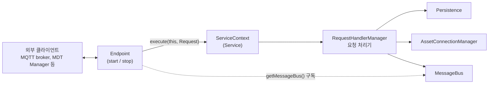
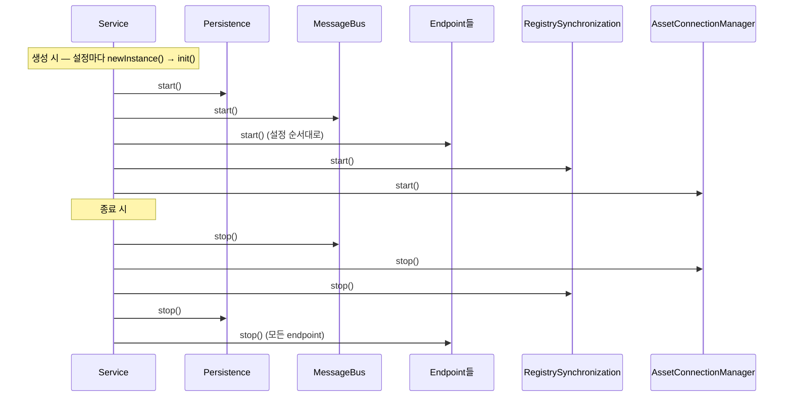
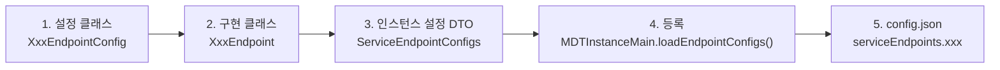

# FA³ST `Endpoint` 사용 가이드

이 문서는 FA³ST 1.3.0의 `de.fraunhofer.iosb.ilt.faaast.service.endpoint.Endpoint`와 관련 클래스의 사용 방법을 설명한다. endpoint의 생성과 생명주기, 서비스 기능을 호출하는 방법, MDT 인스턴스에 새 endpoint를 추가하는 절차를 다룬다. 분석 대상은 FA³ST `core-1.3.0`, `endpoint-http-1.3.0` 소스와 mdt-instance의 `mdt.endpoint` 패키지, `MDTInstanceMain`이다.

| 독자 | 먼저 볼 곳 |
|------|-----------|
| MDT 인스턴스에 새 endpoint를 추가하려는 개발자 | [5장](#5-새-endpoint-추가하기) |
| endpoint를 직접 구현하려는 개발자 | [3장](#3-핵심-인터페이스와-클래스), [4장](#4-구현-계약과-주의-사항) |
| endpoint가 서비스 안에서 어떻게 동작하는지 알고 싶은 개발자 | [2장](#2-생성과-생명주기) |

MDT가 제공하는 개별 endpoint(MQTT, Companion, 연산 취소, Manager 연결)의 설정과 동작은 [mdt.endpoint README](../src/main/java/mdt/endpoint/README.md)에서 자세히 다룬다. 이 문서는 그 바탕이 되는 FA³ST 계약을 중심으로 설명한다.

---

## 목차

1. [개요](#1-개요)
2. [생성과 생명주기](#2-생성과-생명주기)
3. [핵심 인터페이스와 클래스](#3-핵심-인터페이스와-클래스)
4. [구현 계약과 주의 사항](#4-구현-계약과-주의-사항)
5. [새 endpoint 추가하기](#5-새-endpoint-추가하기)
6. [주의 사항 정리](#6-주의-사항-정리)

---

## 1. 개요

### 1.1 역할

FA³ST에서 endpoint는 서비스 기능을 외부에 제공하는 진입점이다. AAS 명세 Part 2가 정의한 인터페이스(HTTP REST API 등)를 구현하는 것이 본래 용도이며, 흔히 "상위 DT 인터페이스(upper DT interface)"라고 부른다.

AAS API를 제공하는 endpoint는 일반적으로 외부 요청을 FA³ST의 `Request` 객체로 변환하고, `ServiceContext.execute()`를 통해 실행한 뒤 응답을 반환한다. 표준 요청 처리기의 검증과 이벤트 처리를 적용하려면 이 경로를 사용한다. 이는 `Endpoint` 인터페이스가 강제하는 규칙은 아니며, MDT의 일부 endpoint는 MDT 전용 기능(예: 연산 실행 목록)을 직접 사용한다.

MDT는 이 구조를 넓게 활용한다. 외부 요청을 받는 서버뿐 아니라, MQTT 메시지를 받아 요소 값을 갱신하는 구독기, MDT Manager와의 연결을 유지하는 백그라운드 작업, 외부 프로세스를 함께 실행하고 감시하는 companion도 모두 endpoint로 구현한다. FA³ST가 서비스 시작과 종료에 맞춰 endpoint를 시작·중지해 주기 때문이다.

### 1.2 구성 요소



| 구성 요소 | 패키지 | 역할 |
|-----------|--------|------|
| `Endpoint<T>` | FA³ST core | endpoint 인터페이스. 시작·중지, 지원 프로파일, registry 등록 정보를 정의한다. |
| `EndpointConfig<T>` | FA³ST core | endpoint 설정의 기반 클래스. 지원할 서비스 프로파일 목록을 담는다. |
| `AbstractEndpoint<T>` | FA³ST core | `init()`, `asConfig()`, `getProfiles()`를 구현한 기반 클래스 |
| `Config<T>`, `Configurable<T>` | FA³ST core | 설정 객체로 구현 객체를 만들고 초기화하는 공통 규약 |
| `ServiceContext` | FA³ST core | endpoint가 서비스 기능을 사용하는 창구. 요청 실행, 메시지 버스, 모델 조회를 제공한다. |
| `ServiceSpecificationProfile` | FA³ST model | AAS 명세의 서비스 프로파일(예: `SUBMODEL_FULL`)과 그 프로파일이 지원하는 요청 목록 |
| `HttpEndpoint` | FA³ST endpoint-http | AAS HTTP REST API 구현. FA³ST가 제공하는 대표 endpoint |

### 1.3 MDT 인스턴스의 endpoint

MDT 인스턴스는 `MDTInstanceMain.loadEndpointConfigs()`에서 다음 endpoint 설정을 조립해 FA³ST 서비스 설정에 넣는다.

| endpoint | 구현 방식 | 등록 조건 | 역할 |
|----------|-----------|-----------|---------|
| `HttpEndpoint` (FA³ST) | — | 항상 | AAS REST API(`instanceEndpoint`의 포트) |
| `OperationControlEndpoint` | `AbstractEndpoint` 상속 | `serviceEndpoints.operationControl` | 비동기 연산 취소 HTTP 서버 |
| `MDTManagerHealthMonitor` | `AbstractEndpoint` 상속 | JAR 인스턴스 | MDT Manager 상태 확인 |
| `MDTManagerReconnector` | `AbstractEndpoint` 상속 | EXTERNAL 인스턴스 | MDT Manager 등록과 하트비트 |
| `MqttEndpoint` | `Endpoint` 직접 구현 | `serviceEndpoints.mqtt` | MQTT 메시지로 요소 값 갱신 |
| `ProgramCompanion` | `Endpoint` 직접 구현 | `serviceEndpoints.companion(s)` | 외부 프로그램 실행과 감시 |

이 중 외부에 AAS API를 제공하는 것은 `HttpEndpoint`뿐이다. 나머지는 FA³ST의 생명주기에 따라 시작·종료되는 MDT 고유 기능이다.

---

## 2. 생성과 생명주기

### 2.1 생성: 설정 객체가 구현 객체를 만든다

FA³ST는 서비스 설정의 `endpoints` 목록에 있는 `EndpointConfig`마다 `config.newInstance(coreConfig, service)`를 호출해 endpoint를 만든다. `Config.newInstance()`는 다음 순서로 동작한다.

1. 설정 클래스의 제네릭 인자(`EndpointConfig<T>`의 `T`)를 리플렉션으로 읽어 구현 클래스를 판별한다.
2. 구현 클래스의 **인자 없는 public 생성자**로 객체를 만든다.
3. `init(coreConfig, config, serviceContext)`를 호출해 설정과 서비스 컨텍스트를 넘긴다.

따라서 설정 클래스는 반드시 구현 타입을 제네릭 인자로 고정해야 한다(예: `class FooEndpointConfig extends EndpointConfig<FooEndpoint>`). 구현 클래스에 인자 없는 public 생성자가 없으면 `ConfigurationInstantiationException`으로 서비스 생성이 실패한다.

### 2.2 시작과 종료 순서



| 시점 | 동작 | endpoint 구현이 알아야 할 점 |
|------|------|------------------------------|
| 서비스 생성 | `newInstance()` → `init()` | 다른 구성 요소는 아직 시작되지 않았다. 설정 보관과 준비만 한다. |
| 서비스 시작 | 저장소, 메시지 버스 다음에 endpoint를 설정 순서대로 `start()` | **자산 연결(`AssetConnectionManager`)은 endpoint보다 나중에 시작된다.** `start()` 안에서 연산을 호출하거나 자산 값을 읽으면 실패할 수 있다. |
| 시작 실패 | 어느 endpoint의 `start()`가 `EndpointException`을 던지면 서비스 시작이 실패한다. | 이미 시작된 앞쪽 endpoint는 자동으로 중지되지 않는다. 실패한 endpoint는 자신이 생성하거나 확보한 자원을 직접 정리한다. |
| 서비스 종료 | 메시지 버스, 자산 연결, 레지스트리 동기화, 저장소를 먼저 멈춘 뒤 **마지막에** 모든 endpoint를 `stop()` | `stop()` 시점에는 저장소와 메시지 버스가 이미 멈춰 있다. 이 안에서 요청을 실행하지 않는다. 또 `stop()`이 호출되기 전까지 endpoint의 백그라운드 작업이 이미 멈춘 구성 요소에 접근할 수 있으므로, 조회나 요청이 실패해도 작업이 비정상 종료되지 않도록 예외를 처리한다. |

MDT 인스턴스에서는 `MDTService.stop()`이 위 FA³ST 종료 절차(`Service.stop()`)보다 먼저 연산 실행 목록(`OperationExecutionRegistry`)을 종료한다. 실행 중인 비동기 연산에 취소를 요청하고 최대 2초 동안 정리를 기다린 뒤 `Service.stop()`을 호출한다.

### 2.3 요청 실행 경로

endpoint는 `ServiceContext.execute(this, request)`로 요청을 실행한다. `Service`는 요청의 클래스에 맞는 처리기를 찾아 실행하고, 다음 규칙으로 응답을 만든다.

| 상황 | 응답 |
|------|------|
| 처리기가 없는 요청 | `SERVER_INTERNAL_ERROR` 응답 |
| 대상이 없음(`ResourceNotFoundException`) | `CLIENT_ERROR_RESOURCE_NOT_FOUND` 응답 |
| 이미 있음(`ResourceAlreadyExistsException`) | `CLIENT_RESOURCE_CONFLICT` 응답 |
| 검증 오류(`ValidationException`) | `CLIENT_ERROR_BAD_REQUEST` 응답 |

이 오류들은 예외로 던져지지 않고 응답 객체의 상태 코드와 메시지로 반환된다. 따라서 endpoint는 **응답의 `getStatusCode().isSuccess()`를 반드시 확인**해야 한다.

요청 처리 중 예상하지 못한 예외가 발생하면 `Service.execute()`가 `InternalErrorResponse`를 반환한다. 이 응답은 요청이 기대하는 응답 타입이 아니므로, 결과를 곧바로 구체적인 응답 타입으로 받으면 상태 코드를 확인하기 전에 `ClassCastException`이 발생할 수 있다. 오류 응답까지 일관되게 처리하려면 먼저 `Response`로 받아 상태 코드를 확인하고, 성공한 경우 구체적인 응답 타입으로 변환한다.

---

## 3. 핵심 인터페이스와 클래스

### 3.1 `Endpoint<T extends EndpointConfig>`

`Configurable<T>`를 상속하는 인터페이스다.

| 메서드 | 시그니처 | 수행 내용 |
|--------|----------|-----------|
| `init` | `void init(CoreConfig coreConfig, T config, ServiceContext serviceContext) throws ConfigurationInitializationException` | (`Configurable`에서 상속) 설정과 서비스 컨텍스트로 endpoint를 초기화한다. |
| `asConfig` | `T asConfig()` | (`Configurable`에서 상속) 현재 상태를 나타내는 설정 객체를 반환한다. |
| `start` | `void start() throws EndpointException` | endpoint를 시작한다. 서버를 열거나 백그라운드 작업을 시작한다. |
| `stop` | `void stop()` | endpoint를 중지하고 자원을 정리한다. 검사 예외를 던지지 않는다. |
| `getProfiles` | `List<ServiceSpecificationProfile> getProfiles()` | 이 endpoint가 지원하는 서비스 프로파일 목록을 반환한다. |
| `getAasEndpointInformation` | `default List<org.eclipse.digitaltwin.aas4j.v3.model.Endpoint> getAasEndpointInformation(String aasId)` | AAS를 registry에 자동 등록할 때 사용할 접근 정보(주소, 인터페이스 종류)를 반환한다. 기본 구현은 빈 목록이다. |
| `getSubmodelEndpointInformation` | `default List<org.eclipse.digitaltwin.aas4j.v3.model.Endpoint> getSubmodelEndpointInformation(String submodelId)` | 서브모델의 registry 등록 정보를 반환한다. 기본 구현은 빈 목록이다. |

`getAasEndpointInformation()`과 `getSubmodelEndpointInformation()`은 FA³ST의 `RegistrySynchronization`이 AAS·서브모델을 registry에 등록할 때 모든 endpoint에서 모아 사용한다. 외부에 AAS API를 제공하지 않는 endpoint는 기본 구현(빈 목록)을 그대로 두면 된다.

### 3.2 `EndpointConfig<T extends Endpoint>`

`Config<T>`를 상속하는 설정 기반 클래스다.

| 메서드 | 시그니처 | 수행 내용 |
|--------|----------|-----------|
| 프로파일 조회 | `List<ServiceSpecificationProfile> getProfiles()` | 지원할 서비스 프로파일 목록을 반환한다. 기본값은 `ServiceSpecificationProfile.ALL`(모든 프로파일)이다. |
| 프로파일 설정 | `void setProfiles(List<ServiceSpecificationProfile> profiles)` | 프로파일 목록을 바꾼다. |
| 구현 객체 생성 | `T newInstance(CoreConfig coreConfig, ServiceContext context) throws ConfigurationException` | (`Config`에서 상속) 구현 객체를 만들고 `init()`을 호출한다([2.1절](#21-생성-설정-객체가-구현-객체를-만든다)). |
| 빌더 | `AbstractBuilder.profiles(List)`, `AbstractBuilder.profile(ServiceSpecificationProfile)` | 빌더로 프로파일을 지정한다. |

프로파일 목록을 실제 요청 제한에 적용할지는 **endpoint 구현이 결정한다.** FA³ST 코어는 프로파일로 요청을 거르지 않는다. 예를 들어 `HttpEndpoint`는 요청마다 설정된 프로파일이 그 요청을 지원하는지 확인하고, 지원하지 않으면 `"'…Request' not supported on this server"`로 거부한다.

### 3.3 `AbstractEndpoint<T extends EndpointConfig>`

`Endpoint<T>`의 공통 부분을 구현한 추상 클래스다. 하위 클래스는 `start()`와 `stop()`만 구현하면 된다.

| 멤버 | 시그니처 | 수행 내용 |
|------|----------|-----------|
| 설정 필드 | `protected T config` | `init()`에서 받은 설정 |
| 컨텍스트 필드 | `protected ServiceContext serviceContext` | `init()`에서 받은 서비스 컨텍스트 |
| `init` | `void init(CoreConfig coreConfig, T config, ServiceContext serviceContext)` | 설정과 컨텍스트가 `null`인지 확인하고 필드에 보관한다. |
| `asConfig` | `T asConfig()` | 보관한 설정을 반환한다. |
| `getProfiles` | `List<ServiceSpecificationProfile> getProfiles()` | 설정의 프로파일 목록을 반환한다. |

`init()`을 재정의할 때는 먼저 `super.init()`을 호출한다. MDT의 `OperationControlEndpoint`가 이렇게 한 뒤 `MDTService`에서 연산 실행 목록을 얻는다.

### 3.4 `ServiceContext`

endpoint가 서비스 기능을 사용하는 기본 진입점이다. MDT 인스턴스에서는 `MDTService`가 이 인터페이스를 구현하며, `getPersistence()`, `getOperationExecutionRegistry()` 같은 MDT 전용 기능을 더 제공한다.

| 메서드 | 시그니처 | 수행 내용 |
|--------|----------|-----------|
| 요청 실행 | `<T extends Response> T execute(Endpoint source, Request<T> request)` | 요청을 실행하고 응답을 반환한다. `source`는 요청을 보낸 endpoint다. |
| 요청 실행(출처 없음) | `default <T extends Response> T execute(Request<T> request)` | `execute(null, request)`와 동일하다. endpoint 외부 코드에서 호출할 때 사용한다. |
| 모델 사본 | `Environment getAASEnvironment() throws PersistenceException` | 저장소에서 AAS·서브모델·개념 기술을 `QueryModifier.DEFAULT`로 조회해 새 `Environment`를 구성한다. MDT의 기본 메모리 저장소에서는 복사본을 반환하며, Blob 값은 포함하지 않는다([persistence 가이드 2.3절](faaast-persistence-guide.md#23-조회-수준-querymodifier)). |
| 메시지 버스 | `MessageBus getMessageBus()` | 요소 변경, 연산 호출 같은 이벤트를 구독·발행하는 메시지 버스를 반환한다. |
| 타입 정보 | `TypeInfo getTypeInfo(Reference reference) throws ResourceNotFoundException, PersistenceException` | 요소의 타입 정보를 반환한다. 값 문자열을 해석할 때 쓴다. |
| 연산 출력 정의 | `OperationVariable[] getOperationOutputVariables(Reference reference) throws ResourceNotFoundException, PersistenceException` | `Operation`의 출력 변수 정의를 반환한다. |
| value provider 여부 | `boolean hasValueProvider(Reference reference)` | 요소가 자산 value provider와 연결되어 있는지 확인한다. |

endpoint 안에서는 `execute(this, request)`처럼 **자기 자신을 출처로 넘기는 것이 좋다.** 요청 처리기는 출처 endpoint를 실행 컨텍스트로 받는데, 예를 들어 자기 기술(self-description) 요청 처리기는 `context.getEndpoint().getProfiles()`로 응답을 만든다. 출처가 `null`이면 이런 처리기는 `NullPointerException`으로 실패한다.

### 3.5 `ServiceSpecificationProfile`

> 이 절은 AAS API를 외부에 제공하는 endpoint를 구현할 때만 해당한다. 백그라운드 작업이나 연동용 endpoint는 건너뛰어도 된다.

AAS 명세가 정의한 서비스 프로파일이다. 각 값은 그 프로파일이 지원하는 요청 클래스 목록을 갖는다.

| 분류 | 값 |
|------|----|
| AAS | `AAS_FULL`, `AAS_READ` |
| 서브모델 | `SUBMODEL_FULL`, `SUBMODEL_READ`, `SUBMODEL_VALUE` |
| 저장소(repository) | `AAS_REPOSITORY_FULL`, `AAS_REPOSITORY_READ`, `SUBMODEL_REPOSITORY_FULL`, `SUBMODEL_REPOSITORY_READ`, `CONCEPT_DESCRIPTION_FULL` |
| registry·검색 | `AAS_REGISTRY_FULL`, `AAS_REGISTRY_READ`, `SUBMODEL_REGISTRY_FULL`, `SUBMODEL_REGISTRY_READ`, `DISCOVERY_FULL` |
| 기타 | `AASX_FILE_SERVER_FULL`, `FAAAST_IMPORT`, `FAAAST_RESET` |

`ServiceSpecificationProfile.ALL`은 모든 값을 담은 **고정 크기 목록**(`Arrays.asList`)이며, 모든 `EndpointConfig`가 기본값으로 이 목록 객체를 공유한다([4.2절](#42-프로파일-목록-변경-시-주의-사항)).

---

## 4. 구현 계약과 주의 사항

### 4.1 반드시 지켜야 할 계약

| 계약 | 지키지 않았을 때 |
|------|------------------|
| 설정 클래스는 `EndpointConfig<구현 클래스>`처럼 구현 타입을 제네릭 인자로 고정한다. | `newInstance()`가 구현 클래스를 판별하지 못해 서비스 생성이 실패한다. |
| 구현 클래스는 인자 없는 public 생성자를 둔다. | `ConfigurationInstantiationException`으로 서비스 생성이 실패한다. |
| `start()`는 오래 기다리지 않는다. 연결이나 반복 작업은 백그라운드 스레드로 넘긴다. | 서비스 시작 전체가 그만큼 늦어진다. 뒤에 오는 endpoint와 자산 연결도 시작되지 않는다. |
| `start()`가 실패하면 자신이 생성하거나 확보한 자원(포트, 스레드)을 정리하고 `EndpointException`을 던진다. | 서비스 시작은 실패했는데 포트나 스레드가 남는다. |
| `stop()`은 여러 번 호출되거나 `start()` 전에 호출되어도 안전하게 동작한다. | 서비스 종료 중 예외가 발생하거나 종료 절차가 중단된다. |
| `stop()`에서 요청을 실행하지 않는다. | 저장소와 메시지 버스가 이미 중지된 상태이므로 요청의 정상 처리를 보장할 수 없다([2.2절](#22-시작과-종료-순서)). |
| 요청 결과는 응답의 상태 코드로 확인한다. | 실패가 예외로 던져지지 않으므로 오류를 감지하지 못한다([2.3절](#23-요청-실행-경로)). |

### 4.2 프로파일 목록 변경 시 주의 사항

> 이 절은 endpoint 설정에서 프로파일을 지정할 때만 해당한다. 프로파일을 쓰지 않는 백그라운드 작업이나 연동용 endpoint는 기본값을 그대로 두면 된다.

`EndpointConfig`의 프로파일 기본값은 `ServiceSpecificationProfile.ALL`이라는 공유 고정 크기 목록이다. 그래서 다음 코드는 의도대로 동작하지 않는다.

- 빌더의 `profile(value)`는 `getProfiles().add(value)`를 호출한다. 기본값을 교체하지 않은 상태에서 호출하면 고정 크기 목록에 추가하려다 `UnsupportedOperationException`이 발생한다.
- `getProfiles()`가 반환한 목록을 직접 고치면 모든 endpoint 설정이 공유하는 목록인 `ALL`의 내용이 변경될 수 있다.

프로파일을 지정할 때는 `profiles(new ArrayList<>(List.of(…)))`처럼 **새 목록으로 먼저 교체**한다.

### 4.3 `Endpoint` 직접 구현과 `AbstractEndpoint` 상속

| 방식 | 장점 | 직접 처리할 것 | MDT 예 |
|------|------|----------------|--------|
| `AbstractEndpoint` 상속 | `init`·`asConfig`·`getProfiles`를 물려받는다 | `start()`, `stop()` | `OperationControlEndpoint`, `MDTManagerHealthMonitor`, `MDTManagerReconnector` |
| `Endpoint` 직접 구현 | 필드와 초기화 방식을 자유롭게 정한다 | `init()`, `asConfig()`, `getProfiles()`, `start()`, `stop()` | `MqttEndpoint`, `ProgramCompanion` |

특별한 이유가 없으면 `AbstractEndpoint`를 상속한다.

---

## 5. 새 endpoint 추가하기

### 5.1 추가 절차



| 순서 | 위치 | 수행 내용 |
|------|------|-------|
| 1 | `mdt.endpoint.<이름>` | `EndpointConfig<XxxEndpoint>`를 상속한 설정 클래스를 만든다. |
| 2 | 같은 패키지 | `AbstractEndpoint<XxxEndpointConfig>`를 상속하고 `start()`, `stop()`을 구현한다. |
| 3 | `mdt.config.ServiceEndpointConfigs` | `config.json`에서 읽을 항목(DTO) 필드와 getter·setter를 추가한다. |
| 4 | `MDTInstanceMain.loadEndpointConfigs()` | DTO가 있으면 설정 클래스를 만들어 endpoint 설정 목록에 추가한다. |
| 5 | 인스턴스 `config.json` | `serviceEndpoints` 아래에 새 항목을 적는다. |

FA³ST는 클래스가 classpath에 있다고 해서 endpoint를 자동으로 등록하지 않는다. 4단계의 등록 코드가 있어야 서비스에 포함된다.

### 5.2 예제: 요소 값을 주기적으로 기록하는 endpoint

지정한 요소의 값을 일정 주기로 읽어 로그에 남기는 endpoint다. 서비스 요청 실행과 백그라운드 작업, 그리고 시작 실패 시 자원 정리와 제한 시간 내 종료 대기 방법을 보여 준다.

#### 5.2.1 설정 클래스

```java
package mdt.endpoint.logger;

import java.time.Duration;
import de.fraunhofer.iosb.ilt.faaast.service.endpoint.EndpointConfig;

public class ValueLoggerEndpointConfig extends EndpointConfig<ValueLoggerEndpoint> {
    private final String m_submodelId;
    private final String m_path;
    private final Duration m_interval;

    public ValueLoggerEndpointConfig(String submodelId, String path, Duration interval) {
        m_submodelId = submodelId;
        m_path = path;
        m_interval = interval;
    }

    public String getSubmodelId() { return m_submodelId; }
    public String getPath() { return m_path; }
    public Duration getInterval() { return m_interval; }
}
```

제네릭 인자에 구현 클래스(`ValueLoggerEndpoint`)를 고정했으므로 FA³ST가 이 설정으로 구현 객체를 만들 수 있다.

#### 5.2.2 구현 클래스

```java
package mdt.endpoint.logger;

import java.time.Duration;
import java.util.concurrent.Executors;
import java.util.concurrent.ScheduledExecutorService;
import java.util.concurrent.TimeUnit;
import org.slf4j.Logger;
import org.slf4j.LoggerFactory;
import de.fraunhofer.iosb.ilt.faaast.service.endpoint.AbstractEndpoint;
import de.fraunhofer.iosb.ilt.faaast.service.exception.EndpointException;
import de.fraunhofer.iosb.ilt.faaast.service.model.api.Response;
import de.fraunhofer.iosb.ilt.faaast.service.model.api.request.submodel.GetSubmodelElementByPathRequest;
import de.fraunhofer.iosb.ilt.faaast.service.model.api.response.submodel.GetSubmodelElementByPathResponse;

public class ValueLoggerEndpoint extends AbstractEndpoint<ValueLoggerEndpointConfig> {
    private static final Logger s_logger = LoggerFactory.getLogger(ValueLoggerEndpoint.class);
    private static final Duration STOP_WAIT = Duration.ofSeconds(2);
    private ScheduledExecutorService m_scheduler;

    public ValueLoggerEndpoint() { }     // FA³ST가 리플렉션으로 호출한다

    @Override
    public synchronized void start() throws EndpointException {
        if ( m_scheduler != null ) {
            return;
        }
        long periodMs = config.getInterval().toMillis();
        if ( periodMs <= 0 ) {
            throw new EndpointException("interval must be positive: " + config.getInterval());
        }

        ScheduledExecutorService scheduler = Executors.newSingleThreadScheduledExecutor();
        try {
            // 첫 실행을 한 주기 늦춘다. 이 지연이 서비스 준비 완료를 보장하지는 않는다.
            scheduler.scheduleAtFixedRate(this::logOnce, periodMs, periodMs, TimeUnit.MILLISECONDS);
        }
        catch ( RuntimeException e ) {
            scheduler.shutdownNow();                // 시작에 실패하면 만든 실행기를 정리한다
            throw new EndpointException("failed to start ValueLoggerEndpoint", e);
        }
        m_scheduler = scheduler;
        s_logger.info("started: {}:{} every {}", config.getSubmodelId(), config.getPath(), config.getInterval());
    }

    @Override
    public synchronized void stop() {
        ScheduledExecutorService scheduler = m_scheduler;
        if ( scheduler == null ) {
            return;
        }
        m_scheduler = null;
        scheduler.shutdownNow();                    // 반복 실행을 멈추고, 실행 중인 작업에 인터럽트를 보낸다
        try {
            if ( !scheduler.awaitTermination(STOP_WAIT.toMillis(), TimeUnit.MILLISECONDS) ) {
                s_logger.warn("logging task did not finish within {}", STOP_WAIT);
            }
        }
        catch ( InterruptedException e ) {
            Thread.currentThread().interrupt();
        }
    }

    private void logOnce() {
        try {
            GetSubmodelElementByPathRequest req = GetSubmodelElementByPathRequest.builder()
                    .submodelId(config.getSubmodelId())
                    .path(config.getPath())
                    .build();
            // 오류 시 InternalErrorResponse가 올 수 있으므로 먼저 Response로 받는다.
            Response resp = serviceContext.execute(this, req);     // 출처로 자신을 넘긴다
            if ( resp.getStatusCode().isSuccess() && resp instanceof GetSubmodelElementByPathResponse ok ) {
                s_logger.info("{} = {}", config.getPath(), ok.getPayload());
            }
            else {
                s_logger.warn("read failed: path={}, status={}, messages={}",
                              config.getPath(), resp.getStatusCode(), resp.getResult().getMessages());
            }
        }
        catch ( Exception e ) {
            // 주기 작업 밖으로 예외가 전파되면 이후 실행이 모두 취소되므로 여기서 잡는다.
            // 실패하면 기록만 하고 다음 주기에 다시 시도한다.
            s_logger.warn("read failed: path={}", config.getPath(), e);
        }
    }
}
```

다음 표는 이 예제 코드에서 눈여겨볼 부분이다. 인자 없는 public 생성자, `stop()`의 중복 호출 안전성 같은 공통 계약은 [4.1절](#41-반드시-지켜야-할-계약)을 따른다.

| 구현 포인트 | 이유 |
|-------------|------|
| 주기 값 검사 | 밀리초로 변환한 값이 0 이하이면 `scheduleAtFixedRate()`가 실패한다. 실행기를 만들기 전에 검사한다. |
| 시작 실패 시 정리 | 스케줄 등록에 실패하면 만든 실행기를 종료하고 `EndpointException`을 던진다([4.1절](#41-반드시-지켜야-할-계약)). |
| `start()`는 스케줄러만 띄우고 반환 | 서비스 시작을 막지 않는다. 첫 실행을 한 주기 늦추되, 이 지연이 서비스 준비 완료를 보장하지는 않는다. 초기 조회에 실패하면 오류를 기록하고 다음 주기에 다시 시도한다. |
| `stop()`의 종료 대기 | `shutdownNow()`는 인터럽트만 보내고 실행 중인 작업을 기다리지 않는다. 그래서 제한된 시간 동안 종료를 기다린다. 작업은 인터럽트에 반응하도록 작성한다. 종료 대기 시간이 지나도 작업이 끝나지 않으면 경고를 남기고 반환한다. 작업 스레드가 계속 실행될 수 있으므로 외부 I/O에는 별도의 시간 제한을 설정한다. |
| `Response`로 받은 뒤 상태 코드 확인 | 예상하지 못한 오류는 `InternalErrorResponse`로 반환되므로, 상태 코드로 성공을 확인한 뒤에 구체적인 응답 타입으로 캐스팅한다([2.3절](#23-요청-실행-경로)). |
| 주기 작업 안에서 예외 처리 | `ScheduledExecutorService`는 작업이 예외로 끝나면 이후 실행을 멈춘다. |

endpoint는 서비스 종료 과정의 마지막에 중지된다. 그래서 `stop()`이 호출되기 전, 저장소와 메시지 버스가 이미 멈춘 사이에도 백그라운드 작업이 계속 실행될 수 있다. 이때의 조회 실패는 위 예제처럼 기록만 하고 넘어가도록 작성한다.

#### 5.2.3 인스턴스 설정과 등록

설정 클래스는 두 가지다. `ValueLoggerConfig`는 `submodelId`, `path`, `interval` 문자열 필드와 각 필드의 getter·setter를 갖는 인스턴스 설정 DTO로, `config.json`의 내용을 그대로 읽는다. `ValueLoggerEndpointConfig`(5.2.1절)는 이 DTO를 변환해 만드는 FA³ST endpoint 설정이다.

`ServiceEndpointConfigs`에 DTO 필드를 추가한다.

```java
// mdt.config.ServiceEndpointConfigs
private ValueLoggerConfig m_valueLogger;          // { "submodelId": …, "path": …, "interval": "10s" }

public ValueLoggerConfig getValueLogger() { return m_valueLogger; }
public void setValueLogger(ValueLoggerConfig conf) { m_valueLogger = conf; }
```

`MDTInstanceMain.loadEndpointConfigs()`의 선택 endpoint 등록 부분(`serviceEndpoints` 처리)에 분기를 추가한다.

```java
Nullables.accept(instConf.getServiceEndpoints().getValueLogger(), conf -> {
    configs.add(new ValueLoggerEndpointConfig(conf.getSubmodelId(), conf.getPath(),
                                              Durations.parse(conf.getInterval())));
    getLogger().info("Register ValueLogger endpoint: {}", conf);
});
```

인스턴스 `config.json`에 해당 설정을 추가한다.

```json
{
  "serviceEndpoints": {
    "valueLogger": {
      "submodelId": "https://example.com/ids/sm/Data",
      "path": "DataInfo.Equipment.Temperature",
      "interval": "10s"
    }
  }
}
```

### 5.3 HTTP 서버형 endpoint를 만들 때

외부 요청을 받는 서버형 endpoint는 MDT의 `OperationControlEndpoint`를 참고한다.

- `start()`에서 포트를 열고, 실패하면 만든 실행기(executor)를 정리한 뒤 `EndpointException`을 던진다.
- 인스턴스 인증서(`CertificateConfig`)를 설정에 전달해 HTTPS를 연다. FA³ST `HttpEndpoint`와 동일한 인증서를 공유하는 방식이다.
- 외부 요청 처리 스레드는 데몬 스레드로 만들어, 서비스 종료를 막지 않게 한다.
- 이 endpoint가 AAS API를 제공해 registry에 등록되어야 한다면 `getAasEndpointInformation()`과 `getSubmodelEndpointInformation()`을 구현한다. FA³ST `HttpEndpoint`는 설정된 프로파일에 따라 AAS·서브모델 인터페이스 정보를 반환한다.

### 5.4 추가 후 확인 사항

1. 인스턴스 시작 로그에 등록 로그(`Register … endpoint`)와 시작 로그가 남는지 확인한다.
2. 설정이 잘못되었을 때(필수 항목 누락, 사용 중인 포트) 인스턴스가 원인을 남기고 시작에 실패하는지 확인한다.
3. endpoint가 요청을 실행한다면 대상 요소가 없을 때 경고 로그를 남기고 다음 주기나 요청에 영향을 주지 않는지 확인한다.
4. 인스턴스를 종료했을 때 스레드, 포트, 자식 프로세스가 남지 않는지 확인한다.
5. 기존 endpoint 설명과 함께 [mdt.endpoint README](../src/main/java/mdt/endpoint/README.md)와 인스턴스 README의 `serviceEndpoints` 설정 설명에 새 항목을 추가한다.

---

## 6. 주의 사항 정리

| 주의할 점 | 이유 | 대응 |
|-----------|------|------|
| 설정 클래스의 제네릭 인자를 비워 두면 안 된다 | `newInstance()`가 제네릭 인자로 구현 클래스를 찾는다 | `EndpointConfig<구현 클래스>`로 고정한다 |
| 구현 클래스에 인자 없는 public 생성자가 필요하다 | 리플렉션으로 생성한다 | 설정이나 서비스 컨텍스트가 필요한 초기화는 `init()`에서 수행한다 |
| `start()`에서 자산 연결을 쓰면 실패할 수 있다 | 자산 연결은 endpoint보다 나중에 시작된다 | 첫 작업을 늦추되 준비 완료가 보장되지 않으므로, 실패를 기록하고 다음 주기나 백그라운드에서 재시도한다 |
| `start()`가 오래 걸리면 서비스 시작 전체가 늦어진다 | endpoint를 차례로 시작한다 | 연결·반복 작업은 백그라운드로 넘긴다 |
| 한 endpoint의 시작 실패가 앞서 시작된 endpoint를 정리하지 않는다 | FA³ST가 실패 시 되돌리지 않는다 | 실패한 endpoint는 자기 자원을 직접 정리한다 |
| `stop()`에서는 요청의 정상 처리를 보장할 수 없다 | endpoint는 저장소·메시지 버스보다 나중에 중지된다 | `stop()`에서는 자원 정리만 한다 |
| 요청 실패가 예외로 오지 않는다 | 처리기 오류가 응답 상태 코드로 변환된다 | `getStatusCode().isSuccess()`를 확인한다 |
| 출처 없이 요청하면 일부 처리기가 실패한다 | 자기 기술 처리기가 출처 endpoint의 프로파일을 읽는다 | endpoint 안에서는 `execute(this, request)`를 쓴다 |
| 프로파일 빌더의 `profile()`이 예외를 던질 수 있다 | 기본값이 공유 고정 크기 목록(`ALL`)이다 | `profiles(new ArrayList<>(…))`로 먼저 교체한다 |
| 프로파일은 endpoint가 직접 적용해야 한다 | FA³ST 코어는 프로파일로 요청을 거르지 않는다 | 요청을 제한하려면 구현에서 확인한다(`HttpEndpoint` 참고) |
| 클래스만 만들어서는 등록되지 않는다 | MDT는 `loadEndpointConfigs()`에서 설정을 조립한다 | DTO와 등록 분기를 함께 추가한다 |
