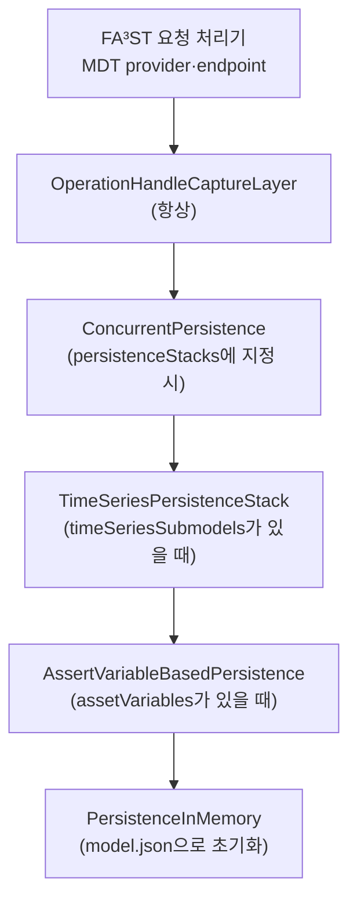
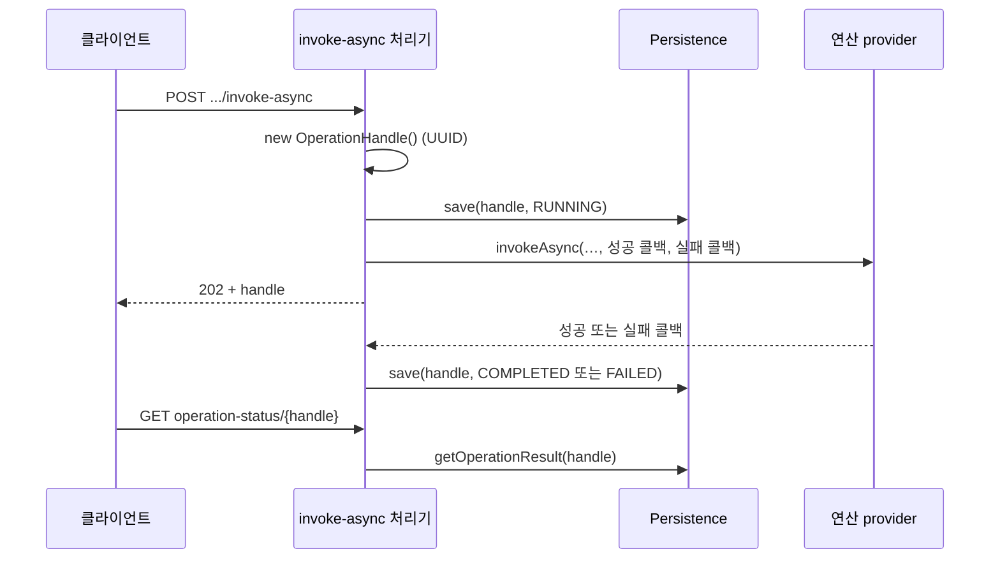

# FA³ST `Persistence` 사용 가이드

이 문서는 FA³ST 1.3.0의 `de.fraunhofer.iosb.ilt.faaast.service.persistence.Persistence` 인터페이스를 MDT 인스턴스 코드에서 사용하는 방법을 설명한다. 인터페이스 계약과 함께, MDT가 실제로 쓰는 구현체 `PersistenceInMemory`의 동작과 주의 사항도 정리한다. 분석 대상은 `core-1.3.0`, `persistence-memory-1.3.0`, `persistence-file-1.3.0`의 소스다.

| 독자 | 먼저 볼 곳 |
|------|-----------|
| provider나 endpoint에서 AAS 모델을 읽고 쓰려는 개발자 | [2장](#2-핵심-타입), [3장](#3-사용-예제) |
| 비동기 연산 결과를 다루는 개발자 | [3.6절](#36-비동기-연산-결과-읽기와-저장) |
| persistence 계층을 새로 만들려는 개발자 | [4장](#4-persistenceinmemory의-동작), [5장](#5-새-persistence-계층-만들기) |

---

## 목차

- [1. 개요](#1-개요)
- [2. 핵심 타입](#2-핵심-타입)
- [3. 사용 예제](#3-사용-예제)
- [4. `PersistenceInMemory`의 동작](#4-persistenceinmemory의-동작)
- [5. 새 persistence 계층 만들기](#5-새-persistence-계층-만들기)
- [6. 메서드 한눈에 보기](#6-메서드-한눈에-보기)
- [7. 파일 저장이 필요한 경우: `PersistenceFile`](#7-파일-저장이-필요한-경우-persistencefile)
- [8. 주의 사항 정리](#8-주의-사항-정리)

---

## 1. 개요

### 1.1 역할

`Persistence`는 FA³ST 서비스의 AAS 모델과 비동기 연산의 상태·결과를 저장하고 조회하는 인터페이스다. 저장·조회하는 대상은 크게 두 가지다.

1. **AAS 모델(`Environment`)**: AAS(`AssetAdministrationShell`), 서브모델(`Submodel`), 서브모델 요소(`SubmodelElement`), 개념 기술(`ConceptDescription`)
2. **비동기 연산의 상태와 결과**: `OperationHandle`을 키로 하는 `OperationResult`

FA³ST의 HTTP 요청 처리기는 모두 이 인터페이스를 통해 모델을 읽고 쓴다. 예를 들어 `PUT .../submodel-elements/{path}`는 `getSubmodelElement()`로 기존 요소를 읽은 뒤 `update()`로 바꾸고, `invoke-async`는 `save(handle, RUNNING)`으로 실행 시작을 기록한다.

### 1.2 구현체

| 구현체 | 모듈 | 저장 위치 | MDT에서의 쓰임 |
|--------|------|-----------|----------------|
| `PersistenceInMemory` | `persistence-memory` | JVM 메모리 | **MDT 인스턴스의 기본 저장소.** persistence 스택의 맨 아래에 놓인다. |
| `PersistenceFile` | `persistence-file` | 파일(JSON 등) | MDT에서는 사용하지 않는다. 내부적으로 `PersistenceInMemory`를 감싸고 변경할 때마다 파일에 쓴다([7장](#7-파일-저장이-필요한-경우-persistencefile)). |
| `PersistenceMongo` | `persistence-mongo` | MongoDB | MDT에서는 사용하지 않는다. |
| MDT 스택 계층(`PersistenceStack` 하위) | mdt-instance | 아래 계층에 위임 | `OperationHandleCaptureLayer`, `ConcurrentPersistence`, `TimeSeriesPersistenceStack`, `AssertVariableBasedPersistence` |

MDT 인스턴스의 실제 구성은 다음과 같다. 바깥 계층부터 안쪽 계층 순서로 쌓이며, `MDTInstanceMain.loadPersistenceConfig()`가 이 스택을 조립한다.



### 1.3 MDT 코드에서 `Persistence` 얻기

서비스의 최상위 persistence는 `MDTService.getPersistence()`로 얻는다. 자산 변수·시계열 등 상위 계층의 조회·갱신 처리를 거치려면 반드시 최상위를 통해 읽고 써야 한다.

```java
Persistence<?> persistence = ((MDTService)serviceContext).getPersistence();
```

특정 계층이 필요하면 최상위 객체를 캐스팅하지 말고 `PersistenceStack.findInStack()`으로 찾는다. 어떤 계층이 몇 번째에 놓이는지는 설정에 따라 달라지기 때문이다.

```java
FOption<TimeSeriesPersistenceStack> ts
        = PersistenceStack.findInStack(persistence, TimeSeriesPersistenceStack.class);
```

---

## 2. 핵심 타입

### 2.1 생명주기: `Configurable`, `start()`, `stop()`

`Persistence<C extends PersistenceConfig>`는 FA³ST의 `Configurable<C>`를 상속한다. 서비스는 다음 순서로 persistence를 다룬다.

1. 설정 객체(`PersistenceConfig`)로 인스턴스를 만들고 `init(coreConfig, config, serviceContext)`를 호출한다.
2. 서비스가 시작될 때 `start()`, 끝날 때 `stop()`을 호출한다.

`PersistenceConfig`는 초기 모델을 정하는 두 속성을 갖는다.

| 속성 | 설명 |
|------|------|
| `initialModel` | 코드에서 직접 전달한 `Environment`. 설정되어 있으면 이 모델을 사용한다. |
| `initialModelFile` | 초기 모델 파일. `initialModel`이 없을 때 읽는다. 파일이 없거나 일반 파일이 아니면 `InvalidConfigurationException`이 발생한다. |

둘 다 없으면 빈 `Environment`로 시작한다(`loadInitialModel()`).

### 2.2 대상 식별

| 대상 | 식별 방법 |
|------|-----------|
| AAS, 서브모델, 개념 기술 | 전역 식별자 `id`(문자열) |
| 서브모델 요소 | `SubmodelElementIdentifier`(서브모델 id + `IdShortPath`) 또는 AAS `Reference` |
| 비동기 연산 결과 | `OperationHandle`(`handleId`, 기본 생성자가 UUID를 만든다) |

`SubmodelElementIdentifier`를 만드는 방법은 두 가지다.

```java
// 1) 서브모델 id와 idShort 경로로 만든다
SubmodelElementIdentifier id = SubmodelElementIdentifier.builder()
        .submodelId("https://example.com/ids/sm/Data")
        .idShortPath(IdShortPath.parse("DataInfo.Equipment.Temperature"))
        .build();

// 2) 모델 참조(ModelReference)에서 만든다. 첫 키가 AAS이면 건너뛴다.
SubmodelElementIdentifier id2 = SubmodelElementIdentifier.fromReference(reference);
```

`fromReference()`는 참조가 `MODEL_REFERENCE`가 아니거나, (AAS 키를 건너뛴 뒤) 첫 키가 서브모델이 아니면 `IllegalArgumentException`을 던진다.

### 2.3 조회 수준: `QueryModifier`

조회 메서드는 대부분 `QueryModifier`를 받아 결과의 깊이와 범위를 정한다.

| 상수 | `Level` | `Extent` | 뜻 |
|------|---------|----------|----|
| `QueryModifier.DEFAULT` | `DEEP` | `WITHOUT_BLOB_VALUE` | 하위 요소를 모두 포함하되 Blob 값은 제외한다. |
| `QueryModifier.MINIMAL` | `CORE` | `WITHOUT_BLOB_VALUE` | 조회 대상이 서브모델 또는 컬렉션이면 직접 포함된 하위 컬렉션의 내용을 비운다. 리스트의 항목은 유지하며, Blob 값은 제외한다. |
| `QueryModifier.MAXIMAL` | `DEEP` | `WITH_BLOB_VALUE` | 하위 요소와 Blob 값을 모두 포함한다. |

Blob 값을 제외하는 옵션으로 조회하면 Blob 요소 자체는 유지한 채 값만 `null`로 비워 반환한다.

일반적인 Property 값 조회에는 `DEFAULT`를 사용할 수 있다. Blob 값까지 읽으려면 `MAXIMAL`을, 하위 컬렉션의 내용이나 Blob 값이 필요하지 않으면 `MINIMAL`을 사용할 수 있다.

**조회한 객체 전체를 수정해 다시 저장하면서 Blob 값을 보존해야 한다면 `MAXIMAL`로 조회한다.** 하위 내용을 생략한 조회 결과를 그대로 저장하지 않도록 주의한다.

다만 `PersistenceInMemory`는 전체 객체를 깊은 복사한 뒤 조회 옵션을 적용하므로, 반환 데이터가 줄어들더라도 복사 비용까지 줄어드는 것은 아니다.

### 2.4 페이지 나누기: `PagingInfo`, `Page<T>`

목록을 돌려주는 메서드(`find*`, `getAll*`, `getSubmodelRefs`, `getSubmodelElements`)는 `PagingInfo`를 받아 `Page<T>`를 돌려준다.

- `PagingInfo.ALL`: 제한 없이 전부 가져온다.
- `PagingInfo.of(cursor, limit)` 또는 `PagingInfo.builder().cursor(…).limit(…).build()`: `limit`개씩 나눠 가져온다.
- 조회 결과 목록은 `page.getContent()`로, 다음 페이지 커서는 `page.getMetadata().getCursor()`로 얻는다. 커서가 `null`이면 마지막 페이지다.

`PersistenceInMemory`의 커서는 조회를 시작하기 전에 건너뛸 항목 수를 문자열로 나타낸다(예: `"20"`). 커서의 형식은 구현체마다 다를 수 있으므로 내용을 해석하지 말고 그대로 다음 요청에 넘긴다.

### 2.5 검색 조건: `*SearchCriteria`

`find*` 메서드는 조건 객체를 받는다. 지정하지 않은 조건은 검색 결과를 제한하지 않는다. 모든 조건 클래스에는 결과를 전혀 제한하지 않는 `NONE` 상수가 있다.

| 조건 클래스 | 조건 항목 | 검색 조건 적용 방식(`PersistenceInMemory` 기준) |
|-------------|-----------|------------------------------------------|
| `AssetAdministrationShellSearchCriteria` | `idShort`, `assetIds` | `idShort` 일치, 전역·특정 자산 ID 포함 |
| `SubmodelSearchCriteria` | `idShort`, `semanticId` | `idShort` 일치, `semanticId` 또는 보조 semanticId 일치 |
| `SubmodelElementSearchCriteria` | `parent`, `semanticId`, `valueOnly` | `parent`가 있으면 그 바로 아래 요소만, 없으면 모델 전체의 모든 요소. `valueOnly`이면 값 전용 직렬화를 지원하는 요소만 |
| `ConceptDescriptionSearchCriteria` | `idShort`, `isCaseOf`, `dataSpecification` | 각 항목 일치 |

### 2.6 예외

| 예외 | 의미 |
|------|------|
| `ResourceNotFoundException` | 대상(또는 부모)이 없다. |
| `ResourceNotAContainerElementException` | 하위 요소를 가질 수 없는 요소를 부모로 지정했다. |
| `ResourceAlreadyExistsException` | 이미 있는 요소를 추가하려 했다(인터페이스가 선언하지만, `PersistenceInMemory`는 실제로 던지지 않는다. [4.3절](#43-insert와-update) 참고). |
| `PersistenceException` | 저장소 자체의 오류. |

---

## 3. 사용 예제

예제를 보기 전에 다음 규칙을 먼저 확인한다. 자세한 근거는 [4.2절](#42-모델-조회-시-복사와-저장-시-객체-참조)과 [4.6절](#46-동시성)에 있다.

| 대상 | 조회 결과 | 수정할 때 주의할 점 |
|------|-----------|---------------------|
| AAS 모델 | 깊은 복사본에 조회 옵션(`QueryModifier`)을 적용한 것 | 조회 옵션 때문에 생략된 값(Blob 값, 하위 컬렉션 내용)이 없는지 확인하고, `update()`/`save()`로 명시적으로 저장한다. |
| 비동기 연산 결과 | 저장된 객체 그 자체 | 조회한 객체를 직접 수정하지 않는다. 바꾸려면 새 `OperationResult`를 만들어 `save()`한다. |
| 여러 메서드 호출로 이루어진 작업 | 호출마다 따로 처리된다 | 개별 메서드의 잠금만으로는 '조회 → 수정 → 저장' 전체의 원자성이 보장되지 않는다. |

예제는 모두 MDT 인스턴스 안(provider, endpoint 등)에서 `ServiceContext`를 가진 코드를 가정한다. 다음 import를 공통으로 쓴다.

```java
import de.fraunhofer.iosb.ilt.faaast.service.model.IdShortPath;
import de.fraunhofer.iosb.ilt.faaast.service.model.SubmodelElementIdentifier;
import de.fraunhofer.iosb.ilt.faaast.service.model.api.modifier.QueryModifier;
import de.fraunhofer.iosb.ilt.faaast.service.model.api.paging.Page;
import de.fraunhofer.iosb.ilt.faaast.service.model.api.paging.PagingInfo;
import de.fraunhofer.iosb.ilt.faaast.service.persistence.Persistence;
import de.fraunhofer.iosb.ilt.faaast.service.persistence.SubmodelElementSearchCriteria;
import de.fraunhofer.iosb.ilt.faaast.service.persistence.SubmodelSearchCriteria;

Persistence<?> persistence = ((MDTService)serviceContext).getPersistence();
```

### 3.1 서브모델 요소 하나 읽기

```java
SubmodelElementIdentifier id = SubmodelElementIdentifier.builder()
        .submodelId(dataSubmodelId)
        .idShortPath(IdShortPath.parse("DataInfo.Equipment.Temperature"))
        .build();

// 타입을 지정하면 캐스팅까지 한다. 타입이 다르면 ClassCastException.
Property temp = persistence.getSubmodelElement(id, QueryModifier.DEFAULT, Property.class);
String value = temp.getValue();
```

### 3.2 요소 값 바꾸기

모델 조회 결과는 **저장소에 있는 객체의 복사본**이다([4.2절](#42-모델-조회-시-복사와-저장-시-객체-참조)). 값을 바꾼 뒤에는 반드시 `update()`로 다시 써야 반영된다.

```java
Property temp = persistence.getSubmodelElement(id, QueryModifier.DEFAULT, Property.class);
temp.setValue("23.5");             // 여기까지는 복사본만 바뀐다
persistence.update(id, temp);      // 저장소에 반영된다
```

**`update()`에 넘긴 객체는 저장소가 그대로 보관한다. 넘긴 뒤에는 그 객체를 다시 고치지 않는다**.

### 3.3 컨테이너의 하위 요소 나열하기

```java
SubmodelElementIdentifier parent = SubmodelElementIdentifier.builder()
        .submodelId(dataSubmodelId)
        .idShortPath(IdShortPath.parse("DataInfo.Equipment"))
        .build();

Page<SubmodelElement> page = persistence.getSubmodelElements(parent, QueryModifier.MINIMAL, PagingInfo.ALL);
for ( SubmodelElement child : page.getContent() ) {
    System.out.println(child.getIdShort());
}
```

부모가 서브모델, `SubmodelElementCollection`, `SubmodelElementList`가 아니면 바로 아래 요소가 없는 것으로 처리된다(`PersistenceInMemory`는 빈 결과를 돌려준다).

### 3.4 조건으로 검색하고 페이지 단위로 읽기

```java
SubmodelSearchCriteria criteria = SubmodelSearchCriteria.builder()
        .semanticId(simulationSemanticId)
        .build();

PagingInfo paging = PagingInfo.builder().limit(50).build();
while ( true ) {
    Page<Submodel> page = persistence.findSubmodels(criteria, QueryModifier.MINIMAL, paging);
    page.getContent().forEach(sm -> System.out.println(sm.getId()));

    String next = page.getMetadata().getCursor();
    if ( next == null ) {
        break;                                  // 마지막 페이지
    }
    paging = PagingInfo.builder().cursor(next).limit(50).build();
}
```

모델 전체에서 특정 semanticId를 가진 요소를 찾으려면 `parent` 없이 `SubmodelElementSearchCriteria`를 쓴다.

```java
Page<SubmodelElement> found = persistence.findSubmodelElements(
        SubmodelElementSearchCriteria.builder().semanticId(semanticId).build(),
        QueryModifier.DEFAULT,
        PagingInfo.ALL);
```

### 3.5 요소 추가와 삭제

```java
Property newProp = new DefaultProperty.Builder()
        .idShort("Humidity")
        .valueType(DataTypeDefXsd.DOUBLE)
        .value("41.0")
        .build();

// 부모(컨테이너) 아래에 추가한다. 같은 idShort가 이미 있으면 교체된다(4.3절).
persistence.insert(parent, newProp);

// 삭제한다. 없으면 ResourceNotFoundException.
SubmodelElementIdentifier humidity = SubmodelElementIdentifier.builder()
        .submodelId(dataSubmodelId)
        .idShortPath(IdShortPath.parse("DataInfo.Equipment.Humidity"))
        .build();
persistence.deleteSubmodelElement(humidity);
```

FA³ST의 `POST .../submodel-elements` 처리기는 `insert()` 전에 `submodelElementExists()`로 중복을 확인하고 `ResourceAlreadyExistsException`을 던진다. 직접 `insert()`를 호출할 때도 중복 여부를 먼저 확인할 수 있다. 다만 확인과 삽입 사이에 다른 요청이 들어올 수 있으므로, 동시 삽입까지 막으려면 두 동작을 함께 보호하는 동기화가 필요하다. 존재 확인 중 발생한 저장소 오류를 구분해야 한다면 `*Exists()` 대신 직접 조회한다.

### 3.6 비동기 연산 결과 읽기와 저장

비동기 연산의 상태와 결과는 `OperationHandle`을 키로 저장된다. 다음은 MDT의 `MDTOperationProvider.saveCancelled()`가 취소된 실행을 `CANCELED`로 기록하는 방식이다.

```java
OperationResult result = new DefaultOperationResult.Builder()
        .executionState(ExecutionState.CANCELED)
        .success(false)
        .inoutputArguments(Arrays.asList(inoutputVars))
        .outputArguments(List.of())
        .build();
persistence.save(handle, result);          // 같은 핸들이면 덮어쓴다

OperationResult current = persistence.getOperationResult(handle);   // 없으면 ResourceNotFoundException
ExecutionState state = current.getExecutionState();
```

**`getOperationResult()`가 돌려주는 객체는 모델 조회와 달리 복사본이 아니라 저장소에 보관된 원본 객체 그 자체다.** 이 객체를 고치면 저장소 내용이 바로 바뀌므로, 상태를 바꿀 때는 위처럼 새 `OperationResult`를 만들어 `save()`한다. **저장된 결과는 개별로 지울 수 없고 자동으로 정리되지도 않는다**([4.5절](#45-종료된-연산-결과는-자동으로-정리되지-않는다)).

다음 그림은 비동기 연산의 일반적인 성공·실패 처리 흐름이다. FA³ST의 `invoke-async` 처리기는 같은 핸들을 키로 사용해 실행 상태와 결과를 저장한다.



### 3.7 존재 확인

```java
if ( !persistence.submodelExists(submodelId) ) {
    // 없음 — 단, 저장소 오류도 여기로 온다(6장)
}
```

---

## 4. `PersistenceInMemory`의 동작

`PersistenceInMemory`는 기본 AAS 모델과 비동기 연산 결과를 메모리에 보관한다. 자산 변수나 시계열 데이터처럼 상위 계층이 외부 저장소와 연결하는 데이터는 해당 계층의 저장 정책을 따른다. 이 장에서는 인터페이스 문서만으로는 알 수 없는 `PersistenceInMemory`의 동작을 정리한다.

### 4.1 저장 구조와 초기화

- AAS 모델은 `Environment` 객체 하나에 담긴다. `init()`에서 `config.loadInitialModel()`로 채운다. MDT는 인스턴스의 `model.json`을 초기 모델 파일로 지정한다.
- 연산 결과는 `ConcurrentHashMap<OperationHandle, OperationResult>`에 담긴다.
- `start()`와 `stop()`은 별도의 처리를 수행하지 않는다.
- 재시작하면 이 메모리 저장소에만 반영된 모델 변경과 연산 결과는 사라진다. 기본 모델은 초기 모델 파일(`model.json`)에서 다시 읽으며, 외부 저장소에 기록된 데이터의 보존 여부는 별도로 판단한다.

### 4.2 모델 조회 시 복사와 저장 시 객체 참조

| 동작 | 처리 |
|------|------|
| 모델 조회(`get*`, `find*`) | AAS 모델 조회 메서드는 저장된 객체를 **깊은 복사**(`DeepCopyHelper.deepCopy`)한 뒤 `QueryModifier`를 적용해 반환한다. 결과를 고쳐도 저장소는 바뀌지 않는다. 다만 `getOperationResult()`는 저장된 `OperationResult` 객체를 그대로 반환하므로, 반환받은 객체를 직접 수정하지 않는다. |
| 저장(`save`, `insert`, `update`) | 전달받은 객체를 **복사하지 않고 그대로** 저장소에 보관한다. 따라서 전달한 뒤 해당 객체를 수정하면 저장소 내용도 함께 변경된다. |

그래서 "읽고 → 고치고 → `update()`" 순서를 지키고, 저장소에 넘긴 객체는 다시 고치지 않는다.

### 4.3 `insert`와 `update`

- **`insert(parent, element)`**
  - 부모가 서브모델, `SubmodelElementCollection`, `SubmodelElementList` 중 하나여야 한다. 그 밖의 타입이면 `IllegalArgumentException`을 던진다(선언된 `ResourceNotAContainerElementException`이 아님).
  - `SubmodelElementList`가 아닌 부모에서는 `idShort`가 비어 있으면 `IllegalArgumentException`을 던진다.
  - 같은 `idShort`(**대소문자 무시**)의 요소가 이미 있으면 예외 없이 **교체**한다. 인터페이스가 선언한 `ResourceAlreadyExistsException`은 던지지 않는다.
- **`update(identifier, element)`**
  - 기존 요소를 찾아 같은 자리에서 새 요소로 바꾼다. 대상이 없으면 `ResourceNotFoundException`.
  - 부모가 `SubmodelElementList`이면 경로 마지막 단계의 인덱스로 자리를 찾는다(아래 구현상 제약 참고).

> **FA³ST 1.3.0 구현상 제약 — 리스트 요소의 `update()`**
>
> `PersistenceInMemory.update()`는 리스트 요소의 인덱스를 **한 자리만** 읽는다(`substring(1, 2)`, `[12]`를 `1`로 읽음). 그래서 인덱스가 10 이상인 리스트 요소를 `update()`하면 지정한 인덱스와 다른 위치의 요소가 변경된다. 이는 인터페이스 규칙이 아니라 이 버전 구현의 결함이다.
>
> 이런 요소를 고칠 때는 리스트 자체를 대상으로 `update()`한다. 리스트를 조회할 때 `MAXIMAL`을 써서 Blob 값과 하위 컬렉션 내용이 생략되지 않은 전체를 받고, 해당 항목을 고친 뒤 리스트 전체를 저장한다. 조회 옵션으로 일부 값이 생략된 객체(`DEFAULT`나 `MINIMAL`로 조회한 리스트 등)를 그대로 저장하면 기존 값이 손실될 수 있다.
>
> 중첩 리스트에서는 교체하려는 리스트 자체가 상위 리스트의 인덱스 10 이상에 있는지도 확인한다. 이 경우에는 문제가 발생하지 않는 상위 요소까지 조회 범위를 넓혀 수정하거나, 서브모델 전체를 조회해 `save()`로 저장한다.

### 4.4 삭제

- `deleteSubmodel(id)`는 서브모델을 지우면서 모든 AAS의 서브모델 참조 목록에서도 그 참조를 지운다.
- `deleteSubmodelElement(identifier)`는 대상 요소를 부모 컨테이너에서 지운다.
- `deleteAll()`은 모델을 빈 `Environment`로 바꾸고 연산 결과도 모두 지운다.

### 4.5 종료된 연산 결과는 자동으로 정리되지 않는다

`save(handle, result)`는 맵에 결과를 추가·갱신하기만 하며, 개별 연산 결과를 삭제하는 메서드는 없고 `deleteAll()`로 전체를 비우는 것만 가능하다. FA³ST 자체에도 오래된 결과를 정리하는 동작이 없다. 따라서 `invoke-async` 호출이 많은 인스턴스는 실행 기간 동안 연산 결과가 계속 쌓인다. MDT의 `OperationExecutionRegistry`가 `retainTimeout` 뒤에 지우는 것은 MDT 쪽 실행 정보이며, 이 저장소의 결과와는 별개다.

- FA³ST에서 `deleteAll()`을 부르는 곳은 FA³ST 고유의 초기화 요청 처리기(`ResetRequestHandler`)뿐이다. 이 요청은 모델까지 함께 지운다.
- MDT 인스턴스는 `PersistenceInMemory`를 쓰므로 연산 결과는 인스턴스가 재시작할 때까지 남고, 재시작하면 모두 사라진다. 그동안은 오래된 핸들로도 결과를 조회할 수 있다.
- 비동기 연산을 자주 호출하는 인스턴스를 오래 실행하면 메모리 사용량이 계속 늘어난다. 결과에 큰 출력 인자가 포함되면 더 빨리 늘어난다.
- 오래된 결과를 정리하려면 MDT 스택 계층에서 하위 `PersistenceInMemory`의 `getOperationStates()` 맵을 직접 다뤄야 한다. 이는 `Persistence` 인터페이스가 아니라 FA³ST 내부 구현에 의존하는 방식이다.

### 4.6 동시성

연산 결과 맵은 `ConcurrentHashMap`이지만, **AAS 모델(`Environment`)에는 잠금이 전혀 없다.** 저장된 컬렉션은 일반 `List`이므로, 여러 HTTP 요청이 같은 서브모델을 동시에 읽고 쓰면 경합이 생길 수 있다. 동시 요청이 많은 인스턴스는 `config.json`의 `persistenceStacks`에 `concurrent`를 지정해 `ConcurrentPersistence`를 쓴다.

**개별 호출의 잠금.** `ConcurrentPersistence`는 주요 조회·변경 메서드에서 공통 잠금을 사용해 하위 계층 호출을 순차 처리한다. `getAssetAdministrationShell()`과 `getSubmodelRefs()`는 잠금 없이 위임한다. 잠금을 사용하는 메서드에서 처리가 지연되면 같은 잠금을 사용하는 다른 호출도 대기한다.

**여러 호출로 이루어진 작업의 원자성.** 잠금 범위는 개별 메서드 호출이다. HTTP 요청 전체나 '조회 → 수정 → 저장', '존재 확인 → 삽입'처럼 여러 호출로 이루어진 작업은 하나의 작업으로 보호되지 않는다. 두 호출 사이에 다른 요청의 변경이 끼어들 수 있다. 작업 전체의 원자성이 필요하면 같은 데이터를 변경하는 모든 접근 경로가 공통 잠금을 사용하도록 설계해야 한다. 특정 호출 경로만 별도로 동기화해도 다른 HTTP 요청의 변경까지 막을 수 있는 것은 아니다.

---

## 5. 새 persistence 계층 만들기

`Persistence`를 처음부터 구현하기보다, MDT의 `mdt.persistence.PersistenceStack<C>`를 상속해 추가 처리가 필요한 메서드만 재정의한다.

- `PersistenceStack`은 주요 조회·변경 메서드와 시작·종료 처리를 하위 계층(`getBasePersistence()`)에 위임한다. 하위 클래스는 `asConfig()`, `deleteAll()`과 추가 동작이 필요한 메서드를 구현한다. 초기화를 재정의할 때는 `super.init()`을 호출해 하위 계층을 초기화한다.
- 각 스택 계층은 설정 클래스 이름에서 마지막 `Config`를 뗀 이름으로 리플렉션을 통해 생성된다(바로 위 계층의 `init()`이 이 규칙으로 하위 계층을 만든다). 따라서 설정 클래스는 `<계층 이름>Config`라는 이름으로 계층 클래스와 같은 패키지에 둔다.
- 스택에 넣으려면 `MDTInstanceMain.loadPersistenceConfig()`에 분기를 추가한다. 설정 파일로 지정하게 하려면 `MDTPersistenceStackConfig`에 하위 타입도 등록한다.
- 재정의한 메서드도 [4.2절](#42-모델-조회-시-복사와-저장-시-객체-참조)의 규칙을 지킨다. 모델 조회 메서드를 재정의할 때는 호출자가 반환 객체를 수정해도 저장된 모델이 바뀌지 않도록 복사본을 반환한다. `getOperationResult()`는 저장된 객체를 그대로 반환하므로 모델 조회와 구분한다. 변경 메서드에 전달된 객체는 추가 계층에서 별도로 보관하거나 수정하지 않고 하위 계층에 전달한다.
- `save(handle, result)`와 `getOperationResult(handle)`는 반드시 아래 계층까지 전달한다. 이 경로가 끊기면 비동기 연산의 상태 조회와 취소 결과 저장이 동작하지 않는다.

### 5.1 요소 변경 로그를 남기는 계층 구현

`update()`를 통한 요소 변경 요청이 정상적으로 처리되면 로그를 남기는 계층이다. 설정 클래스, `asConfig()`, `deleteAll()`, 그리고 추가 동작을 넣은 위임 메서드 하나로 이루어진다. 두 클래스는 같은 패키지에 두며, 설정 클래스 이름은 계층 이름 뒤에 `Config`를 붙인다. 다음 예제에서는 import 문을 생략했다. 두 클래스는 각각 별도의 Java 파일에 작성한다.

```java
package mdt.persistence;

public class UpdateLoggingPersistenceConfig extends PersistenceStackConfig<UpdateLoggingPersistence> {
    public UpdateLoggingPersistenceConfig(PersistenceConfig<?> baseConfig) {
        super(baseConfig);
    }
}
```

```java
package mdt.persistence;

public class UpdateLoggingPersistence extends PersistenceStack<UpdateLoggingPersistenceConfig> {
    private static final Logger s_logger = LoggerFactory.getLogger(UpdateLoggingPersistence.class);
    private UpdateLoggingPersistenceConfig m_config;

    @Override
    public void init(CoreConfig coreConfig, UpdateLoggingPersistenceConfig config, ServiceContext serviceContext)
        throws ConfigurationInitializationException {
        super.init(coreConfig, config, serviceContext);     // 하위 계층을 만들고 초기화한다
        m_config = config;
    }

    @Override
    public UpdateLoggingPersistenceConfig asConfig() {
        return m_config;
    }

    @Override
    public void deleteAll() throws PersistenceException {
        getBasePersistence().deleteAll();
    }

    @Override
    public void update(SubmodelElementIdentifier identifier, SubmodelElement element)
        throws ResourceNotFoundException, PersistenceException {
        getBasePersistence().update(identifier, element);   // 받은 객체를 보관하거나 고치지 않고 그대로 넘긴다
        s_logger.info("element updated: {}", identifier);
    }
}
```

스택에 추가하려면 `MDTInstanceMain.loadPersistenceConfig()`에서 기존 설정을 감싸면 된다. 예를 들어 `OperationHandleCaptureLayerConfig`로 감싸기 직전에 `topConfig = new UpdateLoggingPersistenceConfig(topConfig);`를 추가한다. 그 밖의 메서드(`getOperationResult`, `save(handle, result)` 등)는 `PersistenceStack`이 그대로 위임하므로 따로 구현하지 않는다.

자세한 구성 규칙과 기존 계층의 동작은 `mdt.persistence` 패키지의 [asset/README.md](../src/main/java/mdt/persistence/asset/README.md), [timeseries/README.md](../src/main/java/mdt/persistence/timeseries/README.md)를 참고한다.

---

## 6. 메서드 한눈에 보기

"기본 구현"은 인터페이스의 `default` 메서드로, 다른 추상 메서드를 호출해 동작한다. 새 구현체는 추상 메서드만 구현하면 된다.

| 분류 | 추상 메서드 | 기본 구현 메서드 |
|------|-------------|------------------|
| 생명주기 | `start()`, `stop()`, `init()`·`asConfig()`(`Configurable`) | — |
| 단건 조회 | `getAssetAdministrationShell(id, modifier)`, `getSubmodel(id, modifier)`, `getConceptDescription(id, modifier)`, `getSubmodelElement(identifier, modifier)` | `getSubmodelElement(identifier, modifier, Class<T>)`, `getSubmodelElement(Reference, modifier)`, `getSubmodelElement(Reference, modifier, Class<T>)` |
| 목록 조회 | `getSubmodelRefs(aasId, paging)` | `getSubmodelElements(…)`, `getSubmodelElementsValueOnly(…)`, `getAllAssetAdministrationShells`, `getAllSubmodels`, `getAllConceptDescriptions`, `getAllSubmodelElements` |
| 검색 | `findAssetAdministrationShells`, `findSubmodels`, `findSubmodelElements`, `findConceptDescriptions` | — |
| AAS·서브모델·개념 기술 저장 | `save(AssetAdministrationShell)`, `save(Submodel)`, `save(ConceptDescription)` | — |
| 요소 추가·수정 | `insert(parentIdentifier, element)`, `update(identifier, element)` | `insert(Reference, element)`, `update(Reference, element)` |
| 삭제 | `deleteAssetAdministrationShell(id)`, `deleteSubmodel(id)`, `deleteConceptDescription(id)`, `deleteSubmodelElement(identifier)`, `deleteAll()` | 객체나 `Reference`를 받는 같은 이름의 오버로드 |
| 연산 결과 | `getOperationResult(handle)`, `save(handle, result)` | — |
| 존재 확인 | — | `assetAdministrationShellExists(id)`, `submodelExists(id)`, `conceptDescriptionExists(id)`, `submodelElementExists(Reference)`, `submodelElementExists(identifier)` |

기본 구현 메서드의 동작에서 알아 둘 점은 다음과 같다.

- `getSubmodelElement(Reference, …)`는 참조에 서브모델 키가 없으면 바로 `ResourceNotFoundException`을 던진다.
- `getSubmodelElement(…, Class<T>)`는 결과를 그 타입으로 캐스팅한다. 타입이 다르면 `ClassCastException`이 난다.
- `getAllSubmodelElements()`는 내부에서 발생한 `ResourceNotFoundException`을 `PersistenceException`으로 바꿔 던진다.
- `*Exists()`는 조회 중 발생한 `ResourceNotFoundException`과 `PersistenceException`을 호출자에게 전파하지 않고 `false`를 반환한다. **저장소 오류도 "없음"으로 보이므로**, 오류를 구분해야 하면 직접 조회하고 예외를 처리한다.

---

## 7. 파일 저장이 필요한 경우: `PersistenceFile`

MDT 인스턴스는 `PersistenceFile`을 쓰지 않는다. 이 장에서는 재시작 후에도 모델과 연산 결과를 유지해야 할 때 검토할 수 있는 대안 구현인 `PersistenceFile`의 동작과 제약을 설명한다.

`PersistenceFile`은 내부에 `PersistenceInMemory`를 두고 조회 처리를 위임한다. 변경 메서드(`save`, `insert`, `update`, 삭제)를 실행할 때마다 모델 전체를 모델 파일에 다시 쓰고, `save(handle, result)` 때는 `dataDir`의 `operation-states.json`에 연산 결과 전체를 다시 쓴다.

| 설정 | 기본값 | 설명 |
|------|--------|------|
| `dataDir` | 현재 작업 디렉터리 | 모델 파일과 `operation-states.json`을 둘 디렉터리 |
| `filename` | `model_persistence.<형식>` | 모델을 쓸 파일 이름 |
| `dataformat` | `JSON` (초기 모델 파일이 있으면 그 형식) | 모델 파일 형식 |
| `keepInitial` | `true` | `true`면 초기 모델 파일은 그대로 두고 `model_persistence.<형식>`에 쓴다. `false`면 초기 모델 파일 자체에 덮어쓴다. |

- 시작할 때 모델은 항상 초기 모델(`initialModel` 또는 `initialModelFile`)에서 읽는다. 그래서 `keepInitial`이 `true`이면 다시 시작했을 때 이전에 쓴 `model_persistence.*`가 아니라 초기 모델 상태로 되돌아간다. 변경 내용을 이어 쓰려면 `keepInitial`을 `false`로 두거나, 초기 모델 파일을 이전 결과 파일로 지정한다.
- 연산 결과는 시작할 때 `operation-states.json`이 있으면 읽어 들인다.
- 파일 쓰기에 실패하면 오류 로그만 남고 예외는 던지지 않는다. 메모리 상태는 바뀌었는데 파일에는 반영되지 않을 수 있다.
- 변경할 때마다 모델 전체를 직렬화하므로, 모델이 크거나 값 변경이 잦으면 성능 부담(I/O 부하)이 크다.

---

## 8. 주의 사항 정리

| 주의할 점 | 이유 | 대응 |
|-----------|------|------|
| 모델 조회 결과를 고쳐도 반영되지 않는다 | 모델 조회는 깊은 복사본을 반환한다(`getOperationResult()`는 저장된 객체를 그대로 반환하므로 고치지 않는다) | 고친 뒤 `update()`/`save()`를 호출한다 |
| 저장한 객체를 나중에 고치면 저장소가 바뀐다 | 저장은 넘겨받은 객체를 그대로 보관한다 | 저장한 객체는 다시 고치지 않는다 |
| `insert()`가 중복을 막지 않는다 | `PersistenceInMemory`는 같은 `idShort`(대소문자 무시)를 교체한다 | 필요하면 존재 여부를 먼저 확인한다. 동시 삽입이 가능하면 확인과 삽입을 공통 잠금으로 보호한다 |
| 인덱스 10 이상의 리스트 요소 `update()`가 잘못된다 | 인덱스를 한 자리만 읽는다 | `MAXIMAL`로 조회한 상위 리스트 전체를 수정해 저장한다. 중첩 리스트의 제약은 4.3절을 참고한다 |
| `*Exists()`가 저장소 오류도 `false`를 반환한다 | `ResourceNotFoundException`과 `PersistenceException`을 잡아 `false`를 반환한다 | 오류 구분이 필요하면 직접 조회한다 |
| 모델 동시 접근이 안전하지 않다 | `Environment`에 잠금이 없다 | `ConcurrentPersistence`를 쓴다. 단, '조회 → 수정 → 저장' 과정 전체는 보호하지 않는다 |
| 연산 결과가 계속 쌓인다 | 오래된 연산 결과를 자동으로 정리하는 기능이 없다 | 장기 실행 인스턴스에서는 메모리 사용량을 모니터링한다 |
| 재시작하면 메모리 저장소에만 반영된 변경이 사라진다 | `PersistenceInMemory`는 메모리 저장소다 | 유지가 필요한 값은 자산 변수(외부 DB 등)로 연결한다 |
| 최상위 객체를 특정 계층 타입으로 캐스팅하면 설정에 따라 실패할 수 있다 | 계층 순서가 설정에 따라 달라진다 | `PersistenceStack.findInStack()`을 쓴다 |
