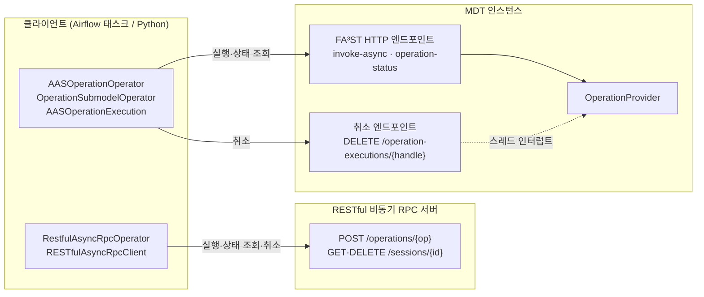
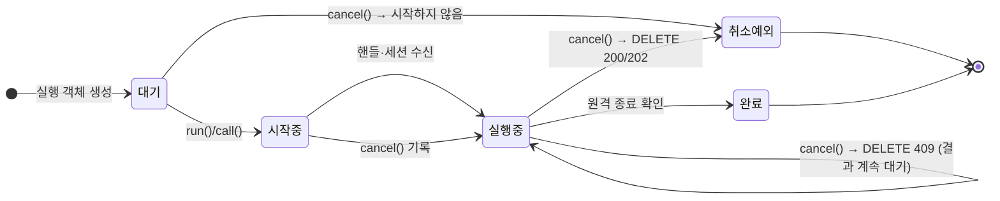
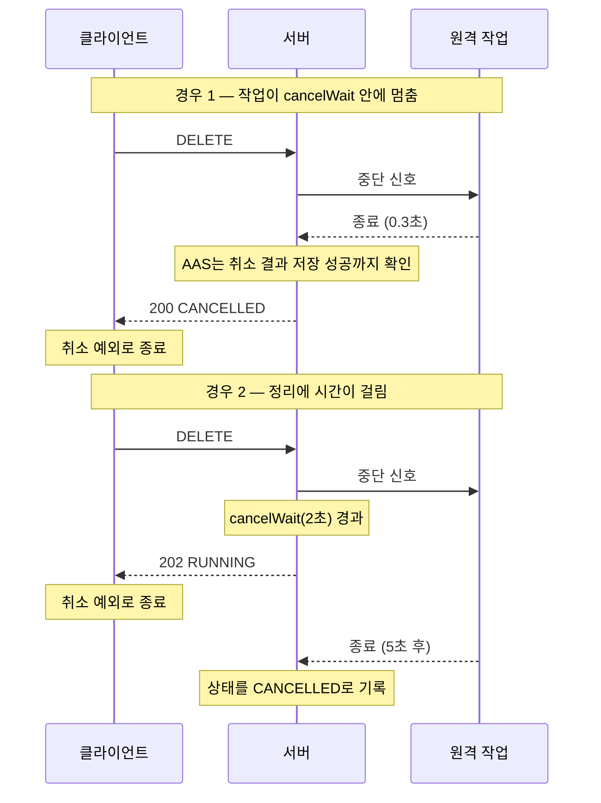
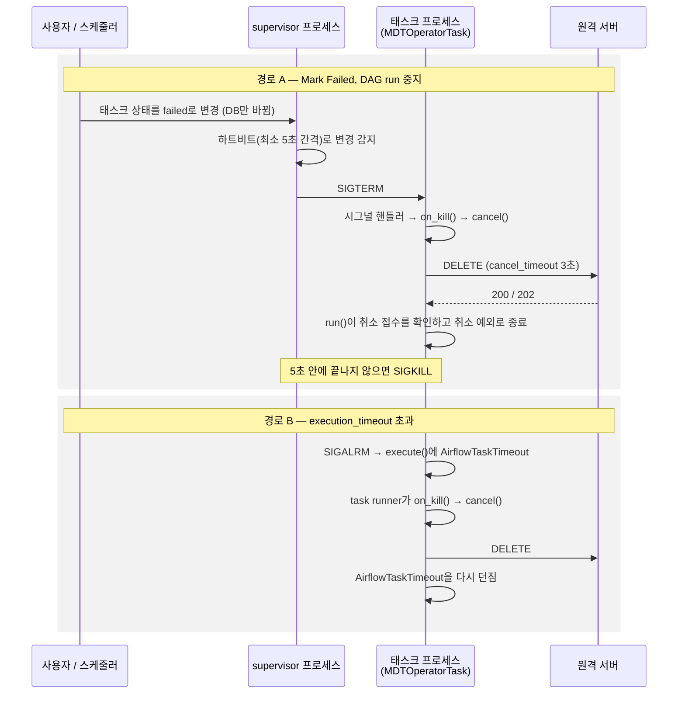
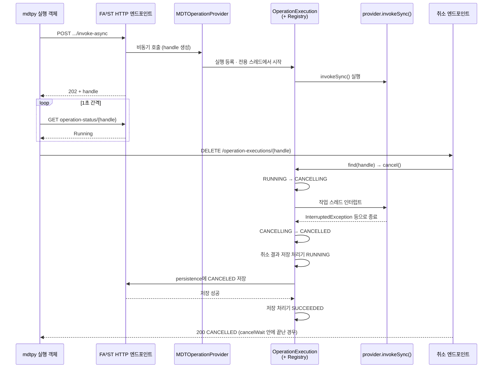
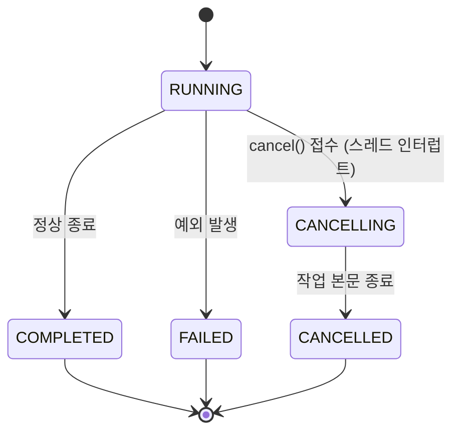
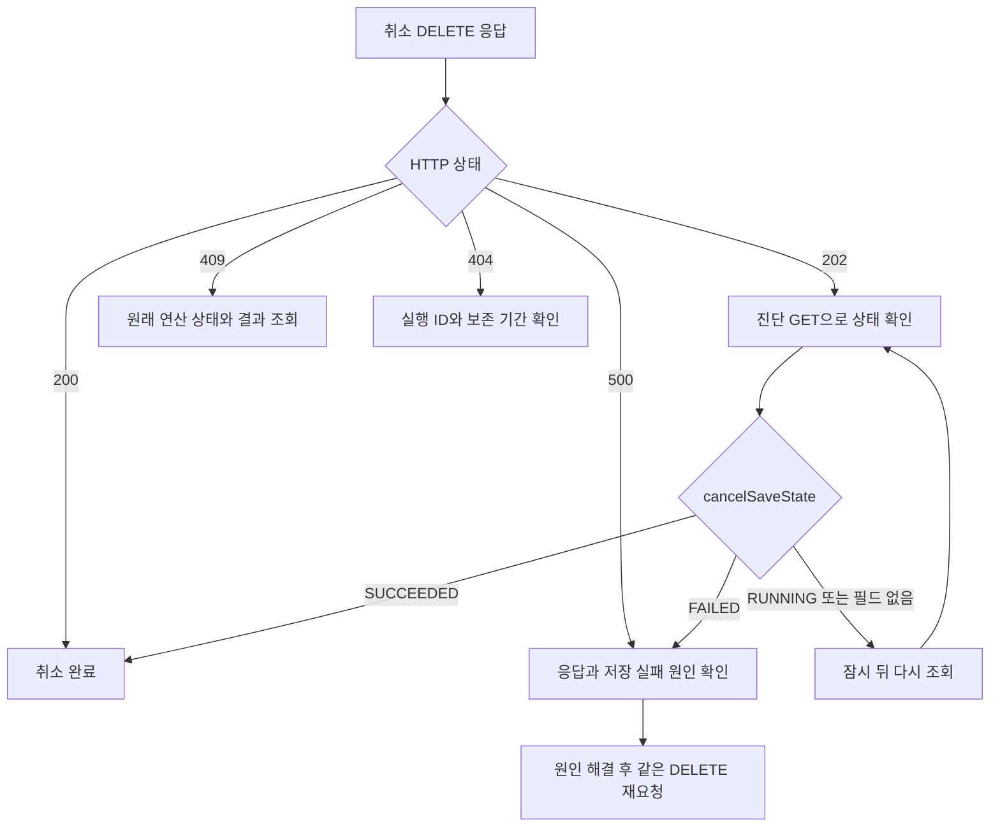

# MDT 원격 연산 취소 가이드

이 문서는 Airflow 태스크나 Python(`mdtpy`) 코드에서 실행 중인 MDT 원격 연산을 취소하는 방법을 다룬다. 취소가 동작하도록 MDT 인스턴스와 연산 서버를 설정하고 구현하는 방법도 함께 설명한다.

| 독자 | 먼저 볼 곳 |
|------|-----------|
| 처음 취소 기능을 써 보는 사람 | [2. 빠른 시작](#2-빠른-시작) |
| Airflow DAG 작성자 | [3. 취소 규약](#3-취소-규약), [4. Airflow DAG에서 취소하기](#4-airflow-dag에서-취소하기) |
| Python에서 `mdtpy`로 연산을 직접 호출하는 개발자 | [3. 취소 규약](#3-취소-규약), [5. mdtpy에서 취소하기](#5-mdtpy에서-취소하기) |
| 인스턴스 설정 담당자, 연산 프로그램·provider 개발자 | [6. 인스턴스와 연산 서버](#6-인스턴스와-연산-서버) |
| 운영 담당자 | [7. 운영](#7-운영) |

> **꼭 기억할 점**
> - 취소 요청이 받아들여졌다고 해서 원격 작업이 바로 끝난 것은 아니다. 클라이언트가 취소 예외를 내고 먼저 끝난 뒤에도 원격 작업은 멈추는 중일 수 있다.
> - 취소는 이미 수행한 작업이나 외부 시스템에 반영된 변경 사항을 되돌리지 않는다.

---

## 목차

- [1. 개요](#1-개요)
  - [1.1 취소가 뜻하는 것](#11-취소가-뜻하는-것)
  - [1.2 용어](#12-용어)
  - [1.3 취소할 수 있는 연산자](#13-취소할-수-있는-연산자)
  - [1.4 두 가지 호출 경로](#14-두-가지-호출-경로)
- [2. 빠른 시작](#2-빠른-시작)
- [3. 취소 규약](#3-취소-규약)
  - [3.1 취소 요청 시점별 처리](#31-취소-요청-시점별-처리)
  - [3.2 취소 HTTP 응답](#32-취소-http-응답)
  - [3.3 `200`과 `202`의 차이](#33-200과-202의-차이)
  - [3.4 계층별 상태 표기](#34-계층별-상태-표기)
  - [3.5 스레드 안전성](#35-스레드-안전성)
- [4. Airflow DAG에서 취소하기](#4-airflow-dag에서-취소하기)
  - [4.1 연산자를 `MDTOperatorTask`로 감싸기](#41-연산자를-mdtoperatortask로-감싸기)
  - [4.2 Airflow 중단 요청이 연산자에 전달되는 과정](#42-airflow-중단-요청이-연산자에-전달되는-과정)
- [5. mdtpy에서 취소하기](#5-mdtpy에서-취소하기)
  - [5.1 AAS Operation 실행과 취소](#51-aas-operation-실행과-취소)
  - [5.2 Operation 서브모델 실행과 취소](#52-operation-서브모델-실행과-취소)
  - [5.3 RESTful 비동기 RPC 실행과 취소](#53-restful-비동기-rpc-실행과-취소)
  - [5.4 시간 초과 뒤 원격 작업 정리하기](#54-시간-초과-뒤-원격-작업-정리하기)
- [6. 인스턴스와 연산 서버](#6-인스턴스와-연산-서버)
  - [6.1 취소 엔드포인트 설정](#61-취소-엔드포인트-설정)
  - [6.2 인스턴스 내부의 취소 처리 과정](#62-인스턴스-내부의-취소-처리-과정)
  - [6.3 provider별 취소 동작](#63-provider별-취소-동작)
  - [6.4 외부 프로그램 연산 작성하기](#64-외부-프로그램-연산-작성하기)
  - [6.5 Java provider 작성하기](#65-java-provider-작성하기)
  - [6.6 curl로 취소 요청 보내기](#66-curl로-취소-요청-보내기)
- [7. 운영](#7-운영)
  - [7.1 계층별 시간 제한](#71-계층별-시간-제한)
  - [7.2 하위 호환성](#72-하위-호환성)
  - [7.3 운영 제약](#73-운영-제약)
  - [7.4 배포 전 확인 사항](#74-배포-전-확인-사항)
  - [7.5 문제 해결](#75-문제-해결)
- [부록 A. API 레퍼런스](#부록-a-api-레퍼런스)

---

## 1. 개요

### 1.1 취소가 뜻하는 것

MDT에서 시뮬레이션, AI 추론, 로봇 제어, 외부 프로그램 실행처럼 오래 걸리는 원격 연산은 실행 도중에 멈춰야 할 때가 있다. Airflow에서 태스크를 중지하거나, 시간 제한을 넘겼거나, 사용자가 직접 멈추려는 경우다.

MDT의 취소는 **협력적 취소(cooperative cancellation)** 방식으로 동작한다. 클라이언트는 원격 작업을 강제로 끊지 않고 서버에 작업 중단을 요청한다. 실제 중단은 서버와 원격 작업이 처리한다.

1. 클라이언트가 `cancel()`을 호출하면 서버에 취소 요청(`DELETE`)이 간다.
2. 서버는 요청을 받아들이고, 실행 중인 작업에 중단 신호를 보낸다. 외부 프로세스라면 종료 신호를, Java 작업이라면 스레드 인터럽트를 보낸다.
3. 작업이 종료되면 서버는 `200 CANCELLED`로 응답한다. AAS 경로에서는 취소 결과 저장도 성공해야 한다. 정리 작업이나 로봇 감속, 상태 저장에 시간이 걸리면 `202 RUNNING`으로 먼저 응답하고 나머지 처리를 계속한다.
4. 클라이언트는 취소가 받아들여지면 서버의 최종 종료를 기다리지 않는다. 취소 접수를 확인하면 취소 예외(`RpcCancelledError` 또는 `mdtpy.CancellationError`)로 종료하며, 성공 후 출력 저장을 수행하지 않는다.

### 1.2 용어

| 용어 | 뜻 |
|------|----|
| 연산자(operator) | mdtpy의 `Operator` 클래스(`mdtpy.airflow.operator`)를 말한다. Airflow의 `BaseOperator`와는 다르다. |
| 실행 객체 | 원격 연산 호출 한 번을 나타내는 객체다. `AASOperationExecution`, `OperationSubmodelExecution`, `RESTfulAsyncRpcClient`가 여기에 해당한다. |
| 핸들(handle) | FA³ST가 `invoke-async` 호출에 발급하는 실행 식별자(`OperationHandle.handle_id`)다. AAS 경로의 취소 대상이 된다. |
| 세션(session) | RESTful 비동기 RPC 서버가 연산 실행마다 만드는 URL(`session_endpoint`)이다. RPC 경로의 취소 대상이 된다. |
| 취소 엔드포인트 | MDT 인스턴스가 별도 포트로 여는 취소 전용 HTTP 서버(`OperationControlEndpoint`)다. |
| provider | MDT 인스턴스에서 AAS `Operation`의 실제 동작을 구현하는 객체(`OperationProvider`)다. |

### 1.3 취소할 수 있는 연산자

| 연산자 | 호출 대상 | 취소 요청을 보내는 곳 | 취소되면 `run()`이 내는 예외 |
|--------|-----------|----------------------|-----------------------------|
| `RestfulAsyncRpcOperator` | RESTful 비동기 RPC 연산 서버(`mdt-operation-http`, 로봇 트윈 등) | 세션 URL(`DELETE {session}`) | `RpcCancelledError` |
| `AASOperationOperator` | MDT 인스턴스(FA³ST)의 AAS `Operation` 요소 | 취소 엔드포인트(`DELETE {opControl}/operation-executions/{handle}`) | `mdtpy.CancellationError` |
| `OperationSubmodelOperator` | MDT 인스턴스의 Operation 서브모델(AI, Simulation)에 있는 `Operation` | 취소 엔드포인트(위와 같음) | `mdtpy.CancellationError` |
| `SetElementOperator`, `RestfulRpcOperator`, `PythonScriptOperator` | 값 설정, 동기 RPC, 로컬 스크립트 | **취소 불가** | — |

> **참고:** 현재 사용 중인 AAS API v3와 FA³ST 1.3.0 구성에는 실행 중인 AAS Operation을 취소하는 표준 방법이 없다. 그래서 MDT 인스턴스는 FA³ST 자체를 수정하지 않고, 별도 포트로 동작하는 취소 엔드포인트를 제공한다([6.1절](#61-취소-엔드포인트-설정)).

### 1.4 두 가지 호출 경로

원격 연산은 두 경로 중 하나로 호출된다. 두 경로는 취소 요청을 보내는 곳만 다르고, 응답 규약([3장](#3-취소-규약))은 같다.



| 구분 | RESTful 비동기 RPC 경로 | AAS 비동기 연산 경로 |
|------|------------------------|---------------------|
| 호출 대상 | `mdt-operation-http`, 로봇 트윈 연산 서버 | MDT 인스턴스(FA³ST)의 AAS `Operation` |
| 실행 시작 | `POST` → 세션 URL 발급 | `invoke-async` → 핸들 발급 |
| 상태 조회 | `GET {session}` | FA³ST `operation-status` |
| 취소 요청 | `DELETE {session}` (같은 서버) | `DELETE {opControl}/operation-executions/{handle}` (별도 포트) |
| 서버 측 준비 | `RESTfulAsyncRpcServer` 기반 실행과 세션 `DELETE` HTTP 경로 연결 필요 | 인스턴스 `config.json`에 `operationControl` 설정 필요 |

---

## 2. 빠른 시작

Airflow DAG에서 MDT 인스턴스의 AAS Operation을 실행하다가 취소할 수 있게 만드는 가장 짧은 절차다. 예제는 `test` 인스턴스의 `AddAndSleep` 서브모델을 쓴다.

**1단계. 인스턴스에 취소 엔드포인트를 연다.**

인스턴스 `config.json`에 다음 항목을 추가하고 인스턴스를 다시 시작한다. 아래 JSON은 관련 설정만 발췌한 것이다.

```json
{
  "serviceEndpoints": {
    "operationControl": { "port": 19900 }
  }
}
```

**2단계. 취소 엔드포인트가 등록되었는지 확인한다.**

```python
import mdtpy

mdt = mdtpy.connect("http://localhost:12985/instance-manager")
print(mdt.instances["test"].descriptor.operation_control_endpoint)
# 예: https://<host>:19900
# None이면 인스턴스 실행 상태, 취소 설정과 매니저의 주소 등록 여부를 확인한다.
```

**3단계. 연산자를 `MDTOperatorTask`로 감싸 DAG에 등록한다.**

Airflow worker에 mdtpy를 설치하고, Airflow Variable `mdt_manager_url`에 worker에서 접근할 수 있는 매니저 주소(예: `http://localhost:12985/instance-manager`)를 설정한다. 컨테이너 안의 `localhost`는 해당 컨테이너를 가리키므로 배포 환경에 맞게 바꾼다.

예제의 `AddAndSleep`은 `Data`, `IncAmount`, `SleepTime`을 입력으로 받는 연산이다. 대상 모델에 따라 인자 이름과 값을 조정한다.

```python
from datetime import datetime, timedelta, timezone
from airflow.sdk import DAG
from mdtpy.airflow import literal
from mdtpy.airflow.operator import AASOperationOperator
from mdtpy.airflow.task import MDTOperatorTask

with DAG(dag_id="cancel_quickstart",
         start_date=datetime(2026, 1, 1, tzinfo=timezone.utc),
         schedule=None, catchup=False,
         default_args={"execution_timeout": timedelta(minutes=5)}) as dag:
    MDTOperatorTask(
        task_id="add_and_sleep",
        operator=AASOperationOperator(
            instance="test",
            submodel="AddAndSleep",
            path="Operation",
            inputs={"Data": literal(10), "IncAmount": literal(3),
                    "SleepTime": literal(50)},
        ),
    )
```

**4단계. 취소 동작을 확인한다.**

DAG를 실행한 뒤 Airflow UI에서 실행 중인 태스크를 `Mark Failed`로 바꾼다. 취소 요청이 전달되면 다음 사항을 확인한다. 상태 변경 감지와 작업 정리에 걸리는 시간은 실행 환경과 연산 구현에 따라 다르다.

- 태스크 로그에 `operation cancel is accepted` 메시지가 남는다.
- 인스턴스의 `operation-status`가 `Canceled`로 바뀐다.
- 취소 예외로 종료된 호출은 성공 후 출력 저장을 수행하지 않는다. 이미 저장된 값이나 외부 변경은 되돌리지 않는다.

---

## 3. 취소 규약

이 장은 연산자, 실행 객체, RPC 클라이언트가 공유하는 취소 규약을 설명한다. 오류 전달 방식과 반복 취소의 동작은 API에 따라 다르므로 각 표의 적용 대상을 함께 확인한다. 4장과 5장의 예제를 읽기 전에 먼저 살펴보는 것이 좋다.

### 3.1 취소 요청 시점별 처리

`cancel()`은 실행의 어느 단계에서든 호출할 수 있다. 호출 시점에 따라 다음과 같이 처리된다.

| `cancel()` 호출 시점 | 처리 |
|---------------------|------|
| 실행 객체(또는 RPC 클라이언트)가 만들어지기 전 | 연산자가 요청을 보관했다가 객체가 만들어지면 바로 전달한다. |
| 객체는 있지만 원격 호출을 시작하기 전 | 원격 연산을 시작하지 않고 곧바로 취소 예외로 끝난다. |
| 시작 요청을 보냈지만 세션 URL이나 핸들을 아직 받지 못함 | 식별자를 받는 즉시 `DELETE`를 보낸다. |
| 원격 작업 실행 중 | 식별자로 `DELETE`를 보낸다. |
| 원격 종료를 이미 확인함(상태 조회 결과가 종료, 또는 RPC `200 CANCELLED`) | HTTP 요청 없이 `False`를 돌려준다. |
| 앞선 취소 요청이 `409`로 끝남 | 원격이 끝났다고 단정하지 않으므로, 다시 호출하면 `DELETE`를 다시 보낸다. |
| 시간 초과나 통신 오류로 `run()`/`call()`만 끝남 | 핸들·세션 주소가 있고 원격 종료를 확인하지 못했다면 이후 `cancel()`로 `DELETE`를 보낼 수 있다. |
| 이미 받아들여진 취소를 다시 요청함 | AAS 실행 객체는 HTTP 요청 없이 `True`를 돌려준다. |



### 3.2 취소 HTTP 응답

RPC 경로와 AAS 경로의 취소 응답은 모두 `utils.rpc.restful`의 취소 규약을 따른다. 클라이언트는 응답 본문보다 **HTTP 상태 코드**를 먼저 본다.

| 상태 코드 | 본문 `status` | 뜻 | 클라이언트 처리 |
|-----------|---------------|----|----------------|
| `200` | `CANCELLED` | 취소가 끝났다. | `True` |
| `202` | `RUNNING` | 취소 요청이 접수되었고 작업 종료 또는 AAS 취소 결과 저장을 기다리는 중이다. | `True` (`run()`/`call()`은 취소 예외로 끝남) |
| `409` | — | 이미 끝났거나 원격이 취소를 거부했다. | `False` (`run()`/`call()`은 원격 결과를 계속 기다림) |
| `404` | — | 세션이나 실행이 없다(보존 기간 만료 포함). | 예외 (Airflow 연산자는 로그만 남기고 `False`) |
| `500` | — | (AAS 경로) 작업은 취소로 끝났지만 `CANCELED` 상태를 저장하지 못했다. | 예외 (같은 요청을 다시 보내면 저장을 다시 시도) |

> **`cancel()`이 `True`를 돌려줄 때:** 취소 요청을 안전하게 기록했거나 서버가 취소를 받아들였다는 뜻이다. 원격 작업이 완전히 멈췄다는 보장은 아니다. 특히 `202`는 작업 종료 또는 취소 결과 저장이 아직 끝나지 않았음을 뜻한다.

### 3.3 `200`과 `202`의 차이

서버는 취소 요청을 받으면 작업 종료를 잠시(`cancelWait`, 기본 2초) 기다린다. AAS 경로는 같은 대기 시간 안에 취소 결과 저장까지 확인하며, 작업과 저장이 모두 끝나야 `200`을 반환한다. 아직 진행 중이면 `202`, 저장이 실패하면 `500`을 반환한다. `200` 또는 `202`로 접수된 경우 실행 중인 `run()`/`call()`은 취소 접수를 확인하면 취소 예외로 종료한다. 진행 중인 HTTP 요청이 끝날 때까지 예외 발생이 지연될 수 있다.



`202`를 받은 뒤 원격 작업이 실제로 멈췄는지 확인하려면 상태 조회(`GET {session}`, AAS `operation-status`)를 따로 해야 한다.

### 3.4 계층별 상태 표기

계층마다 같은 상태를 다르게 적는다. 로그와 HTTP 응답을 비교할 때 아래 표를 참고한다. 철자가 `CANCELLED`와 `CANCELED`로 다른 것에 주의한다.

| 계층 | 취소 완료 | 취소 진행 중 |
|------|-----------|--------------|
| MDT 실행 객체(`OperationExecution`) | `CANCELLED` | `CANCELLING` |
| FA³ST 저장 상태 / AAS 상태 응답 | `CANCELED` / `Canceled` | 완료 전까지 기존 상태(`Running`) |
| 취소 HTTP 응답 본문(`RpcResponseMessage`) | `CANCELLED` (`200`) | `RUNNING` (`202`) |

### 3.5 스레드 안전성

`cancel()`은 다른 스레드나 Airflow의 `SIGTERM` 시그널 핸들러에서 불릴 수 있다. mdtpy의 연산자와 실행 객체는 이를 위해 다음 규칙을 지킨다.

- **재진입 가능한 잠금:** 시그널 핸들러는 잠금을 쥐고 있는 바로 그 스레드에서 실행될 수 있으므로 공유 상태(세션 URL, 핸들, 취소 요청·접수 여부, 종료 여부)는 `threading.RLock`으로 보호한다.
- **잠금 밖에서 HTTP 호출:** 시작, 상태 조회, 취소 요청은 모두 잠금을 풀고 보낸다. 그래야 다른 스레드에서 호출한 `cancel()`이 진행 중인 일반 HTTP 요청의 응답 대기 시간 동안 차단(블로킹)되지 않는다.
- **시그널에 안전한 대기:** 폴링 간격을 대기할 때 `threading.Event` 대신 0.1초 단위로 `sleep`을 반복하면서 취소 접수 여부를 확인한다. 따라서 시그널 핸들러에서 취소가 접수되어도 최대 0.1초 안에 대기를 끝낸다.
- **예외를 밖으로 던지지 않음:** Airflow 연산자의 `cancel()`은 실패해도 예외를 던지지 않는다. 경고 로그를 남기고 `False`를 돌려준다.

---

## 4. Airflow DAG에서 취소하기

### 4.1 연산자를 `MDTOperatorTask`로 감싸기

Airflow에서 원격 연산을 취소하려면 mdtpy 연산자를 반드시 `MDTOperatorTask`(`mdtpy.airflow.task`)로 감싸서 태스크로 등록해야 한다. `MDTOperatorTask`는 태스크가 실행될 때(`execute()`) 연산자의 `run()`을 부르고, 태스크가 중단될 때(`on_kill()`) 연산자의 `cancel()`을 부른다. 취소를 지원하지 않는 연산자([1.3절](#13-취소할-수-있는-연산자))를 감싸면 `cancel()`이 아무 일도 하지 않으므로, 태스크를 중단해도 Airflow 태스크 프로세스만 종료된다. `MDTOperatorTask`는 Airflow 전용이며, Airflow 밖에서는 실행 객체를 직접 사용한다([5장](#5-mdtpy에서-취소하기)).

다음은 취소 가능한 세 연산자를 모두 쓰는 예제다. `sim-01`에는 `Duration` 입력과 `Result` 출력이 있는 `Simulation` 연산, 그리고 출력 저장 대상인 `LastResult` 파라미터가 등록되어 있다고 가정한다. `inputs`에는 `literal()` 등의 입력 명세를, `outputs`에는 `sink()`로 만든 `ElementReference`를 전달한다.

```python
from datetime import datetime, timedelta, timezone
from airflow.sdk import DAG
from mdtpy.airflow import literal, sink
from mdtpy.airflow.operator import (
    AASOperationOperator,
    OperationSubmodelOperator,
    RestfulAsyncRpcOperator,
)
from mdtpy.airflow.task import MDTOperatorTask

with DAG(
    dag_id="mdt_cancellable_operations",
    start_date=datetime(2026, 1, 1, tzinfo=timezone.utc),
    schedule=None,
    catchup=False,
    default_args={"execution_timeout": timedelta(minutes=5)},
) as dag:
    # 1) 서브모델 안의 AAS Operation 호출
    t_aas = MDTOperatorTask(
        task_id="add_and_sleep",
        operator=AASOperationOperator(
            instance="test",
            submodel="AddAndSleep",
            path="Operation",
            inputs={"Data": literal(10), "IncAmount": literal(3),
                    "SleepTime": literal(50)},
        ),
    )

    # 2) Operation 서브모델(AI, Simulation) 호출
    t_sim = MDTOperatorTask(
        task_id="run_simulation",
        operator=OperationSubmodelOperator(
            instance="sim-01",
            submodel="Simulation",
            inputs={"Duration": literal(30)},
            outputs={"Result": sink("param:sim-01:LastResult")},
        ),
    )

    # 3) RESTful 비동기 RPC 연산 서버를 직접 호출
    t_rpc = MDTOperatorTask(
        task_id="run_rpc",
        operator=RestfulAsyncRpcOperator(
            base_url="http://localhost:12987",
            op_endpoint="/api/v1/operations/AddAndSleep",
            inputs={"Data": literal(10), "IncAmount": literal(3),
                    "SleepTime": literal(50)},
        ),
    )

    t_aas >> t_sim >> t_rpc
```

`mdt-workflow`가 만드는 DAG도 같은 방식으로 `MDTOperatorTask`를 쓴다.

#### 4.1.1 `@task` 함수 안에서 `run()`을 부르면 취소되지 않는다

다음처럼 `@task` 함수 안에서 연산자의 `run()`을 직접 부르면, 태스크가 중단되어도 `cancel()`이 호출되지 않는다. Airflow 태스크 프로세스만 종료되고 원격 연산은 서버에서 계속 실행된다.

```python
# 잘못된 예: 태스크를 중지해도 원격 연산은 계속 실행된다
@task
def add_and_sleep():
    AASOperationOperator(instance="test", submodel="AddAndSleep", path="Operation",
                         inputs={"Data": literal(10), "IncAmount": literal(3),
                                 "SleepTime": literal(50)}).run()
```

### 4.2 Airflow 중단 요청이 연산자에 전달되는 과정

Airflow 3.1.5(`airflow/sdk/execution_time/supervisor.py`, `task_runner.py`, `timeout.py`) 기준으로, `on_kill()`이 불리는 과정은 중단 원인에 따라 두 가지다.



#### 4.2.1 경로 A: Mark Failed, DAG run 중지 (`SIGTERM`)

1. 사용자가 UI나 REST API로 태스크나 DAG run을 `Mark Failed`로 바꾸면 DB의 태스크 상태만 `failed`로 바뀐다. 이 시점에 태스크 프로세스에는 아무 신호도 가지 않는다.
2. 태스크 프로세스의 부모인 supervisor 프로세스가 최소 5초 간격(`MIN_HEARTBEAT_INTERVAL`)으로 API 서버에 하트비트를 보내다가, 응답(`404`/`409`)으로 상태 변경을 알아챈다.
3. supervisor가 태스크 프로세스에 `SIGTERM`을 보낸다. 5초(`escalation_delay`) 안에 끝나지 않으면 `SIGKILL`로 강제 종료한다.
4. 태스크 프로세스의 `SIGTERM` 핸들러는 `ti.task.on_kill()`만 부르고 돌아온다. 실행 중인 `run()`을 예외로 끊지 않는다. 그래서 `run()`은 취소가 받아들여졌는지 스스로 확인하고 취소 예외를 던지며 끝나야 한다.

이 경로에서는 중단 요청부터 `cancel()` 호출까지 하트비트 간격(수 초)만큼 늦어질 수 있다. 또 `cancel()`은 `SIGKILL` 전 5초 안에 끝나야 한다. 그래서 mdtpy는 취소 요청의 응답 대기 시간(`cancel_timeout`)을 일반 요청보다 짧은 3초로 둔다.

#### 4.2.2 경로 B: `execution_timeout` 초과 (`AirflowTaskTimeout`)

`execution_timeout`을 넘기면 `SIGTERM`을 거치지 않는다. 태스크 프로세스 안의 시간 제한(`SIGALRM`)이 실행 중인 `execute()`에 `AirflowTaskTimeout` 예외를 일으키고, task runner가 이 예외를 잡아 `task.on_kill()`을 부른 다음 예외를 다시 던진다.

이 경로에서는 `run()`이 예외로 먼저 끝나고 그 뒤에 `cancel()`이 불린다. 원격 작업이 끝났는지 확인하지 못한 채 호출만 끝난 상태이므로, `cancel()`은 그대로 서버에 `DELETE`를 보낸다.

---

## 5. mdtpy에서 취소하기

Airflow 없이 Python 코드에서 `mdtpy`의 실행 객체나 RPC 클라이언트로 연산을 실행하고 취소할 수도 있다. 공통 사용 패턴은 다음과 같다.

1. 실행 객체를 만든다. 이때는 아직 원격 호출을 하지 않는다.
2. 다른 스레드(타이머, UI 이벤트 처리기 등)가 그 객체의 `cancel()`을 부를 수 있게 넘겨준다.
3. `run()`이나 `call()`을 호출하고 취소 예외를 처리한다.

직접 호출한 실행 객체의 `cancel()`은 HTTP·통신 오류를 호출자에게 예외로 던질 수 있다. 타이머나 UI 콜백에서는 다음과 같이 접수 여부와 오류를 기록한다. 이 함수는 아래 예제에서 공통으로 사용한다.

```python
import logging

logger = logging.getLogger(__name__)

def request_cancel(execution):
    try:
        accepted = execution.cancel()
        logger.info("취소 요청 보관 또는 접수: %s", accepted)
        return accepted
    except Exception:
        logger.exception("취소 요청 결과를 확인하지 못했습니다.")
        return False
```

`run()`과 `call()`은 결과를 기다리는 메서드다. 별도 스레드에서 실행한다면 `Future.cancel()` 대신 원격 실행 객체의 `cancel()`을 호출한다. 실행 객체는 호출마다 새로 만든다.

### 5.1 AAS Operation 실행과 취소

`AASOperationService.new_execution(**kwargs)`는 원격 연산을 바로 호출하지 않는다. 호출 한 번을 나타내는 `AASOperationExecution`을 만들어 돌려줄 뿐이다. 연산 변수를 깊은 복사한 뒤 인자를 반영하므로, 한 서비스로 여러 실행을 동시에 돌려도 인자와 상태가 섞이지 않는다.

```python
import threading
import mdtpy
from mdtpy import CancellationError
from mdtpy.operation import AASOperationService

mdt = mdtpy.connect("http://localhost:12985/instance-manager")
submodel = mdt.instances["test"].submodel_services["AddAndSleep"]
op_svc = AASOperationService(submodel, "Operation")

# 실행 객체 생성 (아직 원격 연산을 호출하지 않는다)
execution = op_svc.new_execution(Data=10, IncAmount=3, SleepTime=30)

# 2초 뒤 다른 스레드에서 취소
timer = threading.Timer(2.0, request_cancel, args=(execution,))
timer.start()

try:
    outputs = execution.run(timeout=60.0)
    print("완료:", outputs)
except CancellationError:
    print("취소됨. handle =", execution.handle)
finally:
    timer.cancel()
```

#### 5.1.1 한 서비스로 여러 실행을 돌리다가 일부만 취소하기

앞 절의 `op_svc`를 사용한다. 실행 객체마다 상태가 따로 있으므로 원하는 실행만 취소할 수 있다. 아래 취소는 실행 시작과 겹칠 수 있으며, 아직 시작하지 않았다면 원격 호출 자체를 생략한다.

```python
from concurrent.futures import ThreadPoolExecutor

executions = [op_svc.new_execution(Data=10, IncAmount=3, SleepTime=s) for s in (5, 30, 60)]

with ThreadPoolExecutor(max_workers=len(executions)) as pool:
    futures = [pool.submit(ex.run) for ex in executions]

    # 가장 오래 걸리는 실행만 취소
    request_cancel(executions[2])

    for ex, fut in zip(executions, futures):
        try:
            print(ex.handle, "완료:", fut.result())
        except CancellationError:
            print(ex.handle, "취소됨")
```

### 5.2 Operation 서브모델 실행과 취소

Operation 서브모델(AI, Simulation 등)은 `OperationSubmodelService.new_execution(**kwargs)`로 실행 객체를 만든다. 인자 검증과 기본 출력 참조 채우기는 `invoke()`와 같다. `run()`은 연산이 성공했을 때만 출력 인자 위치에 결과를 저장하고, 취소되거나 실패하면 아무것도 저장하지 않는다.

```python
import threading
import mdtpy
from mdtpy import CancellationError

mdt = mdtpy.connect("http://localhost:12985/instance-manager")
sim_submodel = mdt.instances["sim-01"].operations["Simulation"]

# 출력 위치(ElementReference)를 넘기지 않으면 기본 참조를 쓴다
execution = sim_submodel.new_execution(Duration=30)

timer = threading.Timer(3.0, request_cancel, args=(execution,))
timer.start()

try:
    outputs = execution.run(timeout=60.0)
except CancellationError:
    print("취소로 종료되어 후속 출력 저장을 수행하지 않았습니다.")
finally:
    timer.cancel()
```

### 5.3 RESTful 비동기 RPC 실행과 취소

```python
import threading
from mdtpy.rpc.restful import RESTfulAsyncRpcClient, RpcCancelledError, RpcExecutionError

client = RESTfulAsyncRpcClient(
    base_url="http://localhost:12987",
    op_endpoint="/api/v1/operations/AddAndSleep",
    inputs={"Data": 10, "IncAmount": 3, "SleepTime": 30},
    poll_interval=1.0,
    timeout=60.0,
    cancel_timeout=3.0,
)

timer = threading.Timer(2.0, request_cancel, args=(client,))
timer.start()

try:
    outputs = client.call()
    print("완료:", outputs)
except RpcCancelledError:
    print("취소됨. session =", client.session_url)
except RpcExecutionError as e:
    print("실행 실패:", e.__cause__)
finally:
    timer.cancel()
```

`call()`은 `POST`로 세션을 만든 뒤 `poll_interval`(기본 3초)마다 상태를 조회한다. 결과에 따라 다음과 같이 끝난다.

| 원격 상태 | `call()` 결과 |
|-----------|---------------|
| `COMPLETED` | 출력 딕셔너리를 돌려준다. |
| `FAILED` | `RpcExecutionError`를 던진다. 원인 예외는 `__cause__`에 들어 있다. |
| `CANCELLED` 또는 취소 접수 | `RpcCancelledError`를 던진다. |
| `timeout` 초과 | `TimeoutError`를 던진다. 세션은 **취소하지 않는다**([5.4절](#54-시간-초과-뒤-원격-작업-정리하기)). |

### 5.4 시간 초과 뒤 원격 작업 정리하기

클라이언트의 제한 시간(`timeout`)이 만료되었을 때 원격 작업도 중단되는지는 경로마다 다르다.

| 실행 객체 | `timeout` 초과 시 원격 작업 |
|-----------|-----------------------------|
| `AASOperationExecution.run(timeout=…)` | 서버에 취소를 요청한 뒤 `mdtpy.TimeoutError`를 던진다. |
| `RESTfulAsyncRpcClient.call()` | `TimeoutError`만 던진다. 원격 작업은 계속 실행된다. |

RPC 클라이언트에서 시간 초과나 통신 오류가 났을 때 원격 작업의 중단도 필요하면 `cancel()`을 직접 호출한다. 다음 코드는 5.3절의 `try` 블록을 대체하는 예제다. 새 클라이언트 객체를 사용하고, 원래 호출 오류와 취소 요청 오류를 구분해 기록한다.

```python
try:
    outputs = client.call()
except (TimeoutError, OSError):
    # request_cancel()이 취소 오류를 기록하므로 원래 호출 오류가 가려지지 않는다.
    request_cancel(client)
    raise
```

이미 발급된 핸들과 인스턴스의 취소 엔드포인트 주소를 알고 있으면, 실행 객체 없이 `cancel_operation_execution()`으로 바로 취소할 수도 있다. 다른 프로세스가 시작한 실행을 정리할 때 쓸 수 있다.

```python
from mdtpy.operation.aas_operation import cancel_operation_execution

control_ep = mdt.instances["test"].descriptor.operation_control_endpoint
if control_ep and execution.handle:
    accepted = cancel_operation_execution(control_ep, execution.handle, timeout=3.0)
    print("취소 접수:", accepted)
```

---

## 6. 인스턴스와 연산 서버

### 6.1 취소 엔드포인트 설정

MDT 인스턴스에서 AAS 비동기 연산을 취소하려면 인스턴스 `config.json`에 `serviceEndpoints.operationControl`을 추가해야 한다. 이 설정이 없으면 취소 엔드포인트가 열리지 않는다.

```json
{
  "serviceEndpoints": {
    "operationControl": {
      "port": 19900,
      "cancelWait": "2s",
      "retainTimeout": "30s"
    }
  }
}
```

| 항목 | 기본값 / 예 | 설명 |
|------|-------------|------|
| `port` | 예: `19900` | 취소 엔드포인트가 수신할 포트(1~65535). 같은 호스트의 다른 트윈·서비스와 겹치지 않게 정한다. |
| `cancelWait` | 기본 `2s` | 취소 요청 후 작업 종료와 취소 결과 저장을 기다리는 전체 시간. 넘기면 `202 RUNNING`으로 응답한다. mdtpy의 취소 응답 대기 시간(기본 3초)보다 짧아야 한다. |
| `retainTimeout` | 기본 `30s` | 끝난 실행 정보를 레지스트리에 남겨 두는 시간. 마지막으로 끝난 시각(상태 저장 재시도 포함)부터 계산한다. |

> **포트는 트윈마다 따로 정한다.** 취소 엔드포인트는 트윈 인스턴스마다 별도 프로세스에서 열리므로, 같은 호스트에서 실행되는 트윈끼리 `port`가 겹치면 안 된다. 포트가 겹친 트윈은 엔드포인트를 열지 못한다. MDT Manager는 이 포트를 자동으로 할당하지 않으며 기본값도 없으므로, 각 트윈의 `config.json`에 직접 지정해야 한다. 트윈의 HTTP 포트에 900을 더한 값을 쓰는 식으로 규칙을 정해 두면 관리하기 쉽다(예: HTTP `19000` → 취소 `19900`, HTTP `19104` → 취소 `19904`).

엔드포인트는 FA³ST HTTP 엔드포인트와 같은 인스턴스 키스토어로 HTTPS를 연다. 따로 인증은 하지 않는다.

#### 6.1.1 HTTP API

| 메서드와 경로 | 동작 | 응답 |
|---------------|------|------|
| `DELETE /operation-executions/{handle}` | 실행을 취소한다. `{handle}`은 FA³ST `operation-status`와 같은 base64url 인코딩이다. | `200` `CANCELLED`, `202` `RUNNING`, `409` 이미 완료·실패, `500` `CANCELED` 저장 실패, `404` 미등록·만료, `400` 잘못된 handle, `405` 지원하지 않는 메서드 |
| `GET /operation-executions/{handle}` | 진단용 상태 조회. 실행 상태와 함께 `CANCELED` 저장 상태(`cancelSaveState`)와 마지막 실패 원인(`cancelSaveFailure`)을 돌려준다. | `200`, `404`, `400` |

#### 6.1.2 엔드포인트 주소가 클라이언트에 전달되는 방식

인스턴스는 `instanceEndpoint`의 scheme과 호스트에 `port`를 붙여 취소 엔드포인트 주소(예: `https://<host>:19900`)를 만든다. 이 주소는 다음과 같이 MDT Manager에 전달되고, 클라이언트는 `InstanceDescriptor.operationControlEndpoint`로 읽는다.

| 인스턴스 종류 | 전달 방식 |
|---------------|-----------|
| JAR | 시작 표지(`[***MARKER***]`)를 출력하기 전에 표준 출력에 `[***OPCONTROL***] MDTInstance operation control: <주소>`를 쓴다. `mdt-manager`의 `JarInstanceExecutor`가 이를 읽어 등록한다. |
| EXTERNAL | 등록·하트비트 요청(`POST {mdtUrl}/instance-manager/registry/{id}`)에 쿼리 파라미터 `operationControlEndpoint`를 붙인다. |
| Docker | 지원하지 않는다(항상 `null`). |

MDT Manager는 인스턴스가 `RUNNING`일 때만 이 값을 유지한다. 정지나 실패 등 다른 상태가 되면 지운다.

### 6.2 인스턴스 내부의 취소 처리 과정

AAS 경로에서 클라이언트의 취소 요청이 provider의 작업 스레드까지 전달되는 과정은 다음과 같다.



`OperationExecution`의 상태는 다음과 같이 바뀐다.



실행 상태와 저장 상태는 별도로 확인한다. 작업이 `CANCELLED`여도 저장이 진행 중이거나 실패했을 수 있다.

| `cancelSaveState` | 의미 | 확인·조치 |
|---|---|---|
| 필드 없음 | 취소 처리기 미실행(`NOT_RUN`) | 작업 상태 확인 |
| `RUNNING` | 취소 결과 저장 또는 재시도 중 | GET으로 다시 조회 |
| `SUCCEEDED` | FA³ST에 `CANCELED` 저장 성공 | 취소 완료로 처리 |
| `FAILED` | 저장 실패 | `cancelSaveFailure` 확인 후 같은 DELETE 재요청 |

저장 처리기는 한 번 실행될 때 최대 3회 저장을 시도한다. 재시도는 연산 본문을 다시 실행하지 않는다. 저장 재시도 중에는 실행 정보를 보존하며, 보존 기간이 만료되면 재시도할 수 없다.

취소 요청이 접수된 실행은 연산 본문이 정상적으로 반환되더라도 최종 상태가 `CANCELLED`가 된다. `utils.async`의 일부 실행처럼 취소 도중 성공 결과를 채택하는 동작과 구분한다.

> **취소할 수 없는 호출:** 작업 스레드를 인터럽트할 수 있는 것은 `invoke-async`로 시작되어 `OperationExecutionRegistry`에 등록된 실행뿐이다. 동기 `invoke()`로 시작한 호출은 취소할 수 없다.

### 6.3 provider별 취소 동작

작업 스레드가 인터럽트되면 provider 종류별로 다음과 같이 반응한다.

| provider | 인터럽트를 받았을 때 |
|----------|---------------------|
| `ProgramOperationProvider` | `CommandExecution`이 프로세스 대기를 멈추고, 프로세스 트리에 `SIGTERM`을 보낸다. 1초 안에 끝나지 않으면 `SIGKILL`로 강제 종료한다. |
| `HttpOperationProvider` | 원격 연산 서버의 세션에 `DELETE`를 보내고 세션이 끝나기를 기다린다. |
| 로봇(`RobotTwinOperationProvider` 하위) | 로봇 클라이언트 연산을 `cancel(true)`로 취소한다. 이미 진행 중인 동기 그리퍼 호출은 끝까지 수행된다. |
| RCK(`RCKSimulationOperation`) | `invokeSync()`가 `InterruptedException`을 잡아 시뮬레이션을 취소한다. 시뮬레이터의 중단 절차는 해당 실행 구현을 따른다. |
| 사용자 정의 Java provider | 구현이 `Thread.interrupted()`나 `InterruptedException`에 반응하는지에 달려 있다([6.5절](#65-java-provider-작성하기)). |

### 6.4 외부 프로그램 연산 작성하기

`ProgramOperationProvider`로 실행되는 외부 프로그램은 취소되면 `SIGTERM`을 받는다. 그리고 **1초** 안에 끝나지 않으면 `SIGKILL`로 강제 종료된다. 임시 파일 삭제나 장비 정지처럼 꼭 필요한 정리 작업은 이 1초 안에 끝내야 한다.

#### 6.4.1 연산 기술 파일(`operation.json`)

아래는 숫자 `Data`에 `IncAmount`를 더하는 연산의 기술 파일 예제다. 입력 `Data`, `IncAmount`, `SleepTime`과 숫자 출력 `Output`이 AAS 모델에 정의되어 있다고 가정한다. `op_increment.py`는 다음 예제 코드로 저장하고 기술 파일과 같은 디렉터리에 둔다. `timeout`을 넘기면 인스턴스가 프로그램을 같은 방식으로 종료하고, 연산은 실패로 끝난다.

```json
{
  "commandLine": [
    "python3",
    "op_increment.py",
    "${Data:value}",
    "--inc", "${IncAmount:value}",
    "--sleep", "${SleepTime:value}",
    "--output", "${Output:path}"
  ],
  "timeout": "1m"
}
```

#### 6.4.2 `SIGTERM`을 처리하는 Python 프로그램

Python은 기본적으로 `SIGTERM`을 받으면 정리 작업 없이 바로 끝난다. `finally` 블록이 실행되게 하려면 `SIGTERM`을 예외로 바꾸는 핸들러를 등록한다.

```python
import argparse
import json
import signal
import sys
import time


class Cancelled(Exception):
    pass


def on_sigterm(signum, frame):
    # SIGTERM을 예외로 바꿔 finally 블록이 실행되게 한다
    raise Cancelled()


def main():
    parser = argparse.ArgumentParser()
    parser.add_argument("data", type=float)
    parser.add_argument("--inc", type=float, required=True)
    parser.add_argument("--sleep", type=float, default=0)
    parser.add_argument("--output", type=str, required=True)
    args = parser.parse_args()

    signal.signal(signal.SIGTERM, on_sigterm)

    try:
        # 오래 걸리는 작업: 짧게 나눠서 수행하면 신호에 빨리 반응한다
        deadline = time.monotonic() + args.sleep
        while time.monotonic() < deadline:
            time.sleep(0.1)

        with open(args.output, "w", encoding="utf-8") as out:
            json.dump(args.data + args.inc, out)
    except Cancelled:
        print("cancelled", file=sys.stderr)
        sys.exit(143)               # 128 + SIGTERM(15)
    finally:
        # 1초 안에 끝나는 정리 작업만 둔다
        pass


if __name__ == "__main__":
    main()
```

작성할 때 주의할 점은 다음과 같다.

- 중단 신호를 확인한 뒤에는 새 출력 파일을 기록하지 않는다. 취소 이전에 이미 수행한 파일 쓰기나 외부 시스템 변경은 되돌아가지 않는다.
- 종료 대상 프로세스 트리에 포함된 자식에도 신호가 전달된다. 분리된 서비스나 원격 작업은 자동 종료 대상이라고 가정하지 말고 별도 취소 수단을 제공한다.
- 실행 객체는 호출마다 따로 만들어지지만 작업 디렉터리의 파일은 공유된다. 동시에 여러 요청이 실행될 때 같은 임시 파일을 덮어쓰지 않도록 주의한다.

### 6.5 Java provider 작성하기

`AbstractThreadedExecution` 같은 비동기 실행 객체로 원격 연산을 호출하는 Java provider는 작업 스레드에서 그 실행 객체의 `run()`을 직접 부르면 안 된다. 그렇게 하면 스레드가 인터럽트되어도 로컬 대기만 해제되고, 원격 서버에는 취소 요청이 가지 않을 수 있다.

대신 `OperationProvider.runCancellingOnInterrupt()`를 쓴다. 이 메서드는 실행을 별도 스레드에서 시작해 기다리다가, 인터럽트를 받으면 `execution.cancel(true)`를 불러 원격에도 취소를 전달한다.

아래 코드는 하위 실행 호출 부분을 보여 주는 발췌 예제다. `MyRemoteExecution`은 사용자가 구현하는 클래스이며, `cancel(true)`를 받았을 때 실제 원격 취소를 전달해야 한다. 인스턴스에 로딩할 클래스의 생성자 형태는 다음 예제를 참고한다.

```java
import org.eclipse.digitaltwin.aas4j.v3.model.OperationVariable;
import utils.async.AbstractThreadedExecution;
import mdt.assetconnection.operation.OperationProvider;

public class CustomRemoteOperationProvider implements OperationProvider {
    @Override
    public void invokeSync(OperationVariable[] inputVars,
                           OperationVariable[] inoutputVars,
                           OperationVariable[] outputVars) throws Exception {
        AbstractThreadedExecution<Void> execution = new MyRemoteExecution(inputVars, outputVars);
        // 인터럽트를 받으면 execution.cancel(true)로 원격 취소를 보낸 뒤 InterruptedException을 던진다.
        OperationProvider.runCancellingOnInterrupt(execution);
    }
}
```

#### 6.5.1 직접 작업하는 Java 연산

다음은 인스턴스가 로딩할 수 있는 최소 구현이다. `example.CancellableDelayOperation`을 인스턴스 클래스 경로에 포함하고 `operations.javas`에서 대상 연산의 `className`으로 지정한다. 로더가 호출하는 public 생성자는 아래의 세 인자를 받아야 한다.

```java
package example;

import java.util.Map;
import org.eclipse.digitaltwin.aas4j.v3.model.Reference;
import org.eclipse.digitaltwin.aas4j.v3.model.SubmodelElement;
import de.fraunhofer.iosb.ilt.faaast.service.ServiceContext;
import de.fraunhofer.iosb.ilt.faaast.service.exception.ConfigurationInitializationException;
import mdt.assetconnection.operation.AbstractJavaOperationProvider;
import mdt.assetconnection.operation.JavaOperationProviderConfig;

public final class CancellableDelayOperation extends AbstractJavaOperationProvider {
    public CancellableDelayOperation(ServiceContext context, Reference reference,
                                    JavaOperationProviderConfig config)
            throws ConfigurationInitializationException {
        super(context, reference, config);
    }

    @Override
    protected void invokeSync(Map<String, SubmodelElement> inputs,
                              Map<String, SubmodelElement> inoutputs,
                              Map<String, SubmodelElement> outputs) throws Exception {
        for (int step = 0; step < 100; step++) {
            if (Thread.currentThread().isInterrupted()) {
                throw new InterruptedException("operation cancelled at step " + step);
            }
            Thread.sleep(100); // 실제 구현에서는 작은 단위의 작업을 수행한다.
        }
    }
}
```

이 예제는 입력·출력 없이 약 10초 동안 작업한다. CPU 연산 위주의 작업처럼 인터럽트에 반응하는 대기 메서드를 쓰지 않는 경우에도, 반복 단계마다 인터럽트 여부를 직접 확인해야 한다. 취소 요청이 접수된 뒤 본문이 종료되어야 AAS 실행 상태가 `CANCELLED`가 된다. 취소 요청 없이 본문 자체가 인터럽트 예외로 끝난 경우에는 일반 실패 경로가 적용된다.

`Thread.sleep()`, `Object.wait()`, `BlockingQueue.take()`처럼 인터럽트에 반응하는 대기 메서드는 `InterruptedException`을 던진다. 이 예외를 무시하고 작업을 계속하지 말고 상위 호출자에게 전달한다. 자원은 `finally`나 try-with-resources에서 정리한다. `runCancellingOnInterrupt()`는 취소 후 하위 실행의 종료를 기다리며, 이 대기에 별도 제한 시간은 없다. 다시 인터럽트되면 대기를 중단한다.

### 6.6 curl로 취소 요청 보내기

문제를 진단할 때는 `curl`로 취소 요청을 직접 보내 볼 수 있다.

#### 6.6.1 AAS 경로

`{handle}`에는 핸들 ID를 패딩(`=`)을 유지한 base64url로 인코딩해서 넣는다. 취소 엔드포인트는 인스턴스 키스토어의 인증서를 쓰므로, 신뢰할 인증서를 `--cacert`로 지정한다. 아래 경로는 실제 인증서 파일로 바꾼다. 로컬 진단에서 인증서 검증을 생략하려는 경우에만 `--cacert` 대신 `-k`를 사용할 수 있다.

```bash
OPCTL=https://localhost:19900
CA_CERT=/path/to/instance-ca.pem
HANDLE_ID='<invoke-async 응답의 handle id>'
HANDLE=$(printf '%s' "$HANDLE_ID" | base64 -w0 | tr '+/' '-_')

# 취소 요청
curl --cacert "$CA_CERT" -i -X DELETE "$OPCTL/operation-executions/$HANDLE"

# 진단용 상태 조회 (cancelSaveState, cancelSaveFailure 포함)
curl --cacert "$CA_CERT" -sS "$OPCTL/operation-executions/$HANDLE"
```

GET 응답은 연산 출력이 아닌 진단 정보다. 취소 요청으로 연산 본문이 종료된 뒤 `CANCELED` 상태 저장에 실패한 경우에는 다음과 같이 응답한다.

```json
{
  "handle": "example-handle-id",
  "operation": "Operation",
  "state": "CANCELLED",
  "cancelSaveState": "FAILED",
  "cancelSaveFailure": "PersistenceException: example storage failure"
}
```

`handle` 값은 디코딩된 실행 ID다. 저장 실패 원인을 해결한 뒤 보존 기간 안에 같은 `DELETE`를 보내면 저장만 재시도한다. 재시도가 오래 걸리면 다시 `202`가 올 수 있다.



상태 조회에도 애플리케이션의 대기 제한과 조회 간격을 둔다. 무한히 반복하거나 `404`를 취소 완료로 간주하지 않는다.

#### 6.6.2 RESTful 비동기 RPC 경로

연산을 시작할 때 받은 `session_endpoint`에 `DELETE`를 보낸다. mdtpy 클라이언트와 마찬가지로 서버 기본 주소와 세션 경로를 연결한다. 이미 전체 URL을 알고 있다면 그 URL을 그대로 사용한다. `mdt-operation-http`에서는 `/api/v1/sessions/{sessionId}` 형식이다.

```bash
RPC_BASE=http://localhost:12987
SESSION_ENDPOINT='/api/v1/sessions/<POST 응답의 sessionId>'
SESSION_URL="${RPC_BASE}${SESSION_ENDPOINT}"

curl -i -X DELETE "$SESSION_URL"   # 200 CANCELLED / 202 RUNNING / 409 / 404
curl -s "$SESSION_URL"             # 상태 조회 (종료 후 30초간 같은 결과)
```

---

## 7. 운영

### 7.1 계층별 시간 제한

시간 제한은 어디에 걸렸느냐에 따라 만료됐을 때 원격 작업을 취소하는지가 다르다.

| 적용 위치 | 기본값 / 지정 방법 | 만료되면 |
|-----------|--------------------|----------|
| Airflow `execution_timeout` | DAG·태스크 인자 | `on_kill()` → `cancel()`로 원격 취소 요청([4.2절](#42-airflow-중단-요청이-연산자에-전달되는-과정)) |
| RPC `call()` 전체 대기 | `timeout` 인자 | `TimeoutError`. **세션은 취소하지 않는다.** 필요하면 `cancel()`을 직접 부른다. |
| AAS 실행 객체 `run()` 전체 대기 | `timeout` 인자, `None`이면 제한 없음 | 서버에 취소를 요청한 뒤 `mdtpy.TimeoutError` (원격 종료까지 보장하지는 않음) |
| 외부 프로그램 실행 시간 | `operation.json`의 `timeout` | 프로세스 트리를 종료하고 연산을 실패로 끝냄 |
| 취소 요청 응답 대기 | `cancel_timeout`, 기본 3초 | 취소 결과를 확인할 수 없다는 오류. Airflow 연산자는 로그를 남기고 `False` |
| AAS 취소 엔드포인트의 종료 대기 | `cancelWait`, 기본 2초 | `202 RUNNING` |
| RPC 서버의 종료 대기 | `getCancelWait()`, 기본 2초 | `202 RUNNING` |
| 끝난 AAS 실행 정보 보존 | `retainTimeout`, 기본 30초 | 레지스트리에서 지운다. 이후 조회·취소는 `404` |
| 끝난 RPC 세션 보존 | `sessionRetainTimeout`, 기본 30초 | 그동안은 같은 결과를 다시 조회할 수 있고, 지나면 `404` |

프로젝트에서 확인한 Airflow 3.1.5 환경에서는 다음 기본값을 사용한다. 서버 응답 대기와 네트워크 지연을 포함해 강제 종료 전에 취소 요청이 끝나도록 설정한다.

```
cancelWait (2초)  <  cancel_timeout (3초)  <  Airflow escalation_delay (5초)
```

`cancelWait`이 `cancel_timeout`보다 길면 클라이언트가 서버 응답을 받기 전에 시간 초과로 끝난다. `cancel_timeout`이 강제 종료 유예 시간을 넘으면 응답 전에 태스크가 종료될 수 있다. Airflow의 신호 처리와 유예 시간은 버전·실행 환경에 따라 다시 확인해야 한다. 전체 실행의 `timeout`도 진행 중인 HTTP 요청을 즉시 끊는 엄격한 시각 보장은 아니다.

### 7.2 하위 호환성

| 구성 | 동작 |
|------|------|
| RPC 연산 서버가 취소를 지원하지 않음(`DELETE` 경로 없음) | `cancel()`에서 예외가 난다. Airflow 연산자는 경고 로그를 남기고 `False`를 돌려주며, 원격 연산은 계속 실행된다. |
| mdtpy가 취소 엔드포인트 주소를 얻지 못함(`operationControl` 미설정 등) | AAS 비동기 실행은 정상 동작한다. `cancel()`은 경고 로그를 남기고 `False`를 돌려준다. |
| `operationControlEndpoint`를 인식하지 못하는 이전 버전 매니저 | EXTERNAL 인스턴스는 쿼리 파라미터가 무시되고, JAR 인스턴스는 `[***OPCONTROL***]` 로그가 무시된다. 등록은 정상적으로 이루어지며 취소 주소만 기록되지 않는다. |
| AAS 동기 호출(`invoke()`)만 쓰는 클라이언트 | 취소 엔드포인트를 쓰지 않으므로 영향이 없다. |

### 7.3 운영 제약

- **보장 범위:** `202`는 취소 요청 접수만 뜻한다. `200 CANCELLED`는 취소 완료이며 AAS 경로에서는 결과 저장 성공도 포함한다. 실제 장비 동작이나 외부 작업의 정리는 provider와 원격 서버 구현에 달려 있다.
- **인증 없음:** 두 취소 경로 모두 인증이 없다. 세션 경로나 실행 ID를 알면 누구나 취소할 수 있다.
- **포트와 방화벽:** AAS 취소 엔드포인트는 인스턴스마다 포트를 하나씩 더 쓴다. 방화벽과 포트 포워딩을 함께 설정해야 한다. Docker 인스턴스는 지원하지 않는다.
- **JAR 인스턴스 갱신:** JAR 인스턴스는 추가될 때 매니저의 인스턴스 jar를 복사해 둔다. 취소 엔드포인트를 지원하는 jar로 인스턴스를 새로 추가하거나 jar를 교체해야 한다.
- **취소되지 않는 호출:** AAS 동기 호출(`invoke()`), Java `AASOperationTask`, `RestfulRpcOperator`(동기 RPC)는 취소를 지원하지 않는다.

### 7.4 배포 전 확인 사항

1. 인스턴스 `config.json`에 `serviceEndpoints.operationControl`을 설정한다. 기동 후 `InstanceDescriptor`에 `operationControlEndpoint`가 등록되었는지 확인한다.
2. `MDTOperatorTask`로 오래 걸리는 연산을 실행한다. Airflow에서 `Mark Failed` 등으로 중단해 취소 `DELETE`가 서버에 도착하는지 확인한다.
3. `200`이나 `202` 응답 뒤 클라이언트가 취소 예외로 끝나고 출력을 저장하지 않는지 확인한다.
4. `202`를 받았다면 원격 작업이 실제로 끝나고 AAS `operation-status`가 `Canceled`로 바뀌는지 확인한다.
5. 취소 포트가 없거나 `409` 등으로 거부되었을 때 연산자가 오류 없이 로그만 남기는지 확인한다.

### 7.5 문제 해결

| 증상 | 확인할 것 | 조치 |
|------|-----------|------|
| 태스크를 중지했는데 원격 연산이 계속 실행된다 | 연산자를 `MDTOperatorTask`로 감쌌는지, `@task` 안에서 `run()`을 부르지 않았는지 | [4.1절](#41-연산자를-mdtoperatortask로-감싸기)처럼 `MDTOperatorTask`로 등록한다. |
| `cancel()`이 `False`를 돌려주고 `operation cannot be cancelled: the instance has no operation control endpoint` 경고가 남는다 | `descriptor.operation_control_endpoint`가 `None`인지 | `config.json`에 `operationControl`을 설정한다. JAR 인스턴스라면 jar가 최신인지 확인한다. Docker 인스턴스는 지원하지 않는다. |
| 취소 요청이 연결 오류나 시간 초과로 실패한다 | 취소 포트가 방화벽에 열려 있는지, 인증서 검증에 실패하지 않는지 | 포트를 열고, 자체 서명 인증서라면 mdtpy의 TLS 검증 설정을 확인한다. |
| 취소 응답이 `404` | 실행이 끝난 지 `retainTimeout`(30초)이 지났는지, 핸들 인코딩이 맞는지 | 미등록·만료·잘못된 대상 중 어느 경우인지 확인한다. 404만으로 실제 작업 종료를 단정하지 않는다. 직접 요청했다면 base64url 인코딩을 확인한다. |
| 취소 응답이 `409` | 연산이 이미 완료나 실패로 끝났는지 | 취소 거부도 가능하다. 상태를 조회하고 원래 결과를 기다린다. |
| 취소 응답이 `500` | `GET /operation-executions/{handle}`의 `cancelSaveFailure` | 작업은 멈췄지만 상태 저장이 실패한 것이다. 같은 `DELETE`를 다시 보내면 저장을 다시 시도한다. |
| 항상 `202`가 반환되고 한참 뒤에야 종료된다 | provider가 인터럽트에 반응하는지, 외부 프로그램이 `SIGTERM`을 무시하지 않는지 | [6.4절](#64-외부-프로그램-연산-작성하기), [6.5절](#65-java-provider-작성하기)을 참고해 중단 처리를 보완한다. |
| 동기 호출로 시작한 연산이 취소되지 않는다 | `invoke()`로 시작했는지 | 취소가 필요하면 `invoke-async`(mdtpy 실행 객체, 비동기 연산자)로 시작한다. |
| Mark Failed 후 태스크가 `SIGKILL`로 강제 종료된다 | 취소 요청이 5초 안에 끝나는지 | `cancel_timeout`을 3초 이하로 두고, `cancelWait`이 그보다 짧은지 확인한다([7.1절](#71-계층별-시간-제한)). |

---

## 부록 A. API 레퍼런스

### A.1 Airflow 연동 (`mdtpy.airflow`)

#### A.1.1 `MDTOperatorTask` (`mdtpy.airflow.task`)

Airflow `BaseOperator`를 상속해 mdtpy `Operator`의 실행과 취소를 Airflow 태스크 생명주기에 연결한다. `airflow.sdk`에 의존하므로 `from mdtpy.airflow.task import MDTOperatorTask`로 직접 import한다.

| 메서드 | 시그니처 | 설명 |
|--------|----------|------|
| 생성자 | `__init__(self, *, operator: Operator, **kwargs: Any) -> None` | 실행할 `Operator`를 저장하고, 나머지 키워드 인자(`task_id`, `trigger_rule` 등)는 `BaseOperator`에 전달한다. |
| `execute` | `execute(self, context: Any) -> None` | `self.mdt_operator.run()`으로 연산을 실행한다. `Operator`가 `AirflowDagContext`를 스스로 생성하므로 `context`는 사용하지 않는다. |
| `on_kill` | `on_kill(self) -> None` | 태스크가 중단될 때 Airflow가 호출한다. `self.mdt_operator.cancel()`로 원격 연산 취소를 요청한다. |

#### A.1.2 `Operator`와 `ExecutionCancelSlot` (`mdtpy.airflow.operator.operator`)

모든 mdtpy 연산자의 추상 기반 클래스, 그리고 실행 객체가 생성되기 전후의 취소 요청을 안전하게 전달하는 슬롯 클래스다.

| 클래스.메서드 | 시그니처 | 설명 |
|---------------|----------|------|
| `Operator.run` | `run(self, context: Optional[DagContext] = None) -> None` | 주어진 컨텍스트(생략하면 `AirflowDagContext`)에서 연산을 실행한다. |
| `Operator.cancel` | `cancel(self) -> bool` | 실행 중인 `run()`의 취소를 요청한다. 기본 구현은 취소를 지원하지 않아 `False`를 반환하며, 취소 가능한 연산자가 재정의한다. |
| `ExecutionCancelSlot.__init__` | `__init__(self, name: str) -> None` | 로그에 사용할 이름을 받아 슬롯을 생성한다. 내부 상태는 `threading.RLock`으로 보호한다. |
| `ExecutionCancelSlot.attach` | `attach(self, execution: _CancellableExecution) -> None` | `run()`이 생성한 원격 실행 객체를 등록한다. 그 전에 `cancel()`이 이미 호출되었다면 즉시 `execution.cancel()`을 호출한다. |
| `ExecutionCancelSlot.cancel` | `cancel(self) -> bool` | 실행 객체가 없으면 요청만 기록하고 `True`를 반환한다. 있으면 `execution.cancel()`을 호출하고, 예외가 발생하면 경고 로그만 남기고 `False`를 반환한다. |

#### A.1.3 취소 가능한 연산자

| 연산자 | 생성자 시그니처 | `run()` / `cancel()` |
|--------|-----------------|----------------------|
| `RestfulAsyncRpcOperator` | `__init__(self, base_url: str, op_endpoint: str, *, inputs: Mapping[str, DagTaskInputArgument], outputs: Mapping[str, ElementReference] = {}) -> None` | `RESTfulAsyncRpcClient.call()`로 연산을 실행하고 결과를 기록한다. 취소되면 `RpcCancelledError`를 던지고 출력을 저장하지 않는다. |
| `AASOperationOperator` | `__init__(self, instance: str, submodel: str, path: str, *, inputs: Mapping[str, DagTaskInputArgument], outputs: Mapping[str, ElementReference] = {}) -> None` | `AASOperationService.new_execution()`으로 실행 객체를 생성해 `ExecutionCancelSlot`에 연결한 뒤 실행한다. 취소되면 `mdtpy.CancellationError`를 던지고 출력을 저장하지 않는다. |
| `OperationSubmodelOperator` | `__init__(self, instance: str, submodel: str, *, inputs: Mapping[str, DagTaskInputArgument], outputs: Mapping[str, ElementReference] = {}) -> None` | 대상 서브모델이 `OperationSubmodelService`인지 확인하고 `new_execution()`으로 실행한다. 취소되면 `mdtpy.CancellationError`를 던지고 출력을 저장하지 않는다. |

### A.2 mdtpy 실행 객체와 함수

#### A.2.1 `AASOperationService`, `AASOperationExecution` (`mdtpy.operation.aas_operation`)

| 메서드 / 프로퍼티 | 시그니처 | 설명 |
|-------------------|----------|------|
| `AASOperationService.new_execution` | `new_execution(self, **kwargs: ArgumentType) -> AASOperationExecution` | 연산 변수를 복사해 인자를 반영하고 비동기 실행 객체를 생성한다. 원격 호출은 하지 않는다. |
| `AASOperationExecution.run` | `run(self, *, timeout: Optional[float] = None) -> dict[str, ElementValue]` | `invoke-async`로 연산을 시작하고 1초(`poll_interval`)마다 상태를 조회한다. `Completed`면 결과를 반환한다. `Canceled`이거나 취소가 접수되면 `CancellationError`, `Failed`/`Timeout`이면 `OperationError`를 던진다. `timeout`을 초과하면 취소를 요청한 뒤 `mdtpy.TimeoutError`를 던진다. 객체 하나에 한 번만 호출할 수 있다. |
| `AASOperationExecution.cancel` | `cancel(self) -> bool` | 실행 취소를 요청한다. 실행 전이거나 핸들을 받기 전이면 기록만 하고 `True`를 반환한다. 핸들이 있으면 `cancel_operation_execution()`을 호출한다. 취소 엔드포인트가 없거나 원격 종료를 이미 확인했으면 `False`를 반환한다. |
| `AASOperationExecution.handle` | `handle -> Optional[OperationHandle]` | 서버가 발급한 핸들. 받기 전이면 `None`. |
| `AASOperationExecution.operation_path` | `operation_path -> str` | 대상 `Operation`의 `id_short` 경로. |

#### A.2.2 `OperationSubmodelService`, `OperationSubmodelExecution` (`mdtpy.operation.mdt_operation`)

| 메서드 / 프로퍼티 | 시그니처 | 설명 |
|-------------------|----------|------|
| `OperationSubmodelService.new_execution` | `new_execution(self, **kwargs: ArgumentType) -> OperationSubmodelExecution` | 출력 전용 인자를 검증하고 기본 참조를 채운 뒤 실행 객체를 생성한다. |
| `OperationSubmodelExecution.run` | `run(self, *, timeout: Optional[float] = None) -> dict[str, ElementValue]` | 내부 `AASOperationExecution.run(timeout=timeout)`을 호출하고, 성공했을 때만 출력 인자 위치에 결과를 저장한다. 저장에 실패하면 `OutputWriteError`를 던진다. |
| `OperationSubmodelExecution.cancel` | `cancel(self) -> bool` | 내부 `AASOperationExecution.cancel()`을 호출한다. |
| `OperationSubmodelExecution.execution` | `execution -> AASOperationExecution` | 내부에서 사용하는 `AASOperationExecution`. |

#### A.2.3 `cancel_operation_execution` (`mdtpy.operation.aas_operation`)

| 함수 | 시그니처 | 설명 |
|------|----------|------|
| `cancel_operation_execution` | `cancel_operation_execution(control_endpoint: str, handle: OperationHandle, *, timeout: float = DEFAULT_CANCEL_TIMEOUT) -> bool` | `DELETE {control_endpoint}/operation-executions/{base64url(handle.handle_id)}` 요청을 전송한다. `200`/`202`(`CANCELLED`/`RUNNING`)이면 `True`, `409`면 `False`를 반환한다. `404` 등 그 밖의 응답이면 `MDTException`(`ResourceNotFoundError` 등)을 던진다. |

#### A.2.4 `RESTfulAsyncRpcClient` (`mdtpy.rpc.restful.restful_async_rpc_client`)

| 메서드 / 프로퍼티 | 시그니처 | 설명 |
|-------------------|----------|------|
| 생성자 | `__init__(self, *, base_url: str, op_endpoint: str, inputs: dict[str, Optional[RpcArgument]], outputs: Optional[dict[str, ElementReference]] = None, poll_interval: float = 3.0, timeout: Optional[float] = None, request_timeout: float = 30.0, cancel_timeout: float = 3.0, verify_tls: bool = VERIFY_TLS) -> None` | RPC 클라이언트를 설정한다. 현재 `VERIFY_TLS` 기본값은 `False`이며, 필요한 인증서 검증 정책을 명시한다. |
| `call` | `call(self) -> dict[str, Any]` | `POST`로 세션을 생성하고 `poll_interval`마다 상태를 조회해 결과를 반환한다. 취소가 접수되면 `RpcCancelledError`, 실패하면 `RpcExecutionError`, 제한 시간을 초과하면 `TimeoutError`를 던진다. |
| `cancel` | `cancel(self) -> bool` | 세션이 있으면 `DELETE` 요청을 전송하고([3.2절](#32-취소-http-응답)), 세션을 생성하기 전이면 요청만 기록한다. 원격 종료를 확인한 뒤에는 `False`를 반환한다. |
| `session_url` | `session_url -> Optional[str]` | 할당된 세션 URL. 시작 전이면 `None`. |

### A.3 MDT 인스턴스 (`mdt.assetconnection.operation`, `mdt.endpoint.opcontrol`)

#### A.3.1 `OperationProvider`

| 메서드 | 시그니처 | 설명 |
|--------|----------|------|
| `invokeSync` | `void invokeSync(OperationVariable[] inputVars, OperationVariable[] inoutputVars, OperationVariable[] outputVars) throws Exception` | 연산 본문을 동기적으로 실행한다. AAS 비동기 호출에서는 `MDTOperationProvider`가 전용 스레드 풀에서 호출하며, 취소되면 이 스레드가 인터럽트된다. |
| `runCancellingOnInterrupt` | `static <T> T runCancellingOnInterrupt(AbstractThreadedExecution<T> execution) throws InterruptedException, ExecutionException, CancellationException` | `execution`을 별도 스레드에서 시작하고 끝나기를 기다린다. 기다리는 중에 인터럽트되면 `execution.cancel(true)`로 원격 취소를 전달하고, 실행이 끝나기를 기다린 뒤 `InterruptedException`을 던진다. |
| `toCallbackFailure` | `static Throwable toCallbackFailure(Throwable error)` | 래퍼 예외를 벗겨 원인을 추출한다. 시간 초과, 작업 실패, 취소, 인터럽트 계열이면 `ExecutionException`으로 감싸 FA³ST 실패 콜백에 전달할 형태로 변환한다. |

#### A.3.2 `OperationExecution`, `OperationExecutionRegistry`

| 클래스.메서드 | 시그니처 | 설명 |
|---------------|----------|------|
| `OperationExecution.start` | `public void start(Executor executor)` | 주어진 `Executor`에서 연산 작업을 시작한다. |
| `OperationExecution.cancel` | `public boolean cancel()` | 상태가 `RUNNING`이면 원자적으로 `CANCELLING`으로 전이하고 실행 스레드를 인터럽트한 뒤 `true`를 반환한다. 이미 `CANCELLING`이면 `true`, 이미 끝났으면 `false`를 반환한다. |
| `OperationExecution.awaitFinished` | `public boolean awaitFinished(Duration timeout) throws InterruptedException` | 본문과 최초 결과 처리 경로가 끝나기를 최대 `timeout`만큼 기다린다. 시간 안에 끝나면 `true`를 반환한다. 다만 취소 결과 저장의 성공 여부는 `getCancellationHandlerState()`로 별도 확인해야 한다. |
| `OperationExecution.getState` | `public State getState()` | 현재 상태(`RUNNING`, `CANCELLING`, `COMPLETED`, `FAILED`, `CANCELLED`). |
| `OperationExecution.getCancellationHandlerState` | `public CancellationHandlerState getCancellationHandlerState()` | FA³ST `CANCELED` 상태 저장 처리기의 상태(`NOT_RUN`, `RUNNING`, `SUCCEEDED`, `FAILED`). |
| `OperationExecution.retryCancellationHandler` | `public CancellationHandlerState retryCancellationHandler(Duration wait) throws InterruptedException` | 실패한 `CANCELED` 저장 처리기를 전용 스레드 풀에서 다시 실행하고 최대 `wait`만큼 기다린다. |
| `OperationExecutionRegistry.register` | `public void register(OperationExecution exec)` | 실행 ID를 키로 실행 객체를 등록한다. 종료가 시작된 뒤의 등록은 `IllegalStateException`으로 거부한다. |
| `OperationExecutionRegistry.find` | `public FOption<OperationExecution> find(String handleId)` | 만료되지 않은 실행 객체를 실행 ID로 찾는다. |
| `OperationExecutionRegistry.shutdown` | `public void shutdown(Duration wait)` | 새 등록을 막고 등록된 모든 실행에 `cancel()`을 요청한 뒤, 스레드 풀이 끝나기를 지정한 `wait`만큼 기다린다. MDT 서비스 종료 시에는 기본 2초를 사용한다. |

#### A.3.3 `OperationControlEndpoint`

| 메서드 | 시그니처 | 설명 |
|--------|----------|------|
| `init` | `public void init(CoreConfig coreConfig, OperationControlEndpointConfig config, ServiceContext serviceContext)` | `MDTService`에서 `OperationExecutionRegistry`를 얻고, 레지스트리의 `retainTimeout`을 설정값으로 맞춘다. |
| `start` | `public void start() throws EndpointException` | 설정한 포트에 HTTP(인증서가 있으면 HTTPS) 서버를 열고 `/operation-executions/` 요청을 받기 시작한다. |

### A.4 RESTful 비동기 RPC 서버 (`utils.rpc.restful`)

#### A.4.1 `RESTfulAsyncRpcServer`

RESTful 비동기 RPC 실행과 세션을 관리하는 추상 클래스다. `mdt-operation-http`의 `OperationController`는 이 클래스를 직접 상속하지 않고 등록된 서버 객체에 요청을 위임한다.

| 메서드 | 시그니처 | 설명 |
|--------|----------|------|
| `start` | `public RpcResponseMessage start(RpcRequestMessage reqMsg)` | 연산 실행과 세션을 새로 생성해 시작하고, 첫 응답(`RUNNING`, `session_endpoint`)을 반환한다. |
| `status` | `@Nullable public RpcResponseMessage status(String sessionEndpoint)` | 세션의 현재 상태와 출력을 반환한다. 끝난 세션도 `sessionRetainTimeout`(기본 30초) 동안 같은 결과를 반환한다. |
| `cancel` | `@Nullable public RpcCancelResult cancel(String sessionEndpoint)` | 실행 중인 세션에 `execution.cancel(true)`를 호출하고 `getCancelWait()`(기본 2초)까지 종료를 기다린다. 응답 메시지와 취소 접수 여부를 담은 `RpcCancelResult`를 반환한다. 이미 `CANCELLING`이면 `cancel(true)`를 다시 호출하지 않고 기다리기만 한다. |
| `cancelAllSessions` | `public void cancelAllSessions(Duration timeout)` | 서버가 종료될 때 실행 중인 모든 세션을 취소하고 `timeout` 동안 종료를 기다린다. |
