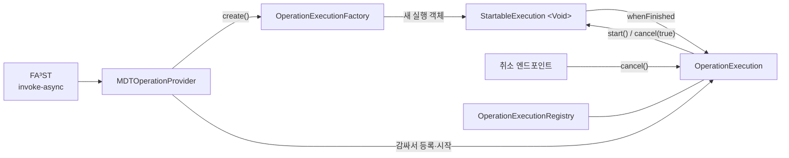
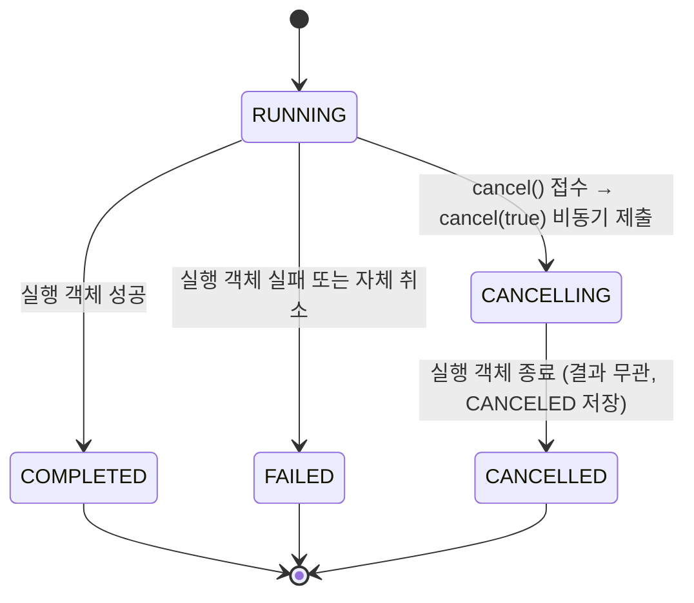

# 연산 실행 팩토리(`OperationExecutionFactory`) 설계

> **상태:** 제안. 9절의 결정 사항이 정해지면 구현에 들어간다.

MDT 인스턴스의 연산 provider 인터페이스(`OperationProvider`)를, 호출마다 실행 객체를 만드는 팩토리 인터페이스(`OperationExecutionFactory`)로 바꾸는 설계다. 취소의 외부 동작은 [원격 연산 취소 가이드](operation-cancel-guide.md)를 따른다.

---

## 1. 목표와 범위

### 1.1 배경

현재 provider는 `invokeSync(inputVars, inoutputVars, outputVars)` 하나만 제공한다. 하나의 provider 객체를 같은 AAS `Operation`의 모든 호출이 공유하고, 취소는 `OperationExecution`이 작업 스레드를 인터럽트하는 방식으로 전달된다. 이 방식에는 다음과 같은 한계가 있다.

- 인터럽트에 반응하지 않는 작업(장비 정지 명령이 필요한 시뮬레이터, 블로킹 I/O, 동기 그리퍼 호출 등)은 취소할 수 없다.
- 원격 연산을 호출하는 provider는 내부에서 이미 실행 객체(`AbstractThreadedExecution`)를 쓰면서도, 인터럽트를 받아 다시 `cancel(true)`로 바꾸는 우회(`runCancellingOnInterrupt`)를 거쳐야 한다.
- provider가 호출별 상태를 필드에 두면 동시 호출끼리 섞인다.

### 1.2 목표

- 연산 호출 한 번마다 실행 객체(`StartableExecution`)를 만들어 취소 대상을 분명히 한다.
- 인터럽트로 멈출 수 없는 작업도 실행 객체가 직접 취소를 처리할 수 있게 한다.
- 원격 호출 provider의 `runCancellingOnInterrupt` 단계를 없앤다.

### 1.3 바꾸지 않는 것

- 외부에서 본 취소 동작: 취소 엔드포인트, HTTP 응답 규약, `cancelWait`, `retainTimeout`, `CANCELED` 상태 저장과 재시도
- `OperationExecutionRegistry`의 역할과 API

---

## 2. 구성 요소와 역할

| 구성 요소 | 단위 | 역할 |
|-----------|------|------|
| `OperationExecutionFactory` (새 인터페이스) | AAS `Operation` 요소마다 1개, 여러 호출이 공유 | 호출마다 시작하지 않은 실행 객체를 만든다. 상태를 갖지 않는다. |
| `StartableExecution<Void>` (팩토리가 반환) | 호출마다 1개 | 연산 본문을 실행하고, 끝나면 `outputVars`·`inoutputVars`를 채운다. 취소 방법은 이 객체가 정한다. |
| `OperationExecution` (기존 클래스, 내부 변경) | 호출마다 1개 | 핸들 ID, MDT 쪽 취소 상태, FA³ST 콜백 연결, `CANCELED` 저장 처리기를 맡는다. 위 실행 객체를 감싸서 관리한다. |
| `MDTOperationProvider` (기존 클래스, 내부 변경) | `Operation` 요소마다 1개 | 설정에 따라 팩토리를 만들고, 호출이 오면 실행 객체 생성 → 등록 → 시작을 맡는다. |
| `ofSync` 어댑터 (새로 추가) | — | 기존 `OperationProvider`(동기 `invokeSync`)를 팩토리로 바꾼다. 지금과 같은 인터럽트 방식 취소를 유지한다. |

---

## 3. 팩토리 계약

### 3.1 `create(inputVars, inoutputVars, outputVars)`

- 실행 객체를 만들기만 한다. 시작하지 않으며, 원격 호출이나 프로세스 실행 같은 부수 효과도 일으키지 않는다.
- FA³ST 요청 스레드에서 호출되므로 빠르게 반환해야 한다.
- 입력 검증에 실패하면 예외를 던진다. 이 경우는 지금의 "시작 실패"와 같게 처리한다(`AssetConnectionException`, 등록 해제).
- 여러 스레드에서 동시에 호출될 수 있으므로, 팩토리는 호출별 상태를 필드에 두지 않는다.

### 3.2 반환하는 실행 객체

- `NOT_STARTED` 상태여야 한다.
- 실행 스레드는 인스턴스가 정한다. `MDTOperationProvider`가 `setExecutor()`로 registry의 전용 executor를 주입한 뒤 `start()`한다. 실행 객체가 스스로 스레드를 만들면 종료 대기에서 빠지므로 허용하지 않는다.
- 결과 타입은 `Void`다. 출력은 지금처럼 전달받은 `outputVars`와 `inoutputVars`를 채운다. **완료(`COMPLETED`)로 전이하기 전에 채우기를 끝내야 한다.** 프로그램 연산의 출력 파일 읽기 같은 후처리도 실행 객체 안에 포함한다.
- 취소는 `cancel(true)`로 요청받는다. 블로킹된 호출을 깨워야 하면 `CancellableWork`의 `cancelWork()`에서 처리한다. `cancelWork()`는 신호만 보내고 바로 반환한다(`utils.async` 규칙).
- 실행 객체가 내부에서 다른 하위 실행이나 프로세스를 쓴다면, 자신이 종료 상태로 바뀌기 전에 그것들도 끝나도록 책임진다.

---

## 4. `OperationExecution` 변경

### 4.1 변경 요약

| 항목 | 현재 | 변경 후 |
|------|------|---------|
| 작업 표현 | `CheckedRunnable work` | `StartableExecution<Void>` |
| 시작 | executor에 `run()`을 제출하고 작업 스레드를 기록 | 실행 객체에 executor를 주입하고 `start()`, `whenFinished`로 종료 통지를 받음 |
| 취소 | `RUNNING → CANCELLING`으로 원자적 전이 후 작업 스레드 인터럽트 | 같은 원자적 전이 후 실행 객체의 `cancel(true)`를 **executor에 비동기로 제출** |
| 종료 판정 | 작업 반환이나 예외에 따라 `finish()` | `whenFinished`의 결과(성공, 실패, 취소)에 따라 `finish()` |
| 작업 스레드 관리 | `m_worker`를 두고 끝나면 남은 인터럽트 플래그를 지움 | 제거(`ofSync` 어댑터로 옮김) |
| 저장 처리기, `awaitFinished`, 보존 만료, 재시도 | — | 바뀌지 않음 |

### 4.2 취소 요청을 비동기로 보내는 이유

`utils.async`의 `cancel(true)`는 실행 객체가 `STARTING`이나 `CANCELLING` 상태일 때 최대 cancel timeout까지 블로킹할 수 있고, `cancelWork()`가 끝날 때까지도 기다린다. 취소 엔드포인트 스레드에는 `cancelWait`(기본 2초) 예산이 있으므로, 이 스레드가 블로킹되지 않도록 취소 요청을 executor에 제출한다.

### 4.3 종료 상태 판정 규칙

현재 규칙을 유지한다. 판정은 `OperationExecution`이 하므로, 실행 객체가 `utils.async`의 규칙(`CANCELLING` 상태에서도 결과가 나오면 `COMPLETED`로 끝날 수 있음)을 따르더라도 외부에 보이는 동작은 바뀌지 않는다.

| MDT 쪽 상태 | 실행 객체 결과 | 최종 상태 | 처리 |
|-------------|----------------|-----------|------|
| `RUNNING` | 성공 | `COMPLETED` | 성공 콜백 |
| `RUNNING` | 실패 | `FAILED` | 실패 콜백 |
| `RUNNING` | 취소 | `FAILED` | 실패 콜백. MDT가 요청하지 않은 취소(예: 실행 객체 자체의 시간 초과)는 연산 실패로 본다. |
| `CANCELLING` | 성공, 실패, 취소 모두 | `CANCELLED` | `CANCELED` 저장. 출력은 무시한다. |

### 4.4 시작 전에 취소된 경우

`OperationExecution`은 `start()`를 부르지 않고 바로 `CANCELLED`로 끝낸다(현재와 같음). 실행 객체가 아직 `NOT_STARTED`이므로 `cancel(true)`만 불러 상태를 정리한다.

### 4.5 `Error` 처리

지금은 작업 스레드에서 `Error`를 다시 던진다. 바뀐 뒤에는 `whenFinished`로 실패를 받으므로, `Error`이면 로그를 남기고 실패로 처리한다. `Error`를 그대로 전파할지는 9절에서 정한다.

---

## 5. `MDTOperationProvider` 변경

- **필드:** `m_opProvider`를 `m_factory`(`OperationExecutionFactory`)로 바꾼다.
- **초기화:** 설정(`java`/`program`/`http`)에 맞는 팩토리를 만든다. 1단계에서는 세 경우 모두 기존 provider를 `ofSync`로 감싼다.
- **`invokeAsync`:**
  1. 출력 변수를 복제한다.
  2. `create()`를 호출한다.
  3. `OperationExecution`으로 감싸 registry에 등록한다.
  4. 시작한다.

  각 단계가 실패했을 때의 처리(등록 해제, 예외 변환, 로그)는 지금과 같다.
- **`invoke`(동기 호출):** `create()`한 뒤 호출 스레드에서 실행한다(`AbstractThreadedExecution.run()`과 같은 동기 실행). 지금처럼 취소할 수는 없다. 동기 호출에 시간 제한을 둘지는 9절에서 정한다.

---

## 6. `ofSync` 어댑터

- 기존 `OperationProvider` 하나를 받아, 호출마다 `invokeSync()`를 실행하는 `AbstractThreadedExecution<Void>`를 만드는 팩토리를 반환한다.
- **반드시 `CancellableWork`를 구현한다.** `utils.async`의 `cancel(true)`는 작업 스레드를 인터럽트하지 않으므로, `cancelWork()`에서 작업 스레드를 인터럽트해야 지금과 같은 동작이 유지된다.
- 작업이 끝나면 소비되지 않은 인터럽트 플래그를 지운다. 풀 스레드에 플래그가 남지 않게 하려는 것으로, 현재 `OperationExecution.run()`의 `finally` 처리를 그대로 옮긴다.
- 이 어댑터 덕분에 `AbstractJavaOperationProvider` 하위 클래스, 그리고 `config.json`의 `javas`로 지정하는 사용자 정의 클래스를 **수정 없이** 계속 쓸 수 있다.

---

## 7. 단계별 이행 계획

| 단계 | 내용 | 외부 동작 변화 |
|------|------|----------------|
| 1 | 팩토리 인터페이스와 `ofSync` 어댑터 추가, `OperationExecution`과 `MDTOperationProvider` 전환. 모든 provider는 어댑터로 연결한다. | 없음 |
| 2 | 원격 호출 provider가 실행 객체를 직접 반환하도록 전환(7.1절) | 취소 전달이 빨라지고 단순해짐 |
| 3 | 남은 단순 provider는 어댑터로 유지. `OperationProvider`를 공개 확장 인터페이스로 남길지 결정 | 없음 |

### 7.1 provider별 2단계 계획

| provider | 반환할 실행 객체 | 추가로 할 일 |
|----------|------------------|--------------|
| `HttpOperationProvider` | `RESTfulAsyncRpcClient`(`AbstractPeriodicPoller` 계열, `cancel()`이 세션 `DELETE`를 보냄) | 응답을 출력 변수에 반영하는 후처리를 실행 객체 안으로 옮겨야 하므로, 이를 포함하는 얇은 실행 클래스가 필요하다. |
| `ProgramOperationProvider` | `CommandExecution`(이미 `AbstractThreadedExecution`이고 `CancellableWork` 구현, 취소하면 프로세스 트리 종료) | 출력 변수 파일을 읽는 후처리가 필요해 감싸는 실행 클래스가 있어야 한다. 작업 디렉터리를 공유한다는 점(동시 실행 시 파일 충돌)은 지금과 같다. |
| 로봇(`RobotTwinOperationProvider` 하위 11개) | 로봇 클라이언트 연산 실행 객체 | 공통 기반 클래스의 `runOperation()`만 바꾸면 되므로 하위 클래스 변경은 적다. 진행 중인 동기 그리퍼 호출이 끝까지 수행되는 제약은 그대로 남는다. |
| RCK(`RCKSimulationOperation`) | `RCKSimulation`은 `StartableExecution`이 아니라 상태 차트(`WebSocketStateChart`)다. | 시뮬레이션을 감싸는 실행 클래스가 필요하다. `cancelWork()`에서 정지 명령을 보내고, 현재의 최대 실행 시간 타이머는 실행 객체의 `setTimeout`으로 옮긴다. |
| `AIModelOperation`, 시계열 조회 2개, `LoadEquipmentPropertiesList`, 사용자 정의 Java 연산 | — | 어댑터로 유지한다. |

---

## 8. 시험 항목

- **회귀:** 기존 취소 시험(`MDTOperationProviderCancelSaveTest` 등)이 1단계 후에도 그대로 통과해야 한다.
- **시점별 취소:** 시작 전, `STARTING` 중, 실행 중, 종료 직후에 취소했을 때 최종 상태와 응답 코드를 확인한다.
- **취소 우선:** 실행 객체가 `CANCELLING` 중에 성공으로 끝나도 최종 상태가 `CANCELLED`이고 출력이 저장되지 않는지 확인한다.
- **엔드포인트 블로킹:** 실행 객체의 `cancel(true)`가 오래 블로킹되어도 취소 엔드포인트가 `cancelWait` 안에 `202`로 응답하는지 확인한다.
- **풀 스레드:** 어댑터 사용 후 풀 스레드에 인터럽트 플래그가 남지 않는지 확인한다.
- **종료:** registry `shutdown` 시 모든 실행 객체에 취소가 전달되고, 주입한 executor 위에서 종료를 기다리는지 확인한다.
- **2단계 provider:** provider마다 원격 취소가 실제로 전달되는지 확인한다(세션 `DELETE`, 프로세스 종료, 로봇 정지, RCK 정지 명령).

---

## 9. 결정이 필요한 사항

| # | 항목 | 선택지 |
|---|------|--------|
| 1 | 이름 | `OperationExecutionFactory`로 정할지. 같은 이름 계열의 `OperationExecution` 클래스와 헷갈리지 않는지 함께 본다. |
| 2 | `Error` 처리 | 실행 객체 안에서 발생한 `Error`를 지금처럼 다시 던질지, 실패로 기록하는 데서 끝낼지. |
| 3 | 시간 초과의 의미 | 실행 객체 자체의 시간 초과로 취소된 경우(4.3절 표의 세 번째 행)를 `FAILED`로 볼지, FA³ST의 `Timeout` 상태로 따로 구분할지. |
| 4 | 동기 `invoke()`의 시간 제한 | 이번 변경에 함께 넣을지. |
| 5 | `OperationProvider` 유지 여부 | 사용자 정의 Java 연산을 위한 공개 인터페이스로 계속 둘지, 장기적으로 팩토리만 남길지. |
