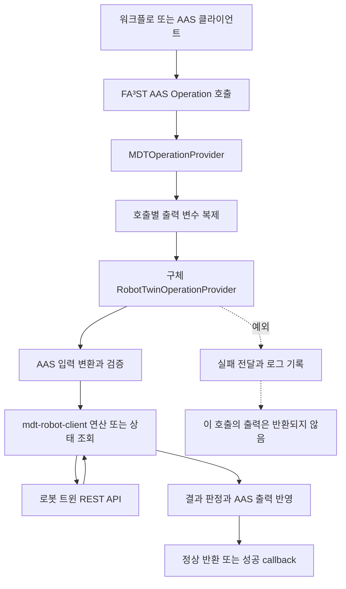
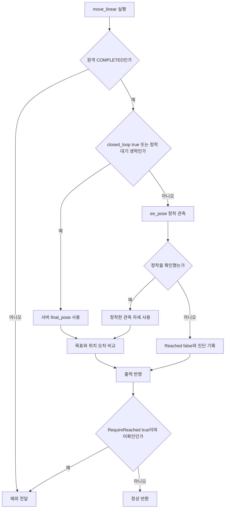
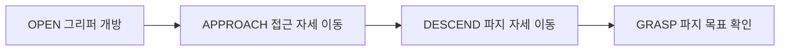
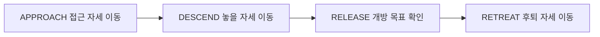
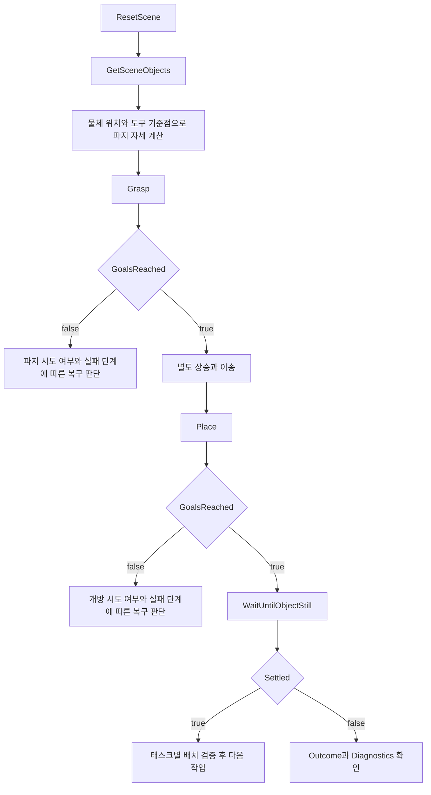

# 로봇 트윈 연산 Provider 기술 가이드

`mdt.assetconnection.operation.robot` 패키지는 AAS Operation의 입력을 로봇 트윈 클라이언트 호출로 변환하고, 실행 결과를 AAS 출력 변수에 반영한다. 로봇 이동, 그리퍼 제어, 파지·놓기 작업, scene 초기화와 관측을 워크플로에서 사용할 때 이 패키지를 이용한다.

이 문서는 MDT 인스턴스와 워크플로 개발자를 대상으로 클래스의 역할, 연산별 동작, 입력·출력 형식과 기본값을 설명한다. 설명 기준은 2026년 10월 25일의 구현이다. AAS 호출 등록과 다른 종류의 Provider는 [assetconnection 가이드](assetconnection-guide.md)를 참고한다.

표의 기본값은 **Provider에서 입력을 생략했을 때 적용하는 값**이다. AAS 모델이나 워크플로가 값을 명시하면 그 값이 우선한다. “서버 설정”은 Provider가 해당 값을 요청에 넣지 않는다는 뜻이며, 특정 배포의 기본값을 클라이언트가 보장한다는 뜻은 아니다.

연산별 설명 바로가기:

- 팔 이동: [MoveLinear](#4-movelinearprovider), [MoveToJoints](#5-movetojointsprovider), [MoveToNamedTarget](#6-movetonamedtargetprovider)
- 그리퍼와 조합 작업: [MoveGripperToTarget](#7-movegrippertotargetprovider), [Grasp](#8-graspprovider), [Place](#9-placeprovider). `PickProvider`·`AlignHeldObjectProvider`는 [assetconnection-guide.md](assetconnection-guide.md)의 해당 절에서 설명한다.
- Scene 관리와 관측: [ResetScene](#10-resetsceneprovider), [GetSceneObjects](#11-getsceneobjectsprovider), [WaitUntilObjectStill](#12-waituntilobjectstillprovider)

## 1 패키지 구성과 실행 흐름

### 1.1 클래스별 역할

| 클래스 | 역할 |
|---|---|
| [AbstractJavaOperationProvider](../src/main/java/mdt/assetconnection/operation/AbstractJavaOperationProvider.java) (상위 `operation` 패키지) | AAS 변수 배열을 이름별 Map으로 바꾸고 Property·SMC 접근 및 값 변환을 제공하는 공통 기반 |
| [RobotTwinOperationProvider](../src/main/java/mdt/assetconnection/operation/robot/RobotTwinOperationProvider.java) | 트윈 연결 설정, 클라이언트 생성, 입력 검증, 공통 결과 처리를 제공하는 추상 클래스 |
| [MoveLinearProvider](../src/main/java/mdt/assetconnection/operation/robot/MoveLinearProvider.java) | 팔 끝을 목표 자세로 직선 이동하고 위치 도달 여부를 판정 |
| [MoveToJointsProvider](../src/main/java/mdt/assetconnection/operation/robot/MoveToJointsProvider.java) | 관절 이름별 목표 각도로 이동 |
| [MoveToNamedTargetProvider](../src/main/java/mdt/assetconnection/operation/robot/MoveToNamedTargetProvider.java) | 서버에 정의된 이름 자세로 이동 |
| [MoveGripperToTargetProvider](../src/main/java/mdt/assetconnection/operation/robot/MoveGripperToTargetProvider.java) | 이름으로 지정한 그리퍼 목표를 실행 |
| [GraspProvider](../src/main/java/mdt/assetconnection/operation/robot/GraspProvider.java) | 개방 → 접근 → 하강 → 파지 목표 확인을 순서대로 실행 |
| [PickProvider](../src/main/java/mdt/assetconnection/operation/robot/PickProvider.java) | Grasp에 들어 올리기를 더하고, 물체 이름을 주면 들기 전후 물린 위치로 유지를 확인 |
| [PlaceProvider](../src/main/java/mdt/assetconnection/operation/robot/PlaceProvider.java) | 접근 → 하강 → 개방 목표 확인 → 후퇴를 순서대로 실행 |
| [ResetSceneProvider](../src/main/java/mdt/assetconnection/operation/robot/ResetSceneProvider.java) | 레시피에 따라 scene을 다시 배치하고 상태 변수 갱신을 대기 |
| [GetSceneObjectsProvider](../src/main/java/mdt/assetconnection/operation/robot/GetSceneObjectsProvider.java) | 품질이 OK인 scene 물체 정보를 조회 |
| [WaitUntilObjectStillProvider](../src/main/java/mdt/assetconnection/operation/robot/WaitUntilObjectStillProvider.java) | 지정한 물체의 위치·회전 변화가 충분히 작아질 때까지 관측 |
| [AlignHeldObjectProvider](../src/main/java/mdt/assetconnection/operation/robot/AlignHeldObjectProvider.java) | 쥔 원기둥의 바닥점을 입구 위로 맞추는 측정·보정 반복(펑션베이 peg 삽입용) |
| [SceneObjects](../src/main/java/mdt/assetconnection/operation/robot/SceneObjects.java) | 물체 JSON을 AAS SMC 목록으로 바꾸는 package-private 보조 클래스 |

11개의 구체 연산 Provider는 모두 `RobotTwinOperationProvider`를 상속한다. `SceneObjects`는 연산 Provider가 아니며 독립적으로 호출하는 AAS Operation도 없다.

### 1.2 AAS 호출과 클라이언트 연산의 관계



`AbstractJavaOperationProvider`는 `OperationVariable[]`을 각 요소의 `idShort`로 인덱싱한 Map으로 변환한다. 구체 Provider는 `invokeSync()`에서 입력을 읽고 클라이언트 연산을 실행한다. 현재 9개 Provider는 입출력 변수인 `inoutputVariables`를 결과 저장 용도로 사용하지 않는다.

AAS 비동기 호출은 Provider의 실행을 비동기로 감싼다. 이것과 로봇 트윈 서버의 동기·비동기 연산 구분은 별개다. 클라이언트는 서버의 연산 카탈로그에 따라 즉시 결과를 받거나 세션을 폴링한다. `GetSceneObjects`와 `WaitUntilObjectStill`은 상태 변수 조회이므로 원격 연산 세션을 만들지 않는다.

### 1.3 공통 기반 클래스

`AbstractJavaOperationProvider`의 주요 기능은 다음과 같다.

| 기능 | 동작 |
|---|---|
| 변수 배열 변환 | 입력·입출력·출력 배열을 각각 이름별 Map으로 변환 |
| 필수 변수 접근 | 변수가 없거나 요구한 AAS 형식과 다르면 예외 |
| 선택 변수 접근 | 변수가 없으면 null 반환. 존재하면 형식 검사 |
| 숫자·Boolean 변환 | 선택 값이 null 또는 공백이면 미지정으로 처리. 숫자 문자열의 앞뒤 공백은 제거 |
| 문자열 접근 | 원래 문자열을 반환. 공백 제거·빈 문자열 허용 여부는 각 연산이 결정 |
| Provider 설정 접근 | `arguments`의 직접 설정 또는 이름으로 지정한 전역 설정 조회 |

Property의 `valueType`도 계약의 일부다. 예를 들어 `VelocityScaling`의 `xs:float`를 임의로 `xs:double`로 바꾸면 일반 Property 접근에서 거부된다. SMC 내부의 관절·자세 변환은 별도의 `Ros2SerDes` 규칙을 따른다.

`RobotTwinOperationProvider`는 다음 기능을 추가한다.

| 메서드 | 역할 |
|---|---|
| `createRobotTwinClient()` | 연결 설정을 이용해 Provider별 클라이언트 하나 생성 |
| `runOperation()` | 클라이언트 연산의 `run()` 실행. `ExecutionException`에 감싸진 원인 예외를 꺼내 전달 |
| `readPose()` | AAS 자세를 변환하기 전에 위치·쿼터니언의 모든 성분이 유한한 숫자인지 검사 |
| `secondsToDuration()`, `settleDuration()` | 초를 밀리초로 반올림하고 음수·비유한 값·변환 범위 초과를 거부 |
| `getClientTimeout()` | 이동 연산의 서버 상한에 30초를 더해 결과 대기 시간 계산 |
| `throwIfRemoteFailed()` | 원격 실패를 로그에 남기고 `OperationFailedException` 발생 |
| `handleMotionResult()` | 관절·이름 자세 이동의 도달 확인 로그와 최종 출력 갱신 |
| `updateFinalState()` | `final_pose`, `final_joints`를 AAS 출력에 반영. 누락된 쪽은 경고 후 기존 값 유지 |
| `describeStop()` | Grasp·Place에서 실행 중 중단과 단계 사이 중단을 구분 |

## 2 공통 실행 계약

### 2.1 정상 반환과 목표 달성

AAS 호출이 정상 완료되어도 로봇이 목표에 도달했다는 뜻은 아니다. 다음 세 가지를 구분해야 한다.

| 구분 | 의미 | 대표 확인 방법 |
|---|---|---|
| 실행 완료 | 서버 또는 Provider가 결과를 반환함 | 원격 `COMPLETED`, AAS 호출 완료 |
| 목표 확인 | 위치 오차나 서버의 목표 보고가 해당 연산의 기준을 만족함 | `Reached`, `ReachedGoal`, `GoalsReached` |
| 실제 작업 성공 | 원하는 물체를 잡았거나 안정적으로 놓았음 | 별도 관측과 태스크별 검증 |

`Grasp`와 `Place`는 단계 목표 미확인도 정상 결과로 반환한다. **워크플로는 `GoalsReached`가 true인지 확인한 뒤 후속 동작을 실행해야 한다.** `WaitUntilObjectStill`은 `Settled`로 분기한다.

### 2.2 실패 시 출력과 기존 값의 의미

`MDTOperationProvider`는 매 호출마다 모델의 출력 정의를 복제한다. Provider가 예외를 던지면 그 출력 배열을 반환하지 않으며, `AASOperationClient`도 실패 상태의 출력 인자를 가져오지 않는다.

따라서 “Provider가 출력을 쓴 뒤 예외를 던졌다”는 사실만으로 워크플로가 그 값을 읽을 수 있는 것은 아니다. `MoveLinear`의 `RequireReached=true` 실패도 여기에 해당한다. 반면 `Grasp`·`Place`의 `GoalsReached=false` 정상 반환에서는 진단 출력이 전달된다.

이 문서에서 “기존 출력 유지”는 Provider가 전달받은 출력 요소를 변경하지 않는다는 뜻이다. 프레임워크에서는 모델에서 복제한 초기값일 수 있으므로, 이를 **직전 호출의 최신 결과**라고 해석하면 안 된다. 출력값을 갱신하지 않는 경우에는 별도의 유효성 판단이 필요하다.

### 2.3 시간 제한과 인터럽트

| 항목 | 기본값 또는 계산 방법 | 적용 범위 |
|---|---|---|
| HTTP timeout | 30초 | 연결·읽기·쓰기에 각각 적용. 전체 연산 시간 상한은 아님 |
| 원격 세션 폴링 | 1초 | 비동기 서버 연산의 결과 조회 |
| 클라이언트 기본 연산 timeout | 120초 | 그리퍼·리셋, Grasp·Place의 기본 하위 연산 대기 |
| 단일 이동의 결과 대기 | `MaxDurationSec + 30초`; 생략 시 90초 | MoveLinear·MoveToJoints·MoveToNamedTarget의 비동기 결과 대기 |
| 이동 후 정착 관측 | `SettleTimeout`, 기본 10초 | MoveLinear 및 Grasp·Place 내부 이동에서 필요할 때 추가 |

단일 이동의 90초는 **서버 기본 실행 상한을 60초로 가정**한 값이다. 서버의 `default_timeout_sec`를 변경하면 부모 클래스의 가정도 맞춰야 한다. `MaxDurationSec`를 생략했다고 Provider가 서버에 60초를 명시하는 것은 아니다.

`SettleTimeout`, 관측의 `Timeout`·`QuietPeriod`는 가장 가까운 밀리초로 반올림한다. 0.5ms는 1ms, 0.5ms 미만은 0이 된다. `SettleTimeout=0`은 정착 확인 생략이며, 양수가 필요한 관측 시간 입력은 반올림 결과가 0이어도 거부된다. 클라이언트가 처리할 수 없는 큰 기간도 거부된다.

결과 대기 시간 초과나 로컬 인터럽트가 원격 동작의 중단을 보장하지 않는다. 현재 Provider는 클라이언트 연산을 동기 실행하며 별도의 취소 API를 제공하지 않는다. 특히 Grasp·Place는 전체 작업의 서버 자원을 예약하지 않으므로 호출자가 다른 명령과의 경합을 조정해야 한다.

## 3 설정과 공통 데이터 구조

### 3.1 AAS 연산 등록

모델에 Operation과 입력·출력 변수를 먼저 정의하고, 인스턴스 `config.json`의 `operations.javas`에 Provider를 연결한다. 다음은 `Data:Operations.Grasp`를 등록하는 설정 일부다.

```json
{
  "operations": {
    "javas": {
      "Data:Operations.Grasp": {
        "className": "mdt.assetconnection.operation.robot.GraspProvider",
        "arguments": {
          "robotTwinConfigName": "panda_functionbay"
        }
      }
    }
  }
}
```

`robotTwinConfigName`은 전역 로봇 트윈 설정을 참조한다. 이름 참조 대신 `arguments`에 아래와 같이 직접 설정할 수도 있다.

```json
{
  "robotTwinConfig": {
    "robotTwinBaseUrl": "http://localhost:8000",
    "twinId": "panda01"
  }
}
```

위 URL은 형식 예시이며 실제 주소와 포트는 배포에 맞춰 지정한다. 두 설정을 모두 넣으면 이름 설정이 우선한다. `RobotTwinConfig.operations` 필드는 존재하지만 이 패키지의 현재 Provider는 그 맵으로 원격 연산 이름을 재지정하지 않는다.

### 3.2 Pose와 관절 목표

SMC는 `SubmodelElementCollection`, SML은 `SubmodelElementList`를 뜻한다. 변수명과 내부 요소의 `idShort`는 아래 대소문자를 그대로 사용한다.

```text
TargetPose / ApproachPose / GraspPose / PlacePose / RetreatPose  SMC
├─ Position       SMC
│  ├─ x           xs:float, m
│  ├─ y           xs:float, m
│  └─ z           xs:float, m
└─ Orientation    SMC
   ├─ x           xs:float
   ├─ y           xs:float
   ├─ z           xs:float
   └─ w           xs:float

Joints             SMC
├─ panda_joint1    xs:float, rad
├─ panda_joint2    xs:float, rad
└─ ...             이동 대상 관절 이름
```

`Orientation`은 Euler angle이 아닌 쿼터니언이다. 목표 자세의 모든 성분은 유한한 숫자여야 하고, 호출자는 유효한 회전을 나타내는 쿼터니언을 전달해야 한다. Grasp·Place는 클라이언트에서도 0 쿼터니언을 거부한다. 단일 MoveLinear의 공통 입력 검사는 유한값 확인까지이므로 이를 회전의 유효성 검증으로 해석하지 않는다. 목표 좌표에는 기본값이 없으므로 호출자가 채워야 한다.

Pose 입력에는 Frame 필드가 없다. 기준 좌표계와 도구 기준점은 서버의 이동 설정에 맞춰야 한다. 물체 중심, TCP, `panda_link8`, 펑션베이의 grasp center는 같은 점이 아니므로 관측한 물체 좌표를 그대로 팔 목표로 사용하지 않는다. 필요한 TCP 보정과 접근 높이는 호출자가 계산한다.

### 3.3 이동 결과의 구조

```text
FinalPose          SMC
├─ Header          SMC
│  ├─ Stamp        xs:long, ROS stamp를 나노초로 합친 값
│  └─ FrameId      xs:string
└─ Pose            SMC
   ├─ Position     SMC, x/y/z: xs:float
   └─ Orientation  SMC, x/y/z/w: xs:float

FinalJoints        SMC
├─ panda_joint1    xs:float, rad
├─ panda_joint2    xs:float, rad
└─ ...
```

`FinalJoints`는 관절 위치만 담는다. 서버의 `joint_states`에 velocity와 effort가 있어도 이 AAS 출력 구조에는 포함하지 않는다. `FinalPose`는 PoseStamped 구조이므로 입력용 Pose SMC와 혼동하지 않는다. 출력 SMC 내부 구조도 변환기가 갱신할 수 있도록 모델에 정의해야 한다.

### 3.4 SceneObjects와 Objects 출력

`SceneObjects`는 두 종류의 JSON을 같은 AAS 구조로 바꾼다.

| 변환 메서드 | 원본 | 의미 |
|---|---|---|
| `fromPlacementList()` | `reset_scene.outputs.objects` 배열 | 리셋으로 명령한 배치 |
| `fromSceneObjectMap()` | `scene_objects.value.objects` 맵 | 상태 변수로 관측한 scene |

```text
Objects              SMC
└─ 물체 이름          SMC, 이름을 idShort로 사용
   ├─ Type           xs:string
   ├─ Dimensions     SML, 각 요소는 xs:float
   └─ Pose           SMC
      ├─ Position    SMC, x/y/z: xs:float, m
      └─ Orientation SMC, x/y/z/w: xs:float
```

Dimensions의 순서는 `shape_msgs/SolidPrimitive`를 따른다. box는 `[x 길이, y 길이, z 길이]`, cylinder는 `[높이, 반지름]`, sphere는 `[반지름]`이며 단위는 m다.

물체 이름은 `[A-Za-z][A-Za-z0-9_]*` 형식이어야 한다. 위치 객체가 없거나 물체 목록의 구조가 맞지 않으면 변환이 실패한다. orientation 객체가 없으면 단위 쿼터니언 `(0, 0, 0, 1)`을 사용한다. 누락되거나 숫자가 아닌 개별 수치는 `NaN`으로 표현될 수 있으므로, `Objects` 변환 자체가 모든 좌표의 유효성을 보장하지는 않는다.

현재 Panda 구성에서는 scene 좌표가 로봇 base인 `panda_link0` 기준이다. 이 변환기는 좌표 변환을 수행하거나 원본 frame을 Objects에 추가하지 않는다. 다른 배포에서는 상태 변수의 frame 설정을 확인해야 한다.

## 4 MoveLinearProvider

### 4.1 동작과 도달 판정

클라이언트 `MoveLinear`를 통해 `move_linear`를 실행한다. 원격 결과가 `COMPLETED`이고 `closed_loop`이 JSON Boolean true가 아니며 `SettleTimeout`이 양수이면, `ee_pose`의 위치가 안정될 때까지 추가로 관측한다.



위치 오차는 `max(|dx|, |dy|, |dz|)`이며, `Tolerance` 이하이면 도달로 판정한다. 방향 오차는 비교하지 않는다. 정착 관측은 목표 도달 검사와 별개이며 내부 기본값은 위치 변화 허용 0.2mm, 정숙 구간 0.6초, 조회 간격 300ms다. Provider의 `Tolerance`를 바꿔도 이 정착 조건은 바뀌지 않는다.

### 4.2 입력 인자

| 이름 | AAS 형식 | 필수 | 생략 시 | 의미와 범위 |
|---|---|---|---|---|
| `TargetPose` | Pose SMC | 예 | 없음 | 직선 이동의 목표 위치·자세 |
| `VelocityScaling` | xs:float | 아니오 | 서버 설정 | 속도 배율. 유한한 `(0, 1]`; 배포별 세부 하한은 서버 검사 |
| `MaxDurationSec` | xs:int | 아니오 | 서버 설정 | 서버 실행 상한, 양수 초. 지정하면 `max_duration_sec`로 전송 |
| `Tolerance` | xs:double | 아니오 | 0.005m | 위치 도달 허용 오차. 유한한 양수 |
| `SettleTimeout` | xs:double | 아니오 | 10초 | 추가 정착 관측 상한. 0이면 생략 |
| `RequireReached` | xs:boolean | 아니오 | false | true이면 도달 미확인을 `TaskException`으로 처리 |

`Frame`, `MaxStep`, `JumpThreshold`는 지원하지 않는다. 값이 비어 있어도 입력 또는 입출력 변수에 해당 이름이 있으면 요청 전에 거부한다. 관련 설정은 서버에서 관리한다.

### 4.3 출력 인자와 실패 처리

| 이름 | AAS 형식 | 필수 바인딩 | 의미 |
|---|---|---|---|
| `FinalPose` | PoseStamped SMC | 예 | 정착을 확인했으면 그 관측 자세, 아니면 서버의 `final_pose` |
| `FinalJoints` | 관절 위치 SMC | 예 | 서버의 `final_joints`. 정착 후 유효한 관절 조회에 성공하면 조회값 사용 |
| `Reached` | xs:boolean | 아니오 | 위치 도달 확인 여부. false에는 확인 불가도 포함 |
| `PositionError` | xs:double | 아니오 | 축별 거리 최댓값, m. 계산할 수 없으면 갱신하지 않음 |

정착에 성공한 뒤에는 `joint_states`를 한 번 더 읽는다. 품질이 OK가 아니거나 값이 없거나 처리 대상 통신 오류가 나면 경고를 남기고 서버의 관절 출력을 사용한다. 인터럽트는 전파한다. `FinalPose`와 `FinalJoints`는 동기화된 표본이 아니므로 같은 시각의 상태라고 가정하지 않는다.

정착 시간 초과이면 `Reached=false`이며 `PositionError`를 갱신하지 않는다. 이때 최종 상태에 서버 스냅샷이 남아 있어도 정착의 증거로 쓰면 안 된다. 서버 출력 자체가 없으면 해당 출력은 갱신하지 않는다.

원격 `FAILED`·`CANCELLED`는 예외다. 목표 미확인은 기본적으로 정상 반환하지만 `RequireReached=true`이면 예외가 된다. **예외로 끝난 호출의 출력은 워크플로에 전달되지 않는다.** 실패 시점의 자세를 이용해 분기하려면 `RequireReached=false`와 `Reached` 출력을 사용한다.

## 5 MoveToJointsProvider

### 5.1 기본 동작

`Joints`를 관절 이름과 목표 각도의 Map으로 변환해 클라이언트 `MoveToJoints`에 넘긴다. 원격 연산은 `move_to_joints`다. 연산이 완료되면 서버가 반환한 최종 자세와 관절 위치를 출력한다.

이 Provider는 추가 정착 관측이나 목표 관절값과의 오차 비교를 하지 않는다. 클라이언트가 `closed_loop=true`를 확인하지 못해도 원격 결과가 `COMPLETED`이면 정상 반환한다. Boolean false는 INFO, 누락·null·형식 오류는 WARN으로 기록한다.

### 5.2 입력 인자

| 이름 | AAS 형식 | 필수 | 생략 시 | 의미와 범위 |
|---|---|---|---|---|
| `Joints` | 관절 목표 SMC | 예 | 없음 | 각 관절 이름의 xs:float 목표 각도, rad. 빈 목표는 허용하지 않음 |
| `VelocityScaling` | xs:float | 아니오 | 서버 설정 | 유한한 `(0, 1]` 속도 배율 |
| `MaxDurationSec` | xs:int | 아니오 | 서버 설정 | 양수 초 단위의 서버 실행 상한 |

팔 이동 그룹에 속한 관절만 전달한다. `joint_states`를 복사하면서 손가락 관절을 함께 넣으면 계획이 실패할 수 있다. 그룹과 관절 이름의 유효성은 서버가 판단한다.

현재 `JointsSerDe`는 SMC 자식 중 `xs:float`만 추출한다. `xs:double`·`xs:string` 등으로 작성한 관절은 변환에서 제외될 수 있으므로 모든 목표 관절의 형식을 `xs:float`로 맞춰야 한다. 이를 자동 형식 변환으로 기대하면 안 된다.

### 5.3 출력 인자와 실패 처리

| 이름 | AAS 형식 | 필수 바인딩 | 의미 |
|---|---|---|---|
| `FinalPose` | PoseStamped SMC | 예 | 서버가 연산 종료 시 반환한 자세 |
| `FinalJoints` | 관절 위치 SMC | 예 | 서버가 연산 종료 시 반환한 관절 위치 |

`Reached` 출력은 없다. 특히 개루프 환경의 두 출력은 아직 움직이는 중의 스냅샷일 수 있다. 원격 `FAILED`·`CANCELLED`는 `OperationFailedException`이며, 서버 출력 누락·null은 경고 후 해당 값을 갱신하지 않는다. 클라이언트 결과 대기 상한은 지정한 서버 상한에 30초를 더한 값이고 생략 시 90초다.

## 6 MoveToNamedTargetProvider

### 6.1 기본 동작

클라이언트 `MoveToNamedTarget`을 통해 `move_to_named_target`을 실행한다. 목표는 서버의 SRDF 등에 정의된 이름 자세다. `ready` 같은 이름의 지원 여부와 실제 관절 목표는 서버 설정을 따른다.

관절 이동과 마찬가지로 추가 정착 관측을 하지 않는다. 클라이언트의 도달 확인 결과는 로그에 반영하며, 개루프라는 이유만으로 AAS 호출을 실패시키지는 않는다.

### 6.2 입력 인자

| 이름 | AAS 형식 | 필수 | 생략 시 | 의미와 범위 |
|---|---|---|---|---|
| `TargetName` | xs:string | 예 | 없음 | 이름 자세. null·공백 문자열·앞뒤 공백은 거부 |
| `VelocityScaling` | xs:float | 아니오 | 서버 설정 | 유한한 `(0, 1]` 속도 배율 |
| `MaxDurationSec` | xs:int | 아니오 | 서버 설정 | 양수 초 단위의 서버 실행 상한 |

### 6.3 출력 인자와 실패 처리

| 이름 | AAS 형식 | 필수 바인딩 | 의미 |
|---|---|---|---|
| `FinalPose` | PoseStamped SMC | 예 | 서버 종료 스냅샷의 자세 |
| `FinalJoints` | 관절 위치 SMC | 예 | 서버 종료 스냅샷의 관절 위치 |

도달 미확인 로그, 원격 실패, 출력 누락, 결과 대기 상한은 `MoveToJointsProvider`와 같다. 목표 이름이 존재하지 않으면 접수 단계에서 서버가 거부할 수 있으며, 이 경우 정상 결과가 아닌 예외가 전달된다.

## 7 MoveGripperToTargetProvider

### 7.1 기본 동작

클라이언트 `MoveGripperToNamedTarget`으로 원격 `move_gripper_to_target`을 실행한다. `open`, `close`, `grasp` 등의 목표 이름을 지정하며 지원되는 이름은 배포마다 다를 수 있다.

동기 서버 연산에서는 HTTP 시간 제한이 적용되고, 비동기 서버 연산에서는 기본 120초 동안 결과를 기다린다. Provider는 별도의 timeout 입력을 제공하지 않는다.

### 7.2 입력 인자

| 이름 | AAS 형식 | 필수 | 생략 시 | 의미 |
|---|---|---|---|---|
| `Target` | xs:string | 예 | 없음 | 실행할 그리퍼 목표 이름. null·공백 문자열·앞뒤 공백은 거부 |

### 7.3 출력 인자와 호환 처리

| 이름 | AAS 형식 | 필수 바인딩 | 의미와 갱신 규칙 |
|---|---|---|---|
| `Pose` | xs:string | 예 | 실행된 목표 이름. 위치·자세 구조가 아닌 문자열 |
| `Position` | xs:float | 예 | 그리퍼 개구 폭, m. 값이 없으면 갱신하지 않음 |
| `Stalled` | xs:boolean | 예 | 서버가 보고한 정지·stall 상태. 실제 파지 성공으로 단정하지 않음 |
| `ReachedGoal` | xs:boolean | 예 | 서버가 보고한 그리퍼 목표 도달 여부 |
| `Effort` | xs:float | 아니오 | 서버의 effort 출력. 숫자가 있을 때만 갱신하며 단위·의미는 서버 규약을 따름 |

원격 출력 이름은 `target` → `goal`, `width` → `position`, `at_goal` → `reached_goal` 순으로 찾는다. 앞 이름이 없거나 null이면 뒤 이름을 사용한다. `stalled`는 대체 이름이 없다. 필수 원격 값인 목표 이름·stall·도달 보고를 얻지 못하면 `IOException`이다. Boolean이 아닌 stall·도달 값은 WARN 후 false로 반영한다.

이 호환 변환 때문에 Provider의 `ReachedGoal`은 클라이언트의 `check.atGoal()`을 그대로 복사한 값이 아니다. 예전 이름의 출력을 받는 경우에도 AAS 호환을 유지한다. 펑션베이에서 개구 폭을 얻지 못하면 `Position`이 갱신되지 않을 수 있다.

원격 `FAILED`·`CANCELLED`는 출력 갱신 전에 예외로 전달한다. 원격 `COMPLETED`에 `at_goal=false`가 담겨 오면 `ReachedGoal=false`로 정상 반환한다. `ReachedGoal=true`도 특정 물체를 실제로 잡았거나 놓았다는 보장은 아니다.

## 8 GraspProvider

### 8.1 실행 순서



클라이언트 `Grasp`로 네 단계를 실행한다. 각 단계의 목표를 확인한 뒤에만 다음 단계로 넘어간다. 이동은 `MoveLinear`, 그리퍼 단계는 `MoveGripperToNamedTarget`을 사용한다. **물체를 들어 올리는 단계는 포함하지 않는다.** 이미 물체를 쥐고 있다면 첫 OPEN 단계에서 개방 명령을 보내므로 호출 시점을 구분해야 한다.

### 8.2 입력 인자

| 이름 | AAS 형식 | 필수 | 생략 시 | 의미와 범위 |
|---|---|---|---|---|
| `ApproachPose` | Pose SMC | 예 | 없음 | 파지 위치에 접근할 절대 자세 |
| `GraspPose` | Pose SMC | 예 | 없음 | 하강 후 파지할 절대 자세 |
| `ApproachVelocityScaling` | xs:float | 아니오 | 0.2 | 접근 속도 배율, 유한한 `(0, 1]` |
| `DescentVelocityScaling` | xs:float | 아니오 | 0.2 | 하강 속도 배율, 유한한 `(0, 1]` |
| `Tolerance` | xs:double | 아니오 | 0.005m | 두 이동에 적용하는 위치 도달 허용 오차, 양수 |
| `SettleTimeout` | xs:double | 아니오 | 10초 | 각 이동의 추가 정착 관측 상한. 0이면 생략 |
| `TimeoutSec` | xs:int | 아니오 | 120초 | 하위 비동기 연산별 결과 대기 상한, 양수 |
| `OpenTarget` | xs:string | 아니오 | `open` | 첫 개방 단계의 목표 이름 |
| `GraspTarget` | xs:string | 아니오 | `grasp` | 마지막 파지 단계의 목표 이름 |

목표 이름은 빈 문자열이나 앞뒤 공백을 허용하지 않는다. 속도 생략 시 서버 기본값을 쓰는 단일 이동 Provider와 달리, Grasp는 각 속도 0.2를 명시한다. `TimeoutSec`는 전체 작업 시간이나 서버 실행 상한이 아니며, 동기 그리퍼의 HTTP 제한과 이동 후 정착 관측은 별도로 적용된다.

### 8.3 출력 인자와 실패 처리

| 이름 | AAS 형식 | 필수 바인딩 | 의미 |
|---|---|---|---|
| `GoalsReached` | xs:boolean | 예 | 네 단계의 목표를 모두 확인했는지 |
| `GraspAttempted` | xs:boolean | 예 | GRASP 하위 실행에 진입했는지 |
| `FailedStage` | xs:string | 예 | `OPEN`, `APPROACH`, `DESCEND`, `GRASP`. 목표를 모두 확인하면 빈 문자열 |
| `FailureReason` | xs:string | 예 | 목표 미확인 사유. 목표를 모두 확인하면 빈 문자열 |

`GraspAttempted=true`는 명령 전송·파지 성공의 증거가 아니다. 복구 시 그리퍼가 무언가를 쥐었을 가능성을 고려하는 정보다. false도 실행 전부터 빈손이었다는 보장은 아니다.

단계 목표 미확인과 하위 원격 `FAILED`·`CANCELLED`는 `GoalsReached=false`로 정상 반환하고 후속 단계를 실행하지 않는다. 접수 거부·통신 오류·인터럽트는 예외다. 예외일 때는 진행 진단을 로그에 남기지만 출력은 워크플로에 전달되지 않는다. 단계 사이 중단은 성공한 앞 단계를 실패로 표시하지 않고 “APPROACH 완료 후 DESCEND 진입 전 중단”처럼 기록한다.

자동 개방·상승·복귀·재시도는 하지 않는다. `GoalsReached=true`는 위치 도달과 그리퍼 목표 보고의 조합이며 실제 물체 파지를 보장하지 않는다.

## 9 PlaceProvider

### 9.1 실행 순서



물체를 쥔 상태에서 클라이언트 `Place`를 실행한다. 하강 목표는 물체 형상·파지 오프셋·여유 간격을 고려한 접촉 전 위치로 계산한다. 하강의 위치 목표를 확인하지 못하면 개방하지 않는다. 개방 목표를 확인하면 고정 대기 없이 후퇴한다.

도달 허용 오차는 충돌을 막는 이동 제한이 아니다. 기본 5mm 허용 오차만으로 작은 접촉 여유를 보장할 수 없다. peg 삽입처럼 개방 전에 착석 확인이 필요한 작업은 이동·관측·개방을 별도 태스크로 구성한다.

### 9.2 입력 인자

| 이름 | AAS 형식 | 필수 | 생략 시 | 의미와 범위 |
|---|---|---|---|---|
| `ApproachPose` | Pose SMC | 예 | 없음 | 놓을 위치에 접근할 절대 자세 |
| `PlacePose` | Pose SMC | 예 | 없음 | 개방할 위치의 절대 자세 |
| `RetreatPose` | Pose SMC | 아니오 | `ApproachPose` | 개방 뒤 후퇴할 자세. **변수 자체가 없을 때만** 기본값 사용 |
| `ApproachVelocityScaling` | xs:float | 아니오 | 0.2 | 접근 속도 배율, 유한한 `(0, 1]` |
| `DescentVelocityScaling` | xs:float | 아니오 | 0.2 | 하강 속도 배율, 유한한 `(0, 1]` |
| `RetreatVelocityScaling` | xs:float | 아니오 | 0.2 | 후퇴 속도 배율, 유한한 `(0, 1]` |
| `Tolerance` | xs:double | 아니오 | 0.005m | 세 이동의 위치 도달 허용 오차, 양수 |
| `SettleTimeout` | xs:double | 아니오 | 10초 | 각 이동의 추가 정착 관측 상한. 0이면 생략 |
| `TimeoutSec` | xs:int | 아니오 | 120초 | 하위 비동기 연산별 결과 대기 상한, 양수 |
| `ReleaseTarget` | xs:string | 아니오 | `open` | 개방 단계의 목표 이름. 빈 문자열·앞뒤 공백은 거부 |

`RetreatPose`를 전달하면서 내부 좌표를 비워 두면 입력 오류다. 후퇴 자세와 속도를 포함해 전체 입력을 첫 이동 전에 검사한다. 시간 제한과 정착 조건은 Grasp와 같은 방식으로 적용한다.

### 9.3 출력 인자와 실패 처리

| 이름 | AAS 형식 | 필수 바인딩 | 의미 |
|---|---|---|---|
| `GoalsReached` | xs:boolean | 예 | 접근·하강·개방·후퇴 목표를 모두 확인했는지 |
| `ReleaseAttempted` | xs:boolean | 예 | RELEASE 하위 실행에 진입했는지 |
| `FailedStage` | xs:string | 예 | `APPROACH`, `DESCEND`, `RELEASE`, `RETREAT`. 목표를 모두 확인하면 빈 문자열 |
| `FailureReason` | xs:string | 예 | 목표 미확인 사유. 목표를 모두 확인하면 빈 문자열 |

`ReleaseAttempted`는 실제 해제의 증거가 아니다. false도 물체를 계속 쥐고 있음을 보장하지 않는다. `FailedStage=RETREAT`이면 개방 목표는 확인했고 후퇴만 확인하지 못한 상태다.

Grasp와 마찬가지로 목표 미확인·하위 원격 실패는 `GoalsReached=false` 정상 결과이며, 접수 거부·통신 오류·인터럽트는 예외다. 자동 재파지·복귀·재시도는 하지 않는다. 개방 후 중단되면 후퇴하지 않은 상태일 수 있으며, 정상 결과라도 물체의 실제 분리·안착은 별도 관측이 필요하다.

## 10 ResetSceneProvider

### 10.1 기본 동작

클라이언트 `ResetScene`으로 `reset_scene`을 실행해 scene을 레시피대로 배치한다. 서버의 `reset_scene.backend.scenes`에 레시피가 정의되어 있어야 한다.

원격 완료 후에는 배치 형식과 `applied_count`를 확인한다. 적용된 물체 수와 결과 배열 크기가 맞지 않는 등 적용을 확인할 수 없으면 실패한다. 적용을 확인한 뒤 `WaitForFreshVariable`로 `scene_objects`의 기준 표본 이후 갱신 2회를 기다린다. 관측 상한은 5초, 조회 간격은 100ms로 고정되어 있으며 공개 입력으로 바꿀 수 없다.

### 10.2 입력 인자

| 이름 | AAS 형식 | 필수 | 생략 시 | 의미 |
|---|---|---|---|---|
| `SceneName` | xs:string | 예 | 없음 | 레시피 이름. 공백 문자열은 거부하며 앞뒤 공백은 제거 |
| `Seed` | xs:int | 아니오 | 서버 기본값 | 무작위 배치의 seed. 지정하면 long으로 변환해 전달 |

현재 rdfp_ws 서버는 seed 생략 시 0을 사용한다. 무작위 레시피도 동일한 seed이면 같은 배치를 만들므로, 매번 다른 배치가 필요하면 호출자가 seed를 바꿔야 한다. 현재 서버 구성은 arm과 scene 자원을 함께 점유하므로 팔 이동 중에는 409 `RESOURCE_BUSY`로 거부될 수 있다.

### 10.3 출력 인자와 관측 실패

| 이름 | AAS 형식 | 필수 바인딩 | 의미 |
|---|---|---|---|
| `Objects` | 물체 목록 SMC | 아니오 | 리셋으로 **명령한 배치**. 관측한 최종 위치가 아님 |

원격 `FAILED`·`CANCELLED`는 `OperationFailedException`, `COMPLETED`라도 적용 미확인이면 `TaskException`이다. 이 경우 출력은 반환하지 않는다.

상태 변수 갱신을 5초 안에 확인하지 못하면 WARN을 남기고 명령 배치를 정상 반환한다. 반면 관측 통신 오류·인터럽트는 예외로 전달하며 출력을 반환하지 않는다. 예외가 이미 적용된 리셋을 취소하거나 되돌리지는 않는다.

새 발행을 확인해도 물리적 정착까지 증명하지는 않는다. 실제 배치는 `GetSceneObjects`, 물체 정착은 `WaitUntilObjectStill`로 구분해서 확인한다.

## 11 GetSceneObjectsProvider

### 11.1 기본 동작과 재조회

`RobotTwinClient.readRaw("scene_objects")`로 품질을 포함한 상태 응답을 조회한다. `quality=OK`이면 물체 맵을 AAS `Objects`로 변환한다. 이미 OK인 표본의 새 발행을 추가로 기다리지는 않는다.

| 응답 또는 상황 | 처리 |
|---|---|
| `OK` | 물체 변환 후 정상 반환 |
| `STALE` | 최초 조회 시작부터 10초 예산 안에서 300ms 간격으로 재조회 |
| `NO_DATA`, 기타 품질, 품질 누락 | 즉시 `TaskException` |
| STALE 재조회 예산 소진 | 조회 횟수와 사유를 포함한 `TaskException` |
| HTTP 오류 또는 인터럽트 | 재시도하지 않고 예외 전달 |

10초는 **추가 요청을 시작할 수 있는 기간**이다. 이미 시작한 요청의 OK 응답은 예산 이후 도착해도 사용하므로 전체 호출 시간이 10초를 넘을 수 있다. 재조회 후 회복하면 조회 횟수와 경과 시간을 INFO로 남긴다.

### 11.2 입력과 출력

입력 인자는 없다. 재조회 예산·간격은 구현 상수이며 AAS 입력이 아니다.

| 이름 | 방향 | AAS 형식 | 필수 바인딩 | 의미 |
|---|---|---|---|---|
| `Objects` | 출력 | 물체 목록 SMC | 예 | 현재 품질 OK인 scene의 물체 정보. 성공 시 목록 전체를 교체 |

품질 검사나 물체 변환에 실패하면 출력을 반환하지 않는다. 관측값은 물체 중심 기준이며 로봇 팔 명령 좌표로 자동 변환하지 않는다. 리셋 직후에 OK 응답을 얻었더라도 그것이 반드시 새 배치의 관측이라는 보장은 없다.

## 12 WaitUntilObjectStillProvider

### 12.1 정착 판정

로봇 명령을 보내지 않고 `scene_objects` 안의 한 물체를 관측한다. 고정 시간 대기와 scene 조회를 조합하는 대신, 물체 움직임이 충분히 작아졌는지 확인할 때 사용한다.

표본은 품질 OK, 시간대가 있는 `received_at`, 대상 물체의 유효한 위치와 단위 쿼터니언을 갖춰야 한다. 새 표본의 위치와 회전이 구간 시작 자세의 허용 범위에 머물고, 로컬 경과 시간과 `received_at` 경과 시간이 모두 `QuietPeriod` 이상이면 정착으로 판정한다. 같은 시각의 중복 표본만 반복해서 읽는 것으로는 정착을 확인할 수 없다.

STALE·잘못된 표본, 시각 역행, frame 변경, 허용 범위를 넘는 움직임 등은 정숙 구간을 다시 시작하게 한다. 관측 상한 뒤 도착한 표본으로 정착 성공을 판정하지 않는다. 이는 늦게 도착한 OK 응답도 사용하는 `GetSceneObjects`의 정책과 다르다.

### 12.2 입력 인자

| 이름 | AAS 형식 | 필수 | 생략 시 | 의미와 범위 |
|---|---|---|---|---|
| `ObjectName` | xs:string | 예 | 없음 | 관측할 물체 이름. null·공백 문자열·앞뒤 공백은 거부 |
| `Timeout` | xs:double | 아니오 | 10초 | 관측 상한. 밀리초 반올림 결과가 양수여야 함 |
| `PositionTolerance` | xs:double | 아니오 | 0.0002m | 중심 위치 변화의 축별 허용값. 유한한 0 이상 |
| `AngleToleranceDeg` | xs:double | 아니오 | 0.5도 | 회전 변화 허용값. 유한한 `[0, 180]`, 내부에서 rad로 변환 |
| `QuietPeriod` | xs:double | 아니오 | 0.6초 | 움직임이 허용 범위에 머물러야 하는 기간. 밀리초 반올림 결과가 양수여야 함 |

조회 간격은 100ms로 고정된다. 펑션베이처럼 발행이 잠시 멈추는 배포에서는 중단 시간과 재개 후의 정숙 구간, 통신 여유를 고려해 Timeout을 정한다. HTTP 요청을 관측 상한 시점에 즉시 끊지는 않는다.

위치 허용값은 물체 중심 기준이다. 긴 물체의 끝점 정밀도가 필요하면 회전 허용값도 줄여야 한다. 작은 회전에서 끝점 변위는 대략 `중심에서 끝점까지 거리 × 회전각(rad)`다. 정착 판정은 관측 구간의 움직임에 대한 판단이며 목표 위치 도달·파지·삽입 성공을 보장하지 않는다.

### 12.3 출력 인자와 결과 해석

| 이름 | AAS 형식 | 필수 바인딩 | 의미 |
|---|---|---|---|
| `Settled` | xs:boolean | 예 | 관측 조건에 따라 정착을 확인했는지 |
| `Outcome` | xs:string | 예 | `SETTLED`, `TIMEOUT`, `NO_VALID_SAMPLE` |
| `Objects` | 물체 목록 SMC | 아니오 | 마지막 유효 표본의 **전체 scene 물체 목록**. 대상 물체 하나만 반환하는 것은 아님 |
| `Diagnostics` | xs:string | 아니오 | 조회·표본 거부·구간 초기화 등에 대한 관측 진단 요약 |

| Outcome | Settled | 해석 |
|---|---|---|
| `SETTLED` | true | 관측 조건을 만족함 |
| `TIMEOUT` | false | 유효 표본은 있었으나 상한 안에 정착을 확인하지 못함 |
| `NO_VALID_SAMPLE` | false | 유효 표본이 하나도 없었음. 대상 물체 누락이나 표본 형식 오류도 원인이 될 수 있음 |

TIMEOUT과 NO_VALID_SAMPLE은 예외가 아닌 정상 결과다. TIMEOUT이어도 마지막 유효 표본이 있으면 `Objects`를 갱신하지만, 이를 정착의 증거로 사용해서는 안 된다. 유효 표본이 없으면 `Objects`를 갱신하지 않는다.

통신 오류·인터럽트는 예외이며 출력이 반환되지 않는다. 입력 오류와 물체 변환 오류도 출력 반영 전에 처리한다. 대상 물체의 pose가 유효해도 전체 scene을 AAS로 변환하는 과정에서 다른 물체의 구조 때문에 실패할 수 있다. 좌표가 필요하지 않다면 선택 출력 `Objects`를 생략할 수 있다.

## 13 연산 선택과 워크플로 구성

### 13.1 목적별 선택

| 목적 | 연산 | 다음 단계로 넘어가기 전에 확인할 사항 |
|---|---|---|
| 팔 끝을 특정 위치로 이동 | MoveLinear | `Reached`. 예외로 중단하려면 `RequireReached=true` |
| 관절 목표 또는 이름 자세로 이동 | MoveToJoints / MoveToNamedTarget | 출력은 서버 스냅샷. 개루프에서 별도 정착 확인 없이 도달로 단정하지 않음 |
| 그리퍼만 제어 | MoveGripperToTarget | `ReachedGoal`; 실제 물체 파지·해제와 구분 |
| 접근과 하강을 포함한 파지 | Grasp | `GoalsReached`, 실패 시 `GraspAttempted`·`FailedStage` |
| 접근과 후퇴를 포함한 놓기 | Place | `GoalsReached`, 실패 시 `ReleaseAttempted`·`FailedStage` |
| scene을 레시피로 재배치 | ResetScene | 출력은 명령 배치. 실제 위치·정착은 별도 조회 |
| 현재 scene 조회 | GetSceneObjects | 반환한 값은 조회 시점의 상태이며 정착 판정이 아님 |
| 특정 물체의 정착 확인 | WaitUntilObjectStill | `Settled`, `Outcome`, 필요하면 `Diagnostics` |

### 13.2 실패 처리 비교

| 연산 | 목표·관측 미확인 | 원격 FAILED/CANCELLED | 통신 오류·인터럽트 |
|---|---|---|---|
| MoveLinear | 기본 정상 반환. RequireReached=true이면 예외 | 예외 | 예외 |
| MoveToJoints / MoveToNamedTarget | 로그 후 정상 반환 | 예외 | 예외 |
| MoveGripperToTarget | COMPLETED의 목표 false는 정상 반환 | 예외 | 예외 |
| Grasp / Place | 진단 출력과 정상 반환 | 진단 출력과 정상 반환 | 예외 |
| ResetScene | 적용 미확인은 예외. 갱신 관측 미확인은 WARN 후 정상 반환 | 예외 | 예외 |
| GetSceneObjects | STALE 재조회 후에도 사용 불가이면 예외 | 해당 없음 | 예외 |
| WaitUntilObjectStill | Settled=false와 정상 반환 | 해당 없음 | 예외 |

자동 복구에 필요한 진단을 읽어야 하는 워크플로에서는 정상 결과의 false와 예외를 다른 경로로 처리해야 한다. 현재 예외 경로에는 호출별 진단 출력 조회 기능이 없으며, 로그에 남은 시도 여부를 AAS 출력처럼 직접 읽을 수는 없다.

### 13.3 파지와 놓기의 연결 예



위 그림은 정상 반환 결과의 분기를 보여 준다. 각 호출에서 예외가 발생하면 별도의 오류 경로로 빠져야 한다. `Grasp`에는 상승이 없고, `Place`에는 물체 안착을 기다리는 단계가 없으므로 필요한 이동·관측을 워크플로에서 연결한다.

## 14 새 Provider를 추가할 때

`RobotTwinOperationProvider`를 상속하고, `ServiceContext`, Operation `Reference`, `JavaOperationProviderConfig`를 받는 공개 생성자를 제공한다. 생성자에서 `createRobotTwinClient()`로 클라이언트를 만들고 호출마다 재사용한다.

`invokeSync()`에서는 먼저 필수 출력 바인딩과 입력을 확인한다. 클라이언트에 대응하는 연산이 있으면 `runOperation()`으로 실행하고, 해당 작업의 의미에 맞게 결과를 AAS 변수로 변환한다. 목표 미확인을 예외로 할지 정상 결과로 할지는 워크플로가 어떤 정보를 받아야 하는지에 따라 결정한다. 예외를 던진 뒤에는 진단 출력을 전달할 수 없다는 공통 계약을 고려해야 한다.

마지막으로 AAS 모델의 Operation·변수 정의와 `config.json`의 연결을 함께 추가한다. 테스트는 Provider 직접 호출뿐 아니라 `MDTOperationProvider`를 통한 출력 복제·반환과 실패 경로도 확인한다. 숫자 기본값, 선택 출력 누락, 정착 시간 초과, 명령 이후의 인터럽트는 연산별 의미가 달라 별도로 검증하는 것이 좋다.
