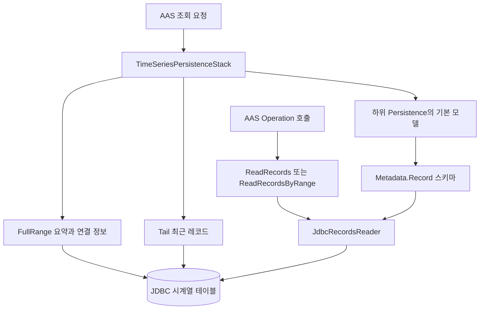
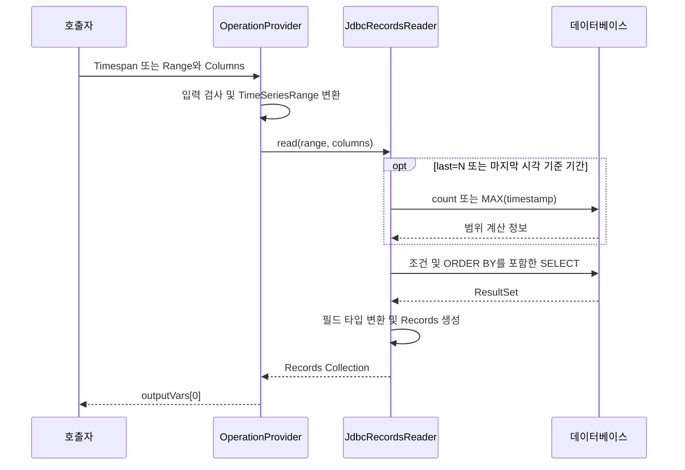

# mdt.persistence.timeseries 패키지 기술문서

`mdt.persistence.timeseries`는 JDBC 테이블의 시계열 데이터를 AAS TimeSeries Submodel과 레코드 조회 연산으로 제공한다. 기본 AAS 모델에서 레코드 스키마를 읽고, DB에서 전체 구간 요약이나 최근 레코드를 조회하여 응답을 구성한다.

이 문서는 MDT 인스턴스 개발자와 시계열 연동 담당자를 대상으로 설정, 모델 구조, 세그먼트 생성, 범위 조회, 확장 및 문제 진단을 설명한다. 대상은 `mdt-instance`의 실제 패키지인 `mdt.persistence.timeseries`이며, 연결되는 `mdt-client`의 `mdt.model.timeseries`와 `mdt.model.sm.ref.timeseries`도 필요한 범위에서 다룬다. 동작 기준은 2026년 10월의 프로젝트 소스다.

## 역할과 전체 구조

시계열 조회는 두 경로로 나뉜다. Submodel이나 `Segments`를 조회하면 `FullRange`와 선택적인 `Tail`을 생성한다. 반면 `ReadRecords`와 `ReadRecordsByRange` 연산은 지정된 범위의 레코드를 DB에서 직접 읽어 `Records` Collection으로 반환한다.



이 패키지는 기존 테이블을 조회하는 계층이다. 테이블 생성, 센서 데이터 수집, 주기적인 INSERT, 보존 기간에 따른 삭제를 수행하지 않는다. `Tail`도 백그라운드에서 지속 갱신되는 버퍼가 아니라 요청 시 DB에서 구성하는 세그먼트다.

| 클래스 | 역할 |
| --- | --- |
| `TimeSeriesPersistenceStack` | 시계열 Submodel을 식별하고 조회 요청에 동적 세그먼트 반영 |
| `TimeSeriesPersistenceStackConfig` | 하위 영속성 설정과 시계열 설정 목록 연결 |
| `TimeSeriesSubmodelConfig` | Submodel, 테이블, 필드 매핑, Tail 설정 |
| `JdbcTimeSeries` | 기본 AAS 모델을 읽고 Metadata와 동적 Segments로 Submodel 구성 |
| `JdbcFullRangeLinkedSegment` | 전체 레코드 수·시간 범위와 JDBC 연결 정보 제공 |
| `JdbcTailInternalSegment` | 최근 개수 또는 기간의 레코드를 포함하는 세그먼트 생성 |
| `JdbcRecordsReader` | 범위·컬럼 선택을 SQL로 변환하고 레코드 생성. 패키지 내부 클래스 |
| `ReadRecordsOperation` | `Timespan` AAS Range를 받는 조회 연산 제공자 |
| `ReadRecordsByRangeOperation` | 범위 표현식과 컬럼 목록을 받는 조회 연산 제공자 |
| `JdbcRangeInternalSegment` | AAS Range로 조회한 레코드를 InternalSegment로 구성하는 보조 구현 |
| `InternalSegmentRecordsReader` | 이미 존재하는 InternalSegment의 Records를 읽어 메모리에서 필터링·컬럼 선택 |

공통 영속성 구조는 [asset 패키지 기술문서](asset-persistence-guide.md)와 [PersistenceStack.java](../src/main/java/mdt/persistence/PersistenceStack.java)를 함께 참고한다.

## AAS 모델과 레코드 스키마

### TimeSeries Submodel 구조

시계열 Submodel 여부는 `idShort` 이름이 아니라 semanticId로 판정한다. 코드의 `TimeSeries.SEMANTIC_ID` 값은 `https://admin-shell.io/idta/TimeSeries/1/1`이다. 아래의 `TelemetryLog`는 예제용 Submodel idShort다.

```text
TelemetryLog
├── Metadata
│   ├── Name
│   ├── Description
│   └── Record
│       ├── Time          Property xs:dateTime
│       ├── Temperature   Property xs:double
│       └── Pressure      Property xs:double
├── Segments
│   ├── FullRange         LinkedSegment
│   │   ├── RecordCount, StartTime, EndTime, Duration, LastUpdate
│   │   └── Endpoint, Query
│   └── Tail              InternalSegment 선택 사항
│       ├── RecordCount, StartTime, EndTime 등
│       └── Records
│           ├── rec000
│           │   ├── Time
│           │   ├── Temperature
│           │   └── Pressure
│           └── ...
├── ReadRecords           기본 모델에 정의할 조회 연산
└── ReadRecordsByRange     기본 모델에 정의할 확장 조회 연산
```

`Metadata.Record`의 Property는 레코드 필드의 이름과 타입을 선언한다. `DefaultMetadata`는 각 Property의 `idShort`와 `valueType`을 읽어 `RecordMetadata`를 만든다. 첫 번째 필드는 반드시 `xs:dateTime`이어야 하며, `DefaultRecord.getTimestamp()`는 첫 번째 값을 `Instant`로 취급한다.

두 가지 시간 컬럼 선택 규칙을 함께 만족시켜야 한다. 세그먼트 구현은 설정의 `parameter`가 정확히 `Time`인 항목을 찾고, `JdbcRecordsReader`는 메타데이터의 첫 번째 필드에 매핑된 DB 컬럼을 사용한다. 따라서 첫 번째 필드를 `Time`으로 두고 설정에도 `Time` 매핑을 제공하는 구성이 적합하다.

### 필드 이름과 순서

| 구성 요소 | 예제 | 의미 |
| --- | --- | --- |
| Metadata 필드 이름 | `Temperature` | AAS 응답에 나타나는 필드 이름 |
| `parameterColumns[].parameter` | `Temperature` | Metadata 필드와 연결할 이름 |
| `parameterColumns[].column` | `temperature` | 실제 SQL 조회에 사용할 DB 컬럼 |

`JdbcRecordsReader`는 이름으로 매핑한 뒤 Metadata 순서로 SELECT를 구성한다. 반면 Tail과 `JdbcRangeInternalSegment`는 설정의 `parameterColumns` 순서로 조회한 값을 Metadata 필드 순서에 대응시킨다. 모든 조회 경로에서 같은 결과를 얻으려면 필드 개수와 순서를 일치시켜야 한다.

모델 구현: [DefaultMetadata.java](../../mdt-client/src/main/java/mdt/model/timeseries/DefaultMetadata.java), [RecordMetadata.java](../../mdt-client/src/main/java/mdt/model/timeseries/RecordMetadata.java), [DefaultRecord.java](../../mdt-client/src/main/java/mdt/model/timeseries/DefaultRecord.java).

## 인스턴스 설정

### 시계열과 연산 등록 예제

다음은 인스턴스 설정에 병합할 예제다. 기본 AAS 모델에 해당 `id`와 `idShort`를 가진 시계열 Submodel, `Metadata.Record`, 두 Operation 및 출력 인자 `Records`가 존재해야 한다. DB 테이블과 JDBC 인증 정보도 실제 환경에 맞게 준비한다.

```json
{
  "timeSeriesSubmodels": [
    {
      "id": "urn:example:machine01:TelemetryLog",
      "idShort": "TelemetryLog",
      "endpoint": "jdbc:postgresql://127.0.0.1:5432/telemetry?user=mdt&password=example",
      "tableName": "machine_measurements",
      "parameterColumns": [
        { "parameter": "Time", "column": "measured_at" },
        { "parameter": "Temperature", "column": "temperature" },
        { "parameter": "Pressure", "column": "pressure" }
      ],
      "tail": { "length": 100 }
    }
  ],
  "operations": {
    "javas": {
      "TelemetryLog:ReadRecords": {
        "className": "mdt.persistence.timeseries.ReadRecordsOperation"
      },
      "TelemetryLog:ReadRecordsByRange": {
        "className": "mdt.persistence.timeseries.ReadRecordsByRangeOperation"
      }
    }
  }
}
```

`timeSeriesSubmodels`만 추가해도 Operation 제공자가 자동 등록되지는 않는다. `operations.javas`는 기본 모델의 Operation 위치를 Java 구현 클래스와 연결한다. 키는 인스턴스 내부의 `<submodelIdShort>:<elementPath>` 형식이고, 여기의 클래스 지정 필드는 `className`이다.

| 설정 필드 | 의미와 제약 |
| --- | --- |
| `id` | 기본 모델의 Submodel 전역 ID. 연산 제공자가 설정을 찾을 때 사용 |
| `idShort` | 기본 모델과 시작 시 매칭할 Submodel idShort |
| `endpoint` | 인증 정보를 포함할 수 있는 전체 JDBC URL |
| `tableName` | 조회 대상 테이블명 |
| `parameterColumns` | Metadata 필드 이름과 DB 컬럼 매핑 목록 |
| `tail` | 생략 또는 null이면 Tail 미생성 |
| `tail.length` | 최근 레코드 개수. Tail 조회에서는 양수 필요 |
| `tail.duration` | 현재 시각을 기준으로 조회할 과거 기간. 예: `10m`, `PT10M` |

Tail 설정이 `{}`이면 기본 길이는 100이다. `length`와 `duration`이 모두 있으면 실제 조회에서는 `duration`이 우선한다. 기간을 사용하려면 예제의 tail을 다음과 같이 바꾼다.

```json
{
  "tail": { "duration": "10m" }
}
```

`endpoint`는 `JdbcConfiguration.parseString()` 계열로 해석한다. 현재 파서는 `?` 뒤에서 `user`, `password`, `maxPoolSize`를 추출하며 나머지 질의 파라미터를 JDBC URL에 보존하지 않는다. `maxPoolSize`는 연결 풀의 최대 크기로 쓰인다(생략하면 3). 따라서 DB 드라이버의 임의 URL 옵션이 그대로 전달된다고 가정해서는 안 된다. asset JDBC 변수의 `jdbcConfigName` 방식과도 다르다.

설정 구현: [TimeSeriesSubmodelConfig.java](../src/main/java/mdt/persistence/timeseries/TimeSeriesSubmodelConfig.java), [AASOperationConfig.java](../src/main/java/mdt/config/AASOperationConfig.java).

### 초기화와 스택 구성

`MDTInstanceMain.loadPersistenceConfig()`는 아래 순서로 기본 스택을 구성한다. 각 선택 계층은 해당 설정이 있을 때만 추가된다.

```text
추가 persistenceStacks 설정
    → TimeSeriesPersistenceStack
        → AssertVariableBasedPersistence
            → PersistenceInMemory
```

`TimeSeriesPersistenceStack.start()`는 하위 계층을 먼저 시작하고 `MDTModelLookup`의 초기 모델 목록과 설정을 연결한다. 시계열 semanticId를 가진 모델을 설정의 `idShort`로 매칭하고, 요청 시 사용할 맵은 실제 Submodel `id`를 키로 구성한다.

시계열 모델에 대응하는 설정이 없거나, 설정에 대응하는 시계열 모델이 없으면 `PersistenceException`으로 시작에 실패한다. 이 매칭은 시계열 스택이 설치된 경우에 수행된다. `timeSeriesSubmodels`가 비어 있으면 시작 코드가 이 스택 자체를 추가하지 않는다.

Operation 제공자는 `PersistenceStack.findInStack()`으로 시계열 계층을 찾으므로 `ConcurrentPersistence` 등이 바깥에 있어도 동작하도록 구성되어 있다. 연산용 설정은 `start()`에서 만드는 맵 대신 설정 목록의 `id`로 찾는다. `idShort`가 맞아 Submodel 조회가 가능하더라도 `id`가 틀리면 Operation 초기화는 실패할 수 있다.

관련 코드: [TimeSeriesPersistenceStack.java](../src/main/java/mdt/persistence/timeseries/TimeSeriesPersistenceStack.java), [MDTInstanceMain.java](../src/main/java/mdt/MDTInstanceMain.java).

## Submodel과 요소 조회

### 요청별 처리

| 요청 | 처리 |
| --- | --- |
| 시계열 설정이 없는 Submodel 또는 요소 | 하위 영속성 구현으로 위임 |
| 시계열 Submodel 전체 | 기본 모델을 읽고 `JdbcTimeSeries`로 FullRange와 선택적인 Tail 구성 |
| `Metadata` 및 하위 경로 | 기본 모델에서 읽기 |
| `Segments` | Tail 설정 시 Tail을 추가하고 FullRange 추가 |
| `Segments.Tail` 및 하위 경로 | Tail을 조회한 뒤 요청 경로 추출 |
| `Segments.FullRange` 및 하위 경로 | FullRange 요약을 조회한 뒤 요청 경로 추출 |
| 알 수 없는 `Segments.<id>` | `ResourceNotFoundException` |
| Tail 미설정 상태의 `Segments.Tail` | `ResourceNotFoundException` |
| 그 밖의 요소 경로 | 하위 영속성 구현으로 위임 |

`FullRange`는 LinkedSegment이므로 `Segments.FullRange.Records`는 제공하지 않는다. 전체 또는 특정 범위의 실제 레코드는 조회 Operation으로 읽는다.

Submodel 전체 조회의 `JdbcTimeSeries`는 FullRange 다음 Tail 순서로 세그먼트를 구성하지만, `Segments` 요소 직접 조회는 Tail 다음 FullRange 순서로 구성한다. 소비자는 배열 위치 대신 `idShort`로 세그먼트를 찾는 편이 적합하다.

### QueryModifier와 기본 모델 보존 범위

`getSubmodel()`은 modifier를 하위 계층에 전달한 뒤 `Metadata.value`가 비어 있는지 확인한다. 비어 있으면 메타데이터 응답으로 간주하여 빈 `Segments`를 추가하고 DB 조회를 생략한다. modifier의 content를 직접 검사하는 구현은 아니다. `Metadata` 자체가 없거나 value가 null인 모델은 이 경로에서 실패할 수 있다.

일반 Submodel 조회는 `JdbcTimeSeries.newSubmodel()`로 새 모델을 만든다. 이 클래스에 매핑된 필드는 `Metadata`와 `Segments`이므로, 기본 모델의 Operation이나 임의의 추가 요소가 전체 응답에 그대로 포함된다고 가정해서는 안 된다. Operation 경로의 직접 조회는 하위 영속성 구현으로 위임된다.

`Segments` 요소 직접 조회는 요청 modifier를 세그먼트 생성에 적용하지 않는다. `findSubmodelElements()`도 동적 세그먼트를 합성하지 않고 하위 계층으로 직접 위임한다. 전체 조회, 요소 직접 조회, 요소 목록 조회의 동작 범위가 다르다.

### Submodel 목록 조회

`findSubmodels()`는 하위 계층이 반환한 각 시계열 Submodel에 `getSubmodel()`을 호출한다. 이때 `ResourceNotFoundException`이 발생하면 해당 항목을 제외하고, `PersistenceException`은 전달한다. DB 오류 등 다른 런타임 예외도 목록 전체를 실패시킬 수 있다.

이 동작은 asset 계층의 저장 모델 대체 처리와 다르다. 시계열 목록 조회에는 일반적인 외부 조회 실패 시 저장 모델을 반환하는 처리가 없다. 반환 Page에는 기존 paging metadata를 유지하므로 항목이 제외된 경우 content 개수와 원래 페이지 구성이 달라질 수 있다.

## FullRange와 Tail 세그먼트

### FullRange 연결 세그먼트

`JdbcFullRangeLinkedSegment`는 다음 집계 질의 하나로 전체 데이터의 요약을 읽는다. 여기서 `measured_at`과 테이블명은 설정에서 가져온 예다.

```sql
SELECT count(*) AS record_count,
       min(measured_at) AS start_time,
       max(measured_at) AS end_time
FROM machine_measurements
```

`RecordCount`, `StartTime`, `EndTime`, `Duration`, `LastUpdate`를 설정하며 `LastUpdate`에는 조회 시각이 아니라 마지막 레코드 시각이 들어간다. 빈 테이블이면 `RecordCount`는 0이고 시간 요약 필드는 설정하지 않는다.

`Endpoint`에는 파싱된 JDBC URL만 넣어 설정의 `user`와 `password`를 전달하지 않는다. `Query`는 `select <매핑 컬럼들> from <테이블>`이며 정렬이나 범위 조건을 포함하지 않는다. 따라서 FullRange의 Query를 직접 실행한 결과 순서와 조회 Operation의 시간 오름차순 결과는 구분해야 한다.

구현: [JdbcFullRangeLinkedSegment.java](../src/main/java/mdt/persistence/timeseries/JdbcFullRangeLinkedSegment.java).

### Tail 내부 세그먼트

Tail은 실제 `Records`를 포함한다. 최근 개수 기준이면 다음 형태로 읽는다.

```sql
SELECT measured_at, temperature, pressure
FROM machine_measurements
ORDER BY measured_at DESC
LIMIT ?
```

DB에서 최신순으로 가져온 결과를 Java에서 뒤집어 시간 오름차순으로 반환한다. 길이 100 설정에서는 `rec000` 형태로 idShort를 생성하며, 번호는 조회 결과 안의 순번이다. 영구적인 레코드 식별자가 아니다.

기간 기준 Tail은 `measured_at >= 현재 시각 - duration` 조건으로 시간 오름차순 조회한다. 기준은 서버의 현재 시각이며, 마지막 데이터 시각을 기준으로 하는 `ReadRecordsByRange`의 기본 `last=10m`와 다르다. 이 SQL에는 현재 시각 이하라는 상한이 없어 미래 시각의 레코드도 조건을 만족할 수 있다.

Tail에 공통 캐시나 `validPeriod` 설정은 없다. `Segments.Tail.RecordCount`처럼 요약 필드만 요청해도 Tail 전체 레코드를 읽어 세그먼트를 만든 뒤 해당 필드를 추출한다.

현재 타입 변환에도 경로 차이가 있다. 개수 기준 Tail은 각 JDBC 값을 Metadata의 `DataType.fromJdbcObject()`로 변환하지만, 기간 기준 Tail은 JDBC 원시 객체 목록을 `DefaultRecord`에 직접 전달한다. `DefaultRecord.getTimestamp()`가 `Instant`를 요구하므로 드라이버가 `Timestamp` 등을 반환하면 기간 기준 경로에서 타입 오류가 발생할 수 있다.

어느 경로든 필드 값이 SQL `NULL`이면 레코드 Property의 값은 `null`(값 없음)이 된다. 숫자 필드라도 0으로 바꾸지 않는다. 원시 객체를 전달하는 경로는 값을 Property로 바꿀 때 `DataType.toValueString()`이 원시 객체를 직접 변환한다. 숫자 필드는 `NUMERIC` 컬럼의 `BigDecimal` 등 어떤 숫자 객체든 받는다. 정수 타입 필드에 소수 부분이 있는 값이 오면 변환에 실패한다.

구현: [JdbcTailInternalSegment.java](../src/main/java/mdt/persistence/timeseries/JdbcTailInternalSegment.java).

### 내부 세그먼트의 요약 계산

`DefaultInternalSegment.setRecords()`는 첫 레코드와 마지막 레코드의 시각으로 범위를 계산한다. 레코드가 둘 이상이면 `SamplingInterval = durationMillis / recordCount`, `SamplingRate = recordCount * 1000 / durationMillis`를 정수 연산으로 계산한다. 일반적인 인접 샘플 간격 계산의 분모인 `recordCount - 1`과 다르다.

동일 시각의 여러 레코드 등으로 전체 기간이 밀리초 기준 0이면 나눗셈 오류가 발생할 수 있다. Tail에 필요한 시각 타입과 순서뿐 아니라 이 요약 계산 조건도 함께 확인해야 한다.

관련 모델: [DefaultInternalSegment.java](../../mdt-client/src/main/java/mdt/model/timeseries/DefaultInternalSegment.java).

## 레코드 조회 Operation

### 공통 실행 흐름

두 Operation 제공자는 생성 시 시계열 설정과 `Metadata`를 읽고 `JdbcRecordsReader`를 준비한다. 요청마다 입력만 변환하여 조회기에 전달하고 첫 번째 출력 인자의 값을 `Records` Collection으로 바꾼다. 조회 결과 전체를 메모리에 구성하며 페이지 커서나 스트리밍 출력을 제공하지 않는다.



제공자 내부의 Metadata와 필드 매핑은 호출마다 다시 로드하지 않는다. 실행 중 모델 스키마를 변경해도 기존 제공자에 자동 반영되는 구조는 아니다.

### ReadRecords

입력 이름은 `Timespan`이며 `xs:dateTime` 타입의 AAS `Range`여야 한다. 다음은 입력 요소의 예시이고 전체 HTTP invoke 요청 본문은 아니다.

```json
{
  "modelType": "Range",
  "idShort": "Timespan",
  "valueType": "xs:dateTime",
  "min": "2026-10-17T00:00:00Z",
  "max": "2026-10-17T01:00:00Z"
}
```

양쪽 경계는 포함된다. min만 있으면 해당 시각 이후, max만 있으면 해당 시각 이전을 조회한다. 두 경계가 모두 없거나 시작이 종료보다 늦으면 오류다. 필드는 모두 반환하며 별도의 Columns 입력을 처리하지 않는다.

`ReadRecordsOperation`은 출력 인자가 적어도 하나인지 검사한다. 결과는 이름으로 검색하지 않고 `outputVars[0]`에 설정하므로 모델의 첫 출력 인자를 `Records`로 구성한다.

구현: [ReadRecordsOperation.java](../src/main/java/mdt/persistence/timeseries/ReadRecordsOperation.java).

### ReadRecordsByRange

MDT 확장 연산은 선택적인 문자열 Property `Range`와 `Columns`를 받는다. Range를 생략하거나 값이 null이면 전체 레코드를 조회한다. 빈 문자열을 전체 조회 의미로 처리하는 분기는 없으므로 전체 조회는 인자를 생략하는 방식으로 표현한다.

| Range 예제 | 의미 |
| --- | --- |
| `last=100` | 마지막 100개를 시간 오름차순으로 반환 |
| `last=10m` | 마지막 레코드 시각을 기준으로 최근 10분 |
| `last=10m@latest` | 위와 동일한 기준을 명시 |
| `last=10m@now` | 서버 현재 시각 기준 최근 10분 |
| `2026-10-17T00:00:00Z~2026-10-17T01:00:00Z` | 두 경계를 포함한 절대 구간 |
| `2026-10-17T00:00:00Z~` | 해당 시각 이상 |
| `~2026-10-17T01:00:00Z` | 해당 시각 이하 |
| `2026-10-17T00:00:00Z+100` | 해당 시각 이상인 첫 100개 |

`Columns`는 `Time,Temperature`와 같이 Metadata 필드 이름을 쉼표로 나열한다. DB 컬럼명 `measured_at`이나 `temperature`를 지정하는 필드가 아니다. 공백을 제거하고 빈 항목을 제외하며, 결과 목록이 비면 전체 컬럼을 선택한다. 존재하지 않는 필드 이름은 오류다.

```json
{
  "modelType": "Property",
  "idShort": "Range",
  "valueType": "xs:string",
  "value": "last=100"
}
```

```json
{
  "modelType": "Property",
  "idShort": "Columns",
  "valueType": "xs:string",
  "value": "Time,Temperature"
}
```

서버 조회기는 요청한 컬럼만 요청 순서로 반환하며 `Time`을 자동 추가하지 않는다. 반면 `mdt-client`의 `TimeSeriesRecordsReference`는 컬럼을 지정할 때 `Time`을 첫 번째에 포함시킨다. 직접 Operation을 호출하는 경우와 클라이언트 참조를 사용하는 경우의 차이다.

첫 번째 출력 인자에 Records를 설정하는 규칙은 동일하지만, 현재 `ReadRecordsByRangeOperation`에는 출력 배열 길이 검사가 없다. 기본 모델에 출력 인자가 없으면 배열 접근 오류가 발생한다.

구현: [ReadRecordsByRangeOperation.java](../src/main/java/mdt/persistence/timeseries/ReadRecordsByRangeOperation.java), [TimeSeriesRange.java](../../mdt-client/src/main/api/mdt/model/sm/ref/timeseries/TimeSeriesRange.java).

## JdbcRecordsReader의 SQL과 반환값

### SQL 생성

기본 형태는 `SELECT <선택 컬럼> FROM <테이블> <조건> ORDER BY <시간 컬럼> ASC <개수 제한>`이다. 조건과 제한은 다음과 같이 나뉜다.

| 범위 타입 | 조건 | 개수 제한 또는 추가 질의 |
| --- | --- | --- |
| null | 없음 | 제한 없음 |
| `Count(N)` | 없음 | 전체 count 후 `LIMIT N OFFSET max(0, count-N)` |
| `Trailing(duration, NOW)` | 시간 ≥ 현재 시각 − 기간 | 제한 없음 |
| `Trailing(duration, LATEST)` | 시간 ≥ 마지막 레코드 시각 − 기간 | 먼저 `MAX(시간 컬럼)` 조회 |
| `Absolute(from, to)` | 존재하는 경계에 대해 `>=`, `<=` | 제한 없음 |
| `Since(from, N)` | 시간 ≥ from | `LIMIT N` |

Count와 Since는 0을 허용한다. 기간은 음수를 허용하지 않으며, Absolute는 적어도 하나의 경계가 있어야 한다. 기간 조회는 시작 경계만 SQL에 반영하며 별도 종료 경계를 만들지 않는다.

빈 테이블에서 일반 조회와 Count는 빈 Records를 반환한다. LATEST 기준 기간 조회는 마지막 시각을 찾을 수 없어 `IOException`이 발생한다. 따라서 빈 테이블에서 `last=100`과 `last=10m`의 결과가 다르다.

Count의 count 조회와 실제 SELECT, LATEST의 MAX 조회와 실제 SELECT는 하나의 스냅숏 트랜잭션으로 묶이지 않는다. 그 사이 데이터가 추가·삭제되면 범위 산정과 결과가 달라질 수 있다. ORDER BY에는 시간 컬럼 하나만 있으므로 동일 timestamp를 가진 레코드 사이의 순서도 고정하지 않는다.

### 타입 변환과 Records 구조

날짜·시간 필드는 `ResultSet.getObject(index, OffsetDateTime.class)`로 읽고 `DataType.fromJdbcObject()`로 변환한다. 나머지는 일반 `getObject()` 후 해당 AAS 타입으로 변환한다. 사용하는 JDBC 드라이버가 날짜·시간 컬럼을 이 방식으로 읽을 수 있어야 한다.

반환되는 `Records`는 SubmodelElementCollection이고 그 아래 레코드도 Collection이다. 각 레코드에는 선택된 필드의 Property가 들어간다. 레코드 idShort는 `rec00`, `rec01`처럼 조회마다 다시 부여하며 DB의 기본 키가 아니다. Records와 개별 레코드에는 해당 모델의 semanticId를 설정한다.

`readValue()`는 같은 SQL 처리로 `ElementCollectionValue`를 생성하는 보조 메서드다. 현재 두 Operation은 AAS 요소를 반환하는 `read()`를 사용한다.

구현: [JdbcRecordsReader.java](../src/main/java/mdt/persistence/timeseries/JdbcRecordsReader.java).

### 시각과 자원 관리

범위 비교용 SQL 시각 리터럴은 `Instants.toUTCString()`으로 생성한다. DB의 저장 방식과 세션 시간대가 이 비교와 일치해야 한다. 입력 예제처럼 `Z` 또는 오프셋이 있는 시각을 사용하면 의도한 절대 시각을 명확히 표현할 수 있다. AAS 값 출력은 공통 `DataTypes.DATE_TIME`의 변환을 따르므로 모든 출력에 `Z`가 붙는다고 가정하지 않는다.

`JdbcRecordsReader`는 `executeQuery(query, true)`의 ResultSet을 try-with-resources로 닫아 연결도 함께 닫도록 한다. FullRange와 Tail 역시 Connection을 try-with-resources로 관리한다. 이 패키지는 여러 조회를 하나의 공통 Connection이나 트랜잭션으로 묶지 않는다.

연결은 utils의 [JdbcConnectionPools](../../../common/utils/src/main/java/utils/jdbc/JdbcConnectionPools.java)가 관리하는 연결 풀에서 얻으며, 닫으면 물리 연결은 유지된 채 풀로 반환된다. 세그먼트는 조회할 때마다 `JdbcProcessor`를 새로 만들지만, 접속 정보(JDBC URL·사용자·비밀번호·드라이버 클래스)가 같으면 같은 풀을 공유하므로 Submodel 조회마다 DB 연결을 새로 맺지 않는다. 같은 DB를 쓰는 asset JDBC 변수와도 풀을 공유한다. 풀은 유휴 연결을 미리 만들지 않고 60초 동안 쓰이지 않은 연결은 닫는다. 연결이 모두 사용 중이거나 DB에 접속할 수 없으면 최대 5초를 기다린 뒤 `SQLException`으로 실패한다. 풀 크기와 인스턴스 수에 따른 전체 연결 수는 [asset 영속성 문서의 JDBC 공통 설명](asset-persistence-guide.md#공통-연결-설정과-캐시)을 따른다.

## 보조 조회 구현과 현재 사용 범위

### JdbcRangeInternalSegment

이 클래스는 AAS Range의 min과 max에 따라 `BETWEEN`, `>=`, `<=` SQL을 선택하고 Timestamp 파라미터를 바인딩한다. 양쪽 경계가 모두 없으면 실패한다. 결과는 `ReadRecords`라는 idShort의 InternalSegment에 담긴다.

현재 `ReadRecordsOperation`은 이 클래스를 사용하지 않고 `JdbcRecordsReader`에 위임한다. 따라서 이 클래스의 구현을 바꾸어도 두 공개 조회 Operation의 SQL은 바뀌지 않는다. 기간 Tail과 마찬가지로 JDBC 원시 값을 `DefaultRecord`에 전달하므로 시각 타입 변환도 별도 확인이 필요하다.

### InternalSegmentRecordsReader

이 클래스는 주어진 세그먼트 참조의 `Records`를 먼저 읽고, 메모리에서 범위 필터와 컬럼 선택을 적용한다. DB에 조건을 내려보내는 조회기가 아니다. `read()` 접근 범위는 `protected`이며 현재 두 Operation에서는 사용하지 않는다.

Count와 Since는 목록 순서에 따라 레코드를 줄이고, 기간 조회는 첫 번째 필드의 시각을 사용한다. 기존 목록이 시간 오름차순이라고 가정하며 직접 정렬하지 않는다. 컬럼 선택은 Metadata 순서로 계산한 인덱스를 이용해 각 레코드의 필드 목록을 변경한다.

JDBC 조회기와 달리 이 구현에 빈 컬럼 목록을 전달하면 각 레코드의 필드를 모두 제거한다. 전체 필드를 유지하려면 null을 전달해야 한다. 입력 Records 객체를 제자리에서 수정하므로 다른 코드와 공유되는 모델을 직접 전달하는 확장에서는 소유권을 고려한다.

보조 코드: [JdbcRangeInternalSegment.java](../src/main/java/mdt/persistence/timeseries/JdbcRangeInternalSegment.java), [InternalSegmentRecordsReader.java](../src/main/java/mdt/persistence/timeseries/InternalSegmentRecordsReader.java).

## 쓰기 지원 범위와 성능 특성

등록된 시계열 Submodel의 `insert`, 요소 `update`, 요소 삭제, Submodel 삭제는 `UnsupportedOperationException`으로 거부한다. 레코드 적재는 별도의 수집기나 DB 쓰기 경로에서 처리해야 한다.

다만 `save(Submodel)`은 이 클래스에서 재정의하지 않아 하위 영속성 구현에 위임되며, `deleteAll()`도 하위 계층으로 전달한다. 따라서 모든 종류의 AAS 모델 변경을 차단하는 구조는 아니다. 이러한 경로도 시계열 테이블에 대한 INSERT나 DELETE로 연결되지 않는다.

| 조회 | 주요 비용 |
| --- | --- |
| Metadata 직접 조회 | 기본 AAS 모델 조회 |
| FullRange | 테이블 전체에 대한 count·min·max 집계 |
| 개수 Tail | 최신 N개 조회 및 레코드 모델 생성 |
| 기간 Tail | 기간에 해당하는 전체 행 조회 및 모델 생성 |
| Submodel 전체 | FullRange 집계와 선택적 Tail 조회 |
| Submodel 목록 | 포함된 각 시계열 Submodel의 전체 조회 비용 |
| `last=N` Operation | 전체 count와 OFFSET 기반 SELECT |
| 범위 없는 Operation | 모든 행을 메모리와 응답에 적재 |

시간 컬럼 인덱스는 기간 필터와 정렬 비용을 줄이는 데 도움이 된다. 대용량 테이블의 Count·OFFSET 비용과 무제한 결과 크기는 별도로 고려해야 한다. 현재 설정에는 공통 TTL, 응답 최대 행 수, Operation 조회 전용 페이지 크기가 없다.

## 확장과 문제 진단

조회 범위의 의미를 바꾸려면 `TimeSeriesRange`, MdtExpr 문법·평가, `JdbcRecordsReader`를 함께 검토한다. JDBC 이외의 저장소를 연결하려면 기본 모델과 세그먼트를 만드는 계층, Operation의 레코드 조회 계층을 구분하여 확장한다. 현재 클래스에는 이 둘을 포괄하는 데이터소스 인터페이스가 없다.

검증할 핵심 사례는 필드 순서가 다른 매핑, 시작·종료 경계 포함, 빈 테이블, 최근 N개 정렬, NOW와 LATEST 차이, 컬럼 선택 순서, JDBC 시각 변환, 같은 timestamp의 복수 행이다. FullRange 요약과 Tail은 별도 조회이므로 동시 적재 중에는 둘이 동일 시점의 상태를 나타내지 않을 수도 있다.

| 증상 | 확인할 지점 |
| --- | --- |
| 시작 시 `No TimeSeriesSubmodelConfig` | 시계열 semanticId와 설정의 idShort 매칭 |
| 시작 시 `No TimeSeries submodel` | 설정에 대응하는 초기 모델의 존재와 semanticId |
| Operation 초기화 시 설정을 찾지 못함 | `timeSeriesSubmodels[].id`와 Operation의 Submodel ID |
| `Cannot find the column mapped to the record field` | Metadata 필드 이름과 parameter 이름의 정확한 일치 |
| Tail에서 필드 값이 뒤바뀜 | parameterColumns와 Metadata의 필드 순서 |
| 기간 Tail에서 시각 타입 오류 | JDBC 원시 객체와 DefaultRecord의 Instant 요구 |
| `Segments.Tail`이 없음 | tail 생략 여부. 빈 객체는 기본 100개를 의미 |
| 데이터가 있는데 현재 시각 기준 조회가 비어 있음 | 데이터의 최신 시각, NOW와 LATEST 기준, DB 시간대 |
| 빈 테이블에서 `last=10m` 실패 | LATEST 범위 계산에 필요한 마지막 timestamp 부재 |
| 컬럼 이름 오류 | Columns에는 DB 컬럼명이 아닌 Metadata 필드명 사용 |
| 전체 Submodel 응답에서 Operation이 보이지 않음 | JdbcTimeSeries의 Metadata·Segments 중심 재구성 |
| 목록 조회가 느리거나 실패 | 각 시계열 모델의 집계·Tail 조회 및 오류 전파 |
| Tail 요약에서 나눗셈 오류 | 복수 레코드의 전체 시간 차이가 밀리초 기준 0인지 확인 |

설정 매칭은 `PersistenceException`, 잘못된 Operation 입력은 주로 `IllegalArgumentException`, 레코드 SQL 조회는 `IOException`, 세그먼트 생성은 `ModelGenerationException` 계열로 실패한다. 타입 변환 등은 다른 런타임 예외로 전달될 수 있으므로 오류 메시지와 실제 조회 경로를 함께 확인한다.
