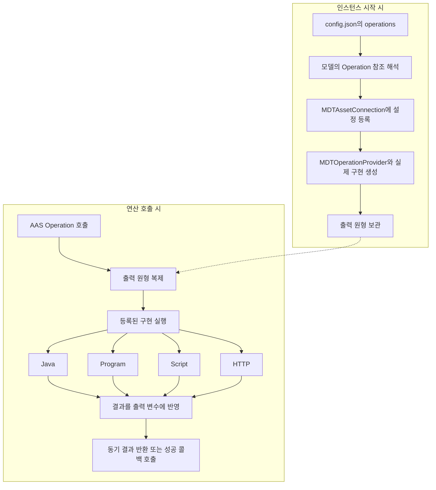
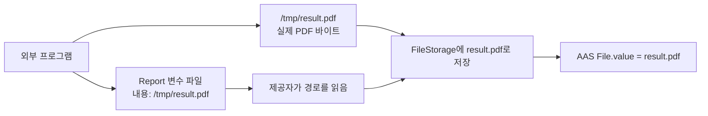
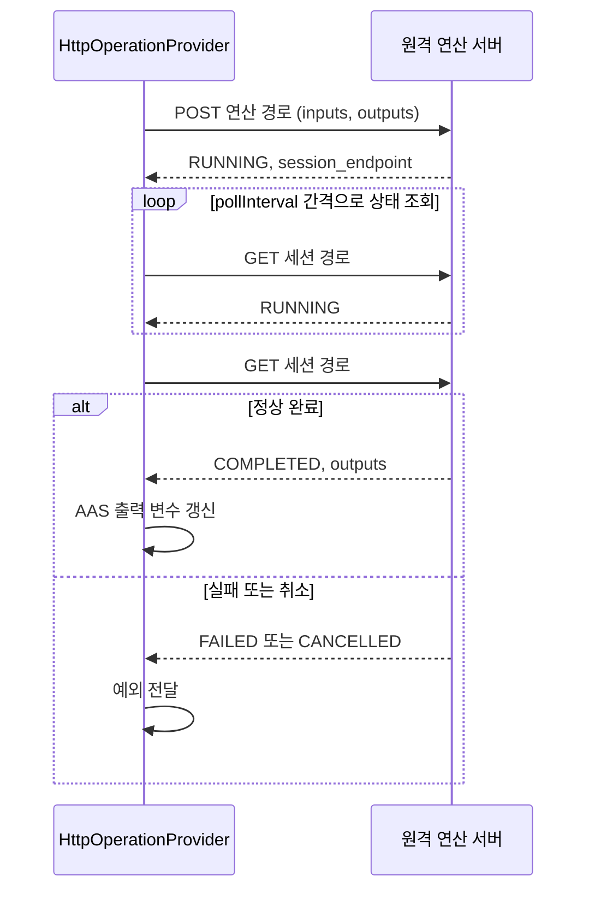

# AAS 연산 연동 가이드 — mdt.assetconnection

`mdt.assetconnection`은 FA³ST의 AAS Operation 호출을 실제 연산 구현에 연결하는 계층이다.
Java 클래스, 외부 프로그램, Python 스크립트, 원격 HTTP 연산을 AAS Operation으로 호출할 수 있도록 연결하고,
실행 결과를 AAS 연산 변수(`OperationVariable`)에 반영한다.

이 문서는 MDT 인스턴스를 설정하거나 새로운 연산을 구현하는 개발자를 대상으로 한다.
2026년 10월 31일의 소스를 기준으로 설정 방법, 입출력 형식, 실행 결과의 해석과 확장 방법을 설명한다.
빌드 대상은 Java 21이며, FA³ST starter 1.3.0을 사용한다.

## 1. 읽기 안내와 구현 방식 선택

처음 연동할 때는 **구현 방식 선택 → 모델 정의 → 인스턴스 설정 → 입출력 확인 → 실패 처리 확인** 순서로 진행한다.
연산 설정을 추가하기 전에 대상 Operation과 변수들을 AAS 모델에 정의해야 한다.

| 하려는 일 | 읽을 절 |
|---|---|
| 연산을 인스턴스에 등록 | [인스턴스 설정](#5-인스턴스-설정) |
| Java로 새 연산 구현 | [Java 연산과 확장](#6-java-연산과-확장) |
| 실행 파일이나 기존 프로그램 연결 | [Program 연산](#7-program-연산) |
| Python 스크립트 연결 | [Script 연산](#8-script-연산) |
| 원격 연산 서버 연결 | [HTTP 연산](#9-http-연산) |
| 로봇 이동·파지·정렬 구성 | [RobotTwin 연산](#10-robottwin-연산) |
| AI 모델의 예측 API 호출 | [AI 모델 연산](#11-ai-모델-연산) |
| 실패 원인과 동시 실행 제약 확인 | [실패 처리와 운영상 제약](#12-실패-처리와-운영상-제약) |

| 구현 방식 | 설정 그룹 | 적합한 용도 | 입출력 전달 방식 | 입출력 겸용 변수 |
|---|---|---|---|---|
| Java | `operations.javas` | 인스턴스 내부 기능 사용, 전용 API 연동 | `OperationVariable` 배열 | 개별 구현에서 지원 |
| Program | `operations.programs` | 언어와 무관한 외부 실행 파일 연동 | 명령 인자와 변수별 파일 | 지원. 수정된 값을 읽으려면 파일 경로로 전달 |
| Script | `operations.scripts` | `run_script.py`로 실행하는 Python 코드 | `inputs.json`, `outputs.json` | 사용하지 않음 |
| HTTP | `operations.https` | 비동기 RPC 규약을 따르는 원격 서버 | 시작 요청과 세션 상태 조회 | 비어 있지 않으면 거부 |

로봇 연산과 `AIModelOperation`은 Java 구현에 속한다. 외부 서버와 HTTP로 통신하더라도
`operations.https`가 아니라 `operations.javas`에 등록한다.
로봇 연동의 모델 구성 예제는 [로봇 트윈 연산 가이드](operation/robot/README.md)도 참고한다.

이 문서에서 사용하는 주요 용어는 다음과 같다.

| 용어 | 의미 |
|---|---|
| 연산 제공자(Provider) | AAS 호출을 받아 실제 작업을 실행하는 객체 |
| 출력 원형 | 모델에 정의된 출력 변수의 구조·타입·초기값. 호출할 때마다 복제하여 결과를 기록 |
| 값 JSON | 요소의 이름·타입 등 메타데이터를 제외한 값. 예: 정수 Property의 값 `10` |
| SMC / SML | `SubmodelElementCollection` / `SubmodelElementList`의 약어 |
| 정착 | 일정 시간 동안 관측값의 변화가 허용 범위 안에 머문 상태. 로봇 절에서 사용하는 판정 기준 |

## 2. 역할과 패키지 구조

AAS 요소의 평상시 값 읽기·쓰기는 `mdt.persistence.asset`이 담당한다.
이 패키지는 **Operation 실행**을 담당하며, `MDTAssetConnection`의 ValueProvider와
SubscriptionProvider 생성은 `UnsupportedOperationException`을 발생시킨다.

| 위치 | 주요 클래스 | 역할 |
|---|---|---|
| 패키지 루트 | `MDTAssetConnection`, `MDTAssetConnectionConfig` | FA³ST의 AssetConnection 연동과 연산 제공자 등록 |
| 패키지 루트 | `UnsupportedValueProvider`, `UnsupportedSubscriptionProvider`와 설정 클래스 | 미지원 기능을 표시하는 타입 |
| `operation` | `OperationProvider` | MDT 연산 구현의 동기·비동기 호출 규약 |
| `operation` | `MDTOperationProvider`, `MDTOperationProviderConfig` | FA³ST 호출 변환, 출력 원형 복제, 구현 선택 |
| `operation` | `ProgramOperationProvider`, `ProgramOperationDescriptor` | 외부 프로세스와 파일 기반 입출력 |
| `operation` | `ScriptOperationProvider` | Python 실행 스크립트를 통한 JSON 파일 입출력 |
| `operation` | `HttpOperationProvider` | 원격 비동기 RPC 호출 |
| `operation` | `JavaOperationProviderConfig`, `OperationVariables` | Java 구현 설정과 변수 접근 보조 |
| `operation` | `AbstractJavaOperationProvider` | Java 연산 구현의 공통 기반(이름별 변수 접근, 설정 arguments·전역 설정 처리) |
| `operation` | `AIModelOperation` | AI 모델 서버의 예측 API 호출 |
| `operation.robot` | `RobotTwinOperationProvider` | RobotTwin 설정 처리와 로봇 연산 공통 기능 |
| `operation.robot` | 이동·그리퍼·파지·배치·관측·정렬 제공자 | 로봇 연산 구현. 클래스별 입출력은 RobotTwin 절에서 설명 |

별도로 있는 `UnsupportedOperationProvider`와 그 설정은 현재 `MDTAssetConnection`의 연산 제공자 타입으로
사용되지 않는다. 실제 연산 제공자는 `MDTOperationProvider`다.

## 3. 등록과 실행 흐름



1. `MDTInstanceMain`이 `operations` 설정의 연산 위치를 실제 모델 Reference로 변환한다.
2. 위치별 `MDTOperationProviderConfig`를 `MDTAssetConnectionConfig.operationProviders`에 등록한다.
3. `MDTAssetConnection.createOperationProvider()`가 설정을 JSON으로 직렬화하고
   `MDTSubstitutor.substibute()`로 환경 변수 등을 치환한 뒤 다시 읽는다.
4. `MDTOperationProvider`는 모델에서 출력 변수 정의를 가져오고 구체 구현을 한 번 생성한다.
5. 호출마다 출력 변수를 JSON 직렬화·역직렬화로 복제한 뒤 구체 구현에 넘긴다.

대상 Operation은 AAS 모델에 미리 정의되어 있어야 한다. 등록 과정이 Operation이나 출력 변수를 생성하지는 않는다.
동기 호출에서는 변경한 `outputVars`를 반환하고, 비동기 호출에서는 성공 콜백에 전달한다.
입력·입출력 배열은 별도로 복제하지 않는다. **제공자 객체는 여러 호출에서 재사용**되므로,
출력 원형을 복제하더라도 제공자의 필드나 작업 파일까지 호출별로 분리되지는 않는다.

`doConnect()`와 `doDisconnect()`는 빈 구현이며 `getEndpointInformation()`은 null을 반환한다.
따라서 asset connection 초기화만으로 외부 연산 서버의 연결 상태가 검증되는 것은 아니다.

## 4. OperationProvider 공통 인터페이스

```java
void invokeSync(
    OperationVariable[] inputVars,
    OperationVariable[] inoutputVars,
    OperationVariable[] outputVars
) throws Exception;
```

구현체는 반환값 대신 전달받은 변수 안의 `SubmodelElement`를 변경한다. 변수 이름은
`OperationVariable.getValue().getIdShort()`다.

| 배열 | 의미 | 구현자가 지켜야 할 사항 |
|---|---|---|
| `inputVars` | 입력 변수 | 필요한 이름과 요소 타입을 확인하고 읽음 |
| `inoutputVars` | 입력과 출력 겸용 변수 | 지원하는 구현에서는 같은 변수에 결과 반영 |
| `outputVars` | 모델 정의에서 복제한 출력 변수 | 기존 요소 타입에 맞춰 결과를 설정 |

사용하지 않는 배열은 빈 배열로 전달하는 편이 안전하다. null 처리 방식은 구현별로 같지 않다.
맵 변환과 파일 입출력이 이름을 키로 사용하므로 변수의 `idShort`가 중복되지 않도록 구성한다.

### 4.1 비동기 호출

기본 `invokeAsync()`는 `CompletableFuture.runAsync()`에서 `invokeSync()`를 실행한다.
별도 실행기(`Executor`)를 지정하지 않으며 호출자에게 `Future`나 취소용 객체를 반환하지 않는다.

- 성공 콜백의 인자 순서는 **`(outputVars, inoutputVars)`**다.
- 작업 예외는 내부 원인을 꺼내 실패 콜백으로 전달한다. 시간 초과, 취소, 작업 오류, 인터럽트 등 일부 예외는
  `ExecutionException`으로 다시 감싼다.
- 성공 콜백은 `Try.run()`으로 감싸므로 콜백 자체의 예외를 실패 콜백으로 전달하지 않는다.
- `Error`와 실패 콜백의 예외는 별도의 결과로 전달하지 않는다.

`MDTOperationProvider`는 동기 호출 및 비동기 시작 과정의 예외를 `AssetConnectionException`으로 감싼다.
이미 해당 타입인 예외는 그대로 전달한다. 비동기 작업 실행 중의 오류는 콜백으로 전달한다.
공통 인터페이스에는 재시도, 변경 사항 되돌리기, 실행 시간 제한이나 외부 취소 요청 API가 없다.
시간 제한은 각 제공자의 설정과 구현을 확인해야 한다.

### 4.2 입출력 형식의 차이

동일한 AAS 정수 Property도 구현 방식에 따라 다음과 같이 전달된다.
입력과 결과의 JSON 형식이 반드시 같지는 않다.

| 구현 | 정수 입력 `Value=10`의 표현 | 정수 출력 `Result=20`의 표현 |
|---|---|---|
| Java | `Value`라는 Property, `valueType=xs:int`, `value="10"` | `Result` Property의 값을 `"20"`으로 변경 |
| Program | `Value` 파일 내용이 `10` | `Result` 파일에 `20` 기록 |
| Script | `inputs.json`에 `{"Value":10}` | `outputs.json`에 `{"Result":20}` |
| HTTP | `inputs.Value`에 이름·타입·값을 포함한 Property JSON | `outputs.Result`에 `20` 또는 타입 정보를 포함한 ElementValue JSON |
| AI 모델 | 요청의 `Inputs`에 `{"Value":"10"}` | 응답의 `Outputs`에 `{"Result":20}` |

출력 값이 응답에서 빠졌을 때 자동으로 null이 설정되는 것은 아니다.
Script·HTTP·AI 모델 제공자는 해당 출력을 갱신하지 않으므로 **모델에서 복제한 초기값이 결과에 남을 수 있다**.
필수 출력의 존재 여부와 작업 성공 여부를 연산 규약에 명시해야 한다.

## 5. 인스턴스 설정

일반 사용자는 FA³ST 제공자 설정을 직접 작성하기보다 인스턴스 `config.json`의 `operations`를 작성한다.
다음은 해당 부분만 보여 주는 예다. `Demo` 서브모델 안에 각 Operation이 이미 존재해야 하며,
파일과 서버 주소는 배포 환경에 맞게 준비한다.

```json
{
  "operations": {
    "javas": {
      "Demo:Increment": {
        "className": "example.IncrementOperation",
        "arguments": {}
      }
    },
    "programs": {
      "Demo:Add": {
        "descriptorFile": "/opt/mdt/operations/add/descriptor.json"
      }
    },
    "scripts": {
      "Demo:Transform": {
        "scriptFile": "/opt/mdt/operations/transform/transform.py",
        "timeout": "60s"
      }
    },
    "https": {
      "Demo:Predict": {
        "baseUrl": "http://example.invalid:12987",
        "endpoint": "/api/v1/operations/predict",
        "pollInterval": "3s",
        "timeout": "60s"
      }
    }
  }
}
```

`https`는 **HTTP 제공자 설정 맵의 이름**이다. HTTPS 프로토콜만 허용한다는 뜻은 아니다.
연산 위치의 일반 형식은 `<submodel idShort>:<요소 경로>`이며 현재 인스턴스 모델 안에서 해석한다.
외부 MDT 참조처럼 앞에 인스턴스 ID를 붙이지 않는다.

### 5.1 외부 설정과 내부 설정의 필드 대응

| 인스턴스 설정 | 내부 제공자 설정 |
|---|---|
| `javas.*.className` | `java.operationClassName` |
| `javas.*.arguments` | `java.arguments` |
| `programs.*.descriptorFile` | `program.operationDescriptorFile` |
| `scripts.*.scriptFile`, `timeout` | `script.scriptFile`, `timeout` |
| `https.*.baseUrl`, `endpoint`, `pollInterval`, `timeout` | `http` 아래 같은 이름의 필드 |

인스턴스 설정은 `programs → javas → scripts → https` 순서로 같은 Map에 등록된다.
같은 Operation을 여러 그룹에 넣으면 나중 항목이 앞 항목을 덮어쓴다.
반면 내부 `MDTOperationProviderConfig` 하나에 여러 종류를 넣으면 선택 순서는
`java → program → script → http`다. 중복을 거부하는 검사가 없으므로 연산 하나에 구현 하나만 지정한다.

### 5.2 기간과 경로

기간은 `UnitUtils.parseDuration()`을 사용한다. `3s`, `1m`, `500ms`, `PT1M`처럼 단위 또는 ISO 기간을
명시하며, 단위 없는 `60`을 초로 해석하지 않는다.
HTTP의 `pollInterval`·`timeout`과 Script의 `timeout`은 null이면 일부 직렬화용 조회 메서드의
`Duration.toString()`에서 실패할 수 있다. HTTP 실행 코드에 3초 기본 폴링이 있더라도
설정 직렬화가 먼저 수행되므로 정상 등록을 위해 이 값들을 명시한다.

Program 기술자와 Script 파일의 상대 경로는 제공자 생성 시 JVM 작업 디렉터리를 기준으로 해석한다.
Program의 `workingDirectory`가 생략되면 기술자 파일의 부모 디렉터리를 쓴다.
지정된 상대 작업 디렉터리는 기술자 위치에 자동으로 붙이지 않으므로 절대 경로를 쓰는 편이 명확하다.

## 6. Java 연산과 확장

Java 구현은 `OperationProvider`를 구현하고 다음 **public 생성자**를 제공해야 한다.

```java
public MyOperation(
    ServiceContext serviceContext,
    Reference operationRef,
    JavaOperationProviderConfig config
)
```

로더는 `Class.forName()`과 위 시그니처의 `getConstructor()`로 인스턴스를 생성한다.
클래스가 classpath에 없거나 생성자·타입이 맞지 않으면 등록 중 실패한다.
실패 원인은 로그에 남기고 `InternalException`으로 감싼다.

### 6.1 간단한 구현 예제

다음 클래스는 `Value`와 `Result`가 `xs:int` Property로 정의된 Operation을 전제로 한다.
이 예제는 프로젝트에 이미 있는 연산이 아니라 추가 구현의 형태를 보여 준다.

```java
package example;

import org.eclipse.digitaltwin.aas4j.v3.model.OperationVariable;
import org.eclipse.digitaltwin.aas4j.v3.model.Reference;
import de.fraunhofer.iosb.ilt.faaast.service.ServiceContext;
import mdt.assetconnection.operation.JavaOperationProviderConfig;
import mdt.assetconnection.operation.OperationProvider;
import mdt.assetconnection.operation.OperationVariables;

public final class IncrementOperation implements OperationProvider {
    public IncrementOperation(ServiceContext context, Reference reference,
                              JavaOperationProviderConfig config) {
    }

    @Override
    public void invokeSync(OperationVariable[] inputs, OperationVariable[] inoutputs,
                           OperationVariable[] outputs) {
        if (inoutputs != null && inoutputs.length != 0) {
            throw new IllegalArgumentException("inoutput variables are not supported");
        }
        int value = OperationVariables.fromArray(inputs).readInt("Value");
        OperationVariables.fromArray(outputs).updateInt("Result", Math.addExact(value, 1));
    }
}
```

`OperationVariables`는 이름으로 값을 읽고 수정하는 `read`·`update`와 문자열·정수·File 전용 메서드를 제공한다.
없는 변수 이름은 `IllegalArgumentException`이다. 현재 `exists(name)`도 내부의 예외를 던지는 조회를 사용하므로,
변수가 없을 때 false를 돌려주는 안전한 검사로 사용하면 안 된다.

### 6.2 AbstractJavaOperationProvider

`mdt.assetconnection.operation` 패키지의 공통 기반 클래스이며, 로봇 연산(`RobotTwinOperationProvider`)뿐 아니라
`AIModelOperation`·`RCKSimulationOperation`도 상속한다.
세 배열을 `Map<String, SubmodelElement>`로 바꿔 protected `invokeSync()`에 전달한다.
설정의 `arguments` 조회, 전역 설정 선택, SMC·Property 및 XSD 타입 검사 기능을 제공한다.

변수 조회 메서드는 이름에 `Required`가 붙더라도 검사 범위가 서로 다르다.

| 메서드 | 변수가 없을 때 | 값이 null 또는 공백일 때 |
|---|---|---|
| `getRequiredSMCVariable()` / `getRequiredPropertyVariable()` | 예외 | 요소의 존재·타입만 검사. 내부 값은 별도 검사 필요 |
| `getRequiredStringVariableValue()` | 예외 | Property의 값을 그대로 반환. null·빈 문자열·공백을 거부하지 않음 |
| `getRequiredIntVariableValue()` / `getRequiredFloatVariableValue()` / `getRequiredDoubleVariableValue()` | 예외 | 예외 |
| `getStringVariableValue()` | null | Property의 값을 그대로 반환 |
| 선택 숫자·Boolean 조회 메서드 | null | null |

요소 타입이나 XSD 타입이 다르거나 값을 해석할 수 없으면 `IllegalArgumentException`이 발생한다.
숫자·Boolean은 앞뒤 공백을 제거한 뒤 해석하며, Boolean은 `true`/`false`/`1`/`0`만 받는다
(`true`/`false`는 대소문자를 구분하지 않는다). 필수 문자열의 공백 여부, 숫자의 범위와 유한성 등
업무 조건은 개별 연산에서 추가로 검사한다.
내부 `JavaOperationProviderConfig.arguments`를 직접 생성할 때는 null 대신 빈 Map을 전달한다.
인스턴스 설정의 `JavaConfig`는 생략한 `arguments`를 빈 Map으로 정규화한다.

## 7. Program 연산

`ProgramOperationProvider`는 연산 기술자에 지정한 외부 프로그램을 `CommandExecution`으로 실행한다.
연산 기술자는 실행 명령, 작업 디렉터리, 시간 제한을 담은 JSON 파일이다.
제공자를 생성할 때 파일을 읽을 수 있는지 확인하고, **호출할 때마다** `ProgramOperationDescriptor`로 다시 읽는다.
AAS File을 주고받을 때는 `MDTService`의 파일 저장소(`FileStorage`)를 사용한다.

### 7.1 기술자와 실행 파일

다음은 `Left`, `Right` 입력과 `Result` 출력을 가진 연산의 기술자 예다.

```json
{
  "commandLine": [
    "python3", "sum.py", "${Left:path}", "${Right:path}", "${Result:path}"
  ],
  "workingDirectory": "/opt/mdt/operations/add",
  "timeout": "30s"
}
```

`commandLine`에는 실행 파일과 인자를 배열로 지정한다. 셸 명령 문자열로 해석하지 않으므로
파이프(`|`)나 입출력 리다이렉션(`>`)을 배열에 넣어도 셸 기능으로 동작하지 않는다.
`CommandExecution`의 변수 표현은 다음과 같다.

| 표현 | 치환 결과 |
|---|---|
| `${Left}` 또는 `${Left:name}` | 변수 이름 `Left` |
| `${Left:value}` | 변수 값 문자열 |
| `${Left:path}` | 변수 파일의 절대 경로 |
| `${WORKING_DIR}` | 작업 디렉터리 절대 경로 |

어느 변수와도 맞지 않는 `${...}`가 남아 있으면(예: 변수 이름 오타) 프로세스를 시작하지 않고
`IllegalArgumentException`으로 실패한다. 치환된 변수 값 안의 `${...}`는 다시 치환하지 않는다.
한 호출에 같은 이름의 변수(예: 같은 `idShort`의 입력과 출력)를 두 번 등록할 수도 없다.
프로그램의 표준 입력은 운영체제의 널 장치(예: `/dev/null`)에 연결된다.
따라서 표준 입력을 읽는 프로그램은 데이터를 받지 못하고 곧바로 EOF를 받는다.

`sum.py`는 값 JSON 파일을 읽고 결과 JSON을 지정 파일에 기록하도록 작성할 수 있다.

```python
import json
import sys
from pathlib import Path

left = json.loads(Path(sys.argv[1]).read_text(encoding="utf-8"))
right = json.loads(Path(sys.argv[2]).read_text(encoding="utf-8"))
Path(sys.argv[3]).write_text(json.dumps(left + right), encoding="utf-8")
```

기술자 클래스에는 `operationSubmodel`, `inputArguments`, `outputArguments`, `concurrent` 필드도 있지만
현재 `ProgramOperationProvider`는 실행에 사용하지 않는다. 실제 인자는 AAS 호출 배열에서 결정된다.
특히 `concurrent: false`가 동시 실행을 직렬화해 주지는 않는다.

### 7.2 변수 파일 규약

| 변수 종류 | 프로세스 입력·출력 방식 |
|---|---|
| 일반 입력 | 작업 디렉터리의 `<idShort>` 파일에 값 JSON 기록. 기존 파일이 있으면 덮어씀. `ElementValues.getValue()`가 null을 반환하는 경우에는 빈 파일을 만들며, 이 경우 기존 파일이 있으면 실패 |
| 일반 출력 | 실행 전에 남아 있던 `<idShort>` 파일을 지운다. 프로그램이 이 파일에 값 JSON을 기록하면 기존 AAS 요소 타입으로 복원 |
| 일반 입출력 | 입력과 같은 CommandVariable을 결과 읽기에도 사용 |
| File 입력 | AAS File의 경로로 FileStorage에서 바이트를 읽어 `<작업 디렉터리>/<AAS File 경로>`에 복사. 경로가 비어 있으면 `TaskException` |
| File 출력 | 출력 변수 파일 내용으로 **결과 파일의 경로**를 전달, 그 파일을 FileStorage에 저장. 경로가 비어 있으면 WARN 후 AAS File 유지 |

일반 문자열 출력은 JSON 문자열이어야 한다. 예를 들어 `hello`가 아니라 `"hello"`를 출력 변수 파일에 쓴다.
일반 입출력 변수는 명령에서 `${변수:path}`를 사용해야 실행 후 파일을 다시 읽어 수정된 값을 반영한다.
값만 전달하고 파일 내용을 나중에 바꿔도 메모리에 남은 원래 값이 반환될 수 있다.

File 출력은 출력 변수 파일 자체가 최종 첨부파일이 아니다. 그 내용으로 최종 파일의 경로를 전달한다.
코드는 경로 문자열의 앞뒤 공백을 제거하거나 작업 디렉터리와 결합하지 않으므로, 개행 없는 절대 경로를 기록한다.
결과 파일은 디렉터리를 제외한 파일 이름으로 FileStorage에 저장되고 AAS File의 `value`가 바뀐다.
결과 파일 삭제는 저장 시도의 `finally`에서 수행되므로 저장 실패 시에도 원본 파일이 삭제될 수 있다.

예를 들어 출력 변수 이름이 `Report`라면, 다음 두 파일을 구분해야 한다.



`Report`에는 JSON 문자열이 아닌 경로 자체를 기록한다. 저장에 사용하는 실제 파일도 삭제 대상이므로,
보존해야 하는 원본을 직접 가리키지 말고 연산 결과용 사본을 전달한다.

`env.file`이 있으면 프로세스 환경에 반영한다. 파일이 있는데 읽을 수 없으면 프로세스를 시작하지 않고 실패한다.
표준 오류(stderr)는 표준 출력(stdout)에 합쳐 `output.log`에 기록하며, 이 파일은 호출마다 덮어쓴다.
종료 코드가 0이 아니면 `CommandFailedException`(종료 코드 포함)으로 실패한다. 출력 끝부분(최대 4KB)은 예외 객체에만
담기고 오류 메시지에는 들어가지 않으므로, 원인은 `output.log`에서 확인한다. 기술자의 `timeout`을 넘기면
`TimeoutException`으로 실패하며, 프로세스 정리는 `CommandExecution`에 위임한다. 자세한 실행 규칙은 utils의
[외부 명령 실행 가이드](../../../../../../../common/utils/src/main/java/utils/async/command/README.md)를 참고한다.
호출 종료 시 등록된 변수 파일을 정리하지만, 실패한 모든 파일 준비 과정까지 원자적으로 되돌리는 것은 아니다.

같은 제공자의 실행 객체와 작업 파일은 여러 호출에서 공유된다. 현재 구현을 사용할 때는
같은 작업 디렉터리를 사용하는 호출이 겹치지 않도록 관리한다. 병렬 실행을 지원하려면
구현을 확장하여 호출별 작업 디렉터리와 실행 객체를 따로 두어야 한다.

## 8. Script 연산

`ScriptOperationProvider`는 설정한 스크립트 파일의 부모 디렉터리를 작업 디렉터리로 사용한다.
아래는 한 번에 실행하는 명령을 읽기 쉽도록 여러 줄로 표시한 것이다.

```text
uv run python <작업 디렉터리>/run_script.py
  --script <실행할 스크립트의 절대 경로>
  --inputs <작업 디렉터리>/inputs.json
  --outputs <작업 디렉터리>/outputs.json
```

`uv`, Python 실행 환경, 실행을 중개하는 `run_script.py`는 배포 시 준비해야 한다.
제공자는 `run_script.py`를 생성하거나 복사하지 않으며, 이 파일은 현재 프로젝트 소스에도 포함되어 있지 않다.
따라서 실제 사용자 스크립트의 진입 함수나 전역 변수는 배포한 `run_script.py`의 규약을 따라야 한다.

### 8.1 파일 입출력 규약

입력은 `inputVars`를 이름별 **값 JSON**으로 변환한 `inputs.json`이다.
`run_script.py`는 실행 결과를 `outputs.json`에 변수 이름별 값 JSON으로 기록해야 한다.
예를 들어 입력 `Value=10`, 출력 `Result=20`이면 다음 형태를 사용한다.

```json
{
  "Value": 10
}
```

```json
{
  "Result": 20
}
```

`outputs.json`의 값은 모델에 정의된 출력 요소의 타입에 맞춰 해석한다.
HTTP 제공자가 받는 타입 정보 포함 ElementValue JSON과는 형식이 다르다.
AAS File을 전달하더라도 첨부파일을 내려받거나 올리는 처리는 수행하지 않는다.

입력 중 `script`라는 이름의 Property에 비어 있지 않은 값이 있으면, 그 내용을 `__script.py`로 써서
설정된 스크립트 대신 실행한다. `script`는 `inputs.json`에서 제외된다. 값이 비어 있으면 설정 파일을 사용하고,
Property가 아니면 실패한다. 입력으로 스크립트를 전달하더라도 설정된 기본 스크립트 파일은 필요하다.
제공자를 생성할 때 해당 파일을 읽을 수 있는지 먼저 검사하기 때문이다.

`inoutputVars`는 현재 입력 파일 구성과 결과 갱신에 사용되지 않는다.
결과에 없는 출력은 건너뛰고, 출력 하나를 갱신하다 발생한 예외는 로그만 남기고 나머지를 계속 처리한다.
따라서 프로세스의 정상 종료가 모든 출력 변수의 정상 갱신을 뜻하지 않는다.

`env.file`과 `output.log`는 Program과 같은 용도로 사용한다.
실행을 감싼 `finally`에서 입력·출력 JSON과 생성한 `__script.py`를 삭제하려고 하지만, 삭제 실패는 무시한다.
파일 준비 단계에서 실패한 경우까지 같은 정리가 적용되는 것은 아니다.
고정 파일명과 공유 `m_cmdExec` 때문에 같은 작업 디렉터리의 동시 호출은 충돌할 수 있다.

## 9. HTTP 연산

`HttpOperationProvider`는 `utils.rpc.restful.RESTfulAsyncRpcClient`로 원격 연산을 시작하고 완료를 기다린다.
설정의 `baseUrl`은 서버 기본 주소, `endpoint`는 연산 경로다. 실제 URL은 클라이언트가 두 값을 결합한다.
예를 들어 `baseUrl=http://host:12987`, `endpoint=/api/v1/operations/predict`로 사용한다.
설정에는 `opId` 필드가 없으므로 호출할 연산의 전체 경로를 `endpoint`에 지정한다.

`inoutputVars`가 비어 있지 않으면 `IllegalArgumentException`을 발생시킨다.
입력뿐 아니라 **출력 원형도** `SubmodelElement` 전체 JSON으로 원격 서버에 보낸다.
서버는 출력 원형을 이용해 결과의 AAS 타입을 알 수 있다.

```json
{
  "inputs": {
    "Value": {
      "modelType": "Property",
      "idShort": "Value",
      "valueType": "xs:int",
      "value": "10"
    }
  },
  "outputs": {
    "Result": {
      "modelType": "Property",
      "idShort": "Result",
      "valueType": "xs:int",
      "value": "0"
    }
  }
}
```

원격 연산은 시작 요청과 결과 조회를 나누어 처리한다.



현재 클라이언트의 시작 처리에서는 즉시 `COMPLETED` 응답을 받는 경우를 지원하지 않는다.
반환 출력의 예는 다음과 같다.

```json
{
  "status": "COMPLETED",
  "outputs": {
    "Result": {"@type": "mdt:value:integer", "value": 20}
  }
}
```

출력 값은 `ElementValues.parseGeneralJsonNode()`로 읽으므로 `@type`이 있는 ElementValue JSON과
일반 값 JSON을 모두 지원한다. 일반 값이면 기존 출력 요소의 타입을 사용한다.
등록된 출력 중 응답에 없는 것은 변경하지 않고, 등록되지 않은 추가 결과는 반환 배열에 추가하지 않는다.
변경하지 않은 출력에는 원형의 초기값이 남을 수 있으므로 “누락 출력은 null”이라고 가정하지 않는다.

실행 코드의 기본 조회 간격은 3초이며, `timeout`은 RPC 클라이언트의 대기 제한으로 전달한다.
이 값은 개별 HTTP 연결·응답 시간 제한과 다르다.
RPC 클라이언트에는 세션 DELETE 취소 기능이 있지만 `OperationProvider`의 공개 인터페이스로 노출하지 않는다.
`timeout`이 지나면 `TimeoutException`으로 끝나지만 원격 세션에 취소(DELETE)를 보내지 않으므로 원격 연산은 계속 실행될 수 있다.
상위 요청 취소가 원격 취소까지 연결된다고 가정해서는 안 된다.

## 10. RobotTwin 연산

로봇 이동·그리퍼·파지(`Grasp`·`Pick`·`Place`)·정렬(`AlignHeldObject`)·장면 초기화와 관측 연산은
`mdt.assetconnection.operation.robot` 패키지의 Java 제공자다. 연산별 입력·출력, 기본값, 결과 해석, 실패 처리와
워크플로 구성은 [로봇 트윈 연산 가이드](operation/robot/README.md)에서 설명한다. 여기서는 등록 방법과 공통 주의점만 정리한다.

로봇 연산은 `operations.javas`에 `className`(예: `mdt.assetconnection.operation.robot.MoveToNamedTargetProvider`)과
`arguments.robotTwinConfig`로 등록한다. `robotTwinConfig`는 전역 `robotTwins` 설정의 항목 이름(문자열) 또는 접속 정보
객체(`robotTwinBaseUrl`, `twinId`)이며, 생략하면 전역 설정의 `default` 항목을 사용한다
([로봇 트윈 연산 가이드 3.1절](operation/robot/README.md#31-aas-연산-등록)).

로봇 연산에서는 **호출이 끝났는지**와 **작업 목표를 달성했는지**를 구분해야 한다.
특히 여러 동작을 묶은 연산은 목표를 달성하지 못해도 진단 결과를 정상 반환한다.

| 연산 | 다음 단계로 넘어가기 전에 확인할 값 | 해석 시 주의점 |
|---|---|---|
| 관절 이동·이름 자세 이동 | 원격 결과와 도달 확인 로그 | `FinalPose`·`FinalJoints`만으로 정착이나 도달을 보장하지 않음 |
| 직선 이동 | `Reached` | `RequireReached=true`이면 미도달을 예외로 처리 |
| 그리퍼 이동 | `ReachedGoal` | 그리퍼 목표 달성이 원하는 물체의 파지 성공을 뜻하지는 않음 |
| `Grasp`·`Pick`·`Place` | `GoalsReached` | false이면 `FailedStage`·`FailureReason`으로 중단 원인 확인 |
| 물체 정착 관측 | `Settled`·`Outcome` | 물체가 멈췄는지에 대한 관측 결과이며 파지·삽입 성공 판정은 아님 |
| 쥔 물체 정렬 | `Aligned`·`StopReason` | 정렬 완료와 하강·삽입은 별도 작업 |

예외로 끝난 호출의 출력은 워크플로에 전달되지 않는다(`MoveLinear`의 `RequireReached=true` 실패 포함).
실패 시점의 진단을 워크플로에서 써야 한다면, 예외 대신 정상 반환으로 진단을 돌려주는 연산·입력을 고른다
([로봇 트윈 연산 가이드 2.2절](operation/robot/README.md#22-실패-시-출력과-기존-값의-의미)).

## 11. AI 모델 연산

`AIModelOperation`은 AI 모델 서버의 예측 API를 호출하는 Java 제공자다.
HTTP 연산의 시작 요청·세션 조회 규약과 달리, 한 번의 POST 요청으로 결과를 받는다.
입력·출력 이름은 정해져 있지 않고, AAS Operation에 정의한 변수 이름을 그대로 쓴다.

| 항목 | 연동 규약 |
|---|---|
| 설정 | 필수 `arguments.modelId`, 선택 `arguments.modelServer`, `arguments.version` |
| 서버 설정 | 전역 `aiModelServers` 그룹의 설정 객체에 `serverUrl` |
| 입력 | 모든 입력 변수. 각 변수는 Property여야 하며 값이 null인 변수는 보내지 않음 |
| 출력 | 응답에서 이름이 같은 항목을 찾아 기존 출력 요소의 타입으로 갱신. 응답에 없는 출력은 그대로 둠 |
| 입출력 겸용 변수 | 사용하지 않음 |
| 요청 URL | 끝에 `/`를 보완한 `serverUrl` + URL 인코딩한 `modelId`. `version`이 있으면 `/<version>`(URL 인코딩)을 덧붙임 |
| 요청 JSON | `{"Inputs":{"<입력 이름>":"<값 문자열>", ...}}` |
| 응답 JSON | `{"Outputs":{"<출력 이름>":<값>, ...}}`. `Outputs` 키는 대소문자를 가리지 않음 |

입력 값은 Property의 `valueType`과 관계없이 문자열 값 그대로 JSON 문자열로 보낸다. 예를 들어 `xs:int` 값 10은
`"10"`으로 전송되며, 문자열 안의 JSON을 객체로 파싱해 보내지도 않는다. 응답에 `Outputs`가 없으면
`IllegalStateException`으로 실패한다. 입력에 Property가 아닌 요소가 있으면 `IllegalArgumentException`으로 실패한다.

기본 설정은 다음 형태로 작성할 수 있다. 첫 JSON은 전역 설정의 일부이고, 두 번째는 인스턴스 설정의 일부다.

```json
{
  "aiModelServers": {
    "default": {"serverUrl": "http://example.invalid/models"}
  }
}
```

```json
{
  "operations": {
    "javas": {
      "AI:Operation": {
        "className": "mdt.assetconnection.operation.AIModelOperation",
        "arguments": {"modelId": "anomaly_model"}
      }
    }
  }
}
```

`modelServer`를 생략하면 `getGlobalConfiguration("aiModelServers", "default")`를 사용한다.
명시한 `default`가 없으면 전역 설정 로더는 그룹의 첫 항목을 선택한다.
기본값이 아닌 문자열을 지정할 때는 단순히 그 이름의 전역 항목을 바로 읽는 방식이 아니다.
예를 들어 `modelServer: "serving"`이면 공통 설정 조회 메서드가 `arguments.servingName`으로 전역 항목을 선택하거나
`arguments.serving`에 직접 지정한 접속 정보를 읽는다.

| `arguments` 설정 | 서버 선택 방식 |
|---|---|
| `modelServer` 생략 또는 `"default"` | 전역 `aiModelServers.default`, 없으면 그룹의 첫 항목 |
| `"modelServer":"serving"`, `"servingName":"production"` | 전역 `aiModelServers.production` |
| `"modelServer":"serving"`, `"serving":{"serverUrl":"…"}` | `arguments.serving`의 서버 주소 |

예를 들어 전역 설정의 `production` 항목을 사용하려면 Java 연산의 `arguments`를 다음처럼 작성한다.
`servingName`과 `serving`을 모두 지정하면 이름으로 참조한 전역 설정을 먼저 사용한다.

```json
{
  "modelId": "anomaly_model",
  "modelServer": "serving",
  "servingName": "production"
}
```

## 12. 실패 처리와 운영상 제약

### 12.1 오류 원인 확인

| 상황 | 현재 처리 | 운영 시 확인할 점 |
|---|---|---|
| 제공자 설정이 모두 없음 | 초기 조건 검사 실패 | 구현 종류 한 개를 지정 |
| 대상 Operation 없음 | 출력 정의 조회 실패 | 모델 위치와 Operation 정의 확인 |
| Java 클래스·생성자 오류 | 로그와 `InternalException` | classpath와 public 생성자 시그니처 확인 |
| Program 기술자·Script 파일 없음 | 생성 시 `FileNotFoundException` | JVM 작업 디렉터리와 파일 읽기 권한 확인 |
| HTTP·Script의 기간 설정 누락 | 설정 변환·직렬화 중 실패할 수 있음 | HTTP의 `pollInterval`·`timeout`, Script의 `timeout` 명시 |
| 외부 프로세스 비정상 종료 | `CommandFailedException`(종료 코드 포함) | 작업 디렉터리의 `output.log` 확인 |
| Script의 개별 출력 변환 실패 | 오류 로그 후 계속 진행 | 성공 응답과 별개로 모든 필수 출력이 갱신됐는지 확인 |
| HTTP 응답의 출력 누락 | 해당 출력 원형의 초기값 유지 | 필수 결과가 실제 응답에 있는지 검증 |
| 일부 결과 반영 후 실패 | 이미 반영한 변경을 자동으로 되돌리지 않음 | 파일 저장·외부 연산 부수효과 별도 확인 |
| 같은 Program·Script의 동시 호출 | 실행 필드·파일명 공유 | 호출이 겹치지 않도록 관리하거나 호출별 작업 공간을 분리하도록 구현 확장 |

Program 제공자는 출력 전용 변수 파일(`<작업 디렉터리>/<idShort>`)을 실행 전에 지운다(지우지 못하면 호출 실패).
따라서 프로그램이 출력 변수 파일을 만들지 않으면 이전 결과를 읽는 대신 호출이 실패한다.
Script의 `outputs.json`은 실행 전에 지우지 않지만, 호출이 끝날 때마다 `finally`에서 삭제를 시도한다.
비정상 종료나 삭제 실패로 파일이 남아 있으면 이전 결과를 읽을 수 있으므로,
`run_script.py`는 성공 종료 전에 이번 호출의 결과 파일을 반드시 새로 작성해야 한다.
`MDTAssetConnectionConfig.equalsIgnoringProviders()`는 현재 항상 false를 반환한다.
연결 설정의 동등성 비교가 이 메서드에 의존하는 경우 의미상 같은 설정도 같다고 판단하지 않는다.

제공자가 직접 HTTP 호출·파일 저장·로봇 제어를 수행하므로 재시도 시 외부 작업이 반복될 수 있다.
이 패키지가 요청 중복 제거, 원자적 갱신, 정확히 한 번 실행을 제공하는 것은 아니다.

### 12.2 시간 제한의 적용 범위

같은 초 단위 설정이라도 무엇을 기다리는지에 따라 의미가 다르다.
특히 여러 단계를 묶은 로봇 연산의 `TimeoutSec`를 전체 작업의 최대 실행 시간으로 해석하면 안 된다.

| 설정 | 적용 대상 | 구분해야 할 시간 |
|---|---|---|
| Program 기술자의 `timeout` | 외부 명령 실행 | 파일 준비·결과 변환은 별도 처리 |
| Script의 `timeout` | `uv run python …` 명령 실행 | 입력 작성·출력 해석은 별도 처리 |
| HTTP의 `timeout` | RPC 결과 대기 | 개별 HTTP 통신 제한과 원격 서버 실행 제한은 별도 |
| 이동 연산의 `MaxDurationSec` | 원격 세션의 실행 상한 | 클라이언트 결과 대기는 이 값에 30초를 더함 |
| `Grasp`·`Pick`·`Place`의 `TimeoutSec` | 각 하위 비동기 연산의 결과 대기 | 이동 정착·물체 측정 대기는 별도 |
| `SettleTimeout` | 이동 후 정착 확인 | 원격 이동 실행 시간과 별도 |
| `WaitUntilObjectStill`의 `Timeout` | 물체 정착 관측 | 이동을 실행하거나 취소하는 설정이 아님 |

## 13. 확장과 검증 절차

1. AAS Operation에 입력·입출력·출력의 이름과 요소 타입을 정의한다.
2. 기존 Java 제공자로 구현할 수 있으면 `OperationProvider`와 요구 생성자를 구현한다.
3. 호출별 상태를 지역 변수로 관리하고, 공유 자원을 쓴다면 동시성 정책을 명시한다.
4. `operations.javas`로 등록하고 클래스 로딩·출력 원형 조회를 확인한다.
5. 동기 호출에서 결과 값·타입·누락 처리, 비동기 호출에서 콜백의 인자 순서와 실패 전달을 확인한다.
6. 외부 프로세스·HTTP를 사용하는 경우 비정상 종료, 시간 초과, 잘못된 결과 형식과 부분 반영을 확인한다.

새 Java 구현을 추가하는 것만으로는 공통 로더를 수정할 필요가 없다.
반면 다섯 번째 **제공자 종류**를 추가하려면 `AASOperationConfig`, `OperationsConfig`,
`MDTInstanceMain.loadAssetConnectionConfigs()`, `MDTOperationProviderConfig`와 구현 선택 분기를 함께 확장한다.

로봇 연산 제공자는 `src/test/java/mdt/assetconnection/operation/robot`에 mockwebserver 기반 단위 테스트가 있다.
`MDTOperationProvider`와 Program·Script·HTTP 제공자에는 아직 테스트가 없다. 검증을 추가할 때는 `ServiceContext`에서
출력 원형을 반환하는 모의 객체를 준비하고, 제공자가 원본을 변경하지 않는지부터 확인한다.
실제 프로그램·HTTP 서버·로봇을 사용하는 통합 검증은 각각의 배포 환경에서 수행해야 한다.

## 14. 소스와 관련 문서

| 내용 | 소스 |
|---|---|
| FA³ST 연결 진입점 | [MDTAssetConnection](MDTAssetConnection.java), [MDTAssetConnectionConfig](MDTAssetConnectionConfig.java) |
| 공통 호출·구현 선택 | [OperationProvider](operation/OperationProvider.java), [MDTOperationProvider](operation/MDTOperationProvider.java) |
| 인스턴스 설정 변환 | [MDTInstanceMain](../MDTInstanceMain.java), [AASOperationConfig](../config/AASOperationConfig.java), [OperationsConfig](../config/OperationsConfig.java) |
| Program | [ProgramOperationProvider](operation/ProgramOperationProvider.java), [ProgramOperationDescriptor](operation/ProgramOperationDescriptor.java) |
| Script | [ScriptOperationProvider](operation/ScriptOperationProvider.java), [ScriptOperationProviderConfig](operation/ScriptOperationProviderConfig.java) |
| HTTP | [HttpOperationProvider](operation/HttpOperationProvider.java), [HttpOperationProviderConfig](operation/HttpOperationProviderConfig.java) |
| Java 구현 보조 | [OperationVariables](operation/OperationVariables.java), [AbstractJavaOperationProvider](operation/AbstractJavaOperationProvider.java) |
| 로봇 연산 | [operation.robot](operation/robot), [RobotTwinConfig](../RobotTwinConfig.java) |
| 로봇 실행·관측·판정 | [mdt-robot-client 연산 구현](../../../../../../mdt-robot-client/src/main/java/mdt/robot/client/operation) |
| AI 모델·전역 설정 | [AIModelOperation](operation/AIModelOperation.java), [MDTGlobalConfigurations](../MDTGlobalConfigurations.java) |
| 명령 실행·변수 파일 | [CommandExecution](../../../../../../../common/utils/src/main/java/utils/async/command/CommandExecution.java), [CommandVariable](../../../../../../../common/utils/src/main/java/utils/async/command/CommandVariable.java), [외부 명령 실행 가이드](../../../../../../../common/utils/src/main/java/utils/async/command/README.md) |
| RPC 프로토콜 | [RESTfulAsyncRpcClient](../../../../../../../common/utils/src/main/java/utils/rpc/restful/RESTfulAsyncRpcClient.java) |
| 값 변환 | [ElementValues](../../../../../../mdt-client/src/main/api/mdt/model/sm/value/ElementValues.java) |
| 외부 데이터 값 연결 | [asset persistence 가이드](../persistence/asset/README.md) |
| 시계열 연산 확장 예 | [timeseries persistence 가이드](../persistence/timeseries/README.md) |

`common/utils`, `mdt-client`, `mdt-robot-client` 링크는 관련 저장소를 현재와 같은 디렉터리 구조로 배치했을 때 사용할 수 있다.
