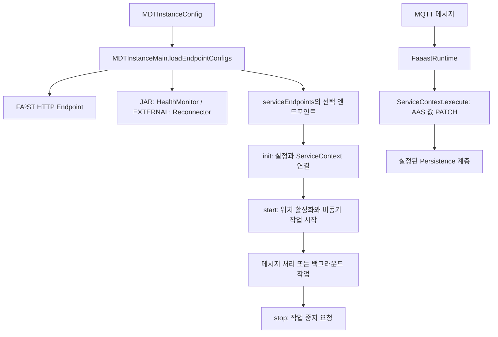
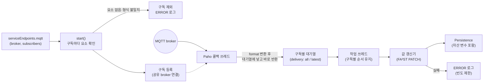
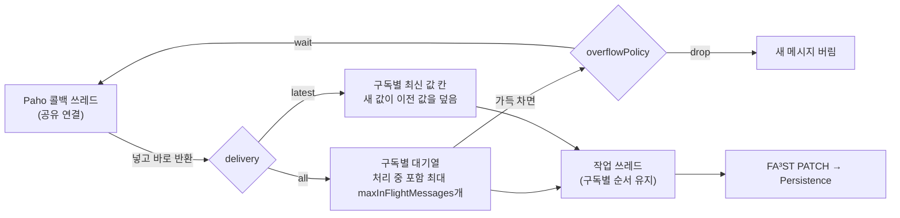
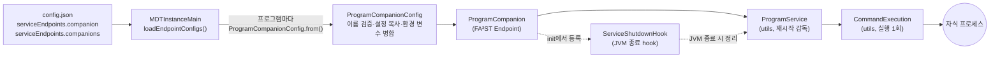
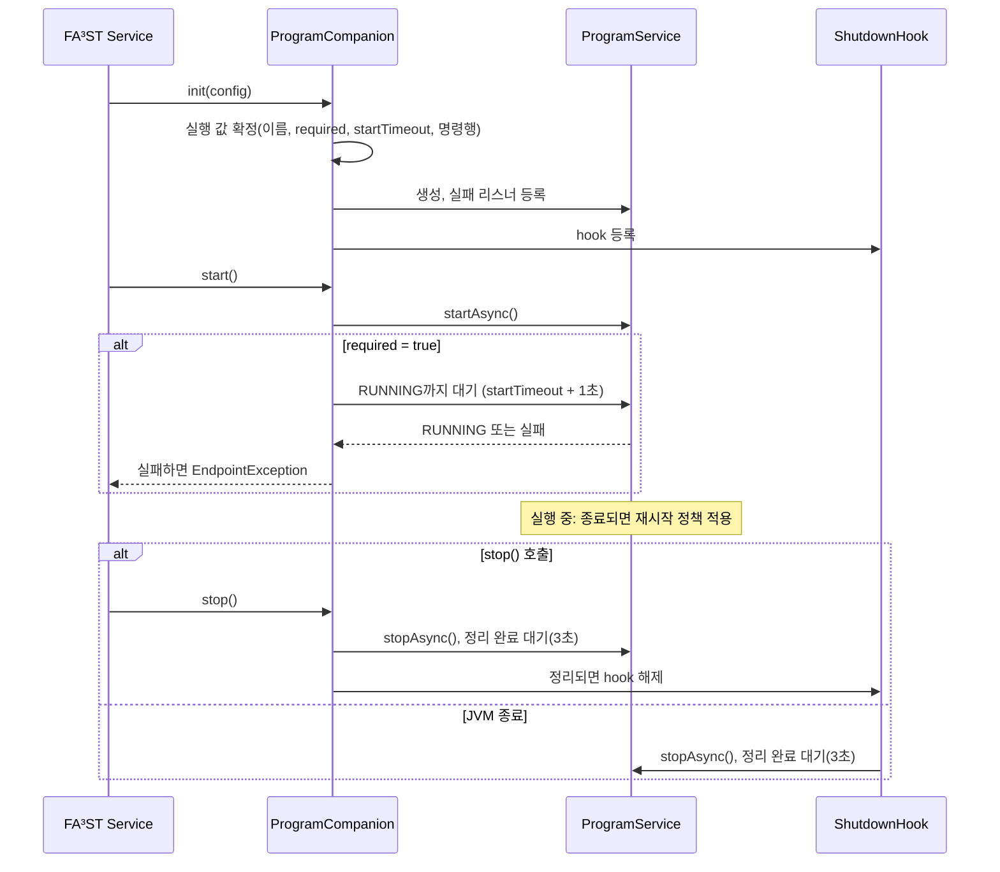
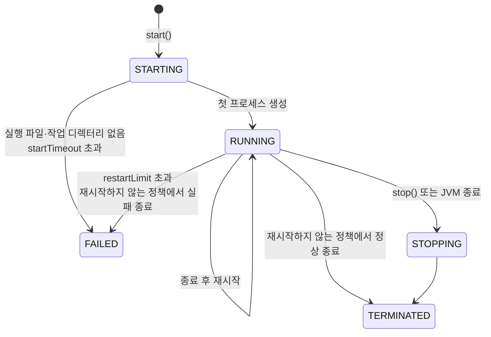

# mdt.endpoint 패키지 기술문서

`mdt.endpoint`는 MDT 인스턴스의 FA³ST 서비스 생명주기에 외부 통신과 백그라운드 작업을 연결한다.
MQTT 메시지를 AAS 요소 값에 반영하고, MDT Manager와의 연결을 관리하며,
외부 동반 프로세스를 실행한다.

이 문서는 인스턴스 개발자와 연동 담당자를 대상으로 한다. 2026년 10월 28일의 작업 트리를 기준으로
설정 로더, 엔드포인트 구현, 관련 `mdt-client`·`utils` 코드를 함께 검토했다.
개정 내용은 다음과 같다.

- MQTT(4절): broker 인라인 설정, 구독별 옵션(`delivery`, `qos`, `format`, `maxInFlightMessages`, `overflowPolicy`),
  시작할 때의 구독 검증, 작업 쓰레드에서의 반영, 공유 연결의 교착 방지, 실패 로그 빈도 제한, 종료 순서
- Companion(5절): 여러 프로그램 등록, 필수 프로그램 지정, 환경 변수 병합, 실패 로그, 종료 시 프로세스 정리
- Audit: 기본 로더에 등록 경로가 없어 쓰이지 않던 `mdt.endpoint.audit`(주기적 JDBC 기록) 패키지를 삭제하고 관련 절을 뺐다
- ROS2: `serviceEndpoints.ros2`(rosbridge `joint_states` 수신) 엔드포인트를 삭제하고 관련 절을 뺐다. 이를 쓰던 예전 모델(`panda_org`)도
  함께 정리했으며, 로봇 관절 상태는 RobotTwin 자산 변수로 받는다([mdt.persistence.asset](../persistence/asset/README.md))
- RobotTwin: 조회 루프가 꺼져 있어 아무 일도 하지 않던 `serviceEndpoints.robotTwin` 엔드포인트를 삭제하고 관련 절을 뺐다.
  로봇 상태는 RobotTwin 자산 변수(`mdt:asset:robot-twin:state`)로 읽는다

설정 예제는 기존 인스턴스 설정에 합치는 **부분 설정**이며, 전체 실행 파일을 대체하지 않는다.

## 1. 역할과 구현 상태

여기서 Endpoint는 HTTP 요청을 받는 서버만을 뜻하지 않는다. FA³ST의 `Endpoint<C>` 계약으로
시작·중지되는 메시지 소비자, 주기 작업, 프로세스 관리기도 포함한다.
AAS HTTP API는 `MDTInstanceMain`이 별도로 등록하는 FA³ST `HttpEndpointConfig`가 담당한다.

| 위치 / 주요 클래스 | 역할 | 기본 인스턴스 로더에서의 등록 |
| --- | --- | --- |
| 루트 / `MDTManagerHealthMonitor` | Manager 생존 확인, 실패 시 인스턴스 JVM 종료 | `JAR` 유형에 자동 등록 |
| `reconnector` / `MDTManagerReconnector` | 외부 인스턴스의 주기적 등록·연결 유지 | `EXTERNAL` 유형에 자동 등록 |
| `mqtt` / `MqttEndpoint` | MQTT 메시지 → AAS 요소 값 갱신 | `serviceEndpoints.mqtt` |
| `companion` / `ProgramCompanion` | 외부 프로그램 시작·재시작·종료, 실패 로그 | `serviceEndpoints.companion`, `serviceEndpoints.companions` |

연산 호출은 [mdt.assetconnection](../assetconnection/README.md), 저장 계층의 값 접근은
[mdt.persistence.asset](../persistence/asset/README.md)에서 다룬다.
이 패키지의 MQTT 엔드포인트는 수신 이벤트에 따라 FA³ST에 값 변경 요청을 전달하는 역할이다.

## 2. 등록과 공통 생명주기



`loadEndpointConfigs()`는 `mdtUrl`과 `instanceEndpoint`를 요구한다.
HTTP 엔드포인트의 포트는 `instanceEndpoint`에서 추출하며, 인증서 설정도 함께 구성한다.
이후 인스턴스 유형에 맞는 Manager 엔드포인트와 선택 엔드포인트를 설정 목록에 추가한다.

| 메서드 | 공통 역할 | 구현별 유의점 |
| --- | --- | --- |
| `init(CoreConfig, C, ServiceContext)` | 설정 보관, 클라이언트·실행 객체 준비 | 모델 위치 해석을 `start()`까지 미루는 구현이 있음 |
| `asConfig()` | 현재 엔드포인트 설정 반환 | FA³ST 설정 래퍼와 인스턴스 JSON DTO를 구분해야 함 |
| `getProfiles()` | 설정의 서비스 프로파일 반환 | 외부 연결 성공 여부를 나타내는 상태 API는 아님 |
| `start()` | 작업 시작 | 대부분 `startAsync()` 또는 비동기 실행을 호출하며 연결 완료를 기다리지 않음. MQTT는 구독마다 대상 요소를 확인함. Companion의 `required=true`만 프로세스 시작을 확인함 |
| `stop()` | 중지 요청 | 완료 대기·자원 정리 범위가 구현마다 다름. MQTT는 구독 해제와 반영 작업 정리를 기다림(4.8절). Companion은 자식 프로세스 정리를 최대 3초 기다림 |

`start()` 반환이나 시작 로그만으로 broker 연결, 자식 프로그램의 업무 준비가
완료되었다고 판단할 수 없다. 또한 메시지 갱신은 `FaaastRuntime`을 통해 FA³ST 요청으로 실행되므로,
실제 저장·외부 자산 쓰기 동작은 해당 인스턴스의 Persistence 구성에도 영향을 받는다.

근거: [MDTInstanceMain](../MDTInstanceMain.java),
[ServiceEndpointConfigs](../config/ServiceEndpointConfigs.java),
[FaaastRuntime](../FaaastRuntime.java).

### 2.1 전역 연결 설정

MQTT 엔드포인트는 인스턴스 설정에서 연결 이름을 지정하고, 전역 설정 파일에서 상세 내용을 읽을 수 있다.
다음은 전역 설정 파일의 일부다.

```json
{
  "mqttBrokers": {
    "factory": {
      "brokerUrl": "tcp://localhost:1883",
      "connectionTimeout": "10s",
      "keepAliveInterval": "30s"
    }
  }
}
```

`MDTGlobalConfigurations`가 설정된 전역 파일에서 그룹과 이름을 조회한다.
`default`라는 이름의 항목이 없으면 해당 그룹의 첫 항목으로 대체한다.
그룹 자체가 없거나, `default` 이외의 이름을 찾지 못하면 실패한다.
배포 설정에서는 의도한 연결 이름을 명시하는 편이 명확하다.

MQTT 엔드포인트의 `mqttBrokerConfig`는 MQTT 자산 변수와 같은 규칙을 따른다. 문자열이면 전역 설정 이름으로,
객체이면 broker 설정을 직접 적은 것으로 해석하고, 생략하면 `default`를 쓴다(4.2절).

근거: [MDTGlobalConfigurations](../MDTGlobalConfigurations.java).

### 2.2 AAS 요소 위치

MQTT 구독은 `ElementLocations.parseStringExpr()`로 대상 요소를 지정한다.

| 표현 | 의미 | 예 |
| --- | --- | --- |
| `<submodelIdShort>:<elementPath>` | Submodel의 idShort와 요소 경로 | `RobotState:Joints` |
| `param:<parameterId>` | MDT 파라미터 위치 | `param:Temperature` |
| `oparg:<submodelIdShort>:<kind>:<argumentName>` | AI·Simulation Submodel의 입출력 값 위치 | `kind`는 `INPUT` 또는 `OUTPUT` |

일반 표현의 앞부분은 Submodel의 전역 ID URI가 아니라 **idShort**다.
예를 들어 `RobotState:Joints.Joint1`은 `RobotState` Submodel의 `Joints.Joint1` 요소를 가리킨다.
시작 시 `activate(MDTModelLookup)`가 이를 실제 Submodel ID와 경로로 해석한다.
대상 모델·요소가 미리 존재해야 하며, 엔드포인트가 모델 구조를 생성하지 않는다.
파서는 콜론으로 분리하므로 콜론을 포함한 임의의 식별자에 대한 이스케이프 문법은 제공하지 않는다.

`oparg`는 일반 AAS Operation의 임의 인자를 탐색하는 기능으로 해석하면 안 된다.
현재 `MDTOperationArgumentLocation`은 AI·Simulation semantic ID를 검사하고 각각
`AIInfo.Inputs.InputValue` 또는 `SimulationInfo.Inputs.InputValue` 같은 경로를 구성한다.
OUTPUT도 같은 방식으로 처리하지만, 입력받은 `argumentName`은 경로 선택에 사용하지 않는다.
개별 인자를 지정할 때는 실제 모델 경로와 이 제한을 확인해야 한다.

근거: [ElementLocations](../ElementLocations.java),
[DefaultElementLocation](../DefaultElementLocation.java),
[MDTOperationArgumentLocation](../MDTOperationArgumentLocation.java).

## 3. Manager 연결 관리

### 3.1 JAR 인스턴스: HealthMonitor

`MDTManagerHealthMonitor`는 Manager가 실행한 JAR 인스턴스가 Manager 종료 후 남아 있는 상황을
방지하기 위한 서비스다. 시작 직후부터 일정 주기로 `GET {mdtUrl}/health`를 호출한다.

```json
{
  "mdtUrl": "http://localhost:12985",
  "managerCheckInterval": "10s"
}
```

- 기본 주기는 `10s`이고, 스케줄은 초기 지연 0의 fixed-rate다.
- HTTP 응답 본문의 업무 상태 필드를 별도로 분석하지 않는다.
- 호출 과정에서 예외가 한 번 발생하면 로그를 남기고 **`System.exit(0)`**을 호출한다.
- 연속 실패 횟수, 유예 시간, 재접속 후 복구 판단은 구현되어 있지 않다.
- `stop()`은 스케줄 중지만 요청하며 종료 완료를 기다리지 않는다.

따라서 Manager의 일시적인 통신 장애도 인스턴스 종료로 이어질 수 있다.
종료 코드가 0이므로 외부 프로세스 관리기의 재시작 정책과 함께 해석해야 한다.
설정 클래스에는 `enabled`가 있지만 기본 로더는 `true`로 생성한다.
`serviceEndpoints`에 HealthMonitor 비활성화 필드는 없다.

근거: [MDTManagerHealthMonitor](MDTManagerHealthMonitor.java),
[MDTManagerHealthMonitorConfig](MDTManagerHealthMonitorConfig.java).

### 3.2 EXTERNAL 인스턴스: Reconnector

`MDTManagerReconnector`는 시작 직후와 이후 주기마다 자신의 repository endpoint를 Manager에 전달한다.
기본 `heartbeatInterval`은 `60s`다.

```json
{
  "id": "robot-01",
  "mdtUrl": "http://localhost:12985",
  "instanceEndpoint": "https://localhost:19001",
  "heartbeatInterval": "60s"
}
```

요청 계약은 다음과 같다.

```http
POST /instance-manager/registry/robot-01
Content-Type: text/plain

https://localhost:19001
```

본문은 endpoint 문자열 자체다. 패키지에 `ConnectRequestBody` DTO가 있지만 현재 전송 경로에서는
사용하지 않는다. URL의 instance ID는 문자열로 직접 결합되며 별도 경로 인코딩은 수행하지 않는다.

일반 통신 실패는 다음 주기에 재시도한다. 역직렬화·unwrap된 원인이 `MDTInstanceManagerException`이면
`System.exit(-1)`을 호출하는 분기가 있다. 다만 이 분기는 `isInfoEnabled()` 조건 안에 있으므로
현재는 INFO 로깅 활성 여부에 따라 종료 동작도 달라진다.

`stop()`은 스케줄 중지를 요청한 뒤 같은 registry URL에 DELETE를 보내고 DELETE 실패는 무시한다.
진행 중인 POST 완료를 기다리는 처리가 없어, 종료 중 등록 요청과 해제 요청의 순서가 보장되지는 않는다.
기본 로더는 `enabled=true`로 생성한다. 설정 클래스를 직접 JSON으로 만들 경우에는 생성자의
primitive `boolean enabled`에 의존하므로 활성 여부를 명시해야 한다.

근거: [MDTManagerReconnector](reconnector/MDTManagerReconnector.java),
[MDTManagerReconnectorConfig](reconnector/MDTManagerReconnectorConfig.java).

## 4. MQTT 수신 엔드포인트

MQTT 엔드포인트는 broker의 토픽을 구독해, 받은 메시지를 AAS 요소 값으로 반영한다. 센서·설비가 MQTT로 내보내는 값을
디지털 트윈 모델에 실시간으로 옮길 때 쓴다. 같은 MQTT라도 방향이 반대인 MQTT 자산 변수와 구분해야 한다.

| 구분 | MQTT 엔드포인트 (`serviceEndpoints.mqtt`) | MQTT 자산 변수 (`mdt:asset:mqtt`) |
| --- | --- | --- |
| 방향 | broker → AAS 요소 (구독) | AAS 요소 → broker (발행) |
| 시점 | 메시지를 받을 때마다 | 요소 값이 바뀔 때마다 |
| 설정 위치 | 인스턴스 설정의 `serviceEndpoints.mqtt` | `assetVariables` |
| broker 연결 | 같은 broker 설정이면 하나의 연결을 함께 쓴다(4.6) | 〃 |

### 4.1 구성 요소와 처리 흐름



| 구성 요소 | 역할 |
| --- | --- |
| [MqttEndpoint](mqtt/MqttEndpoint.java) | FA³ST 엔드포인트. 시작할 때 구독을 검증·등록하고, 멈출 때 정리한다 |
| [MqttEndpointConfig](mqtt/MqttEndpointConfig.java) | broker 설정(이름 또는 인라인)과 구독 목록 |
| [MqttElementSubscriber](mqtt/MqttElementSubscriber.java) | 구독 설정 하나(토픽, 요소, 반영 옵션) |
| [MqttSubscriber](mqtt/MqttSubscriber.java) | 실제 구독자. payload 변환, 구독별 대기열, 반영과 실패 로그 |
| `DeliveryMode`, `PayloadFormat`, `OverflowPolicy` | 반영 방식(`all`/`latest`), payload 형식(`json`/`text`), 포화 정책(`wait`/`drop`) |
| [FaaastRuntime](../FaaastRuntime.java), [ElementValueUpdater](../ElementValueUpdater.java) | 요소별 값 갱신기. 타입을 미리 조회하고 FA³ST 응답 상태로 실패를 알린다 |
| [MqttServicePool](../MqttServicePool.java), [MqttService](../../../../../../mdt-client/src/main/java/mdt/client/support/MqttService.java) | broker 연결 공유, 토픽 구독 관리와 메시지 분배 |

### 4.2 설정 방법

#### broker 지정

`mqttBrokerConfig`에는 전역 설정의 `mqttBrokers` 항목 이름을 적거나, broker 설정을 객체로 바로 적는다.
MQTT 자산 변수의 `mqttBrokerConfig`와 같은 규칙이다.

| 적는 방법 | 예 | 의미 |
| --- | --- | --- |
| 문자열 | `"mqttBrokerConfig": "factory"` | 전역 설정 `mqttBrokers.factory` |
| 객체 | `"mqttBrokerConfig": { "brokerUrl": "tcp://192.168.0.10:1883" }` | 인스턴스 설정에 직접 기술 |
| 생략 | — | 전역 설정 `mqttBrokers.default` |

숫자나 배열처럼 문자열도 객체도 아닌 값은 설정을 읽는 단계에서 `invalid 'mqttBrokerConfig' value` 오류로 거부된다. MQTT 자산 변수와 달리 이전 형식인 `mqttBrokerConfigName`은 받지 않는다. 이 필드가 있으면 `'mqttBrokerConfigName' is not supported` 오류로 거부되므로, 전역 설정 이름도 `mqttBrokerConfig`에 문자열로 적는다.

broker 설정 항목은 다음과 같다. 현재 사용자명·비밀번호·인증서 항목은 없고, 모르는 항목(예: 오타인 `connectTimeout`)은 무시하되 설정을 읽을 때 경고를 남긴다.

| 항목 | 기본값 | 설명 |
| --- | --- | --- |
| `brokerUrl` | `tcp://localhost:1883` | broker 주소 |
| `connectionTimeout` | Paho 기본값 | 연결 시도 제한 시간(예: `"10s"`) |
| `keepAliveInterval` | Paho 기본값 | keep-alive 주기 |
| `reconnectInterval` | 첫 연결 5초, 재연결 최대 128초 | 첫 연결을 다시 시도하는 간격이자, 연결이 끊긴 뒤 Paho 자동 재연결 간격의 상한(Paho는 1초부터 두 배씩 늘려 이 값까지 기다린다) |

#### 구독 항목

```json
{
  "serviceEndpoints": {
    "mqtt": {
      "mqttBrokerConfig": "factory",
      "subscribers": [
        {"topic": "factory/robot01/events", "element": "RobotState:LastEvent"},
        {"topic": "factory/robot01/temperature", "element": "RobotState:Temperature", "delivery": "latest"},
        {"topic": "factory/robot01/status", "element": "RobotState:Status", "format": "text", "qos": 0},
        {"topic": "factory/robot01/counter", "element": "RobotState:Count",
         "maxInFlightMessages": 200, "overflowPolicy": "drop"}
      ]
    }
  }
}
```

| 필드 | 기본값 | 설명 |
| --- | --- | --- |
| `topic` | (필수) | 구독할 토픽 필터. `+`, `#` 와일드카드를 쓸 수 있다 |
| `element` | (필수) | 값을 반영할 요소 위치(2.2절) |
| `delivery` | `all` | `all`: 받은 메시지를 모두 순서대로 반영. `latest`: 반영이 밀리면 최신 값만 반영(4.5절) |
| `qos` | `1` | broker 구독 QoS(0, 1, 2) |
| `format` | `json` | `json`: AAS value-only JSON. `text`: payload 전체를 Property 값으로 사용(4.3절) |
| `maxInFlightMessages` | `1000` | `delivery: all`에서 **처리 중인 메시지와 대기 중인 메시지를 합한** 수의 상한. `latest`에는 적용되지 않는다 |
| `overflowPolicy` | `wait` | 상한에 이르렀을 때 `wait`(자리가 날 때까지 기다림) 또는 `drop`(새 메시지를 버림) |

`subscribers`에는 구독을 하나 이상 적어야 한다. 구독이 없는 MQTT 엔드포인트는 아무 일도 하지 않으므로, `mqtt` 항목을 적고 `subscribers`를 빠뜨리거나(철자 오류 포함) 비워 두면 설정 실수로 보고 거부한다. 문자열 옵션은 대소문자를 구분하지 않는다.

#### 설정 검증

다음 오류는 broker에 연결하기 전, 설정을 읽는 단계에서 거부되어 인스턴스가 시작되지 않는다. 오류 메시지에는 `subscribers[1]`처럼 문제가 된 항목의 위치가 나온다.

| 오류 | 예 |
| --- | --- |
| MQTT 규칙에 맞지 않는 토픽 필터 | 빈 문자열, `a/#/b`(`#`는 마지막 레벨에만), `a+`(`+`는 한 레벨 전체로만) |
| 범위를 벗어난 값 | `qos: 3`, `maxInFlightMessages: 0` |
| 알 수 없는 옵션 값 | `delivery: "newest"`, `format: "xml"`, `overflowPolicy: "block"` |
| 구독이 없음 | `subscribers` 누락·철자 오류(`subscriber`)·빈 목록 → `'subscribers' is required and must not be empty` |
| `null` 구독 항목 | `"subscribers": [ null ]` → `subscribers[0] is null` |

반면 **모델에 없는 요소**는 설정만 보고 알 수 없으므로 시작할 때 확인하며, 이때는 그 구독만 빠진다(4.4절).

### 4.3 payload 형식

기본 형식(`json`)의 payload는 대상 요소 타입에 맞는 **AAS value-only JSON**이다.

| 대상 요소 | payload 예 |
| --- | --- |
| 숫자 Property `Temperature` | `23.5` |
| 문자열 Property `Status` | `"running"` (따옴표 포함) |
| Collection `Joints` (숫자 Property `Joint1`, `Joint2`) | `{"Joint1": 0.25, "Joint2": -0.1}` |

장치가 문자열을 따옴표 없이(`running`) 보내면 JSON 형식이 아니어서 반영되지 않는다. 이때는 구독에 `"format": "text"`를 지정한다. 그러면 payload 전체를 JSON 문자열로 감싸(따옴표·역슬래시는 이스케이프) 넘기고, FA³ST가 Property의 데이터 타입에 맞게 해석한다. 그래서 숫자 Property에 `23.5`, 불리언 Property에 `true`를 그대로 보내도 된다.

| payload → 대상 | `format: "json"` (기본) | `format: "text"` |
| --- | --- | --- |
| `23.5` → 숫자 Property | 반영 | 반영 |
| `"running"` → 문자열 Property | 반영 | 따옴표까지 포함한 `"running"`이 값이 됨 |
| `running` → 문자열 Property | JSON 형식 오류 | 반영 |
| `{"Joint1": 0.25}` → Collection | 반영 | 사용 불가(시작할 때 구독 제외) |

AAS 요소 전체 정의나 MDT 타입 메타데이터가 붙은 직렬화 형식은 받지 않는다. 값의 해석은 모델에 이미 있는 요소 타입을 따르며, 타입 정보는 시작할 때 한 번 조회해 메시지마다 다시 조회하지 않는다.

### 4.4 시작과 구독 검증

`start()`는 다음 순서로 진행한다.

1. 구독마다 요소 위치를 활성화하고 `FaaastRuntime.newValueUpdater()`로 값 갱신기를 만든다. 이때 대상 요소의 타입을 조회하므로 요소가 실제로 있는지 확인된다.
2. 요소를 찾지 못했거나(경로 오타, 없는 Submodel·파라미터 등), `format: "text"`인데 대상이 Property가 아니면 그 구독만 빼고 ERROR 로그를 한 번 남긴다.
3. 남은 구독이 있으면 공유 broker 연결을 얻어 구독마다 `qos`로 등록한다. 남은 구독이 없으면 broker에 연결하지 않는다.

```text
skipping MQTT subscription, cannot apply messages to the target element: topic=factory/robot01/pressure, element=RobotState:Presure, cause=...
Starting service: MqttEndpoint[broker=tcp://192.168.0.10:1883], subscriptions=3/4
```

시작 로그의 `subscriptions=<등록 수>/<설정 수>`로 빠진 구독이 있는지 바로 알 수 있다.

시작 도중 연결 사용권 획득이나 구독 등록이 실패하면 그때까지 만든 자원(작업 쓰레드, 연결, 등록된 구독)을 모두 되돌리고, 원인을 담은 `EndpointException`을 던진다. 이미 시작된 엔드포인트의 `start()`를 다시 부르면 `IllegalStateException`이 난다.

### 4.5 메시지 반영: 작업 쓰레드와 `delivery`

Paho는 한 broker 연결의 메시지를 콜백 쓰레드 하나에서 차례로 전달하고, 이 연결은 MQTT 자산 변수와 함께 쓴다. 그래서 엔드포인트는 콜백 쓰레드에서 요소를 갱신하지 않는다. 메시지를 구독별 대기열에 넣고 곧바로 반환하며, 실제 반영은 엔드포인트의 작업 쓰레드(`mqtt-endpoint-<n>`, daemon)가 **구독별로 한 번에 하나씩, 받은 순서대로** 한다.
JDBC 저장처럼 느린 반영이 있어도 같은 연결의 다른 구독과 자산 변수의 수신은 막히지 않는다.



| 상황 | `all` + `wait` (기본) | `all` + `drop` | `latest` |
| --- | --- | --- | --- |
| 반영이 메시지 속도를 따라갈 때 | 모든 메시지를 순서대로 반영 | 〃 | 〃 |
| 반영이 밀릴 때 | 쌓아 두었다가 모두 반영 | 쌓아 두었다가 모두 반영 | 밀린 값은 버리고 최신 값만 반영 |
| 상한(`maxInFlightMessages`)에 이를 때 | 자리가 날 때까지 콜백 쓰레드가 기다림. 그동안 같은 연결의 다른 수신도 늦어짐 | 새 메시지를 버림. 다른 수신은 늦어지지 않음 | 해당 없음(값 하나만 보관) |
| 알리는 로그 | `MQTT in-flight limit (n) reached, waiting ...` WARN을 처음 한 번 | `... dropped <n> message(s) so far ...` WARN을 1·10·100…번째에 | — |
| 알맞은 데이터 | 이벤트·카운터처럼 중간 값도 의미 있고 유실되면 안 되는 경우 | 중간 값도 의미 있지만 다른 수신 지연이 더 곤란한 경우 | 센서 값처럼 마지막 값만 의미 있는 경우 |

메모리에 둘 수 있는 메시지는 유한하므로 "모든 메시지 보관"과 "다른 수신에 영향 없음"을 동시에 보장할 수는 없다. 반영이 계속 메시지 속도를 따라가지 못한다면 `latest`나 `drop`을 고르거나 저장 계층을 점검한다.

### 4.6 공유 연결과 재연결

broker 연결은 `MqttServicePool`을 통해 같은 broker 설정(URL, 연결 timeout, keep-alive 주기, 재연결 간격)을 쓰는
MQTT 자산 변수와 공유한다. 처음 연결을 얻는 쪽이 연결을 만들고, 마지막 사용자가 반납하면 연결을 끊는다(종료를 최대 5초 기다림).
같은 토픽을 여러 곳에서 구독해도 broker 구독은 하나만 유지되며, QoS는 요청된 값 중 가장 큰 값이 쓰인다.

공유 연결(`MqttService`)은 수신이 밀려도 교착되지 않도록 다음처럼 동작한다.

| 동작 | 방식 |
| --- | --- |
| 구독 목록 잠금 | 구독 목록만 보호한다. broker와의 통신(구독·해제·발행·연결 종료)은 이 잠금 밖에서 한다 |
| broker 구독·해제 | 별도 잠금으로 한 번에 하나씩 수행하고, 수행 시점의 구독 목록을 보고 구독할지 해제할지 정한다. 응답은 작업 제한 시간(기본 10초)까지만 기다리고, 넘기면 ERROR를 남긴 뒤 다음 연결 때 다시 맞춘다 |
| 첫 연결 | 연결될 때까지 `reconnectInterval`(기본 5초) 간격으로 반복 시도한다 |
| 연결이 끊겼을 때 | Paho 자동 재연결을 쓰고, 연결되면 모든 토픽을 요청된 QoS로 재구독한다. 재구독은 Paho 콜백 쓰레드가 아닌 별도 쓰레드(`mqtt-resubscribe-<n>`)에서 하며, 한 토픽이 실패해도 나머지는 계속한다 |
| 잘못된 토픽 | 구독 목록에 넣기 전에 거부하므로 공유 연결에 남지 않는다 |

받은 메시지는 토픽 필터가 일치하는 모든 구독자에게 전달한다. 일치 규칙은 MQTT 3.1.1을 따른다.

| 필터 | 일치하는 토픽 | 일치하지 않는 토픽 |
| --- | --- | --- |
| `a/+` | `a/b`, `a/` (빈 레벨도 한 레벨) | `a`, `a/b/c` |
| `a/#` | `a`, `a/b`, `a/b/c` | `b` |
| `a` | `a` | `a/` |
| `#`, `+/broker` | `$`로 시작하지 않는 토픽 | `$SYS/broker` (`$` 토픽은 첫 레벨 와일드카드와 일치하지 않음) |

겹치는 필터로 여러 구독이 같은 메시지를 받으면 각자 반영한다. 중복 제거, 수신 시각 비교, 메시지 영속 저장·재처리 기능은 없다.

### 4.7 오류 처리와 로그

FA³ST는 요청 처리 중의 실패(값 파싱 실패, 요소 없음, 저장 계층의 쓰기 실패 등)를 예외 대신 오류 응답으로 돌려준다.
값 갱신기는 응답 상태를 확인해 실패를 `ElementUpdateException`으로 알리고, 구독자는 이를 로그로 남긴 뒤 다음 메시지를 계속 처리한다.
자산 변수의 쓰기 실패(`AssetVariableException`)와 `PersistenceException`도 이 경로로 드러난다.

장치가 잘못된 형식을 계속 보내도 로그가 넘치지 않도록, 구독마다 연속 실패를 다음과 같이 기록한다.

| 연속 실패 | 로그 |
| --- | --- |
| 첫 번째 | ERROR `failed to update element from MQTT message: topic=..., element=..., cause=...` |
| 10번째, 100번째, 1000번째 … | ERROR `still failing to update element from MQTT messages: <n> consecutive failures, ..., last cause=...` |
| 그 밖의 실패 | DEBUG |
| 실패가 이어지다 성공 | INFO `MQTT element updates recovered after <n> consecutive failures` (이후 실패는 다시 첫 번째로 센다) |

`cause`에는 응답 상태 코드와 FA³ST 메시지가 들어간다. **payload 원문은 비밀 값이 있을 수 있어 어떤 로그에도 남기지 않는다.**
공유 연결의 수신 DEBUG 로그도 `Message arrived: topic=..., bytes=..., qos=..., retained=...`처럼 메타데이터만 남긴다.

자주 보게 되는 로그와 의미는 다음과 같다.

| 로그 | 의미 |
| --- | --- |
| `Starting service: MqttEndpoint[...], subscriptions=<n>/<m>` | 설정된 구독 m개 중 n개를 등록함 |
| `skipping MQTT subscription, cannot apply messages to the target element: ...` | 요소가 없거나 `text` 형식이 맞지 않아 구독을 뺌 |
| `created a shared MQTT connection` / `closing the shared MQTT connection` | 공유 연결을 처음 만들거나 마지막 사용자가 반납함 |
| `failed to connect to <broker>, keep retrying every ...` | 첫 연결 실패(이후 실패는 DEBUG). 연결되면 `connected to ... after <n> failed attempts` |
| `MQTT broker disconnected` | 연결이 끊김. 자동 재연결 후 재구독 |
| `failed to subscribe topic[...] at the broker, retry on reconnection` | broker 구독·해제가 실패하거나 제한 시간을 넘김 |
| `failed to update element from MQTT message` 등 | 요소 반영 실패(위 표) |
| `MQTT in-flight limit (n) reached, ...` | 처리 중·대기 중 메시지가 상한에 이름(4.5절) |
| `failed to resolve the MQTT broker config: ...` | 초기화 때 broker 설정을 찾지 못함(원래 원인이 함께 남음) |
| `... stopped with leftovers: ...` | 종료 때 정리하지 못한 것이 있음(4.8절) |

문제가 생겼을 때는 다음을 먼저 확인한다.

| 증상 | 확인할 것 |
| --- | --- |
| 값이 전혀 바뀌지 않음 | 시작 로그의 `subscriptions=n/m`과 구독 제외 로그, broker 연결 로그, 토픽 필터 일치 여부(4.6절) |
| 일부 메시지만 반영되지 않음 | `failed to update element` 로그의 `cause`(payload 형식, 저장 실패). 문자열 값이면 `format: "text"` 검토 |
| 값이 늦게 반영되고 다른 MQTT 수신도 늦음 | `in-flight limit ... waiting` WARN. 저장 계층의 속도, `latest`·`drop` 검토 |
| 중간 값이 빠짐 | `delivery: latest`이거나 `overflowPolicy: drop`인지 |
| 같은 메시지가 여러 요소에 반영됨 | 겹치는 토픽 필터가 있는지 |

### 4.8 종료

`stop()`은 다음 순서로 정리하며, 한 단계가 실패해도 다음 단계를 계속한다.


구독자를 먼저 닫는 이유는, 상한 때문에 기다리던 콜백 쓰레드를 풀어야 broker의 구독 해제 응답을 읽을 수 있기 때문이다.
구독 해제를 확인하지 못했거나 반영 작업을 인터럽트했으면 `stopped with leftovers: unconfirmed unsubscriptions=<n>, updates interrupted after PT5S=<true|false>` WARN을 남긴다.
`stop()`은 여러 번 불러도 되고, 멈춘 뒤에는 다시 시작할 수 있다. 이 저장소에는 현재 FA³ST 서비스의 `stop()`을 부르는 종료 경로가 없어,
JVM이 끝나면 프로세스와 함께 연결이 정리된다.

### 4.9 제약

- MQTT QoS는 broker에서 엔드포인트까지의 전달을 보장할 뿐, AAS 저장 완료를 보장하지 않는다. 반영에 실패한 메시지는 재시도하지 않으며, 종료할 때 대기 중인 메시지는 버린다.
- `latest`는 구독별 최신 값이다. 와일드카드 필터에 여러 실제 토픽이 들어오면 서로의 대기 값을 대체한다.
- FA³ST 1.3.0의 값 갱신 처리기는 persistence의 `update()`가 던진 `IllegalArgumentException`을 일부러 무시하고 성공으로 응답한다. 저장 계층이 이 예외로 실패를 알리면 값이 저장되지 않아도 실패 로그가 남지 않는다.
- broker 인증(사용자명·비밀번호)과 TLS 인증서 설정은 아직 없다.
- 서비스의 RUNNING 상태나 시작 로그는 broker 연결 완료를 뜻하지 않는다. 연결 여부는 연결 로그로 확인한다.
- 구독별 처리 상태(받은 수, 반영 수, 실패 수 등)를 조회하는 API는 없다. 로그로 확인한다.

근거: [MqttEndpoint](mqtt/MqttEndpoint.java),
[MqttSubscriber](mqtt/MqttSubscriber.java),
[MqttEndpointConfig](mqtt/MqttEndpointConfig.java),
[MqttElementSubscriber](mqtt/MqttElementSubscriber.java),
[FaaastRuntime](../FaaastRuntime.java),
[MqttServicePool](../MqttServicePool.java),
[MqttService](../../../../../../mdt-client/src/main/java/mdt/client/support/MqttService.java),
[MqttBrokerConfig](../../../../../../mdt-client/src/main/java/mdt/client/support/MqttBrokerConfig.java).

## 5. Companion 외부 프로그램

Companion은 MDT 인스턴스가 떠 있는 동안 **함께 실행해 두어야 하는 외부 프로그램**을 관리한다.
센서 데이터를 가공해 AAS에 써 넣는 Python 스크립트, 예측 결과를 MQTT로 내보내는 보조 프로세스처럼
인스턴스와 수명을 같이하는 프로그램이 대상이다. 인스턴스가 시작되면 프로그램을 띄우고, 프로그램이 죽으면
정책에 따라 다시 띄우며, 인스턴스가 끝나면 프로그램도 정리한다.

AAS Operation이 호출될 때마다 프로그램을 한 번씩 실행하는 `ProgramOperationProvider`와는 쓰임새가 다르다.

| 구분 | Companion (`ProgramCompanion`) | Operation 프로그램 (`ProgramOperationProvider`) |
| --- | --- | --- |
| 실행 시점 | 인스턴스 시작 시 한 번 시작해 계속 실행 | Operation 호출마다 실행 후 종료 |
| 종료 후 동작 | 재시작 정책에 따라 다시 실행 | 결과를 Operation 출력으로 반환 |
| 입출력 | 없음(프로그램이 직접 MDT·MQTT·DB에 접근) | Operation 입력·출력 인자 |
| 설정 위치 | `serviceEndpoints.companion` / `companions` | `operations.programs` |

### 5.1 구성 요소와 등록 흐름



| 구성 요소 | 위치 | 역할 |
| --- | --- | --- |
| `CompanionConfig` | `mdt.endpoint.companion` | 설정 파일의 항목 하나. utils `ProgramServiceConfig`에 `required`를 더한 형태 |
| `ProgramCompanionConfig` | `mdt.endpoint.companion` | FA³ST endpoint 설정. 이름, 실행 설정, `required`를 담는다. 로더가 `from()`으로 만든다 |
| `ProgramCompanion` | `mdt.endpoint.companion` | FA³ST 생명주기(`init`·`start`·`stop`)와 프로그램 서비스를 연결한다 |
| `ProgramService` | `utils.async.command` | 자식 프로세스 실행, 재시작 정책, 시작 제한 시간, 정리 완료 대기 |
| `CommandExecution` | `utils.async.command` | 프로세스 한 번의 실행. 출력 기록, SIGTERM 후 SIGKILL 종료 |
| `ServiceShutdownHook` | `utils.async.command` | JVM이 종료될 때 서비스를 멈추고 정리를 기다리는 hook |

동반 프로그램 하나에 `ProgramCompanion` 하나가 만들어진다. 따라서 여러 프로그램을 등록하면 각각 따로 시작·재시작·중지되고,
한 프로그램의 실패가 다른 프로그램에 영향을 주지 않는다. 엔드포인트 목록에서 companion은 HTTP·Manager·MQTT
엔드포인트 다음에 놓이며, 단일 `companion`이 먼저, 이어서 `companions`가 설정 파일에 적힌 순서대로 시작된다.

### 5.2 설정 방법

#### 단일 프로그램

프로그램이 하나뿐이면 `serviceEndpoints.companion`에 실행 설정을 바로 적는다.
`programConfig` 같은 감싸는 항목은 넣지 않는다.

```json
{
  "serviceEndpoints": {
    "companion": {
      "commandLine": ["python3", "bridge.py", "--instance", "${MDT_INSTANCE_ID}"],
      "workingDirectory": "/opt/mdt/robot-bridge",
      "environmentFile": "/opt/mdt/robot-bridge/bridge.env",
      "restartDelay": "5s"
    }
  }
}
```

#### 여러 프로그램

프로그램이 여럿이면 `serviceEndpoints.companions`에 이름을 키로 하여 적는다.
단일 `companion`과 함께 써도 된다.

```json
{
  "serviceEndpoints": {
    "companions": {
      "inspect-waveform": {
        "commandLine": ["uv", "run", "python", "inspect_waveform.py", "--instance", "${MDT_INSTANCE_ID}"],
        "workingDirectory": "${env:MDT_INSTANCE_HOME}/welder",
        "restartDelay": "10s"
      },
      "predict-throughput": {
        "commandLine": ["uv", "run", "--directory", "${env:MDT_INSTANCE_HOME}/welder",
                        "python", "predict_throughput.py", "--instance", "${MDT_INSTANCE_ID}"],
        "workingDirectory": "${env:MDT_INSTANCE_HOME}/companion",
        "required": true
      }
    }
  }
}
```

이름은 영문자나 숫자로 시작하고 영문자·숫자·`_`·`-`로만 이루어져야 한다(`.`, 공백, 한글 불가).
규칙에 맞지 않으면 설정을 읽는 단계에서 `IllegalArgumentException`으로 인스턴스 시작이 실패한다.
이름은 hook과 logger 이름, 실패 로그에 들어가므로 프로그램을 알아보기 쉬운 이름을 쓴다.

| 설정 형태 | 이름 | hook 쓰레드 이름 | logger 이름 |
| --- | --- | --- | --- |
| `companion` | 없음 | `<id>-companion-ShutdownHook` | `mdt.endpoint.companion.ProgramCompanion.<id>-companion` |
| `companions.<name>` | `<name>` | `<id>-companion-<name>-ShutdownHook` | `mdt.endpoint.companion.ProgramCompanion.<id>-companion-<name>` |

`<id>`는 인스턴스 ID다. 인스턴스 ID를 알 수 없으면 `<id>-` 부분이 빠진다(예: `companion-ShutdownHook`).

모든 프로그램은 표준 출력과 표준 오류를 작업 디렉터리의 `application.log`에 이어 쓴다.
두 프로그램이 같은 작업 디렉터리를 쓰면 로그가 한 파일에 섞이므로 작업 디렉터리를 나누는 것이 좋다.
위 예제의 `predict-throughput`처럼 프로그램은 다른 디렉터리에서 실행해야 한다면, 작업 디렉터리는 로그용으로 따로 두고
`uv run --directory`나 `sh -c "cd ...; exec ..."`로 실행 위치를 옮기면 된다.

#### 설정 항목

| 필드 | 기본값 | 설명 |
| --- | --- | --- |
| `commandLine` | (필수) | 실행 파일과 인자 목록. 셸을 거치지 않으므로 파이프나 리다이렉션이 필요하면 `["sh", "-c", "..."]`로 적는다 |
| `workingDirectory` | 인스턴스의 현재 디렉터리 | 프로그램 실행 위치이자 `application.log`가 생기는 위치. 상대 경로는 인스턴스의 현재 디렉터리 기준 |
| `environmentFile` | 없음 | `KEY=VALUE` 형식의 환경 변수 파일. 파일이 없으면 무시한다 |
| `environments` | 빈 맵 | 자식 프로세스에 줄 환경 변수. 로더가 인스턴스 변수와 병합한다(5.3) |
| `restartPolicy` | `ALWAYS` | `ALWAYS`, `ON_COMPLETED`, `ON_FAILED`, `NO`. `on-completed`처럼 소문자·하이픈 표기도 된다(5.5) |
| `restartDelay` | `5s` | 재시작 전에 기다리는 시간 |
| `maxRestartDelay` | `1m` | 짧은 실행이 이어질 때 늘어나는 재시작 지연의 상한. `restartDelay` 이하이면 지연을 늘리지 않는다 |
| `stableRunTime` | `10s` | 이보다 짧게 끝난 실행을 "짧은 실행"으로 본다 |
| `restartLimit` | `0` (제한 없음) | 양수이면 `restartLimitInterval` 안에 이 횟수를 넘겨 재시작하려 할 때 서비스를 FAILED로 만든다 |
| `restartLimitInterval` | `1m` | `restartLimit`을 세는 구간 |
| `startTimeout` | `30s` | 첫 실행이 이 시간 안에 시작되지 못하면 서비스를 FAILED로 만든다. `0s`이면 제한 없음 |
| `required` | `false` | `true`이면 프로그램이 시작되지 못할 때 인스턴스 시작도 실패시킨다(5.4) |

시간 값은 `"5s"`, `"1m"`, `"PT5S"` 형식을 모두 받는다.

### 5.3 변수 치환과 환경 변수

Companion 설정에서 값을 바꿔 넣는 방법은 두 가지이고, 적용 시점이 다르다.

| 방법 | 적용 시점 | 쓰는 곳 | 예 |
| --- | --- | --- | --- |
| 설정 문자열 치환 | 인스턴스가 `config.json`을 읽을 때 | `commandLine`, `workingDirectory` 등 설정 파일의 모든 문자열 | `${MDT_INSTANCE_ID}`, `${env:MDT_HOST}`, `${sys:user.home}` |
| 자식 프로세스 환경 변수 | 프로그램이 실행될 때 | 프로그램 내부에서 `os.environ` 등으로 읽음 | `MDT_INSTANCE_ID`, `environments`의 값 |

**설정 문자열 치환**에서 `${MDT_INSTANCE_ID}`처럼 접두어가 없는 참조는 아래 인스턴스 변수에서 찾고,
`${env:...}`는 인스턴스 JVM의 환경 변수, `${sys:...}`는 Java 시스템 속성에서 찾는다.
찾지 못한 참조는 오류 없이 글자 그대로 남으므로, 치환 결과는 인스턴스 로그의
`Register Companion endpoint` 줄에서 확인한다. 인스턴스 ID는 Manager가 띄우든 직접 띄우든 항상 정해지므로
`${env:MDT_INSTANCE_ID}`보다 `${MDT_INSTANCE_ID}`를 쓰는 편이 안전하다.

**자식 프로세스 환경 변수**로는 로더가 다음 인스턴스 변수를 항상 넣어 준다.

| 변수 | 값 |
| --- | --- |
| `MDT_INSTANCE_ID` | 인스턴스 ID |
| `MDT_INSTANCE_ENDPOINT` | 인스턴스의 AAS API 주소 |
| `MDT_URL` | MDT Manager 주소 |
| `MDT_INSTANCE_PORT` | 인스턴스 포트. 설정에 없으면 `instanceEndpoint`에서 뽑은 값 |
| `MDT_INSTANCE_DIR` | 인스턴스 JVM의 현재 디렉터리 |

자식 프로세스가 받는 환경은 다음 순서로 만들어진다. 아래쪽이 위쪽을 덮어쓴다.

1. 인스턴스 JVM의 환경 변수(부모 프로세스 환경)
2. `environmentFile`의 값 중 3에 없는 이름
3. 인스턴스 변수 위에 사용자의 `environments`를 병합한 값

같은 이름이 인스턴스 변수와 `environments`에 모두 있으면 사용자 값이 이긴다. 이때 인스턴스 변수를 다른 값으로
덮어쓰면 `companion environment 'MDT_URL' overrides the MDT instance variable` 같은 WARN 로그가 남는다.
값에는 비밀 정보가 있을 수 있어 로그에는 변수 이름만 나온다.

병합은 설정의 복사본에서 이루어지므로 원래 설정 객체는 바뀌지 않는다. 같은 설정으로 companion을 여러 번 만들어도
각자의 인스턴스 변수가 들어간다.

> **비밀 값은 `commandLine`에 쓰지 않는다.** 명령행은 `Register Companion endpoint`, JVM 종료 시의
> `Shutting down Service ...`, 실행 취소 시의 `cancelled: ...` 로그에 그대로 찍힌다. DB 비밀번호 같은 값은
> `environments`나 `environmentFile`로 넘기고 프로그램이 환경 변수에서 읽게 한다.

### 5.4 생명주기



| 단계 | 동작 |
| --- | --- |
| `init()` | 설정을 검사한다(`programConfig`가 없으면 `IllegalArgumentException`). 이름, `required`, `startTimeout`, 명령행을 이때 확정하고, `ProgramService`를 만들고, JVM 종료 hook을 등록한다. 이후 설정 객체를 바꿔도 실행·대기·로그에는 반영되지 않는다 |
| `start()` | `ProgramService`를 시작한다. `required=false`면 바로 반환하고, `true`면 5.4.1처럼 시작을 확인한다 |
| 실행 중 | 프로그램이 끝날 때마다 재시작 정책을 적용한다(5.5) |
| `stop()` | 중지를 요청하고 자식 프로세스 정리가 끝날 때까지 최대 3초 기다린다(5.6) |

`ProgramService`의 상태는 다음과 같이 바뀐다. FAILED로 가는 모든 경로에서 companion은 ERROR 로그를 남긴다(5.7).



여기서 **RUNNING은 자식 프로세스가 생성되었다는 뜻일 뿐**, 프로그램이 일할 준비를 마쳤다는 뜻이 아니다.
실행하자마자 스크립트 오류로 죽는 프로그램도 일단 RUNNING이 되고, 그다음부터는 재시작 정책을 따른다.

#### 5.4.1 필수 프로그램(`required`)

프로그램이 없으면 인스턴스가 제 역할을 못 하는 경우 `required`를 `true`로 둔다.

| 상황 | `required = false` (기본) | `required = true` |
| --- | --- | --- |
| `start()` | 시작만 요청하고 바로 반환 | RUNNING이 될 때까지 `startTimeout` + 1초 기다림(`startTimeout`이 0이면 제한 없이) |
| 실행 파일 없음, `startTimeout` 초과 등 시작 실패 | ERROR 로그만 남기고 인스턴스는 계속 실행 | `EndpointException`으로 FA³ST 서비스 시작이 실패하고 인스턴스 프로세스가 종료 코드 255로 끝남 |
| 시작한 뒤의 실패(재시작 한도 초과 등) | ERROR 로그만 남김 | ERROR 로그만 남김(인스턴스를 멈추지 않음) |

`required` 프로그램의 시작이 실패하면 인스턴스는 다음 순서로 끝난다. `runService()`가 ERROR 로그를 남기므로
Manager는 인스턴스 출력에서 `ERROR`를 보고 시작 실패로 판단한다. 이미 시작된 다른 companion은 JVM 종료 hook이 정리한다.


`required`는 프로세스가 생성되는지만 확인한다. 포트가 열렸는지, 모델을 다 읽었는지 같은 업무 준비 상태는 확인하지 않으며,
여러 companion을 적은 순서대로 시작해도 앞 프로그램의 준비가 끝난 뒤 다음 프로그램이 시작된다는 보장은 없다.

### 5.5 재시작 정책

프로그램이 스스로 끝났을 때 서비스가 어떻게 되는지는 `restartPolicy`가 정한다.
`stop()`이나 JVM 종료로 멈춘 경우에는 정책과 관계없이 재시작하지 않는다.

| 정책 | 정상 종료(종료 코드 0) | 실패 종료 |
| --- | --- | --- |
| `ALWAYS` (기본) | 재시작 | 재시작 |
| `ON_COMPLETED` | 재시작 | FAILED |
| `ON_FAILED` | TERMINATED (재시작 안 함) | 재시작 |
| `NO` | TERMINATED | FAILED |

첫 실행이 RUNNING에 이르지 못하고 끝나면 정책과 관계없이 시작 실패로 보고 FAILED가 된다.

**재시작 지연(backoff).** `stableRunTime`(기본 10초)보다 짧게 끝나는 실행이 연달아 일어나면, 두 번째 재시작부터
지연을 두 배씩 늘려 `maxRestartDelay`(기본 1분)까지 키운다. 늘어나는 지연의 시작값은 `restartDelay`와 1초 중 큰 값이다.
한 번이라도 `stableRunTime` 이상 실행되면 원래 지연으로 돌아간다. 시작하자마자 죽는 프로그램이 쉬지 않고 재시작되며
CPU와 `application.log`를 소모하는 것을 막기 위한 장치다.

**재시작 한도.** `restartLimit` 기본값은 0(제한 없음)이다. 이 경우 `ALWAYS` 정책에서 계속 죽는 프로그램은 FAILED가 되지 않고
재시작 간격만 늘어나므로, 실패 로그도 남지 않는다. 계속 죽는 상황을 실패로 드러내려면 예를 들어
`"restartLimit": 5, "restartLimitInterval": "10m"`처럼 한도를 둔다. 한도를 넘으면
`restart limit exceeded: ...` 원인으로 FAILED가 되고 ERROR 로그가 남는다.

### 5.6 종료와 프로세스 정리

자식 프로세스를 정리하는 경로는 두 가지다. 두 경로 모두 같은 기준으로 정리 완료를 판단한다.

| 경로 | 호출되는 때 | 하는 일 | 3초 안에 정리되지 않으면 |
| --- | --- | --- | --- |
| `ProgramCompanion.stop()` | FA³ST 서비스를 `stop()`으로 멈출 때 | 중지 요청 후 정리 완료 대기, 정리되면 hook 해제 | WARN 로그를 남기고 hook을 유지 |
| JVM 종료 hook | 정상 종료, `System.exit`, SIGTERM·SIGINT | 중지 요청 후 정리 완료 대기 | WARN 로그를 남기고 JVM 종료를 계속 진행 |

현재 mdt-instance에는 FA³ST 서비스의 `stop()`을 부르는 종료 경로가 없다. Manager가 인스턴스를 멈추거나
`kill`로 종료하면 **JVM 종료 hook이 정리를 맡는다.**

"정리 완료"는 서비스가 끝난 상태(TERMINATED 또는 FAILED)가 된 것만으로 판단하지 않는다.
시작 제한 시간을 넘긴 경우처럼 서비스가 먼저 FAILED가 되고 실행 취소와 프로세스 종료가 그 뒤에 진행되는 경우가 있기 때문이다.
그래서 utils의 `ProgramService.awaitCleanup()`으로 **마지막 실행의 프로세스 정리까지 끝났는지**를 확인한다.
프로세스 종료는 SIGTERM을 보내고 1초 안에 끝나지 않으면 SIGKILL로 마무리한다.

다음 경우에는 자식 프로세스가 남을 수 있다.

- `kill -9`나 JVM 충돌처럼 JVM이 종료 hook을 실행하지 못한 경우
- 자식 프로세스가 스스로 데몬이 되어 부모와의 관계를 끊은 경우. 하위 프로세스는 부모-자식 관계를 따라가며 찾기 때문에
  그 사이에 떨어져 나간 프로세스는 놓칠 수 있고, 프로세스 그룹 단위로 함께 종료하는 장치는 없다.

### 5.7 로그와 문제 확인

| 위치 | 내용 |
| --- | --- |
| `<workingDirectory>/application.log` | 프로그램의 표준 출력과 표준 오류. 재시작해도 뒤에 이어 쓰며 크기 제한이나 순환은 없다 |
| 인스턴스 로그, logger `mdt.endpoint.companion.ProgramCompanion.<hook 이름>` | `ProgramService`의 시작·재시작·중지 기록 |
| 인스턴스 로그, logger `mdt.endpoint.companion.ProgramCompanion` | 실패 ERROR, 환경 변수 덮어쓰기 WARN, 정리 지연 WARN |

자주 보게 되는 로그는 다음과 같다.

| 로그 | 의미 |
| --- | --- |
| `Register Companion endpoint: <name>: command=[...], workingDirectory=...` | 로더가 companion을 등록함. 변수 치환 결과를 여기서 확인한다 |
| `command output will be redirected to <file>` | 프로그램 출력이 기록될 파일 |
| `the command is started` | 첫 프로세스가 생성되어 서비스가 RUNNING이 됨 |
| `restarting the command after PT10S` | 재시작 지연 후 다시 실행함(시간은 ISO-8601 형식) |
| `the command exited after ... backing off: restart in ...` | 짧은 실행이 이어져 재시작 지연을 늘림 |
| `companion program failed: name=..., state=..., cause=..., program=[...]` | 서비스가 FAILED가 됨. `state`가 `STARTING`이면 시작 실패, `RUNNING`이면 실행 중 실패 |
| `companion environment '<name>' overrides the MDT instance variable` | `environments`가 인스턴스 변수를 덮어씀 |
| `Shutting down Service due to JVM shutdown: ...` | JVM 종료 hook이 정리를 시작함 |
| `Failed to cleanly shutdown ... within PT3S` | JVM 종료 hook이 3초 안에 정리를 확인하지 못함 |
| `companion program was not cleaned up within PT3S, keeping the shutdown hook: name=...` | `stop()`이 3초 안에 정리를 확인하지 못함 |

증상별로는 다음을 먼저 본다.

| 증상 | 확인할 것 |
| --- | --- |
| 프로그램이 아예 뜨지 않음 | `companion program failed ... state=STARTING` 로그, `commandLine`의 실행 파일 경로, `workingDirectory` 존재 여부 |
| 인자에 `${...}`가 그대로 들어감 | `Register Companion endpoint` 줄. 치환하지 못한 참조는 글자 그대로 남는다(5.3) |
| 프로그램이 계속 재시작됨 | `application.log`의 마지막 출력, `backing off` 로그. 실패로 드러내려면 `restartLimit` 설정 |
| 두 프로그램의 출력이 섞임 | 두 companion의 `workingDirectory`가 같은지 |
| 인스턴스 종료 후 프로세스가 남음 | 인스턴스를 `kill -9`로 끝냈는지, 프로그램이 데몬으로 떨어져 나가는지(5.6) |

### 5.8 제약

- 프로그램의 업무 준비 상태를 확인하는 readiness 검사는 없다. `required`도 프로세스 생성까지만 확인한다.
- Companion의 실패는 로그로만 드러난다. Manager에 보이는 인스턴스 상태는 바뀌지 않고, 실행 중 실패로 인스턴스를 멈추지도 않는다.
- 실행 값은 `init()` 시점에 확정된다. `asConfig()`는 설정 객체를 그대로 돌려주므로, 초기화 뒤 설정 객체를 바꾸면
  `asConfig()`로 보이는 값과 실제 실행 값이 달라질 수 있다.
- 실행 시간 전체에 대한 제한은 없다(실행 timeout 없음).
- `application.log`는 크기 제한과 순환이 없으므로 장기 운영 시 외부에서 정리해야 한다.

근거: [ProgramCompanion](companion/ProgramCompanion.java),
[ProgramCompanionConfig](companion/ProgramCompanionConfig.java),
[CompanionConfig](companion/CompanionConfig.java),
[ServiceEndpointConfigs](../config/ServiceEndpointConfigs.java),
[MDTInstanceMain](../MDTInstanceMain.java),
[ProgramServiceConfig](../../../../../../../common/utils/src/main/java/utils/async/command/ProgramServiceConfig.java),
[ProgramService](../../../../../../../common/utils/src/main/java/utils/async/command/ProgramService.java),
[CommandExecution](../../../../../../../common/utils/src/main/java/utils/async/command/CommandExecution.java),
[ServiceShutdownHook](../../../../../../../common/utils/src/main/java/utils/async/command/ServiceShutdownHook.java),
utils의 [외부 명령 실행 가이드](../../../../../../../common/utils/src/main/java/utils/async/command/README.md).

## 6. 확장과 검증 지점

새 엔드포인트를 추가하려면 FA³ST `Endpoint<C>`와 `EndpointConfig`를 구현하고,
인스턴스 JSON DTO를 `ServiceEndpointConfigs`에 추가한 뒤 `MDTInstanceMain.loadEndpointConfigs()`에서
래퍼 설정을 생성해야 한다. 클래스가 존재하는 것만으로 기본 로더가 자동 등록하지 않는다.
초기화·연결 완료·중지 완료를 분리하고, 비동기 서비스 상태 전이와 자원 해제도 함께 구현해야 한다.

운영 전 검증은 다음 동작에 초점을 맞출 수 있다.

| 대상 | 확인할 동작 |
| --- | --- |
| Manager | 첫 호출 시점, 일시 장애 시 JVM 종료, registry 등록·해제 요청, INFO 수준 변경 영향 |
| MQTT | 시작 로그의 `subscriptions=n/m`과 구독 제외 로그, 값 형식·대상 타입 불일치 시 실패 로그와 빈도 제한, `delivery`·`overflowPolicy`별 반영(밀릴 때와 상한에 이를 때), 대기 중 `stop()`이 제한 시간 안에 끝나는지, broker 재연결 후 재구독 |
| Companion | 변수 치환 결과(`Register Companion endpoint` 로그), 자식 환경 변수, 정책별 재시작과 `restartLimit`, `required` 시작 실패 시 인스턴스 종료, 실패 ERROR 로그, 프로그램별 `application.log` 분리, 인스턴스 종료 후 자식 PID 소멸 |

이 문서는 소스와 호출 경로의 정적 검토를 바탕으로 작성했다.
실제 Manager에 대한 연결 시험 결과를 검증 완료로 제시하는 문서는 아니다.
MQTT는 단위 테스트와 함께, 로컬 Mosquitto broker로 포화 상태의 종료와 연결된 상태의 잘못된 토픽 거부를 확인했다
(`MqttEndpointBrokerTest`, 환경 변수 `MDT_TEST_MQTT_BROKER`가 있을 때만 실행).
Companion은 단위 테스트와 함께, 2026년 10월 28일 Welder 모델의 두 프로그램을 `companions`로 등록해 Manager가 띄운 인스턴스에서
시작·로그 분리·종료 후 프로세스 정리를 확인했다.
