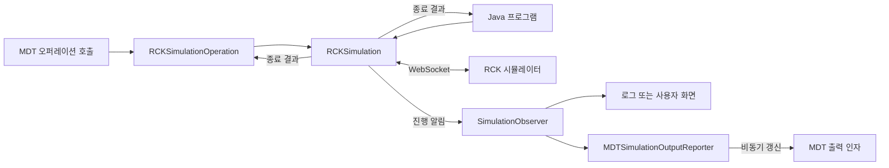
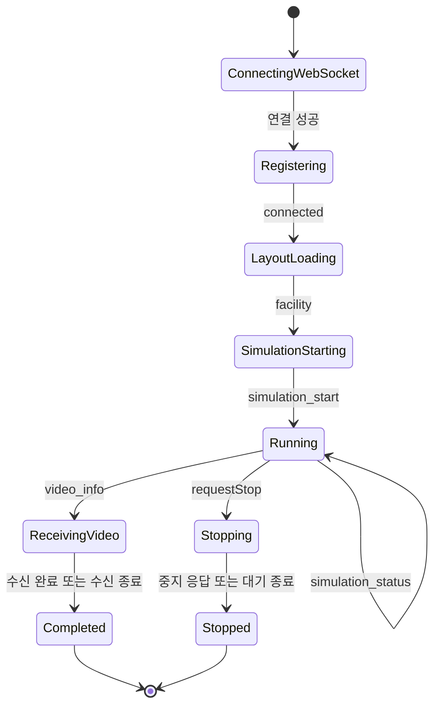

# RCK 시뮬레이션 사용 가이드

`mdt.ext.rck`는 RCK 프레스 공정 시뮬레이터에 WebSocket으로 접속하여 레이아웃을 실행하고, 진행 상황·생산량·설비 이용률·결과 영상 URL을 수집한다. MDT 오퍼레이션으로 등록하거나 Java 코드에서 직접 실행할 수 있다.

**목차**

- [1. 사용 방식과 구성 요소](#1-사용-방식과-구성-요소)
- [2. MDT 오퍼레이션으로 사용하기](#2-mdt-오퍼레이션으로-사용하기)
- [3. Java에서 직접 실행하기](#3-java에서-직접-실행하기)
- [4. 진행 상황과 결과 해석하기](#4-진행-상황과-결과-해석하기)
- [5. 중지·취소·시간 제한](#5-중지취소시간-제한)
- [6. 통신 흐름과 문제 해결](#6-통신-흐름과-문제-해결)
- [7. 관련 코드와 검증](#7-관련-코드와-검증)

## 1. 사용 방식과 구성 요소

### 1.1. 어떤 방식으로 사용할 것인가

| 목적 | 진입점 | 준비할 항목 |
|---|---|---|
| MDT 연산으로 실행하고 출력 인자를 조회 | `RCKSimulationOperation` | AAS Operation 모델, Java 연산 설정, `LayoutName` 입력 |
| Java 프로그램에서 직접 실행하고 결과 처리 | `RCKSimulation` | 서버 URL, 클라이언트 ID, 공정명, 레이아웃명 |
| 직접 실행하면서 MDT에 진행 상황 반영 | `RCKSimulation` + `MDTSimulationOutputReporter` | 위 항목과 MDT 관리자·대상 인스턴스 ID |

예제의 서버 주소·공정명·레이아웃명은 사용 환경에 맞게 바꿔야 한다. 레이아웃은 RCK 서버에서 사용할 수 있는 이름을 지정한다. 이 패키지가 로컬 레이아웃 파일을 업로드하지는 않는다.

### 1.2. 구성 요소

| 클래스 | 사용자가 알아둘 역할 |
|---|---|
| [RCKSimulation](RCKSimulation.java) | 실행 시작, 종료 대기, 중지·취소, 최종 결과 조회 |
| [RCKSimulationContext](RCKSimulationContext.java) | 접속·실행 대상 정보와 실행 중 수신한 정보 보관 |
| [SimulationObserver](SimulationObserver.java) | 상태 변화, 진행 상황, 영상 URL, 종료 결과 알림 |
| [RCKSimulationProgress](RCKSimulationProgress.java) | 진척도·생산량·설비 유형별 평균 이용률 |
| [RCKSimulationResult](RCKSimulationResult.java) | 종료 사유, 중지 확인 여부, 마지막 진행 상황, 영상·실패 정보 |
| [VideoInfo](VideoInfo.java) | 영상 다운로드 URL과 수신 크기 등 메타데이터 |
| [RCKSimulationOperation](RCKSimulationOperation.java) | MDT OperationProvider와 시뮬레이션 연결 |
| [MDTSimulationOutputReporter](MDTSimulationOutputReporter.java) | MDT 출력 인자에 진행 상황을 비동기로 반영 |
| [RCKExecutors](RCKExecutors.java) | 내부 타이머·작업용 데몬 스레드 관리. 직접 생성할 필요 없음 |



## 2. MDT 오퍼레이션으로 사용하기

### 2.1. 모델과 연산 설정 준비

대상 AAS Operation과 입출력 변수는 모델에 미리 정의한다. 제공자 등록만으로 모델이나 변수가 생성되지는 않는다. 연산 등록 절차는 [assetconnection 가이드](../../assetconnection/README.md)를 참고한다.

#### 2.1.1. Java 제공자 설정 예제

아래는 `JavaOperationProviderConfig`에 해당하는 설정 조각이다. 인스턴스 연산 설정에서 대상 Operation에 연결하는 `java` 설정으로 사용한다. 전체 인스턴스 설정 파일은 아니다.

```json
{
  "operationClassName": "mdt.ext.rck.RCKSimulationOperation",
  "arguments": {
    "clientId": "mdt-client-01",
    "processName": "press",
    "rckServerUrl": "ws://localhost:4000/rck/simulator",
    "responseTimeout": "2m",
    "pingInterval": "10s",
    "pongTimeout": "2s",
    "maxDuration": "1h"
  }
}
```

| 설정 인자 | 필수 | 기본값 | 의미 |
|---|---|---|---|
| `clientId` | 예 | 없음 | RCK 서버에 등록할 클라이언트 ID |
| `processName` | 예 | 없음 | 실행할 공정명 |
| `rckServerUrl` | 예 | 없음 | RCK WebSocket URL (`ws://` 또는 `wss://`) |
| `responseTimeout` | 아니요 | `2m` | 응답 대기 상태에서 메시지 없이 기다릴 최대 시간 |
| `pingInterval` | 아니요 | `10s` | 연결 유지 ping 간격 |
| `pongTimeout` | 아니요 | `2s` | pong 응답 대기 시간 |
| `maxDuration` | 아니요 | `1h` | 시뮬레이션 전체 실행 제한 시간 |

필수 문자열은 공백만으로 지정할 수 없다. 시간 설정은 `90s`, `2m`처럼 `UnitUtils.parseDuration()`이 해석하는 문자열이며 양수여야 한다. 형식이 잘못되면 제공자 초기화가 실패한다.

#### 2.1.2. 입출력 변수 정의

변수 이름은 `OperationVariable` 안에 있는 요소의 `idShort`다. 아래 변수는 모두 AAS `Property`로 정의한다.

| 방향 | 이름 | `valueType` | 의미 |
|---|---|---|---|
| 입력·필수 | `LayoutName` | `xs:string` | 실행할 레이아웃 이름. 빈 값·공백 불가 |
| 출력·선택 | `Progress` | `xs:int` | 마지막 진척도(%) |
| 출력·선택 | `Production` | `xs:int` | 마지막 생산량 |
| 출력·선택 | `AverageUtilization` | `xs:string` | 설비 유형별 평균 이용률을 담은 JSON 문자열 |
| 출력·선택 | `FinalState` | `xs:string` | 성공한 호출의 결과 코드: `Completed` 또는 `Stopped` |
| 출력·선택 | `SimulationVideoUrl` | `xs:string` | 영상 URL. 영상 정보가 없으면 빈 문자열 |

출력 변수는 생략할 수 있지만, 정의한다면 위 타입에 맞춰야 한다. 입력·출력 형식은 실행 전에 검사한다. 이 오퍼레이션은 입출력 겸용 변수(`inoutputVars`)를 사용하지 않는다.

### 2.2. 호출과 결과 확인

1. 대상 Operation에 위 Java 제공자를 연결하고 인스턴스를 실행한다.
2. 호출 입력 `LayoutName`에 서버에 등록된 레이아웃 이름을 넣는다.
3. 동기 호출은 실행 종료까지 기다린다. 비동기 호출은 실행을 시작한 뒤 반환하며 완료 시 성공·실패 콜백으로 알린다.
4. 성공하면 모델에 정의된 출력 변수에서 결과를 읽는다. 실패·취소·전체 시간 초과는 예외 또는 실패 콜백으로 처리한다.

입력 예: `LayoutName = "프레스 공정_사람_NOCON.vcmx"`.

성공 결과의 예는 다음과 같다. 실제 값은 시뮬레이터의 보고 내용에 따라 달라진다.

```text
Progress            = 100
Production          = 120
AverageUtilization  = {"TP-75":0.75,"가열로":0.6}
FinalState          = Completed
SimulationVideoUrl  = https://simulator.example/results/run-001.mp4
```

`AverageUtilization`은 AAS 컬렉션이 아니라 **JSON을 담은 문자열 Property**다. 수치 단위는 시뮬레이터가 보낸 값을 그대로 따르므로 화면에서 임의로 100을 곱하지 않는다.

### 2.3. MDT에 실시간 진행 상황 반영

오퍼레이션은 갱신기를 자동으로 생성하고 다음 참조 표현식으로 출력 인자에 접근한다.

```text
oparg:{instanceId}:PressSimulation:out:{argName}
```

실시간 반영 대상은 `State`, `Progress`, `Production`, `AverageUtilization`, `SimulationVideoUrl`이다. `State`는 문자열 출력 인자로 준비한다. 이 경로의 `PressSimulation`은 현재 구현에 고정돼 있으므로, 다른 이름의 Submodel에 연산을 등록했다면 실시간 반영 경로도 확인해야 한다.

| 구분 | `State` | `FinalState` |
|---|---|---|
| 목적 | 화면에서 진행 상태 표시 | 호출 결과를 코드로 판단 |
| 예 | `소켓 연결중`, `시뮬레이션 진행중`, `시뮬레이션 실패` | `Completed`, `Stopped` |
| 반영 경로 | 갱신기가 MDT 출력 인자를 비동기로 변경 | 성공 시 Operation 출력 변수에 기록 |
| 실패·취소 시 | MDT 갱신이 가능하면 종료 상태 표시 | 새 성공 결과를 기록하지 않음 |

`State`의 한글 문구는 분기 조건으로 사용하지 않는다. 실패 후 저장된 출력 값은 이전 실행의 값일 수도 있으므로, 호출의 성공 여부를 먼저 확인한다.

대상 ID는 `MDTService`의 인스턴스 설정에서 찾고, 사용할 수 없으면 `MDT_INSTANCE_ID` 환경변수를 확인한다. 관리자 접속은 `HttpMDTManager.connectWithDefault()`를 사용한다. 관리자나 개별 출력 인자에 접근하지 못해도 시뮬레이션은 계속되며, 경고 로그를 남긴다.

갱신은 별도 스레드에서 순서대로 처리한다. 같은 인자의 갱신이 밀리면 최신 값만 남기며, 새 실행이 시작되면 이전 실행의 미처리 갱신은 버린다. 따라서 공용 출력 인자는 실행별 이력 저장소가 아니다. 오퍼레이션은 결과를 통지하기 전에 갱신 완료를 최대 5초 기다리고, 그 시간을 넘으면 경고를 남긴 뒤 결과를 통지한다.

## 3. Java에서 직접 실행하기

### 3.1. 실행하고 최종 결과 읽기

다음 예제는 MDT 연동 없이 RCK 시뮬레이션 한 건을 실행한다. 직접 실행에는 오퍼레이션의 `maxDuration`이 적용되지 않으므로 호출자가 종료 대기 시간과 시간 초과 처리를 정한다.

```java
import java.time.Duration;
import java.util.concurrent.TimeUnit;
import java.util.concurrent.TimeoutException;
import mdt.ext.rck.*;

public class RunRck {
    public static void main(String[] args) throws Exception {
        var context = new RCKSimulationContext(
                "ws://localhost:4000/rck/simulator",
                "mdt-client-01", "press", "프레스 공정_사람_NOCON.vcmx");
        var simulation = new RCKSimulation(context);
        simulation.setResponseTimeout(Duration.ofMinutes(2));
        simulation.setPingInterval(Duration.ofSeconds(10));
        simulation.setPongTimeout(Duration.ofSeconds(2));
        simulation.start();

        try {
            simulation.waitForFinished(50, TimeUnit.MINUTES);
        }
        catch (TimeoutException e) {
            // 대기 시간 초과만으로 실행이 멈추지는 않는다.
            simulation.requestStop();
            simulation.waitForFinished();
        }
        catch (InterruptedException e) {
            simulation.cancel(true);
            Thread.currentThread().interrupt();
            throw e;
        }

        RCKSimulationResult result = simulation.getSimulationResult();
        System.out.println("종료 사유: " + result.termination());
        System.out.println("생산량: " + result.progress().production());
        System.out.println("영상 URL: " + result.videoUrl());
        if (result.failureCause() != null) {
            result.failureCause().printStackTrace();
        }
    }
}
```

`waitForFinished()`가 반환됐다는 사실만으로 정상 완료를 판단하지 않는다. 종료 후 `getSimulationResult().termination()`을 확인한다. 실행 중에는 `getSimulationResult()`가 `IllegalStateException`을 던진다. 실행마다 새 context와 simulation 객체를 생성한다.

### 3.2. 진행 알림 받기

생성자에 `SimulationObserver`를 전달하면 상태·진행률·영상 URL·종료 결과를 받을 수 있다. 아래는 화면이나 로그 처리에 필요한 콜백을 연결하는 예제다.

```java
SimulationObserver observer = new SimulationObserver() {
    @Override
    public void onStateChanged(String statePath, String displayName) {
        System.out.println(statePath + " : " + displayName);
    }

    @Override
    public void onProgressUpdated(RCKSimulationProgress progress) {
        System.out.println("진척도=" + progress.progress()
                + ", 생산량=" + progress.production());
    }

    @Override
    public void onVideoReady(String downloadUrl) {
        System.out.println("영상 URL=" + downloadUrl);
    }

    @Override
    public void onFinished(RCKSimulationResult result) {
        System.out.println("종료=" + result.termination());
    }
};

var simulation = new RCKSimulation(context, observer);
simulation.start();
```

이 예제의 `context`는 3.1절과 같이 생성한다. 콜백은 잠금을 보유한 상태에서 호출될 수 있으므로 원격 요청, 파일 다운로드, 종료 대기처럼 오래 걸리는 작업을 직접 수행하지 않는다. 그런 작업은 호출자가 관리하는 executor나 화면 이벤트 큐로 넘긴다. 관찰자의 예외는 경고로 남기고 무시된다. 알림이 필요 없으면 기본 생성자나 `SimulationObserver.NONE`을 사용한다.

### 3.3. 직접 실행하면서 MDT 출력 반영하기

이미 준비한 `MDTInstanceManager manager`와 대상 인스턴스 ID가 있다면 갱신기를 관찰자로 사용할 수 있다.

```java
var reporter = new MDTSimulationOutputReporter(
        () -> manager, () -> "press-instance");

// 같은 출력 대상의 여러 실행에서는 reporter를 재사용한다.
var simulation = new RCKSimulation(context, reporter.startRun());
simulation.start();
simulation.waitForFinished();
reporter.flushAsync().get(5, TimeUnit.SECONDS);
RCKSimulationResult result = simulation.getSimulationResult();
```

`startRun()`은 실행마다 새 관찰자를 반환한다. 생성자와 `startRun()` 자체는 MDT 접속을 기다리지 않는다. `flushAsync()`는 대기 중인 갱신 처리가 끝날 때 완료되지만, 개별 갱신 실패는 경고로 처리하므로 모든 출력의 저장 성공을 보증하는 것은 아니다. 위 예제의 5초 대기에서 발생하는 `TimeoutException`은 호출자가 처리한다.

## 4. 진행 상황과 결과 해석하기

### 4.1. 진행 상황

`RCKSimulationProgress`의 필드는 다음과 같다.

| 필드 | 의미 |
|---|---|
| `progress()` | `simulation_status.message.Progress`를 정수로 읽은 진척도 |
| `production()` | `Conveyor_6.Production`을 정수로 읽은 생산량. 필드가 없으면 0 |
| `averageUtilizations()` | 설비 유형별 평균 이용률. 키 순서가 정렬된 변경 불가 맵 |

이용률은 설비 이름이 `TP-75`, `파츠피더`, `가열로`, `세척기`, `템퍼링호`로 시작하는 설비를 유형별로 묶어 평균을 내고 소수 셋째 자리까지 반올림한다. 숫자 이용률이 없는 설비는 제외한다. 첫 진행 보고 전에는 진척도·생산량이 0이고 이용률 맵은 비어 있다.

`Progress`가 없거나 숫자가 아니면 해당 보고를 무시한다. `Conveyor_6.Production`도 필드가 있는데 숫자가 아니면 보고 전체를 무시한다. 이전에 받은 정상 진행 상황은 유지된다.

### 4.2. 종료 결과

| `termination()` | 의미 | 추가 확인 |
|---|---|---|
| `COMPLETED` | 정상 종료 | `videoUrl()` 확인 |
| `STOPPED` | 중지 절차로 종료 | `stopConfirmed()`가 true일 때만 서버의 중지 응답을 받음 |
| `FAILED` | 통신·프로토콜·응답 대기 실패 등 | `failureCause()` 확인 |
| `CANCELLED` | 취소 | 오퍼레이션의 전체 시간 초과도 내부적으로 취소 처리 |

`STOPPED`는 상태 차트 실행 자체로는 성공이다. 서버 응답 없이 중지 대기 시간이 끝나거나 연결이 종료돼도 `STOPPED`가 될 수 있으므로, 서버의 중지 확인이 필요하면 `stopConfirmed()`를 함께 본다.

### 4.3. 결과 영상

`video_info`를 받으면 URL을 즉시 관찰자에게 알린다. 이어서 오는 이진 데이터는 수신량만 세며 파일로 저장하지 않는다. 영상 파일이 필요하면 `videoUrl()`의 주소에서 별도로 내려받는다.

영상 정보를 받은 뒤에는 이진 데이터 수신 중 연결 종료·오류·응답 대기 시간 초과가 발생해도 `COMPLETED`로 끝난다. 따라서 정상 완료는 로컬 영상 파일 저장이나 URL의 다운로드 성공까지 보장하지 않는다. 영상 정보를 받기 전에 끝났다면 `videoUrl()`은 null이다.

## 5. 중지·취소·시간 제한

### 5.1. 중지와 취소 선택

| 호출 | 동작 | 결과 |
|---|---|---|
| `requestStop()` | 접속 이후 stop 명령을 보내고 확인 응답을 기다림 | 보통 `STOPPED`. 시작 전·접속 중이면 `CANCELLED` |
| `cancel(true)` | 연결돼 있으면 stop 전송을 시도한 뒤 취소. 서버 확인 응답은 기다리지 않음 | `CANCELLED` |

```java
// 사용자 중지 버튼 등에서 호출한다.
simulation.requestStop();

// 종료 절차를 기다릴 수 없을 때 선택한다.
// simulation.cancel(true);
```

stop 전송 실패는 `FAILED`가 될 수 있다. 취소도 stop 전송 완료를 최대 2초 기다릴 수 있으므로 지연에 민감한 화면 스레드에서는 작업 스레드로 넘긴다.

### 5.2. 시간 제한의 차이

| 제한 | 의미 | 설정 위치 |
|---|---|---|
| 응답 대기 | 메시지가 오지 않는 구간 제한. 메시지 수신 시 다시 시작 | `responseTimeout` / `setResponseTimeout()` |
| 중지 응답 대기 | stop 명령의 응답을 기다리는 시간. 기본 10초 | 직접 실행 시 `setStopResponseTimeout()` |
| 전체 실행 시간 | 메시지가 계속 와도 적용되는 전체 제한 | 오퍼레이션 `maxDuration` |
| 호출자 대기 시간 | 호출자가 완료를 기다리는 시간. 초과만으로 자동 취소되지 않음 | `waitForFinished(timeout, unit)` |

오퍼레이션은 `maxDuration`이 지나면 취소하고 시간 초과로 보고한다. 동기 호출의 대기가 인터럽트되면 취소한다. 직접 실행에서는 이러한 전체 제한 처리를 호출자가 구현해야 한다.

## 6. 통신 흐름과 문제 해결

### 6.1. 정상 실행 흐름



그림은 주요 경로만 표시한다. 등록·레이아웃 로딩·시작 대기·영상 수신 상태에서도 중지를 요청할 수 있으며, 오류 경로에서는 `Failed`로 전이한다.

| 단계 | 송신 내용 | 기다리는 응답 |
|---|---|---|
| 등록 | `{"register":"<clientId>"}` | `connected` |
| 레이아웃 선택 | `type=layout`, `target=processName`, `name=layoutName` | `facility` (`loading`은 대기 유지) |
| 실행 시작 | `type=command`, `target=processName`, `message=facility 정보` | `simulation_start` (`simulation_waiting`은 대기 유지) |
| 실행 중 | 진행 보고 수신 | `simulation_status`, `video_info` |
| 중지 | `type=stop`, `target=processName` | `simulation_stop` |

진척도가 100이라는 이유만으로 종료하지 않는다. 정상 실행의 종료 판단에는 영상 정보와 영상 수신 단계가 사용된다. `video_progress`와 `video_ready`는 로그에만 남긴다.

### 6.2. 자주 확인할 사항

| 증상 | 확인할 내용 |
|---|---|
| 실행 전에 예외 발생 | 필수 설정, 양수 시간 값, `LayoutName`, 출력 Property 타입 |
| 등록·레이아웃 단계에서 시간 초과 | URL·클라이언트 등록 방식·공정명·서버 레이아웃 이름과 응답 로그 |
| 진행 중 갑자기 실패 | `failureCause()`, pong 시간 초과, 영상 정보 수신 전 연결 종료 여부 |
| 실행은 되지만 MDT 상태가 바뀌지 않음 | 관리자 접속 설정, 인스턴스 ID, `PressSimulation` 출력 인자와 경고 로그 |
| 중지됐지만 서버 확인 여부가 불명확 | `stopConfirmed()` 확인 |
| 완료됐는데 영상 파일이 없음 | 이 패키지는 파일을 저장하지 않음. 결과 URL에서 별도 다운로드 |
| 비동기 호출에서 오류를 찾기 어려움 | 실패 콜백의 예외와 원인 확인. 일부 실패는 `ExecutionException`으로 전달됨 |

상태 처리와 관찰자는 빠르게 반환하도록 작성한다. 내부 타이머·취소·MDT 갱신에는 RCK 전용 스레드를 사용하며, 명령 송신은 앞선 송신이 끝난 뒤 순서대로 보낸다. `Completed`·`Failed` 진입 시 연결이 열려 있으면 stop 전송을 시도한 뒤 연결을 닫는다.

## 7. 관련 코드와 검증

- [RCKSimulation.java](RCKSimulation.java): 프로토콜과 상태별 처리
- [RCKSimulationOperation.java](RCKSimulationOperation.java): 설정·입출력·시간 제한·콜백 처리
- [수동 실행 예제](../../../../../test/java/mdt/ext/rck/RCKSimulationManualRun.java): 실제 서버에 접속하는 개발용 프로그램. 실행 전 코드의 서버·공정·레이아웃 값을 변경한다.
- 자동 테스트: `src/test/java/mdt/ext/rck`의 상태 전이, 진행 상황 파싱, 오퍼레이션, 출력 갱신 테스트

`mdt-instance` 프로젝트 루트에서 관련 자동 테스트를 실행한다.

```bash
gradle :test --tests 'mdt.ext.rck.*' --console=plain
```

수동 실행 프로그램은 자동 테스트와 구분한다. 실제 시뮬레이터와 MDT 서버의 연결 가능 여부는 사용하는 환경에서 별도로 확인해야 한다.
