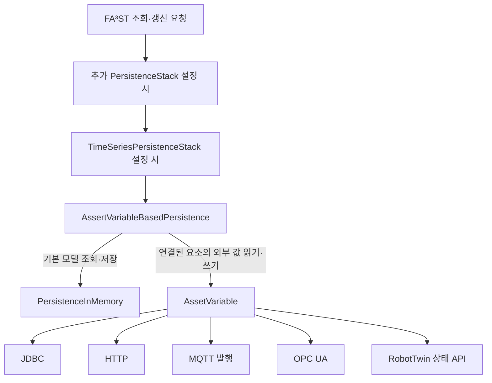
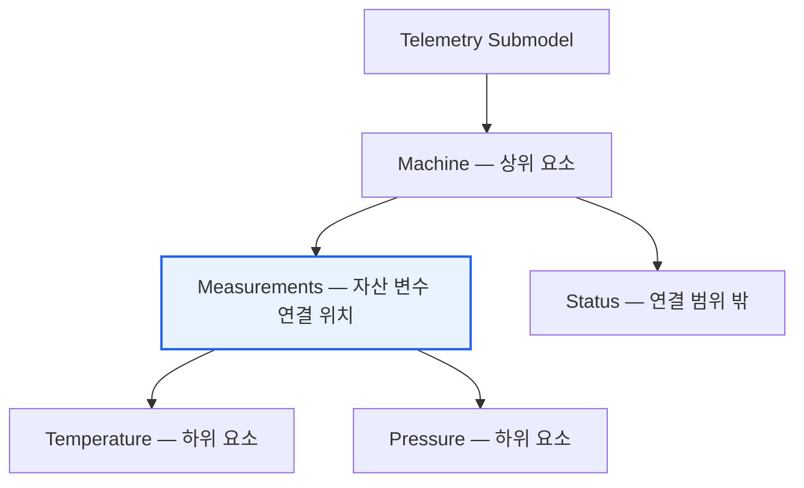
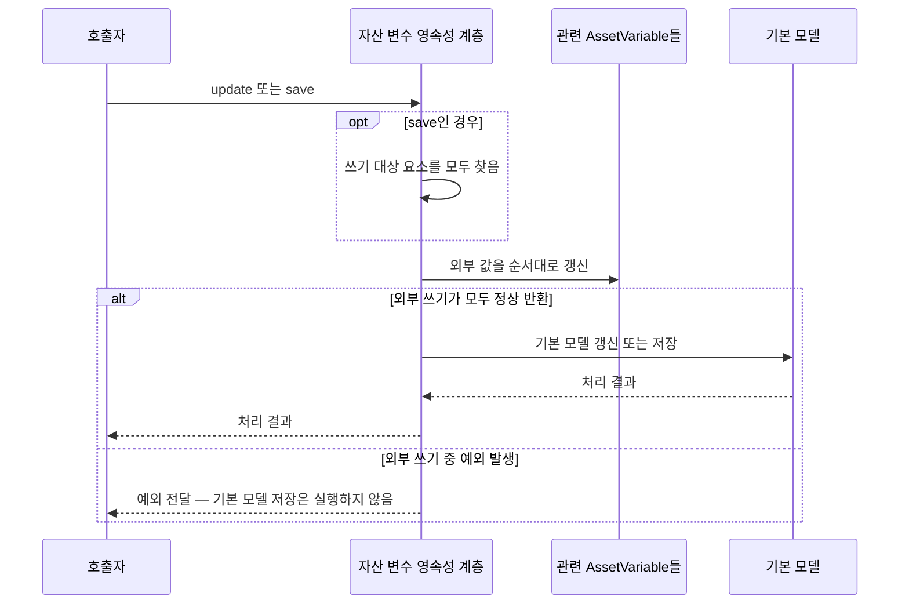
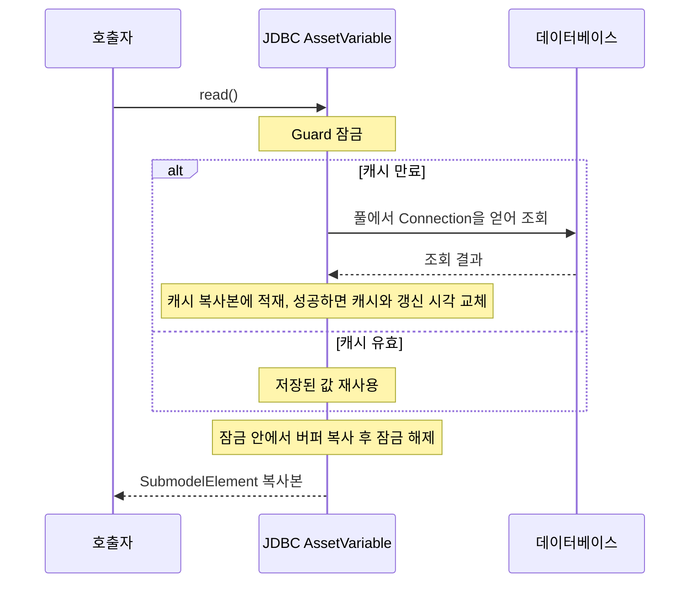
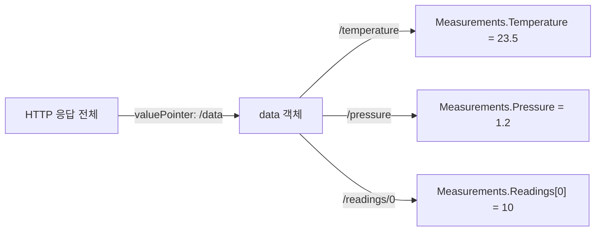

# mdt.persistence.asset 패키지 기술문서

`mdt.persistence.asset`은 AAS 모델의 요소를 DB, HTTP API, MQTT, OPC UA 등의 외부 시스템과 연결한다. AAS 조회 요청이 들어오면 외부 값을 읽어 응답에 반영하고, 갱신 요청이 들어오면 새 값을 외부 시스템에 전달한다. 이 연결을 담당하는 객체가 `AssetVariable`이다.

예를 들어 `Telemetry:Measurements.Temperature`를 DB의 온도 컬럼에 연결하면, 사용자는 AAS API로 온도를 조회하면서 DB의 값을 읽을 수 있다. `Measurements` Collection 전체를 연결해 온도와 압력을 한 번에 다룰 수도 있다. 연결할 요소의 구조와 타입은 초기 AAS 모델에 미리 정의해야 한다.

이 문서는 MDT 인스턴스를 개발하거나 외부 시스템을 연동하는 개발자를 위한 문서다. 먼저 전체 구조와 공통 동작을 설명하고, 이어서 연결 방식별 설정과 구현상의 주의점을 다룬다. 설명은 2026년 10월 30일 소스를 기준으로 한다. `AssertVariableBasedPersistence`와 `AssertVariableBasedPersistenceConfig`는 실제 코드에 쓰인 클래스 이름이다.

- 연동을 설정하려면 [설정 형식과 구현 선택](#설정-형식과-구현-선택)에서 사용할 구현을 고른 뒤 해당 연동 절의 예제를 참고한다.
- 조회 결과나 갱신 동작을 이해하려면 [조회와 갱신 요청 처리](#조회와-갱신-요청-처리)를 먼저 읽는다.
- 새 구현을 추가하려면 [AssetVariable의 역할과 사용 규칙](#assetvariable의-역할과-사용-규칙)과 [새 데이터소스 구현 방법](#새-데이터소스-구현-방법)을 함께 읽는다.

## 패키지 구조와 영속성 스택

`AssertVariableBasedPersistence`는 `PersistenceStack`을 상속한다. 영속성 스택은 여러 저장·조회 처리 계층을 겹쳐 놓은 구조다. 각 계층은 자신이 맡은 요청을 처리하고 나머지는 안쪽 계층에 넘긴다. `MDTInstanceMain.loadPersistenceConfig()`는 `assetVariables`가 비어 있지 않으면 자산 변수 계층을 추가한다.



추가 스택과 시계열 계층은 설정했을 때만 존재한다. 기본 AAS 모델에는 요소의 구조·타입과 저장된 값이 들어 있고, 자산 변수는 자신에게 연결된 요소의 외부 연동을 맡는다. 외부 값이 필요 없는 요청은 하위 영속성 구현이 처리한다.

| 용어 | 이 문서에서의 의미 |
| --- | --- |
| 기본 모델 | 하위 영속성 구현이 보관하는 AAS 모델. 기본 구성에서는 `PersistenceInMemory`가 담당 |
| 자산 변수 | AAS 요소 하나와 외부 데이터소스를 연결하는 `AssetVariable` 객체 |
| 연결 경로 | 자산 변수가 맡는 요소의 위치. Collection이나 List를 가리키면 그 하위 요소도 포함 |
| 내부 버퍼 또는 캐시 | 구현이 값을 읽거나 변환할 때 사용하는 `m_prototype`. AAS 요소의 구조도 함께 보관 |
| 캐시 유효 기간 | 이미 읽은 값을 다시 사용할 수 있는 기간. 설정 이름은 `validPeriod` |

| 패키지 | 주요 클래스 | 역할 |
| --- | --- | --- |
| `mdt.persistence.asset` | `AssetVariable`, `AbstractAssetVariable` | 공통 인터페이스, 모델 요소 연결, 캐시 만료 계산 |
| 같은 패키지 | `AssetVariableConfig`, `AbstractAssetVariableConfig`, `AssetVariableConfigs` | 설정 항목 정의와 `@type`별 설정 읽기·저장 |
| 같은 패키지 | `AssertVariableBasedPersistence`, `AssertVariableBasedPersistenceConfig` | FA³ST 요청을 기본 모델과 자산 변수에 전달 |
| 같은 패키지 | `AssetVariableException` | 변수 생성이나 외부 데이터 접근 실패를 알리는 예외 |
| `jdbc` | `AbstractJdbcAssetVariable`과 네 가지 구현 | DB의 행·컬럼을 AAS 요소에 연결 |
| `http` | `HttpAssetVariable` | HTTP GET 응답에서 값 추출 |
| `mqtt` | `MqttAssetVariable` | AAS 값을 MQTT 메시지로 발행 |
| `opcua` | `AbstractOpcUaAssetVariable`과 세 가지 구현 | OPC UA 노드 조회 및 재연결 |
| `robot` | `RobotStateVariable` | RobotTwin 상태 변수 조회 |

관련 코드: [AssertVariableBasedPersistence.java](AssertVariableBasedPersistence.java), [PersistenceStack.java](../PersistenceStack.java), [MDTInstanceMain.java](../../MDTInstanceMain.java).

## AssetVariable의 역할과 사용 규칙

### 인터페이스와 객체 사용 규칙

| 메서드 | 역할 |
| --- | --- |
| `getElementLocation()` | 연결된 SubmodelElement의 위치 반환 |
| `isReadable()` | 외부에서 값을 읽을 수 있는지 확인 |
| `isUpdatable()` | 외부에 값을 쓸 수 있는지 확인 |
| `initialize(MDTModelLookup)` | 설정의 위치를 실제 모델 요소와 연결하고 내부 버퍼 준비 |
| `close()` | 외부 연결과 백그라운드 작업 정리. 기본 구현은 아무 일도 하지 않음 |
| `read()` | 연결된 요소의 값을 읽어 새 SubmodelElement로 반환 |
| `update(SubmodelElement)` | 전달받은 요소의 값을 외부에 기록 |
| `updatePart(String, SubmodelElement)` | 연결된 요소 중 지정한 하위 요소의 값만 변경 |
| `contains`, `isContained`, `overlaps` | 두 요소 경로가 서로 포함되거나 겹치는지 확인 |

`read()`가 반환한 객체는 호출자가 자유롭게 변경하거나 보관할 수 있어야 한다. 따라서 구현은 내부 캐시 자체를 반환해서는 안 된다. 공유 캐시를 쓰는 구현은 잠금을 잡은 상태에서 복사본을 만든 뒤 반환한다. `update()`도 전달받은 객체를 그대로 캐시로 보관하지 않고, 필요하면 복사해서 보관한다.

`updatePart()`의 기본 구현은 전체 값을 읽고, 지정한 부분을 바꾼 다음 전체를 저장한다. 이 과정 사이에 다른 쓰기 요청이 끼어들면 변경 내용이 사라질 수 있다. JDBC 구현은 세 단계를 하나의 잠금으로 묶어 같은 변수에 대한 다른 갱신이 끼어들지 못하게 한다.

읽기·쓰기 가능 여부는 **외부 연동의 기능**을 뜻한다. 읽기 전용 HTTP 변수를 등록했다고 해서 AAS 요소의 갱신까지 금지되는 것은 아니다. 이 경우 외부 쓰기는 건너뛰고 기본 모델만 갱신한다. 이후 조회에서는 HTTP로 읽은 값이 다시 응답에 반영될 수 있다.

관련 코드: [AssetVariable.java](AssetVariable.java).

### 생성과 초기화

1. `MDTInstanceMain`이 초기 AAS 모델의 Submodel 목록으로 `MDTModelLookup`을 준비한다.
2. 영속성 스택의 `init()`이 하위 영속성 구현을 생성하고 초기화한다.
3. `AssertVariableBasedPersistence.start()`가 하위 영속성 구현을 시작한다.
4. 각 설정 클래스 이름에서 끝의 `Config`를 뺀 이름으로 구현 클래스를 찾는다.
5. 해당 설정 클래스를 인자로 받는 생성자를 호출한 뒤 `initialize(lookup)`을 실행한다.
6. 생성한 변수를 Submodel의 전역 `id`별로 묶어 등록한다.

예를 들어 `SimpleJdbcAssetVariableConfig`에는 같은 패키지의 `SimpleJdbcAssetVariable`이 대응한다. 리플렉션으로 이 이름과 생성자를 찾으므로 새 구현도 이 규칙을 따라야 한다.

`AbstractAssetVariable.initialize()`는 `ElementLocation.activate()`로 Submodel ID와 요소 경로를 확정하고, lookup의 모델에서 해당 요소를 찾아 `m_prototype`에 보관한다. 이때는 모델 요소를 복사하지 않고 직접 참조한다. 매번 복사본을 반환해야 한다는 규칙은 `read()`의 반환값에 대한 규칙이다.

`MDTModelLookup`은 최초 모델로 생성하는 싱글턴이다. 변수 목록과 연결 경로도 시작할 때 정해진다. 실행 중 새 Submodel을 추가하면 등록된 자산 변수가 없으므로 하위 영속성 구현이 처리한다. 기존 모델의 구조를 바꾸더라도 변수의 경로나 내부 버퍼를 자동으로 다시 연결하지는 않는다.

### 초기화 실패와 종료

`initialize()`가 실패하면 생성된 해당 변수의 `close()`를 호출한다. 변수 생성이나 초기화 도중 실패하면 앞서 생성한 변수들도 닫는다. 생성자 자체가 실패한 경우에는 객체를 얻지 못하므로 해당 객체의 `close()`를 호출할 수 없다. 생성자에서 자원을 확보하는 구현은 이 경우를 직접 처리해야 한다.

정상 종료에서는 등록된 모든 변수의 `close()`를 호출한 다음 하위 영속성 구현을 중지한다. `close()`에서 예외가 발생하면 경고를 남기고 다른 변수의 정리를 계속한다. 현재 MQTT 변수는 이 경로에서 공유 연결 사용권을 반납한다. OPC UA 변수는 기본 `close()`를 그대로 쓰므로 스택 종료와 OPC UA 연결 종료가 연결되어 있지 않다.

관련 코드: [AbstractAssetVariable.java](AbstractAssetVariable.java), [MDTModelLookup.java](../MDTModelLookup.java).

### element로 연결 위치 지정하기

`element`는 인스턴스 내부에서 연결할 요소를 가리킨다. [ElementLocations.java](../../ElementLocations.java)가 다음 형식을 해석한다.

| 형식 | 예 | 의미 |
| --- | --- | --- |
| `<submodelIdShort>:<idShortPath>` | `Telemetry:Measurements.Temperature` | Submodel의 요소를 경로로 지정 |
| `param:<parameterExpression>` | `param:Temperature` | Data Submodel에서 ParameterID를 찾아 값 위치 결정 |
| `oparg:<submodelIdShort>:<kind>:<argumentName>` | `oparg:Simulation:INPUT:Speed` | AI 또는 Simulation의 입출력 인자 위치 표현 |

하위 요소는 `.`으로, List의 원소는 `[0]`처럼 인덱스로 지정한다. 외부 MDTExpression과 달리 인스턴스 ID는 넣지 않는다. 예를 들어 이 설정에서는 `param:machine01:Temperature` 대신 `param:Temperature`를 쓴다.

`oparg`의 `kind`는 대문자 `INPUT` 또는 `OUTPUT`이다. 다만 현재 [MDTOperationArgumentLocation.java](../../MDTOperationArgumentLocation.java)는 `argumentName`으로 요소를 고르지 않고 입출력 종류에 따라 경로를 정한다. 특정 이름의 인자를 연결하려면 실제 모델 경로를 확인해 일반 위치 표현식으로 지정한다.

## 조회와 갱신 요청 처리

### 연결 경로에 따른 요소 조회

자산 변수는 **연결한 요소 전체**를 읽는다. 사용자가 그 하위 요소만 요청해도 외부에서는 전체 값을 읽은 뒤 필요한 부분을 추출한다. 다음 예에서 변수는 `Telemetry:Machine.Measurements`에 연결되어 있다.



| 요청 경로 | 변수와의 관계 | 조회 방법 |
| --- | --- | --- |
| `Machine.Measurements` | 연결 위치와 같음 | `var.read()` 결과 반환 |
| `Machine.Measurements.Temperature` | 연결된 요소의 일부 | 변수 전체를 읽고 `Temperature` 추출 |
| `Machine` | 연결된 요소를 포함 | 기본 모델의 `Machine`을 읽고 `Measurements` 값만 외부 값으로 교체 |
| `Machine.Status` | 연결 범위 밖 | 기본 모델에서 읽기 |

경로 비교에서는 `.`과 `[`를 구분자로 본다. 따라서 `Value1`과 `Value10`은 서로 다른 요소이고, `Values`는 `Values[0]`을 포함한다.

같은 Submodel에 읽기 변수를 여러 개 등록하면 설정 순서대로 확인한다. 요청 경로와 같거나 요청을 포함하는 변수를 만나면 그 결과를 바로 반환한다. 더 구체적인 경로를 우선하는 정렬이나 중복 등록 검사는 없다. 연결 범위를 겹치게 설정하면 어떤 변수가 먼저 읽히는지도 결과에 영향을 준다.

### Submodel 조회와 조회 옵션

`getSubmodel()`은 기본 Submodel을 읽고 그 안의 읽기 가능한 자산 변수 값을 차례로 반영한다. 하나라도 외부 조회에 실패하면 호출도 실패한다.

`findSubmodels()`는 목록의 각 Submodel에 대해 같은 작업을 시도하되, 실패한 항목은 검색에서 얻었던 기본 모델로 대신 반환하고 경고를 남긴다. 목록 조회가 성공했다고 해서 모든 항목에 외부 최신 값이 들어 있다는 뜻은 아니다.

조회 옵션(`QueryModifier`) 처리는 메서드마다 다르다.

| 메서드 또는 조건 | 외부 값 반영 |
| --- | --- |
| `getSubmodelElement()`의 content가 `METADATA`, `PATH`, `REFERENCE` | 외부 조회 없이 원래 옵션으로 하위 계층에 요청 |
| 그 밖의 `getSubmodelElement()` | 경로에 따라 외부 값 반영. 기본 모델을 읽을 때는 `QueryModifier.DEFAULT` 사용 |
| `getSubmodel()` | 별도 level 검사 없이 외부 값 반영 |
| `findSubmodels()`의 level이 `DEFAULT` | 항목별 외부 조회 시도. 실패하면 기본 모델 반환 |
| `findSubmodels()`의 다른 level | 하위 계층의 결과를 그대로 반환 |
| `findSubmodelElements()` | 하위 계층에 직접 요청 |

직접 읽은 변수 결과에 조회 옵션을 다시 적용하지는 않는다. 특히 `getSubmodel()`에 하위 요소를 생략하는 옵션을 사용하면, 값을 반영할 경로가 없어 탐색에 실패할 수 있다.

### 요소의 일부를 갱신하는 방법

`update()`는 요청 경로와 겹치는 쓰기 가능한 변수를 모두 찾아 처리한다. 조회와 달리 하나를 처리한 뒤에도 다음 변수를 계속 확인한다.

| 요청 범위 | 외부에 전달하는 값 |
| --- | --- |
| 연결 위치와 같음 | 요청으로 받은 요소 전체 |
| 연결된 요소의 일부이며 변수도 읽기 가능 | `updatePart()`로 현재 전체 값을 읽고 요청 부분만 바꿔 저장 |
| 연결된 요소의 일부이며 쓰기 전용 변수 | 기본 모델의 전체 요소를 복사하고 요청 부분만 바꿔 `update()`에 전달 |
| 연결된 요소를 포함하는 상위 요소 | 요청에서 변수에 해당하는 부분을 추출해 전달 |
| 연결 범위 밖 | 해당 변수는 처리하지 않음 |

예를 들어 MQTT를 `Measurements`에 연결하고 `Temperature`만 갱신하면, 기본 모델에 있던 `Pressure`와 새 `Temperature`를 합친 `Measurements` 전체 값이 발행된다. 실제 기본 모델의 갱신은 모든 외부 쓰기가 끝난 뒤에 수행한다.

### 저장 순서와 실패 시 상태

`update()`와 `save(Submodel)` 모두 **외부 쓰기를 먼저 하고 기본 모델을 나중에 저장**한다. `save()`는 외부에 쓰기 전에 새 Submodel에 쓰기 가능한 모든 변수의 요소가 있는지 확인한다. 하나라도 없으면 외부에 쓰지 않고 실패한다. 읽기 전용 변수의 요소까지 이 단계에서 검사하는 것은 아니다.



| 상황 | 결과 |
| --- | --- |
| `save()`에서 쓰기 대상 요소를 찾지 못함 | 외부 쓰기와 기본 모델 저장 모두 실행하지 않음 |
| 여러 외부 쓰기 중 하나가 실패 | 앞서 성공한 외부 쓰기는 남을 수 있고, 기본 모델 저장은 실행하지 않음 |
| 외부 쓰기 후 기본 모델 저장이 실패 | 외부 값은 이미 바뀌었을 수 있음 |
| MQTT가 `whenDisconnected: skip`으로 정상 반환 | 발행을 확인하지 못했더라도 나머지 처리와 기본 모델 저장을 계속함 |

여러 데이터소스와 기본 모델을 묶는 트랜잭션이나 실패 후 원상 복구 처리는 없다. 따라서 외부 쓰기가 끝났다는 사실과 요청 전체가 성공했다는 사실은 구분해야 한다. `insert`, 삭제 메서드, `deleteAll`은 외부 데이터소스의 생성·삭제와 연결하지 않고 하위 계층에 넘긴다.

관련 코드: [AssertVariableBasedPersistence.java](AssertVariableBasedPersistence.java).

## 설정 형식과 구현 선택

인스턴스 설정의 `assetVariables` 배열에 연결할 요소와 외부 시스템 설정을 넣는다. 각 항목의 `@type`으로 구현을 선택하며, 값이 없거나 등록되지 않은 타입이면 설정을 읽는 단계에서 실패한다.

| `@type` | 구현 클래스 | 읽기 | 외부 쓰기 |
| --- | --- | --- | --- |
| `mdt:asset:jdbc:simple` | `SimpleJdbcAssetVariable` | `readQuery` 사용 | `updateQuery`가 있으면 지원 |
| `mdt:asset:jdbc:multi-column` | `MultiColumnCollectionAssetVariable` | 기본 사용 | `APPEND` 또는 `UPDATE` |
| `mdt:asset:jdbc:multi-column-list` | `MultiColumnCollectionListAssetVariable` | 지원 | 미지원 |
| `mdt:asset:jdbc:multi-row` | `MultiRowAssetVariable` | `readQuery` 사용 | `updateQuery`가 있으면 지원 |
| `mdt:asset:http` | `HttpAssetVariable` | 지원 | 미지원 |
| `mdt:asset:mqtt` | `MqttAssetVariable` | 미지원 | 메시지 발행 |
| `mdt:asset:opcua:simple` | `OpcUaAssetVariable` | 기본 사용 | 미지원 |
| `mdt:asset:opcua:list` | `OpcUaListAssetVariable` | 기본 사용 | 미지원 |
| `mdt:asset:opcua:collection` | `OpcUaCollectionAssetVariable` | 기본 사용 | 미지원 |
| `mdt:asset:robot-twin:state` | `RobotStateVariable` | 지원 | 미지원 |

공통 필드는 연결할 위치를 나타내는 `element`와 선택 항목인 `validPeriod`다. 실제 요소가 초기 모델에 존재하고, 그 구조와 타입이 선택한 구현에 맞아야 한다. 예를 들어 multi-column은 Collection, multi-column-list는 List를 대상으로 한다.

### 연결 설정 지정

JDBC, MQTT, RobotTwin은 연결 정보를 하나의 필드에 지정한다. 문자열을 쓰면 전역 설정의 항목을 참조하고, 객체를 쓰면 그 자리에서 연결 정보를 정의한다.

| 변수 | 연결 설정 필드 | 전역 설정 그룹 | 호환용 이전 필드 |
| --- | --- | --- | --- |
| JDBC 계열 | `jdbcConfig` | `jdbcs` | `jdbcConfigName` |
| MQTT | `mqttBrokerConfig` | `mqttBrokers` | `mqttBrokerConfigName` |
| RobotTwin 상태 | `robotTwinConfig` | `robotTwins` | `robotTwinConfigName` |

다음 두 예제는 변수 설정 안에 넣을 수 있는 연결 설정 부분이며, 둘 중 하나를 사용한다.

```json
{
  "jdbcConfig": "factory"
}
```

```json
{
  "jdbcConfig": {
    "jdbcUrl": "jdbc:postgresql://localhost:5432/mdt",
    "user": "mdt",
    "password": "example"
  }
}
```

필드를 생략하거나 null을 지정하면 `default` 이름으로 조회한다. 전역 설정에 그 이름이 없으면 해당 그룹의 첫 항목을 사용하므로, 연결 대상을 분명히 하려면 이름을 직접 지정한다. 새 필드와 이전 이름 필드에 모두 null이 아닌 값을 넣으면 설정 오류다.

설정을 다시 저장할 때는 새 필드 하나에 이름 또는 객체 형식을 유지한다. 객체 안의 null 필드는 생략한다. 설정 객체의 로그 문자열은 전역 설정을 읽지 않고 `jdbcs.factory`처럼 참조 이름을 표시한다. 인라인 JDBC 설정은 `(inline)`으로 표시한다. MQTT 수신 엔드포인트의 `mqttBrokerConfig`도 같은 연결 설정 방식을 사용한다. 단, 엔드포인트는 이전 형식인 `mqttBrokerConfigName`을 받지 않고 설정 오류로 거부한다.

인라인 연결 객체에 지원하지 않는 필드가 있으면 JDBC(`jdbcConfig`)와 RobotTwin(`robotTwinConfig`)은 설정 로딩이 실패한다. 예를 들어 이전 버전의 `RobotTwinConfig`에 있던 `operations` 필드가 전역 `robotTwins` 항목이나 인라인 객체에 남아 있으면 읽지 못한다. 반면 MQTT는 해당 필드를 무시하고 경고만 남긴다. 인라인 `jdbcConfig`에는 `maxPoolSize`도 지정할 수 있다.

관련 코드: [ConnectionConfigRef.java](../../ConnectionConfigRef.java), [MDTGlobalConfigurations.java](../../MDTGlobalConfigurations.java).

### 캐시 유효 기간

`validPeriod`는 외부에서 읽은 값을 얼마나 오래 재사용할지 정한다. `500ms`, `1s`, `PT1S`처럼 단위를 포함해 지정하며, 생략하면 `Duration.ZERO`여서 통상 매 조회마다 외부 값을 다시 읽는다. 설정을 저장할 때는 `Duration.toString()` 형식을 쓴다.

캐시는 `현재 시각 - 마지막 갱신 시각 > validPeriod`일 때 만료된다. 만료되어도 즉시 외부를 조회하지는 않는다. **다음 `read()` 호출이 들어왔을 때** 새 값을 읽는다. 초기 갱신 시각은 `Instant.EPOCH`이므로 일반적인 유효 기간 설정에서는 첫 조회부터 외부에 접근한다.

| 구현 | 외부를 다시 읽는 시점 | 동시 접근 처리 |
| --- | --- | --- |
| JDBC | 캐시가 만료된 상태의 `read()` | 변수별 Guard로 읽기·쓰기·부분 갱신 보호 |
| HTTP | 캐시가 만료된 상태의 `read()` | 변수별 Guard로 읽기와 복사 보호 |
| RobotTwin 상태 | 캐시가 만료된 상태의 `read()` | 변수별 Guard로 읽기와 복사 보호 |
| OPC UA | `read()`를 호출할 때마다 | 공유 원본을 바꾸지 않고 복사본에 값 반영 |
| MQTT | 외부 읽기 미지원 | 쓰기 요청 때 발행 |

예를 들어 `validPeriod: 1s`인 HTTP 변수는 첫 조회로 얻은 값을 1초 동안 재사용하고, 1초가 지난 뒤 들어온 조회에서 다시 HTTP를 호출한다. 1초마다 자동으로 호출하는 설정은 아니다. 같은 HTTP URL이나 DB 테이블에 연결했더라도 변수 객체가 다르면 캐시와 잠금은 별개다.

JDBC·HTTP·RobotTwin의 읽기에서는 외부 호출 직전에 기록한 시각을 갱신 시각으로 사용한다. 통신이 오래 걸리면 응답을 받은 직후라도 유효 기간이 이미 지났을 수 있다. 또한 값이 없어서 기존 값을 유지한 경우에도 예외 없이 읽기가 끝나면 갱신 시각이 바뀐다. 즉, 캐시가 유효하다는 사실만으로 원본 데이터가 최신임을 보장하지는 않는다.

관련 코드: [AssetVariableConfigs.java](AssetVariableConfigs.java), [AbstractAssetVariable.java](AbstractAssetVariable.java).

## JDBC 연동

### 조회 결과에 맞는 구현 선택

먼저 SQL 결과의 모양과 연결할 AAS 요소를 기준으로 구현을 고른다. 조회 결과가 없을 때의 처리도 구현마다 다르다.

| 구현 | SQL 결과 → AAS 요소 | 결과가 없을 때 |
| --- | --- | --- |
| `simple` | 첫 행의 첫 컬럼 → 요소 하나 | `onNoRecord`에 따름(기본: 기존 값 유지) |
| `multi-column` | 첫 행의 여러 컬럼 → Collection의 하위 요소들 | `onNoRecord`에 따름(기본: 기존 값 유지) |
| `multi-column-list` | 여러 행 → Collection을 담은 List | 빈 List로 변경 |
| `multi-row` | 각 행의 키·값 → 키에 연결한 하위 요소 | 조회되지 않은 키의 기존 값 유지 |

### 공통 연결 설정과 캐시

JDBC 접속 정보는 `jdbcConfig`로 지정한다. 전역 설정 `jdbcs`의 항목 이름이나 접속 정보 객체를 쓸 수 있고, 생략하면 `default`를 사용한다([연결 설정 지정](#연결-설정-지정)).

JDBC 변수는 DB 작업마다 연결을 새로 만들지 않고 연결 풀에서 얻는다. 풀은 utils의 [JdbcConnectionPools](../../../../../../../../common/utils/src/main/java/utils/jdbc/JdbcConnectionPools.java)가 인스턴스(JVM) 단위로 관리하며, 접속 정보(JDBC URL·사용자·비밀번호·드라이버 클래스, 드라이버를 별도로 적재한 경우 그 ClassLoader·jar 파일)가 같으면 변수가 달라도 하나의 풀을 공유한다. 같은 DB를 쓰는 [시계열 조회](../timeseries/README.md)도 같은 풀을 사용한다. 풀의 동작은 다음과 같다.

| 항목 | 값 |
|---|---|
| 최대 크기 | 접속 정보의 `maxPoolSize`. 0이거나 생략하면 3. 같은 접속 정보로 풀을 처음 만든 쪽의 값을 따름 |
| 유휴 연결 | 미리 만들어 두지 않음. 60초 동안 쓰이지 않은 연결은 닫음 |
| 연결 대기 | 풀의 연결이 모두 사용 중이거나 DB에 접속할 수 없으면 최대 5초 대기 후 실패 |
| 종료 | 인스턴스(JVM)가 종료될 때 닫음 |

```json
"jdbcs": {
  "factory": {
    "jdbcUrl": "jdbc:postgresql://localhost:5432/factory",
    "user": "mdt",
    "password": "...",
    "maxPoolSize": 2
  }
}
```

MDT 인스턴스는 각자 별도의 JVM이므로 풀도 인스턴스마다 따로 생긴다. 한 DB에 열릴 수 있는 연결 수는 최대 (그 DB를 쓰는 인스턴스 수 × 풀 크기)이다. 예를 들어 같은 DB를 쓰는 인스턴스가 11개이고 풀 크기가 3이면 최대 33개이다. 이 값이 DB의 최대 연결 수(PostgreSQL 기본값 100)를 넘지 않도록 `maxPoolSize`를 정한다.

연결을 풀에 반환할 때 auto-commit, read-only, 트랜잭션 격리 수준, catalog, schema는 원래 값으로 복원되지만 `SET` 문으로 바꾼 세션 변수 등은 복원되지 않는다. 따라서 조회·갱신 SQL에서 세션 상태를 바꾸지 않는다. 연결 검사에 JDBC 4의 `Connection.isValid()`를 사용하므로, 이를 지원하지 않는 드라이버는 쓸 수 없다.

설정을 읽을 때 각 타입이 사용하지 않는 필드가 있으면 무시하되 경고 로그를 남긴다(예: simple 설정의 `table`). 필수 필드가 없거나, 배열이 비었거나, 열거 값이 잘못된 경우에는 `JacksonDeserializationException`으로 설정 로딩이 실패한다. 열거 값(`updateMode`, `onNoRecord`)은 대소문자를 구분하지 않는다.

SQL `NULL`은 Property 값 `null`(값 없음)로 반영한다. 숫자 타입이라도 0으로 바꾸지 않는다. 반대로 쓰기에서 숫자 Property(`xs:int`·`xs:long`·`xs:short`·`xs:float`·`xs:double`)의 값이 null이거나 빈 문자열이면 SQL `NULL`을 기록한다.

시간 관련 타입은 다음 규칙으로 변환한다. `xs:dateTime`은 `Timestamp`로 기록하며, 오프셋이 없는 값 문자열은 JVM 기본 시간대로 해석한다. 읽은 값은 오프셋 없는 지역 시각(밀리초까지)으로 표시된다. `xs:duration`은 밀리초 단위 정수로 기록한다. 읽을 때는 정수 컬럼이면 밀리초, 실수 컬럼이면 초, 문자열이면 ISO-8601 기간으로 해석하며, 드라이버 고유의 interval 객체는 지원하지 않는다.

SQL 하나의 실행 제한 시간은 공통 필드 `queryTimeout`으로 정하며, 생략하면 30초다(`"5s"`처럼 지정, 양수만 허용). 변수는 잠금을 잡은 채 SQL을 실행하므로 느린 질의가 같은 변수의 다른 요청까지 붙잡지 않도록 제한을 둔다. 제한 시간을 넘기면 드라이버가 실행을 취소하고 읽기·쓰기가 실패한다. JDBC 제한 시간은 초 단위이므로 소수 부분은 버리고, 1초 미만은 1초로 올린다(예: `1.9s` → 1초). 연결 풀에서 연결을 얻는 대기(최대 5초)와는 별개다.

로그와 예외 메시지에 JDBC URL을 출력할 때는 URL에 포함된 비밀번호(`password=`·`passwd=`·`pwd=` 파라미터(구분자 `?`, `&`, `;`, 대소문자 무시)와 `//user:password@host` 형식)를 `****`로 가린다. 전역 설정 이름으로 지정한 변수는 `jdbcs.<이름>`으로 표시한다.

`AbstractJdbcAssetVariable`은 변수마다 하나의 `Guard`를 두어 캐시를 읽거나 쓰는 작업이 동시에 실행되지 않도록 한다. 서로 다른 변수는 같은 DB를 사용하더라도 이 잠금을 공유하지 않는다.



`read()`는 캐시의 복사본에 조회 결과를 적재하고, 모든 값이 성공적으로 반영된 경우에만 캐시를 교체한다. 일부 컬럼·행의 변환이 실패해도 캐시가 반쯤 바뀐 채 남지 않으므로, 이후 조회 결과가 없더라도 서로 다른 시점의 값이 섞여 반환되지 않는다.

`update()`는 하위 클래스의 저장(`saveBuffer()`)을 하나의 트랜잭션으로 실행한다. auto-commit을 끄고 저장이 끝나면 `commit`하고, 실패하면 `rollback`한 뒤 원래 auto-commit 설정을 복원한다. 따라서 여러 SQL 문으로 이루어진 저장(`MultiRowAssetVariable`)도 일부만 반영되지 않는다. 갱신 질의가 한 행도 바꾸지 못한 경우(예: `WHERE`에 맞는 행이나 MultiRow의 key 행이 없음)도 실패로 처리한다. 저장이 성공하면 입력 객체를 복사해 캐시에 보관하고 갱신 시각을 변경한다. 실패하면 갱신 시각을 초기값(`Instant.EPOCH`)으로 되돌려 다음 읽기에서 다시 조회하도록 한다. 각 DB 작업에 사용한 `Connection`은 try-with-resources로 닫아 풀에 반환한다.

`updatePart()`는 읽기·부분 변경·저장을 같은 잠금으로 묶어, 같은 변수 객체를 통해 들어온 부분 갱신끼리 서로의 변경을 덮어쓰지 않게 한다. 읽기는 `validPeriod`와 관계없이 항상 DB에서 다시 읽는다. 캐시를 쓰면 그 사이 다른 프로그램이 DB에 기록한 값을 캐시의 이전 값으로 되돌릴 수 있기 때문이다. 저장은 구현에 따라 바뀐 부분만 기록한다.

| 구현 | 부분 갱신의 저장 범위 |
| --- | --- |
| multi-column, `updateMode: UPDATE` | 바뀐 하위 요소에 매핑된 컬럼만 `UPDATE` (매핑되지 않은 하위 요소이면 DB에 쓰지 않음) |
| multi-column, `updateMode: APPEND` | 새 행에 모든 컬럼이 필요하므로 다시 읽은 값으로 전체를 `INSERT` |
| multi-row | 바뀐 하위 요소에 매핑된 key의 행만 `UPDATE` |
| simple | 컬럼이 하나이므로 전체를 저장 |

다른 변수나 프로세스의 DB 쓰기까지 이 잠금으로 보호하지는 않는다. 다시 읽기와 저장은 별도의 트랜잭션이므로, 그 짧은 사이에 다른 프로세스가 같은 컬럼·행을 바꾸면 그 변경을 덮어쓸 수 있다.

핵심 구현: [AbstractJdbcAssetVariable.java](jdbc/AbstractJdbcAssetVariable.java), [AbstractJdbcAssetVariableConfig.java](jdbc/AbstractJdbcAssetVariableConfig.java).

### 단일 값 매핑

`SimpleJdbcAssetVariable`은 조회 결과의 첫 행 첫 컬럼을 사용한다. `readQuery`는 JSON 설정에서 필수이며, 선택적인 `updateQuery`에는 값 하나를 `?`에 바인딩한다. `updateQuery`는 `INSERT`·`UPDATE` 같은 DML이어야 하며(`executeUpdate()`로 실행), 한 행도 바꾸지 못하면 갱신이 실패한다.

다음 예제는 인스턴스 설정에 추가할 부분이다. `Telemetry` Submodel에 `Measurements.Temperature` Property가 존재하고, 전역 `jdbcs.default` 연결과 해당 DB 테이블이 준비되어 있어야 한다.

```json
{
  "assetVariables": [
    {
      "@type": "mdt:asset:jdbc:simple",
      "element": "Telemetry:Measurements.Temperature",
      "jdbcConfig": "default",
      "validPeriod": "1s",
      "readQuery": "SELECT temperature FROM machine_state WHERE machine_id = 'machine01'",
      "updateQuery": "UPDATE machine_state SET temperature = ? WHERE machine_id = 'machine01'",
      "onNoRecord": "KEEP"
    }
  ]
}
```

조회 결과가 없을 때의 동작은 선택 항목인 `onNoRecord`로 정하며, 값과 의미는 multi-column과 같다([한 행의 여러 컬럼 매핑](#한-행의-여러-컬럼-매핑)). 생략하면 `KEEP`이다. 기존 값을 유지한 경우에도 공통 읽기 로직은 갱신 시각을 변경하므로 캐시가 만료된 뒤에야 DB를 다시 조회한다.

### 한 행의 여러 컬럼 매핑

`MultiColumnCollectionAssetVariable`은 SQL 결과의 첫 행을 Collection 안의 하위 요소들에 반영한다. `columns` 배열(1개 이상)에는 DB 컬럼 표현식과 대응하는 AAS 상대 경로(`subPath`)를 순서대로 적으며, `subPath`는 중복될 수 없다.

```json
{
  "@type": "mdt:asset:jdbc:multi-column",
  "element": "Telemetry:Measurements",
  "jdbcConfig": "default",
  "validPeriod": "500ms",
  "table": "machine_state",
  "where": "machine_id = 'machine01'",
  "readable": true,
  "updateMode": "UPDATE",
  "columns": [
    { "column": "temperature", "subPath": "Temperature" },
    { "column": "pressure", "subPath": "Pressure" }
  ]
}
```

`readable`의 기본값은 `true`, `updateMode`의 기본값은 `DISABLED`다. `APPEND`는 INSERT, `UPDATE`는 UPDATE를 생성한다. SQL은 처음 필요할 때 생성하여 설정 객체 안에 캐시한다.

`table`은 필수이며 조인 식도 쓸 수 있다. 읽을 행은 다음 필드로 고르며 모두 선택이다.

| 필드 | 생성되는 SQL | 예 |
| --- | --- | --- |
| `where` | `WHERE <조건식>` | `"machine_id = 'machine01'"` |
| `orderBy` | `ORDER BY <정렬식>` | `"id desc"` |
| `limit` | `LIMIT <행 수>` (양의 정수) | `1` |

예를 들어 최신 행 하나는 `"orderBy": "id desc", "limit": 1`로 읽는다. `where`와 `orderBy`에는 `WHERE`, `ORDER BY` 키워드를 쓰지 않는다(쓰면 설정 오류). `LIMIT` 구문은 PostgreSQL·MariaDB·MySQL·H2에서 동작하며, 이를 지원하지 않는 DB에서는 `limit`을 쓸 수 없다.

`UPDATE` 모드에서는 조건이 없으면 테이블 전체가 갱신되므로 `where`가 필수다. 갱신 SQL에는 `where`만 쓰이고 `orderBy`·`limit`은 쓰이지 않는다. 이 변수는 Collection 하나를 한 행에 연결하므로, 갱신된 행이 없거나 두 행 이상이면 실패로 처리하고 트랜잭션을 되돌린다.

이전 방식인 `whereClause`도 그대로 쓸 수 있다. `whereClause`는 SQL 끝에 그대로 붙는 문자열이라 `WHERE`, `ORDER BY`, `LIMIT` 같은 키워드를 포함해 쓰며(예: `"order by id desc limit 1"`), 조회 SQL과 `UPDATE` 모드의 갱신 SQL에 붙는다(`APPEND`의 INSERT에는 붙지 않는다). `whereClause`는 `where`·`orderBy`·`limit`과 함께 쓸 수 없다. 설정을 다시 저장할 때는 읽어 들인 방식을 유지한다. `UPDATE` 모드에서 `whereClause`를 쓰면, SQL 주석(`/* */`, `--`)을 지운 뒤 `WHERE` 키워드가 있어야 한다. 예를 들어 `"order by id desc limit 1"`이나 주석만 있는 문자열은 조건이 아니므로 설정 오류다.

값은 PreparedStatement로 바인딩하지만 테이블명, 컬럼 표현식, 조건·정렬 문자열은 직접 SQL 구문이 된다.

결과 컬럼은 이름이 아니라 `SELECT` 목록의 위치(=`columns` 순서)로 읽으므로 `max(t.x)`, `x AS y` 같은 표현식도 쓸 수 있다. 쓰기 SQL(`INSERT`/`UPDATE`)에는 표현식에서 한정자를 뗀 컬럼 이름(`t.temperature` → `temperature`)을 쓴다. 단순 컬럼 이름은 점으로 이어진 이름들이며, 인용한 이름(`"Sensor Value"`, `` `my col` ``, `[col]`)도 쓸 수 있다. 인용한 이름 안의 공백과 점은 이름의 일부다(`t."a.b"` → `"a.b"`). 쓰기를 사용하는 설정(`updateMode`가 `DISABLED`가 아님)에서 표현식이 단순 컬럼 이름이 아니면 매핑에 다음 중 하나를 지정해야 하며, 없으면 설정 오류다.

| 매핑 필드 | 의미 | 예 |
| --- | --- | --- |
| `writeColumn` | 쓰기에 쓸 컬럼 이름 | `{ "column": "round(temp, 1)", "subPath": "Temperature", "writeColumn": "temp" }` |
| `readOnly: true` | 읽기에만 쓰고 쓰기 SQL에서 뺀다(계산 컬럼 등) | `{ "column": "avg(temp)", "subPath": "AvgTemp", "readOnly": true }` |

두 필드는 함께 쓸 수 없고, 모든 매핑이 `readOnly`이면서 쓰기를 사용하는 설정도 오류다.

`readOnly` 매핑의 값은 DB에 기록되지 않는다. 따라서 다음과 같이 처리한다.

- `readOnly` 매핑의 하위 요소만 바꾸는 부분 갱신은 `AssetVariableException`으로 거부한다.
- Collection 전체를 갱신할 때 포함된 `readOnly` 값은 무시하고 나머지 컬럼만 기록한다.
- `readOnly` 매핑이 하나라도 있으면 저장에 성공한 뒤 캐시를 만료시킨다. 다음 조회는 `validPeriod`와 관계없이 DB에서 다시 읽으므로, 계산 컬럼은 다른 컬럼의 변경이 반영된 값을 돌려준다. 대상 하위 요소는 Property가 아니어도 되며, 이 경우 컬럼 값을 MDT 값 형식의 JSON으로 반영한다([값 변환](#값-변환)).

조회 결과에 행이 없을 때의 동작은 `onNoRecord`로 정한다. simple도 같은 필드를 쓴다.

| `onNoRecord` | 동작 |
| --- | --- |
| `KEEP` (기본) | 이전 값(처음이면 모델의 초기값)을 그대로 돌려준다. 경고 로그는 행이 없어진 뒤 첫 조회에서 한 번만 남기고, 행이 다시 조회되면 초기화한다 |
| `CLEAR` | 매핑된 Property의 값을 `null`로 비운다. JSON으로 주고받는 요소(Collection 등)는 비울 형태가 정해져 있지 않으므로, 그런 요소가 매핑되어 있으면 변수 초기화 단계에서 설정 오류로 거부한다 |
| `FAIL` | `AssetVariableException`으로 읽기를 실패시킨다 |

### 여러 행을 Collection 목록으로 매핑

`MultiColumnCollectionListAssetVariable`은 결과 행마다 Collection을 만들고 대상 `SubmodelElementList`를 다시 채운다. 설정은 `table`, `columns`와 행 선택 필드(`where`, `orderBy`, `limit` 또는 `whereClause`)를 사용하며, `columns`의 각 항목은 `{ "column": "...", "subPath": "..." }` 형식이다. `columns`의 이전 이름인 `memberColumns`도 받지만 두 이름을 함께 쓸 수는 없다.

이 구현은 읽기 전용이다. 조회 결과로 List를 다시 채우므로 결과가 없으면 빈 목록이 된다. 조회나 변환 도중 실패하면 캐시는 바뀌지 않는다([공통 연결 설정과 캐시](#공통-연결-설정과-캐시)). 행 선택 필드는 multi-column과 같다([한 행의 여러 컬럼 매핑](#한-행의-여러-컬럼-매핑)).

행 원소의 구조는 모델의 List에 원소가 있는지에 따라 정해진다.

- **원소가 하나 이상 있으면** 첫 원소를 템플릿으로 삼아 행마다 복제하고, 매핑된 하위 요소에 컬럼 값을 채운다. 값의 타입은 모델에 선언된 `valueType`을 따르고, 매핑하지 않은 하위 요소와 설명·의미 식별자 등은 템플릿을 그대로 가진다. `Info.Qty`처럼 중첩된 `subPath`도 쓸 수 있다.
- **원소가 없으면** 매핑마다 `subPath`를 `idShort`로 하는 Property를 만들고, 타입은 결과 컬럼의 SQL 타입으로 정한다(대응하는 타입이 없으면 `xs:string`). `NUMERIC`·`DECIMAL` 컬럼은 정밀도를 유지하도록 `xs:decimal`이 된다. 이 경우 중첩된 `subPath`는 쓸 수 없어 초기화 시 거부한다.

원소가 없을 때는 조회할 때마다 결과 컬럼의 메타데이터로 임시 템플릿을 만든 뒤, 원소가 있을 때와 같은 방식으로 행마다 복제해 채운다. 따라서 두 경우의 값 변환 규칙은 같다([값 변환](#값-변환)).

모델에 원소가 없을 때 만드는 List 원소(Collection)에는 AAS 규칙에 따라 `idShort`를 두지 않는다. 모델의 첫 원소를 템플릿으로 쓸 때는 그 원소를 그대로 복제하므로, 모델 원소에도 `idShort`를 두지 않아야 한다. 대상 요소가 `SubmodelElementList`가 아니면 초기화가 `AssetVariableException`으로 실패한다.

### 여러 행의 키와 값 매핑

`MultiRowAssetVariable`은 결과의 첫 컬럼을 키 문자열, 두 번째 컬럼을 값으로 취급하고 `rows`로 연결한 하위 요소를 갱신한다.

```json
{
  "@type": "mdt:asset:jdbc:multi-row",
  "element": "Telemetry:Measurements",
  "jdbcConfig": "default",
  "validPeriod": "1s",
  "readQuery": "SELECT metric_key, metric_value FROM machine_metric WHERE machine_id = 'machine01'",
  "updateQuery": "UPDATE machine_metric SET metric_value = ? WHERE metric_key = ? AND machine_id = 'machine01'",
  "rows": [
    { "key": "temperature", "subPath": "Temperature" },
    { "key": "pressure", "subPath": "Pressure" }
  ]
}
```

`readQuery`와 `rows`(1개 이상)는 필수이며, `rows`의 키는 중복될 수 없고 적은 순서가 유지된다. 등록되지 않은 키는 건너뛰고, 조회되지 않은 키의 기존 값은 유지한다. 행이 없어진 키는 처음 한 번 경고 로그를 남기며, 그 키의 행이 다시 조회된 뒤 또 없어지면 다시 경고한다. 저장은 매핑별로 SQL을 실행하며 첫 번째 파라미터는 값, 두 번째는 키다. 모든 키를 하나의 트랜잭션으로 갱신하며, 어느 키의 행이라도 없거나 실패하면 전체를 되돌린다.

### 값 변환

컬럼과 요소 사이의 변환은 [JdbcColumnBinding.java](jdbc/JdbcColumnBinding.java)이 맡는다. 바인딩은 변수를 초기화할 때 매핑마다 하나씩 만들어지며, 대상 요소의 종류에 따라 변환 방식이 정해진다.

| 대상 요소 | 바인딩 | 읽기 | 쓰기 | SQL `NULL` / 비우기(`onNoRecord: CLEAR`) |
|---|---|---|---|---|
| Property (지원 valueType) | `PropertyColumnBinding` | `getObject()` → `DataType.fromJdbcObject()` → 값 문자열 | 값 문자열 → `DataType.toJdbcObject()` → `setObject()` | 값 `null` |
| 그 밖의 요소, 지원하지 않는 valueType의 Property(예: `xs:integer`) | `JsonColumnBinding` | `getString()` → MDT 값 JSON으로 반영 | MDT 값 JSON → `setString()` | SQL `NULL`이면 바꾸지 않음. `CLEAR`와 함께 쓰면 설정 오류 |

지원 valueType은 `xs:string`, `xs:boolean`, `xs:short`, `xs:int`, `xs:long`, `xs:float`, `xs:double`, `xs:decimal`, `xs:dateTime`, `xs:date`, `xs:time`, `xs:duration`이다.

JSON은 타입 정보(`@type`)가 없는 값 형식이다. 예를 들어 `W`, `H` 두 Property를 가진 Collection은 `{"W": 1.5, "H": 2.5}`로 주고받는다. 읽기와 쓰기가 같은 형식이므로 쓴 값을 그대로 다시 읽을 수 있다. 읽을 때 `getString()`을 쓰므로 문자열 컬럼뿐 아니라 CLOB이나 PostgreSQL `json`/`jsonb` 컬럼도 읽는다. 쓰기는 문자열 파라미터이므로, PostgreSQL `json`/`jsonb` 컬럼에 쓰려면 SQL에서 형 변환(`?::jsonb`)을 하거나 접속 URL에 `stringtype=unspecified`를 지정한다.

컬럼은 이름이 아니라 위치로 읽는다. 대상 요소는 바인딩이 루트 요소(변수 버퍼, 저장할 값, List의 행 원소)에서 `subPath`로 찾는다. 변환에 실패하면(예: 숫자 Property에 숫자가 아닌 값) 바인딩이 `subPath`, 컬럼 번호·이름, 값을 담은 `AssetVariableException`을 던진다. 숫자 Property는 드라이버가 돌려준 어떤 숫자 객체든 받는다. 예를 들어 `NUMERIC` 컬럼이나 `avg()` 결과의 `BigDecimal`도 `xs:int`·`xs:double` 등으로 변환된다. 정수 타입(`xs:int`, `xs:long`, `xs:short`)으로 바꿀 때 소수 부분이 있으면(`12.75`) 변환에 실패한다. `12.00`처럼 소수 부분이 0이면 통과한다. 따라서 `avg()` 같은 결과를 정수 Property에 넣으려면 SQL에서 `round()`나 형 변환으로 정수로 만든다. 범위를 넘는 값은 검사하지 않는다. 정밀도를 그대로 유지하려면 Property를 `xs:decimal`로 정의한다.

`opcua:simple` 변수가 읽은 값은 [ElementValueSetter.java](ElementValueSetter.java)가 JDBC와 같은 규칙(Property는 `DataType`, 그 밖은 MDT 값 JSON)으로 반영한다. `opcua:list`·`opcua:collection`은 값을 `Double`로 반영하고, HTTP와 RobotTwin은 각 클래스가 JSON 값을 직접 변환한다.

## HTTP 연동

`HttpAssetVariable`은 읽기 전용이다. 조회 요청 시 캐시가 만료되어 있으면 설정된 URL에 HTTP GET 요청을 보낸다. 응답 본문을 JSON으로 해석하고, JSON이 아니면 본문 앞뒤의 공백을 제거한 문자열로 취급한다.

```json
{
  "@type": "mdt:asset:http",
  "element": "Telemetry:Measurements",
  "validPeriod": "1s",
  "url": "http://127.0.0.1:8080/api/machines/machine01/state",
  "headers": { "Accept": "application/json" },
  "timeout": "3s",
  "valuePointer": "/data",
  "mappings": {
    "Temperature": "/temperature",
    "Pressure": "/pressure",
    "Readings[0]": "/readings/0"
  }
}
```

위 설정은 `{ "data": { "temperature": 23.5, "pressure": 1.2, "readings": [10] } }` 같은 응답을 처리한다. 먼저 `/data`를 선택하고, 그 안에서 각 매핑의 값을 찾는다. 대상 AAS 모델에는 세 경로가 미리 존재해야 한다.



| 필드 | 동작 |
| --- | --- |
| `url` | 필수이며 공백 문자열은 허용하지 않음 |
| `headers` | 선택적인 헤더 이름과 값 객체 |
| `timeout` | HTTP 호출 전체의 제한 시간. 생략하면 호출 전체 제한은 없고 OkHttp 기본값(연결·읽기·쓰기 각 10초)만 적용 |
| `valuePointer` | 응답에서 기준 JSON 선택. 기본값 `""`는 전체 응답 |
| `mappings` | AAS 상대 경로 → 기준 JSON 내부 Pointer. 생략하면 기준 값 전체를 반영 |

매핑의 키와 값은 서로 다른 경로 문법을 사용한다.

| 구분 | 예 | 뜻 |
| --- | --- | --- |
| 매핑의 키: AAS 상대 경로 | `Readings[0]` | 연결한 AAS 요소 안에서 `Readings` List의 첫 항목 |
| 매핑의 값: JSON Pointer | `/readings/0` | 기준 JSON 안에서 `readings` 배열의 첫 항목 |
| 빈 JSON Pointer | `""` | 기준 JSON 자체 |

JSON Pointer에 `/readings[0]`을 쓰면 배열 첫 항목이 아니라 `readings[0]`이라는 이름의 필드를 찾는다.

`valuePointer` 설정을 생략하는 것은 허용하지만, 지정한 Pointer가 가리키는 값이 응답에 없으면 조회에 실패한다. 개별 매핑의 Pointer가 가리키는 필드가 없으면 경고 후 그 항목만 건너뛴다. 매핑으로 선택한 값이 JSON `null`이면 기존 값을 유지한다.

요청이나 변환이 실패하면 갱신 시각을 변경하지 않으므로 다음 읽기에서 재시도한다. 다만 HTTP 구현은 내부 버퍼에 여러 매핑을 순서대로 적용한다. 중간에 변환이 실패해도 앞서 변경한 필드를 되돌리지는 않는다.

Property는 선언된 AAS 타입에 맞춰 변환한다. 다만 RobotTwin 변수와 달리 JSON 값의 종류를 따로 검사하지 않으므로, 숫자 Property에 숫자가 아닌 문자열이나 boolean이 오면 0으로 반영될 수 있다. 응답 본문이 비어 있으면 읽기가 실패한다. 객체·배열은 `xs:string` Property일 때 JSON 문자열로 저장할 수 있고, 다른 Property 타입에서는 오류가 된다. 복합 요소에는 MDT 값 형식으로 반영한다.

현재 설정 파서는 `url`을 사용한다. `AASHubConfig` 레코드와 관련 상수가 있지만 `aasHubName` 또는 `baseUrl`만으로 URL을 조립하는 경로는 연결되어 있지 않다.

관련 코드: [HttpAssetVariable.java](http/HttpAssetVariable.java), [HttpAssetVariableConfig.java](http/HttpAssetVariableConfig.java).

## MQTT 연동

`MqttAssetVariable`은 쓰기 전용이다. 초기화할 때 브로커 설정을 읽어 보관하고 `MqttServicePool`에서 공유 연결을 얻는다. `update()`는 전달받은 요소의 값을 MDT `ElementValue` 형식의 JSON으로 변환해 지정된 토픽으로 발행한다. 메시지에는 AAS 요소의 설명·타입 같은 전체 메타데이터가 아니라 값이 담긴다. 코드에서는 `ElementValues.getValue(newElement).toValueJsonString()`으로 메시지 본문을 만든다.

같은 JVM 안에서 브로커 URL, 연결 제한 시간, keep-alive 주기, 재연결 간격의 설정 값이 같으면 MQTT 변수들과 수신 엔드포인트(`serviceEndpoints.mqtt`)가 연결을 공유한다. 전역 설정 이름으로 참조했는지 객체로 직접 지정했는지는 공유 여부에 영향을 주지 않는다. 다만 시간 설정도 문자열로 비교하므로, 같은 기간이라도 표현이 다르면 별도 연결이 될 수 있다.

`close()`는 공유 연결의 사용권을 반납한다. 마지막 사용자가 반납하면 서비스 종료를 요청하고 최대 5초 동안 기다린다. 이 시간 안에 종료하지 못하면 경고를 남긴다.

```json
{
  "@type": "mdt:asset:mqtt",
  "element": "Telemetry:Measurements",
  "mqttBrokerConfig": "factory",
  "topic": "machines/machine01/measurements",
  "qos": 1,
  "retained": false,
  "publishTimeout": "10s",
  "whenDisconnected": "skip"
}
```

| 필드 | 기본값 | 설명 |
| --- | --- | --- |
| `mqttBrokerConfig` | `"default"` | 전역 `mqttBrokers`의 항목 이름 또는 연결 설정 객체. 객체 필드는 `brokerUrl`(생략하면 `tcp://localhost:1883`), `connectionTimeout`, `keepAliveInterval`, `reconnectInterval` |
| `topic` | 필수 | 발행할 토픽. 비어 있거나 와일드카드(`+`, `#`)가 있으면 설정 오류 |
| `qos` | `1` | 0, 1, 2 중 선택. 0은 브로커의 수신 확인을 기다리지 않으며, 1·2는 각각 PUBACK·PUBCOMP를 기다림 |
| `retained` | `false` | 브로커가 마지막 메시지를 보관해 새 구독자에게 전달하도록 지정. 인스턴스를 없애도 브로커의 보관 값은 남음 |
| `publishTimeout` | `10s` | QoS 1·2의 전달 확인 대기 시간. 양수여야 함 |
| `whenDisconnected` | `skip` | 연결 끊김 또는 전달 확인 시간 초과 시 처리 방법 |

이전 형식인 `mqttBrokerConfigName`도 지원하며, 두 형식의 사용 규칙은 [연결 설정 지정](#연결-설정-지정)과 같다. 연결 설정 객체에 지원하지 않는 필드(예: 오타인 `connectTimeout`)가 있으면 해당 필드는 무시하고 경고를 남긴다. MQTT 메시지를 구독해 AAS 값을 갱신하는 작업은 이 변수의 역할에 포함되지 않는다.

`whenDisconnected`는 브로커에 연결되어 있지 않거나 제한 시간 안에 전달 확인을 받지 못했을 때 적용한다. 연결은 비동기로 맺어지므로 초기화가 끝나도 곧바로 발행할 수 있다고 보장하지는 않는다. 인스턴스 시작 직후에도 이 정책이 적용될 수 있다. 또한 전달 확인 시간이 초과했더라도 메시지는 실제로 전달되었을 수 있다.

| 값 | 동작 |
| --- | --- |
| `skip` (기본값) | 예외 없이 반환해 기본 모델 갱신을 계속 진행한다. 처음 건너뛸 때 경고를 한 번 남기고, 이후에는 DEBUG 로그를 남긴다. 다시 발행에 성공하면 INFO 로그를 남긴다. 건너뛴 값은 재연결 후에도 자동으로 재발행하지 않는다. |
| `fail` | `AssetVariableException`을 던진다. 해당 요청의 기본 모델 갱신·저장 단계는 실행하지 않는다. 앞서 다른 변수에 쓴 외부 값까지 되돌리지는 않는다. |

연결을 확인한 뒤 실제로 발행하기 전에 연결이 끊긴 경우도 같은 정책으로 처리한다. 그 밖의 발행 오류나 값 변환 실패는 `skip`을 설정했더라도 예외를 던진다.

발행과 전달 확인 대기 모두 공유 연결(`MqttService`)의 잠금 밖에서 수행한다. 따라서 같은 연결을 쓰는 다른 변수의 발행이나 엔드포인트의 메시지 수신을 잠금으로 막지 않는다. 다만 바깥 영속성 계층이 요청 전체에 잠금을 걸었다면 같은 잠금이 필요한 요청은 기다려야 한다. 그 범위는 다음 절을 참고한다.

Collection 등 복합 요소에 연결한 경우 하위 요소만 갱신해도 된다. 영속성 계층이 기본 모델에 저장된 전체 요소를 복사하고 요청 부분을 바꾼 뒤 전체 값을 발행한다. 이때 서로 다른 하위 요소의 갱신이 동시에 진행되면, 각 요청이 만든 전체 값에 다른 요청의 변경이 빠질 수 있다. 예를 들어 온도와 압력을 따로 갱신하면 각 메시지에 이전 압력이나 이전 온도가 포함될 수 있다.

관련 코드: [MqttAssetVariable.java](mqtt/MqttAssetVariable.java), [MqttServicePool.java](../../MqttServicePool.java).

### 동시 요청과 잠금 범위

`ConcurrentPersistence`를 바깥 계층에 추가하더라도 모든 AAS 요청이 순서대로 실행되지는 않는다. 현재 구현의 잠금 범위는 다음과 같다.

| 요청 | 잠금을 사용하는 조건 |
| --- | --- |
| 요소 조회·갱신 | 요청 식별자가 `MDTModelLookup.getParameterId()`에 등록된 파라미터 경로와 정확히 일치할 때 |
| Submodel 조회·저장·삭제 | Data Submodel일 때 |
| 요소 삽입 | 항상 |
| Submodel 및 요소 목록 검색 | 잠금 없이 하위 계층에 전달 |

등록된 파라미터 경로는 파라미터 Collection 자체의 경로다. 그 아래 `ParameterValue` 경로나 일반 경로인 `Telemetry:Measurements.Temperature`까지 자동으로 보호하지는 않는다. 따라서 **`ConcurrentPersistence`를 추가하는 것만으로 모든 MQTT 부분 갱신의 충돌을 막을 수는 없다.** 전체 값의 일관성이 필요하면 호출 측에서 해당 요소의 갱신 순서를 보장하거나, 읽기·병합·외부 발행·기본 모델 저장 전체를 보호하도록 별도로 구현해야 한다.

JDBC의 변수별 `Guard`와 `ConcurrentPersistence`의 요청 잠금은 각각 보호하는 대상이 다르다. MQTT 변수의 발행에는 잠금이 없다(`MqttService`의 잠금은 구독 목록과 broker 구독·해제만 보호한다). 한 곳에 잠금이 있다는 이유로 전체 저장 과정까지 하나의 작업으로 실행된다고 해석해서는 안 된다.

관련 코드: [ConcurrentPersistence.java](../ConcurrentPersistence.java), [MDTModelLookup.java](../MDTModelLookup.java).

## OPC UA 연동

OPC UA 변수는 읽기 전용이며 연결 설정은 모두 전역 `opcuas.default`를 사용한다. `readable`은 기본 `true`다. 현재 구현은 `validPeriod`와 관계없이 `read()`마다 서버를 조회한다.

| 타입 | 설정 필드 | 노드와 AAS 요소 대응 |
| --- | --- | --- |
| `opcua:simple` | `nodePath` 문자열 | namespace 2의 문자열 NodeId 하나 → 대상 요소 |
| `opcua:list` | `identifiers` 정수 배열 | namespace 2의 숫자 NodeId들 → 기존 List 멤버 순서 |
| `opcua:collection` | `mappings` 객체 | 상대 AAS 경로 → namespace 2의 숫자 NodeId |

표의 타입 앞에는 모두 `mdt:asset:`이 붙는다. 예를 들어 단일 노드는 다음과 같이 설정한다.

```json
{
  "@type": "mdt:asset:opcua:simple",
  "element": "Telemetry:Measurements.Temperature",
  "nodePath": "Machine01.Temperature",
  "readable": true
}
```

`nodePath`는 `new NodeId(2, nodePath)`의 문자열 식별자로 쓰인다. `ns=2;s=...` 전체를 파싱하는 필드가 아니다. List는 `identifiers: [1001, 1002]`, Collection은 `mappings: { "Joint1": 1001, "Joint2": 1002 }` 형태로 지정한다.

simple은 반환값을 요소 타입에 맞춰 반영하고, 응답 상태가 Bad이면 예외를 던진다. list와 collection은 노드 값을 `Double`로 읽어 `PropertyValue.DOUBLE`로 반영하므로 서버의 반환 타입도 맞아야 한다. List는 기존 멤버와 `identifiers`를 순서대로 짝짓기 때문에 두 개수를 맞춰야 한다. list와 collection에는 simple과 달리 Bad 상태를 명시적으로 검사하는 코드가 없다.

세 구현 모두 내부 버퍼를 복사한 객체에 조회 값을 반영해 반환한다. List와 Collection은 여러 노드를 순서대로 읽으므로, 반환된 값들이 모두 같은 시점에 측정된 값이라고 볼 수는 없다.

`AutoReconnectingOpcUaClient`는 비동기로 연결을 시도하고 연결이 끊기면 클라이언트를 정리한 뒤 재접속한다. 변수에서 지정하는 재시도 간격은 5초이고, 노드 조회 전에 연결된 클라이언트를 기다리는 제한도 5초다. 이 대기 제한은 뒤이어 수행되는 `readValue(...).get()` 전체의 제한 시간을 뜻하지 않는다.

MQTT 변수와 달리 OPC UA 연결은 공유하지 않는다. 변수마다 생성자에서 자체 `AutoReconnectingOpcUaClient`를 만들어 시작하고, 영속성 계층이 멈출 때 `close()`에서 재연결 작업을 취소하고 연결을 끊는다. 같은 서버를 읽는 변수가 많으면 그만큼 연결이 생긴다는 점을 고려한다.

`OpcUaServerReconnect`는 실제 연결 재시도를 수행한다. `PandaRobotOpcUaReader`는 별도의 로봇 조회 보조 코드이며 `AssetVariableConfigs`에 등록되는 변수 구현은 아니다.

관련 코드: [AbstractOpcUaAssetVariable.java](opcua/AbstractOpcUaAssetVariable.java), [AutoReconnectingOpcUaClient.java](opcua/AutoReconnectingOpcUaClient.java).

## RobotTwin 상태 연동

`RobotStateVariable`은 읽기 전용이며, `mdt-robot-client`의 `RobotTwinClient.readRaw()`로 상태 변수 하나를 조회한다. 조회 요청 시 캐시가 만료되어 있으면 다음 API를 호출한다. 응답의 품질은 이 클래스에서 판단하므로, 클라이언트 단계에서 낮은 품질을 예외로 바꾸지 않는 `readRaw()`를 사용한다.

```text
GET {robotTwinBaseUrl}/api/v1/robot_twins/{twinId}/variables/{variable}
```

접속 정보는 `robotTwinConfig`로 지정한다. 전역 설정 `robotTwins`의 항목 이름이나 접속 정보 객체를 쓸 수 있고, 생략하면 `default`를 사용한다([연결 설정 지정](#연결-설정-지정)). 객체로 지정할 때는 다음과 같이 URL과 트윈 ID를 적는다.

```json
{
  "@type": "mdt:asset:robot-twin:state",
  "element": "Robot:JointStates",
  "validPeriod": "500ms",
  "robotTwinConfig": {
    "robotTwinBaseUrl": "http://127.0.0.1:8801",
    "twinId": "panda01"
  },
  "variable": "joint_states",
  "requireOkQuality": true,
  "mappings": {
    "Joint1": "/position/panda_joint1",
    "Joint2": "/position/panda_joint2"
  }
}
```

응답은 `RobotTwinVariable`로 해석한다. `mappings`의 JSON Pointer는 응답의 **`value` 필드 내부**를 기준으로 한다. 예를 들어 `/position/panda_joint1`은 응답 전체에서 보면 `value.position.panda_joint1`에 해당한다. 매핑을 생략하면 `value` 전체를 AAS 요소에 반영한다.

응답 필드는 다음과 같다. 모르는 필드는 무시하지만, 이 변수가 쓰지 않는 필드라도 형식이 맞지 않으면(예: 시간대가 없는 `received_at`) 응답 해석이 실패해 읽기가 실패한다.

| 필드 | 의미 |
| --- | --- |
| `name` | 변수 이름 |
| `quality` | 값의 신선도. `OK`, `STALE`, `NO_DATA`, `SOURCE_UNAVAILABLE`, `ERROR` 중 하나이며, 대소문자를 가리지 않는다. 그 밖의 값은 `UNKNOWN`으로 읽는다 |
| `value` | ROS 메시지를 변환한 JSON 값. 아직 받은 값이 없으면 없거나 `null` |
| `stamp` | 로봇이 값을 만든 시각(`sec`, `nanosec`) |
| `received_at`, `age_ms` | 트윈이 값을 받은 시각과 값의 나이 |
| `schema_version` | 값 스키마 버전. 없으면 0 |
| `reason`, `error` | 소스가 없는 사유(`SOURCE_UNAVAILABLE`), 변환 실패 원인(`ERROR`) |

이 중 이 변수가 쓰는 것은 `quality`와 `value`이고, `reason`은 품질 경고 로그에만 들어간다. 품질은 `OK`인지만 보며, `age_ms`로 값의 나이를 따로 판단하지 않는다.

매핑은 예제의 객체 형식 외에 기존 `{ "subPath": "...", "pointer": "..." }` 항목을 나열한 배열 형식도 지원한다. 다시 JSON으로 저장할 때는 객체 형식을 사용한다.

### 설정 검사

설정을 읽을 때 다음을 검사하며, 맞지 않으면 `JacksonDeserializationException`으로 인스턴스 설정 로딩이 실패한다.

- `requireOkQuality`는 JSON boolean이어야 한다. 생략하면 `false`이며, 명시한 값은 설정을 다시 저장할 때도 유지한다.
- 매핑 값은 문자열 JSON Pointer여야 한다. 빈 문자열은 `value` 전체를 뜻하며, 그 외에는 `/`로 시작해야 한다.
- JSON Pointer에서 `~`로 시작하는 이스케이프는 `~0`과 `~1`만 허용한다. `~2`나 끝의 `~`는 거부한다.

별도로, 변수 생성 시 기본 URL이 HTTP(S) URL인지 검사한다. 잘못된 URL은 생성자에서 `IllegalArgumentException`을 발생시킨다. 설정 JSON을 읽는 단계의 검사와는 시점과 예외가 다르다.

### 응답 품질과 누락 값 처리

품질 검사는 값의 유무나 개별 매핑 검사보다 먼저 수행한다.

| 응답 상태 | 처리 |
| --- | --- |
| 품질이 `OK`가 아니고 `requireOkQuality: true` | 읽기 실패. 캐시와 갱신 시각 유지 |
| 품질이 `OK`가 아니고 `requireOkQuality: false` | 경고를 남긴 뒤 값 처리 계속 |
| `value`가 없거나 `null` | 기존 값 유지. 정상 반환하므로 캐시 갱신 시각은 변경 |
| 매핑한 필드가 없음 | 경고를 남기고 해당 필드의 기존 값 유지 |
| 매핑으로 선택한 값이 `null` | 해당 필드의 기존 값 유지 |
| 값 변환 중 예외 발생 | 읽기 실패. 이번 응답의 변경을 캐시에 반영하지 않음 |

예를 들어 품질이 `NO_DATA`이고 값이 없는 응답은 `requireOkQuality: true`이면 실패하지만, `false`이면 이전 값을 반환한다. 후자의 경우 다음 외부 조회는 캐시가 다시 만료된 뒤에 이루어진다.

### 타입 검사와 캐시 반영

값을 반영하기 전에 대상 AAS 요소의 타입과 JSON 값이 맞는지 검사한다. 숫자 Property에 `"sensor-error"` 같은 문자열이 들어왔을 때 숫자 0으로 변환되어 저장되는 일을 막기 위한 검사다.

| AAS 타입 | 허용하는 JSON 값과 추가 검사 |
| --- | --- |
| `FLOAT`, `DOUBLE` | 숫자만 허용. `FLOAT`는 표현 범위, `DOUBLE`은 유한한 값인지 검사 |
| `DECIMAL` | 숫자만 허용. 정수·BigDecimal 노드는 별도 범위 제한이 없고, double로 읽힌 값은 유한해야 함 |
| `INTEGER` | 정수만 허용 |
| `LONG`, `INT`, `SHORT`, `BYTE` | 정수만 허용하며 각 타입의 범위 검사 |
| `BOOLEAN` | JSON boolean만 허용. 문자열 `"true"`는 거부 |
| 그 밖의 타입 | 이 단계의 추가 검사 없이 기존 변환 로직 사용 |

단, 매핑 대상 요소 자체가 `xs:integer`·`xs:byte` Property이면 `DataTypes`가 이 타입을 지원하지 않아 값 변환 단계에서 읽기가 실패한다. 이 두 타입의 검사는 Collection·List의 하위 Property에만 의미가 있으며, HTTP 변수도 같다.

Collection은 같은 `idShort`의 필드, List는 같은 위치의 원소, Range는 `min`·`max`를 따라 검사한다. 복합 값의 내부 구조나 누락 값에 대한 나머지 처리는 `ElementValues.update()`가 담당한다.

모든 매핑을 캐시의 복사본에 적용하고, 처리가 끝나면 캐시를 교체한다. 따라서 중간에 변환 예외가 나면 일부 필드만 바뀐 캐시가 남지 않는다. 다만 누락되거나 `null`인 필드는 의도적으로 이전 값을 유지하므로, 정상 처리된 결과에도 이전 값과 새 값이 함께 있을 수 있다. JDBC·HTTP와 마찬가지로 캐시 갱신과 반환용 복사는 `Guard` 잠금 안에서 수행한다.

관련 코드: [RobotStateVariable.java](robot/RobotStateVariable.java), [RobotStateVariableConfig.java](robot/RobotStateVariableConfig.java), [RobotTwinVariable.java](robot/RobotTwinVariable.java), [RobotTwinConfig.java](../../RobotTwinConfig.java).

## 새 데이터소스 구현 방법

1. `AssetVariableConfig`를 구현하는 `ExampleAssetVariableConfig`를 만든다. 공통 위치·TTL 처리는 `AbstractAssetVariableConfig`를 상속하면 재사용할 수 있다.
2. 고유한 `SERIALIZATION_TYPE`, `getSerializationType()`, `serializeFields()`와 정적 `deserializeFields(JsonNode)`를 구현한다.
3. `AssetVariableConfigs.parseJsonNode()`에 해당 타입의 분기를 등록한다.
4. 같은 패키지에 `ExampleAssetVariable`을 만들고, 접근 가능한 `ExampleAssetVariable(ExampleAssetVariableConfig config)` 생성자를 제공한다.
5. 읽기·쓰기 지원 여부, 초기화와 값 변환을 구현한다. `read()`는 호출자가 자유롭게 바꿀 수 있는 복사본을 반환하고, `update()`는 입력 객체를 수정하거나 그대로 캐시에 보관하지 않는다.
6. 쓰기 가능한 복합 요소에서 동시 부분 갱신이 가능하다면 `updatePart()` 전체를 보호한다. 쓰기 전용 구현(`isReadable()`이 `false`)에는 영속성 계층이 `updatePart()` 대신 기본 모델의 현재 값으로 만든 전체 값을 `update()`로 전달한다.
7. 연결이나 백그라운드 작업을 시작하는 구현은 `close()`에서 이를 정리한다. `close()`는 `initialize()`가 끝나지 않은 상태에서도 호출될 수 있고, 여러 번 호출되어도 안전해야 한다.

JDBC 구현을 추가한다면 `AbstractJdbcAssetVariable`과 `AbstractJdbcAssetVariableConfig`를 상속할 수 있다. `loadOnBuffer(Connection, SubmodelElement)`에서는 조회 값을 인자로 받은 버퍼(캐시의 복사본)에 반영하고, `saveBuffer(Connection, SubmodelElement)`에서는 전달받은 값을 DB에 저장한다. 공통 클래스가 적재 성공 후 버퍼를 캐시로 교체하고, 저장은 트랜잭션으로 감싼 뒤 성공하면 캐시를 교체한다. 따라서 `loadOnBuffer()`는 `m_prototype`이 아닌 버퍼에 값을 채우고, `saveBuffer()`는 캐시를 바꾸거나 입력 객체를 수정하거나 `commit`·`rollback`을 직접 호출해서는 안 된다. 갱신할 행이 없으면(영향받은 행 수 0) `AssetVariableException`을 던진다.

검증할 때는 설정을 JSON으로 저장했다가 다시 읽어도 값이 유지되는지, 없는 모델 경로를 제대로 거부하는지 확인한다. 또한 반환 객체를 바꿔도 캐시가 변하지 않는지, 저장 실패 후 다시 조회하는지, 동시에 부분 갱신해도 변경이 유실되지 않는지 확인한다. 초기화 도중 실패했을 때 자원이 정리되는지도 포함한다. 캐시 유효 기간은 외부 값의 변경이 조회에 늦게 반영될 수 있는 시간이므로 업무에서 허용하는 지연에 맞춘다.

## 문제 진단

| 증상 | 확인할 지점 |
| --- | --- |
| 시작 시 `Failed to create an AssetVariable` | 내부 원인 예외, 설정 클래스 이름, 생성자 타입, 연결 설정, 모델의 실제 경로 |
| 조회 값이 즉시 바뀌지 않음 | `validPeriod`, 조회 결과가 없는 경우의 기존 값 유지, 외부 null 응답 |
| 목록은 조회되지만 단일 Submodel 조회가 실패 | `findSubmodels()`의 저장 모델 대체 경고와 외부 데이터소스 오류 |
| HTTP 매핑에서 일부 필드만 갱신되지 않음 | 기준 `valuePointer`, JSON Pointer의 배열 문법, null, AAS 상대 경로 |
| HTTP 숫자 값이 0으로 바뀜 | 응답 값이 숫자가 아닌 문자열·boolean인지. HTTP 변수는 JSON 값 종류를 검사하지 않음 |
| MQTT 메시지가 없는데 AAS 값은 갱신됨 | 기본 정책인 `whenDisconnected: skip`, 시작 직후 연결 상태, 전달 확인 시간 초과 로그 |
| MQTT 부분 갱신 메시지에 다른 필드의 이전 값이 들어 있음 | 기본 모델 전체 값을 복사해 발행하는 방식과 동시 요청 여부. [잠금 범위](#동시-요청과-잠금-범위) 확인 |
| OPC UA 값을 읽지 못함 | 전역 `opcuas.default`, namespace 2, 문자열·숫자 NodeId 구분, 반환 타입 |
| RobotTwin 값이 그대로이거나 읽기에 실패함 | 응답의 `quality`, `requireOkQuality`, `value` 유무, 매핑한 JSON 값의 종류와 숫자 범위 |
| 연결 설정을 찾지 못하거나 설정 로딩 실패 | 전역 그룹과 항목 이름, 새 필드와 이전 `...ConfigName` 필드의 중복 사용 여부 |
| JDBC 갱신 후 모델과 DB 값이 다름 | 외부 쓰기와 기본 모델의 처리 순서, 여러 SQL의 부분 성공, 다른 프로세스의 갱신 |
| 모델 구조 변경 후 경로 탐색 실패 | 시작 시 등록한 경로와 내부 버퍼의 구조가 현재 모델에 맞는지 확인 |

`AssetVariableException`은 `MDTException`을 상속한다. 모든 실패가 이 타입으로 정규화되는 것은 아니며, 경로 탐색·타입 변환에서 다른 런타임 예외가 전달될 수도 있다. 로그의 변수 위치와 원인 예외를 함께 확인한다.
